<div align="center">


<br>

# AI Cyber Threat Detection, Attack-Path Reconstruction, Precog Forecasting, Visualization, Mobile SOC & Automated Containment Platform

**Detect. Forecast. Act. Re-evaluate.**<br>
A closed-loop security console that predicts where an attacker will move next and lets an analyst stop them before they get there.

<br>


<br>

[**Overview**](#overview) &nbsp;|&nbsp; [**See it**](#see-it) &nbsp;|&nbsp; [**Precog Engine**](#precog-engine) &nbsp;|&nbsp; [**Architecture**](#architecture) &nbsp;|&nbsp; [**Run it**](#quick-start) &nbsp;|&nbsp; [**API**](#api-reference) &nbsp;|&nbsp; [**Team**](#team)

</div>

<br>

> [!IMPORTANT]
> **This is a simulation.** The platform runs in **Replay Mode**: pre-recorded and scripted attack events are replayed through the same live pipeline that real traffic would use. No scan, exploit or attack tool is ever run against a real network, device or infrastructure, and **Contain** only changes an in-memory status and writes a log line.

<a id="choose-your-path"></a>

### Choose your path

| If you are... | Start here |
|---|---|
| **An evaluator or faculty member** | [See it](#see-it), then [The golden-path demo](#golden-path-demo) |
| **Someone who wants to run it** | [Quick start](#quick-start) |
| **A developer on the team** | [Architecture](#architecture), [Repository layout](#repository-layout), [API reference](#api-reference) |
| **A reader of the research** | [Precog Engine](#precog-engine), [Evaluation](#evaluation) |

<details>
<summary><b>Full contents</b> (click to expand)</summary>

<br>

| # | Section | # | Section |
|---|---|---|---|
| 1 | [Overview](#overview) | 10 | [Using the app](#using-the-app) |
| 2 | [See it](#see-it) | 11 | [API reference](#api-reference) |
| 3 | [The golden-path demo](#golden-path-demo) | 12 | [Data contracts](#data-contracts) |
| 4 | [Precog Engine](#precog-engine) | 13 | [Repository layout](#repository-layout) |
| 5 | [Architecture](#architecture) | 14 | [Evaluation](#evaluation) |
| 6 | [Tech stack and reused repositories](#tech-stack) | 15 | [Safety and ethics](#safety-and-ethics) |
| 7 | [Demo network and host states](#demo-network) | 16 | [Plan and risks](#plan-and-risks) |
| 8 | [Quick start](#quick-start) | 17 | [Team](#team) |
| 9 | [Run modes and configuration](#run-modes-and-configuration) | 18 | [Documentation and credits](#documentation-and-credits) |

</details>

---

<a id="overview"></a>

## 🧭 Overview

Precog SOC detects intrusions in network traffic, reconstructs how they spread from host to host, and, through its novel **Precog Engine**, forecasts where the attacker will most likely go **next**, with a confidence score. The analyst sees that forecast as glowing cones on a **3D console** and as an alert on an **installable phone app**, and can contain the predicted target with one confirmed tap. After every response the system re-evaluates, so the loop closes.

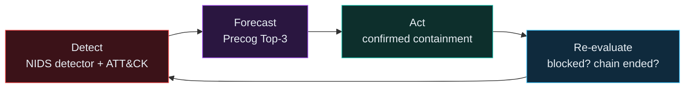

### At a glance

<table align="center">
  <tr>
    <td align="center"><b>6</b><br>demo hosts in 3 zones</td>
    <td align="center"><b>Top-3</b><br>forecast, with confidence</td>
    <td align="center"><b>2 steps</b><br>propose, then confirm</td>
    <td align="center"><b>25</b><br>add-on API routes</td>
  </tr>
  <tr>
    <td align="center"><b>26</b><br>ATT&amp;CK techniques mapped</td>
    <td align="center"><b>~1.5 s</b><br>polling interval</td>
    <td align="center"><b>0</b><br>NIDS files edited</td>
    <td align="center"><b>1</b><br>process serves everything</td>
  </tr>
</table>

### The problem

Security teams without a full Security Operations Center struggle to see *how* an intrusion is spreading while it happens. By the time the path is understood, the damage is usually done.

| Gap | What is missing |
|---|---|
| **G1** | **Detection alone isn't understanding.** A flood of alerts does not show how they form one unfolding attack |
| **G2** | **Reconstruction alone is reactive.** An attack-path graph only shows what already happened |
| **G3** | **Nothing accessible closes the loop.** No widely available tool combines detection, path reconstruction, forecasting and one-tap response in one system that keeps re-evaluating |

| Existing system | Category | Limitation |
|---|---|---|
| Bitdefender GravityZone | Endpoint detection and response | Describes what happened; does not forecast what happens next |
| CrowdStrike Falcon | Endpoint detection and response | Strong at detection and response; does not predict the attacker's next move |
| Sekoia.io | Attack-path visualization | Shows the path after compromise is detected, not before |

Every tool in this category answers **"what happened?"** Precog SOC targets the gap none of them address: live, node-level, confidence-scored forecasting of the next move, combined with a pre-emptive containment step that feeds back into the same running system.

### What you get

| | Capability | What it does |
|:---:|---|---|
| 🔎 | **Detection** | NIDS's Isolation Forest labels replayed packets live; a CICIDS2017 model trained offline supplies the evaluation numbers |
| 🧾 | **Security events** | Every detection becomes a plain-English event with severity, a 0 to 100 risk score, an ATT&CK technique where known, and an audit-log line |
| 🕸️ | **Live attack graph** | A `networkx` graph of hosts and observed connections; hosts are `normal`, `compromised` or `contained` |
| 🔮 | **Precog forecast** | Top-3 likely next hosts with confidence, a likely-next-technique hint, and self-scoring (hit, miss or blocked hit) |
| 🧊 | **3D SOC console** | Three.js scene with shape-coded hosts, forecast cones, replay controls, an alert timeline and a live accuracy counter |
| 📱 | **Mobile app (PWA)** | Installable on a phone: Home, Alerts, Forecast and History tabs; keeps the last state and marks it stale if the connection drops |
| 🛡️ | **Contain, safely** | Two-step propose and confirm, a 60-second expiry, a clear **SIMULATION** label and a re-evaluation of the outcome |
| 🔔 | **Push alerts** | Firebase web push for `HIGH` severity; the in-app feed still shows every alert if push is unavailable |
| 📊 | **Charts** | Chart.js calibration chart (stated confidence vs observed hit rate) and alert volume by severity |
| ▶️ | **Replay controls** | Start, pause, resume, restart and 1x, 2x, 4x speed; the same file and speed always give the same result |

---

<a id="see-it"></a>

## 👀 See it

> [!NOTE]
> The images below are **design previews** drawn from the project's [UI/UX Brief](docs/), using the brief's real colours, layout and wording with illustrative numbers. Replace them with real screenshots once the screens are merged.

### The 3D console (desktop)


### The mobile app (installable PWA)


### One colour, one meaning

The interface uses three colours that never change meaning, and every colour is paired with a shape and a word so it also works in greyscale.


<details>
<summary><b>Design system</b> (palette, type, accessibility)</summary>

<br>

| Role | Colour | Hex | Used for |
|---|:---:|---|---|
| What **happened** |  | `#ef4444` | Compromised hosts, critical alerts |
| What Precog **predicts** |  | `#a855f7` | Forecast cones, bars, anything predicted |
| What **you did** |  | `#14b8a6` | Contained hosts, containment success |
| Normal |  | `#64748b` | Quiet hosts |
| Accent |  | `#38bdf8` | Buttons, links, focus ring |
| Background / surface |   | `#0b0f14` / `#121821` | Page and cards |

| Topic | Rule |
|---|---|
| Fonts | Inter for text and JetBrains Mono for numbers and ids, both with system fallbacks so it works offline |
| Contrast | WCAG 2.2 AA: 4.5:1 for text, 3:1 for icons and controls |
| Touch | 44 x 44 px minimum targets on the phone |
| Motion | Only three things animate: a newly compromised host, the forecast and a containment. Everything stops under *reduce motion* |
| Honesty | Forecasts say "predicts", never "will". Old data is marked stale. A miss is shown as plainly as a hit |
| No green | Deliberately: nothing in a simulation is ever safe to claim |
| Single source | All colours live in `web/src/shared/theme.css`; screens never contain a colour code |

</details>

---

<a id="golden-path-demo"></a>

## 🎬 The golden-path demo

This is the **golden path**, the one rehearsed scenario that must work every time.

| # | What happens | What the audience sees |
|:---:|---|---|
| 1 | The scripted attack replays until Workstation A is confirmed compromised | A host turns **red** and pulses on the 3D console |
| 2 | Precog produces a forecast | **Violet cones** grow toward the likely targets; the panel lists the Top-3 and the phone gets the same forecast |
| 3 | The replay pauses: *Waiting for your decision* | The forecast and **Contain** are the focus |
| 4 | The analyst taps **Contain** on the phone and slides to confirm | A two-step confirmation that states it is a simulation |
| 5 | The replay resumes with the attacker's next move toward Web Server B | The cone fades, the host becomes a **teal cube**, and the move is shown stopping short |
| 6 | The forecast resolves as a *blocked hit* | The accuracy counter ticks up: *"Precog accuracy this session"* |

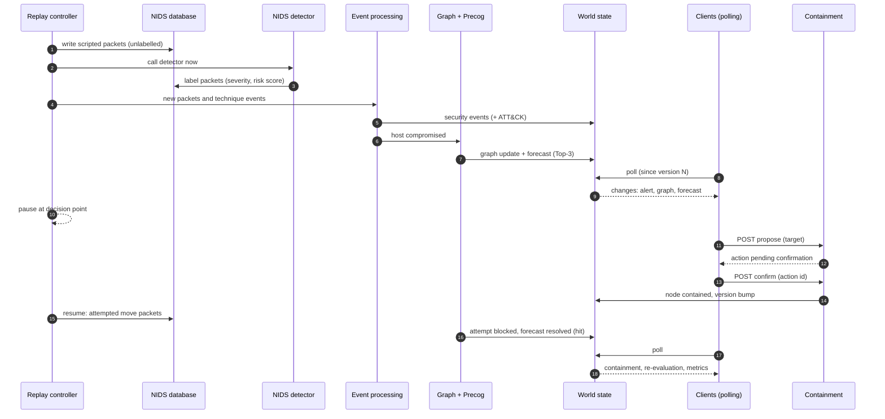

<details>
<summary><b>Why Replay Mode, and not a live attack lab?</b></summary>

<br>

The original concept used real virtual machines and a live scripted attack chain. It was replaced deliberately.

| Replay Mode removes... | Because... |
|---|---|
| **Demo-day failure risk** | No dependence on Wi-Fi, venue firewalls or laptop updates; a recorded backup run also exists |
| **Offensive-tooling risk** | The team never has to run real attack tools under time pressure |
| **Legal and ethical risk** | Nothing is ever scanned or exploited; all attack behaviour is dataset traffic or scripted event logs |

To an evaluator the experience is identical: detection fires, the graph draws itself, cones appear and a containment visibly stops the attack, all in real time.

</details>

<details>
<summary><b>Scenario file format</b> (how an attack is scripted)</summary>

<br>

A scenario is a JSON file of ordered events. Three kinds exist:

| Kind | What it does | Passes through | Result |
|---|---|---|---|
| `traffic` | Writes packets into the NIDS table, unlabelled | NIDS detector (called immediately), then event processing | Event labelled by the real detector |
| `technique` | Injects a scripted ATT&CK technique for a host | Event processing only | Event with a technique, source `scripted` |
| `attempt` | An attempted move from one host to another | Graph and containment check | Becomes `success` or `blocked` |

```json
{
  "scenario_id": "golden-path",
  "description": "Recon, credential attack, lateral movement, simulated exfiltration",
  "events": [
    { "seq": 1, "offset_ms": 0,    "kind": "technique", "host": "host-a", "technique_id": "T1046", "note": "network scan" },
    { "seq": 2, "offset_ms": 1500, "kind": "traffic",   "packets": [ { "src_host": "host-a", "dst_host": "host-b", "protocol": "TCP", "dst_port": 22, "size": 800, "flags": "S" } ] },
    { "seq": 3, "offset_ms": 3000, "kind": "technique", "host": "host-a", "technique_id": "T1110", "compromise": true },
    { "seq": 4, "offset_ms": 4500, "kind": "attempt",   "from_host": "host-a", "to_host": "server-b", "pause_for_decision": true }
  ]
}
```

*Values are illustrative.* `pause_for_decision` stops the replay **before** that event until the analyst decides; `compromise: true` marks where a host falls and triggers a forecast. Scripted attack packets use destination ports that NIDS already treats as suspicious, so the real detector flags them.

</details>

---

<a id="precog-engine"></a>

## 🔮 Precog Engine

Detection plus a graph is a solved problem. The contribution here is what happens **next**: a probabilistic model that says where the attacker is likely to go, scores itself honestly, and is wired into a containment loop.

### How it works

| Step | What happens |
|:---:|---|
| 1 | **Trajectory model.** A frequency-based **Markov transition model** over the host graph estimates, from the currently compromised host, a probability for each reachable candidate |
| 2 | **Live inference.** When a host is confirmed compromised, Precog returns a ranked **Top-3** with confidence, and recomputes as new evidence arrives |
| 3 | **Visualization.** Violet cones leave the compromised host; their width and opacity grow with confidence |
| 4 | **Pre-emptive containment.** The phone shows the top prediction with a single **Contain** action (propose, then confirm) |
| 5 | **Self-scoring.** Every forecast is resolved against the attacker's next attempted move, and the running hit-rate is shown live |

```text
P(j | i) = ( count(i -> j) + alpha ) / ( sum over candidates k of count(i -> k) + alpha * number_of_candidates )
```

`i` is the compromised host, `j` a candidate, and `alpha` a small smoothing constant (starting at 0.1 and tuned on the training split). Candidates are the hosts **reachable from `i`** along feasible paths, excluding hosts already compromised or contained.

<details>
<summary><b>Two layers: which host, and which technique</b></summary>

<br>

| Layer | Question | Source | Output |
|---|---|---|---|
| **Node-level** | Which host will the attacker try next? | This project's own Markov model over hosts | Top-3 hosts with confidence |
| **Technique-level** | Which ATT&CK technique is likely next? | Markov table exported **once** from [`mayank02raj/MITRE-ATTACK-based-Attack-Chain-Prediction`](https://github.com/mayank02raj/MITRE-ATTACK-based-Attack-Chain-Prediction) into a JSON file | A "likely next technique" hint |

The backend only ever **reads** the exported JSON; it never imports that repository (it needs Python 3.11 and PyTorch). If the export fails, `FORECAST_SOURCE=lookup` switches to a rule-based ATT&CK lookup table and the forecast records which source produced it.

</details>

<details>
<summary><b>When a forecast is produced and how it resolves</b></summary>

<br>

| Trigger | Action |
|---|---|
| A host becomes compromised | Compute and publish a forecast |
| New evidence arrives | Recompute and replace the pending forecast (the old one becomes `superseded`) |
| The replay restarts | Clear pending forecasts |

A forecast resolves when the attacker's **next attempted move** is observed:

| Outcome | Rule |
|---|---|
| **Hit at rank r** | The attempted target is the forecast's r-th host (1 to 3) |
| **Miss** | The attempted target is not in the Top-3 |
| **Blocked hit** | The target was predicted **and** contained: right prediction, attack stopped before it succeeded |

Training data comes from a seeded scenario generator: **300 generated sequences** across several attacker strategy profiles, split **80% train and 20% held out**. The seed is stored with the model so any run is reproducible.

</details>

> [!IMPORTANT]
> **Honest numbers.** The golden path is a *scripted demonstration* whose forecast is arranged to be right. Every reported metric (precision@k, calibration, containment success) comes only from the **held-out generated sequences**, which include wrong forecasts. The live counter in the app is labelled *"Session counter, not the model's overall accuracy."*

> [!NOTE]
> **What is and isn't novel.** Technique-level attack-chain forecasting already exists in the literature (see [credits](#documentation-and-credits)). The contribution claimed here is narrower: **node-level next-host forecasting combined with confirmed, closed-loop, pre-emptive containment under replay.** A literature search backs the novelty wording in the paper.

**Research framing:** *"Probabilistic Attack Trajectory Forecasting for Pre-Emptive Network Containment: A Closed-Loop Detect-Forecast-Act Framework."* An IEEE-format paper scoped to this contribution is due in the first week of December 2026.

---

<a id="architecture"></a>

## 🏗️ Architecture

The backend is **`123dars/NIDS` taken as it is**, extended through add-on files that register extra routes in the *same* Flask process. Replay, events, graph, Precog and containment run inside that process; the web project is built into static files and served by the same app at `/app/`.

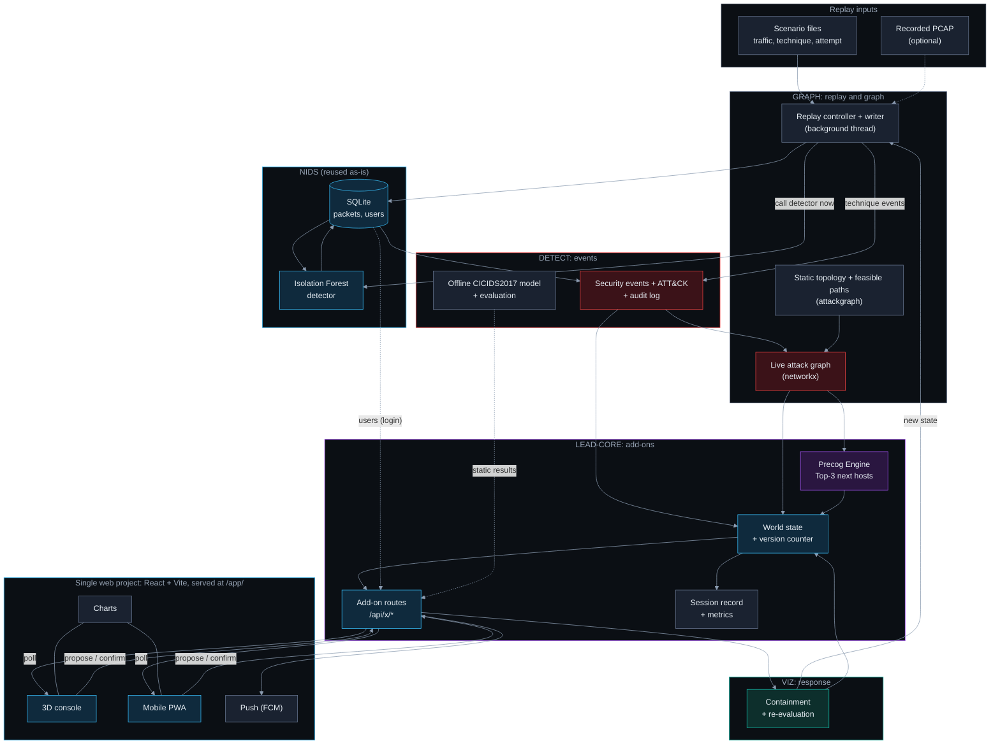

<sub>Colour key: <b>red</b> = what happened, <b>violet</b> = what Precog predicts, <b>teal</b> = what you did, <b>sky</b> = reused or delivery layer, <b>grey</b> = supporting parts.</sub>

### The same system as a stack


### Layer responsibilities

| Layer | Responsibility | Owner |
|---|---|---|
| **Replay inputs and controller** | Supply realistic attack activity with no live network: start, pause, resume, restart, speed | GRAPH |
| **NIDS core** | Login, packet table, Isolation Forest detector, PCAP analysis, its own dashboard; used unchanged | reused |
| **Security event processing** | Normalizes detections into events with identity, time, severity, plain-English explanation; writes the audit log | DETECT |
| **ATT&CK correlation** | Adds technique id, name and tactic from a curated 26-technique table built from MITRE's official data | DETECT |
| **Live attack graph** | Hosts as nodes (`normal`, `compromised`, `contained`), observed connections as edges, feasible paths from `attackgraph` | GRAPH |
| **Precog Engine** | Top-3 next-host forecast, technique hint, forecast resolution and metrics | LEAD-CORE |
| **World state and API** | One in-memory state with a **version counter**; REST routes under `/api/x`; serves the web app at `/app/` | LEAD-CORE |
| **Containment and re-evaluation** | Propose, confirm, simulated isolation, then check whether the chain ended | VIZ |
| **3D console, charts, push** | Three.js scene, Chart.js components, Firebase notifications | VIZ |
| **Mobile web app (PWA)** | Installable app: alerts, forecast, one-tap Contain, history | GRAPH (LEAD-CORE assisting) |

### How the clients stay live: polling with a version number

NIDS has no WebSocket, so both clients **poll**. A version number makes each poll cheap.

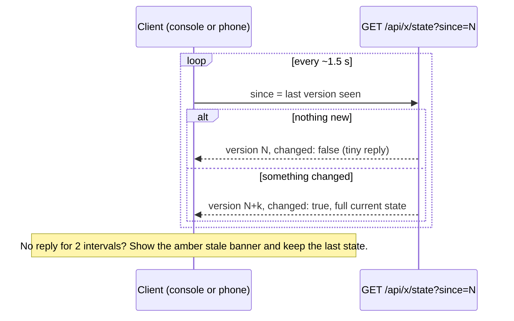

### Where it runs

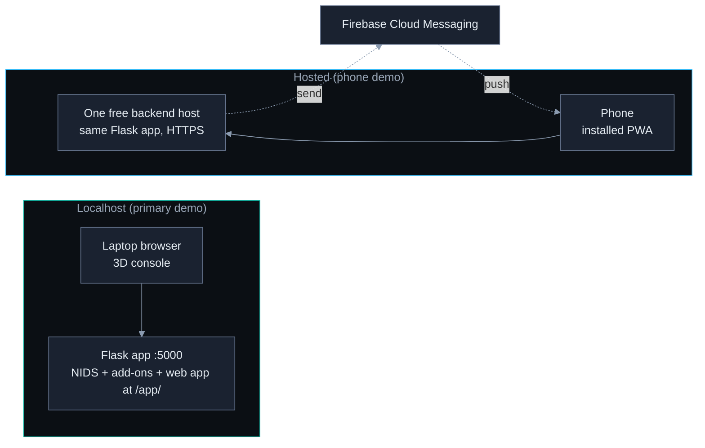

<details>
<summary><b>Design principles and key decisions</b></summary>

<br>

| # | Principle | Consequence |
|:---:|---|---|
| P1 | **Replay, not live** | All traffic is scripted or from a PCAP; containment is a status change plus a log entry |
| P2 | **Use NIDS as it is** | Add-on files register routes; **no NIDS file is edited** |
| P3 | **Contract first** | Data formats between roles are fixed first; everyone builds against sample JSON |
| P4 | **One folder, one owner** | Each person edits only their own folder |
| P5 | **Only the lead merges** | Branch protection and `CODEOWNERS` enforce it |
| P6 | **Every risky part has a switch and a fallback** | See [Run modes](#run-modes-and-configuration) |
| P7 | **Deterministic demo** | Seeded randomness, fixed scenario files, no network dependency on localhost |
| P8 | **Honest evaluation** | Metrics come from held-out data, never the rehearsed golden path |
| P9 | **Low hardware demand** | No GPU, no Docker, no database server, no live packet capture |
| P10 | **No fake intelligence presented as real** | NIDS's invented threat-actor, ASN and location values are never shown as real |

| Decision | Why |
|---|---|
| **DD-1/2** NIDS as-is plus add-on files on one Flask blueprint | Avoids a rewrite; NIDS has no graph, forecast, containment or push, so those are add-ons |
| **DD-3** Add-ons run **in the same process** and keep product state in memory | One deployment; matches the no-long-term-retention rule |
| **DD-4** Polling with a version number | NIDS has no push channel |
| **DD-5** Scripted packets are written **unlabelled**, then NIDS's `run_detection()` is called immediately | The real detector labels them, and the 30-second batch loop is bypassed |
| **DD-6** Technique events are injected directly as security events | Lets the golden path name ATT&CK techniques, which a packet-level detector cannot |
| **DD-7** The CICIDS2017 model is trained **offline** in DETECT's own environment | Avoids library clashes with NIDS's pinned versions; produces the paper's numbers |
| **DD-8** `networkx` for the live graph; `attackgraph` for static topology and feasible paths | `attackgraph` is static |
| **DD-9** Precog has a node layer and a technique layer | The reused repository predicts techniques, not hosts |
| **DD-10** Containment is **propose, then confirm** | Human confirmation is enforced by the API, so no client can skip it |
| **DD-12/13** Web app at `/app/`; an add-on JSON login reuses NIDS's own user table | Same-origin cookies work; NIDS's redirect-style login stays untouched |

</details>

---

<a id="tech-stack"></a>

## 🧰 Tech stack and reused repositories

**Standing rule:** reuse an existing, best-in-class open-source repository for every subsystem where one exists. Custom code is written only for the glue and for parts nothing existing covers.

| Layer | Technology | Notes |
|---|---|---|
| Language | Python **3.11** (3.11.9 installer on Windows) | Tested; NIDS's own `.python-version` also says 3.11.9 |
| Backend | **Flask 3.0** from `123dars/NIDS` | Flask-Login, SQLAlchemy and Flask-Bcrypt come with it |
| Database | **SQLite** through NIDS's `DATABASE_URL` | No Docker, no PostgreSQL; every NIDS route verified on SQLite |
| Live detector | NIDS Isolation Forest (`scikit-learn`) | Used unchanged |
| Live updates | Polling with a version counter | About every 1.5 s |
| Graphs | `networkx` (live) and `attackgraph` (static) | `attackgraph` is **not on PyPI**; installed from GitHub at a pinned commit |
| Frontend | **React + Vite**, one project | Built to static files, served at `/app/` |
| 3D | `3d-force-graph` (Three.js) | Octahedron, cube and sphere host shapes plus custom cones |
| Charts | **Chart.js** | Calibration and alert-volume charts |
| Mobile | Web app manifest + service worker (PWA) | Scope `/app/`; HTTPS when hosted |
| Push | **Firebase Cloud Messaging** web push | Needs HTTPS when hosted |
| Validation / tests | `jsonschema`, `pytest` | Contract and unit tests |
| Build tools | Antigravity and other AI coding tools | AI-assisted development throughout |

<details>
<summary><b>Reused repositories and how each one is used</b></summary>

<br>

| Subsystem | Repository / tool | How it is used |
|---|---|---|
| Backend | [`123dars/NIDS`](https://github.com/123dars/NIDS) (MIT) | Unchanged copy in `lead-core/backend/nids/`; adjusted only from outside by `run_app.py` |
| ML (offline) | [`Western-OC2-Lab/Intrusion-Detection-System-Using-Machine-Learning`](https://github.com/Western-OC2-Lab/Intrusion-Detection-System-Using-Machine-Learning) | Training code for the **offline** CICIDS2017 model (fallback: CICIDS2017's own labels) |
| Dataset | CICIDS2017 (University of New Brunswick) | Offline training and evaluation only, **not** a replay input |
| Attack graph | [`cwccie/attackgraph`](https://github.com/cwccie/attackgraph) (MIT) + `networkx` | Static topology, feasible paths and ATT&CK-mapped risk; `networkx` fallback if missing |
| Precog (technique layer) | [`mayank02raj/MITRE-ATTACK-based-Attack-Chain-Prediction`](https://github.com/mayank02raj/MITRE-ATTACK-based-Attack-Chain-Prediction) | Markov table exported once to JSON, **with the author's permission** |
| ATT&CK data | [`mitre-attack/attack-stix-data`](https://github.com/mitre-attack/attack-stix-data) | Curated 26-technique subset in `attack_techniques.json`, MITRE notice kept |
| 3D | [`vasturiano/3d-force-graph`](https://github.com/vasturiano/3d-force-graph) | The console's graph scene |
| Charts | [`chartjs/Chart.js`](https://github.com/chartjs/Chart.js) | Both chart components |
| Technique format | [`apache/caldera`](https://github.com/apache/caldera), [`redcanaryco/atomic-red-team`](https://github.com/redcanaryco/atomic-red-team) | Output-format reference for scripted technique events |
| Containment pattern | [`wazuh/wazuh`](https://github.com/wazuh/wazuh) Active Response | Pattern reference only; execution is simulated |

**Dropped:** `bqmxnh/ids-agent` (Linux and live-capture only; NIDS already provides ingestion). NIDS's Docker setup, PostgreSQL and live packet sniffer are **not used**.

</details>

---

<a id="demo-network"></a>

## 🌐 Demo network and host states

Six hosts in three zones. Packet records identify hosts by IP, so each host has a fixed address in a host-mapping table.

| Host id | Name | Role | Zone | Address |
|---|---|---|---|---|
| `host-a` | Workstation A | User workstation (entry point) | user | `192.168.1.11` |
| `host-b` | Workstation B | User workstation | user | `192.168.1.12` |
| `server-b` | Web Server B | Web server (the golden path's predicted target) | dmz | `192.168.1.20` |
| `file-server` | File Server | File server | internal | `192.168.1.30` |
| `db-server` | Database | Database server | internal | `192.168.1.40` |
| `domain-controller` | Domain Controller | Domain controller | internal | `192.168.1.50` |

| State | 3D shape | Colour | Word | Meaning |
|---|---|---|---|---|
| `normal` | small sphere | slate | Normal | Nothing to report |
| `compromised` | **octahedron**, pulses once | red | Compromised | Confirmed by the detector |
| `contained` | **cube** with a thin ring | teal | Contained | Isolated after a confirmed Contain (simulated) |
| predicted target | dashed ring plus confidence label | violet | Predicted, with % | Forecast by Precog |

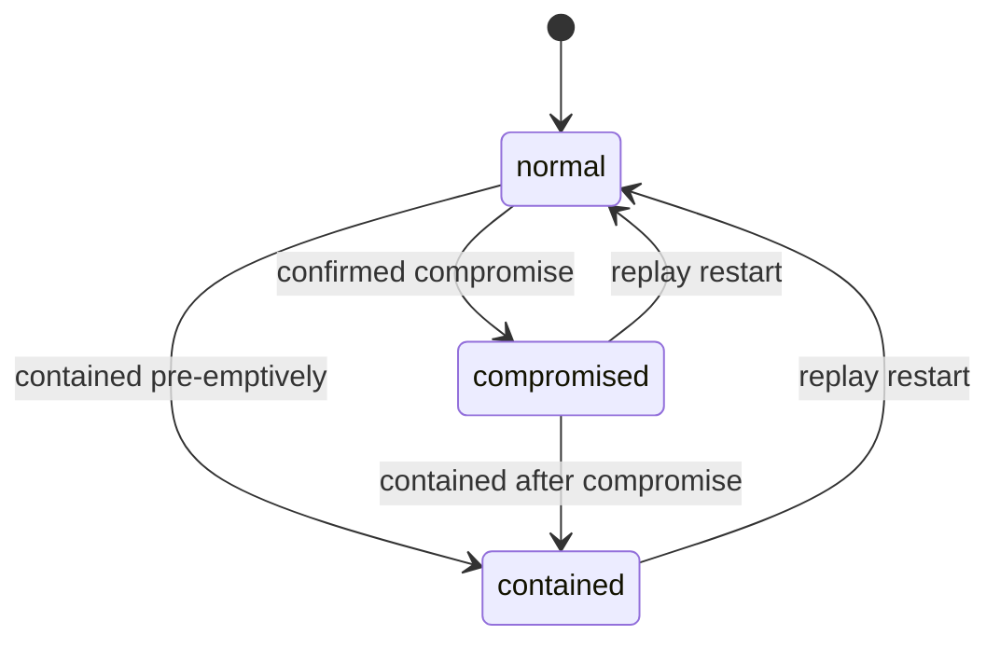

---

<a id="quick-start"></a>

## 🚀 Quick start

Run the full product on one Windows laptop, on **localhost**, with no Docker, no database server and no internet-hosted part.

### Prerequisites

| Need | Version | Why |
|---|---|---|
| **Windows** 10 or 11 | | Primary supported platform (macOS and Linux work too; see the note below) |
| **Python** | **3.11** (3.11.9 recommended) | Backend; NIDS's pinned libraries are tested on 3.11 |
| **Node.js** | Current LTS | Builds the React + Vite web app |
| **Git** | any recent | Clones the repo and installs `attackgraph` from GitHub |
| Not needed | | Docker, PostgreSQL, a GPU, live packet capture |

### 1. Get the code

```powershell
git clone https://github.com/<your-org>/<your-repo>.git
cd <your-repo>
```

### 2. Create the Python environment

```powershell
py -3.11 -m venv .venv
.\.venv\Scripts\Activate.ps1
python -m pip install --upgrade pip
pip install -r lead-core/backend/requirements.txt
pip install -r graph/requirements.txt
```

> [!TIP]
> If PowerShell refuses to run the activate script, allow it for this window only: `Set-ExecutionPolicy -Scope Process Bypass`. The second requirements file installs `attackgraph` straight from GitHub at a pinned commit (it is not on PyPI), so `git` must be on your PATH.

<details>
<summary><b>macOS / Linux equivalent</b></summary>

```bash
python3.11 -m venv .venv
source .venv/bin/activate
python -m pip install --upgrade pip
pip install -r lead-core/backend/requirements.txt
pip install -r graph/requirements.txt
```

</details>

### 3. Configure secrets

Secrets and switches live in environment variables. `.env` is git-ignored; only `.env.example` (names, no values) is committed.

```powershell
Copy-Item .env.example .env
python -c "import secrets; print(secrets.token_hex(32))"
```

Open `.env` and set at least these two:

```dotenv
SECRET_KEY=paste-the-long-random-string-here
ADMIN_PASSWORD=choose-a-password-you-do-not-use-anywhere-else
```

NIDS ships with a published default admin login and a hardcoded secret key. `run_app.py` replaces both from the outside at start-up, so **NIDS's default password never works**.

<details>
<summary><b>If your shell does not load <code>.env</code>, set the variables directly</b></summary>

```powershell
$env:SECRET_KEY     = "paste-the-long-random-string-here"
$env:ADMIN_PASSWORD = "choose-a-password-you-do-not-use-anywhere-else"
$env:DATA_MODE      = "live"
```

</details>

### 4. Build the web app

```powershell
cd web
npm install
npm run build
cd ..
```

The build output is served by the Flask app itself at `/app/`, so there is no second server to run.

### 5. Start everything

```powershell
cd lead-core/backend
python run_app.py
```

On first start, `run_app.py` trains NIDS's detector model if the model file is missing, seeds the demo account, registers the add-on routes and serves on **port 5000**.

### 6. Open it and play the golden path

| What | URL |
|---|---|
| Sign in (and the mobile app) | <http://localhost:5000/app/> |
| 3D console (desktop) | <http://localhost:5000/app/console/> |
| Mobile app (resize the window to phone width) | <http://localhost:5000/app/mobile/> |
| NIDS's own dashboard (unchanged) | <http://localhost:5000/> |

1. **Sign in** as `admin` with the `ADMIN_PASSWORD` you set.
2. On the console, choose the `golden-path` scenario and press **Start** in the replay controls.
3. Watch Workstation A turn red and the violet cones appear. The replay stops at **Waiting for your decision**.
4. Press **Contain Web Server B** on the console (or on the phone view) and confirm.
5. The replay resumes, the next move is **blocked**, and the accuracy counter updates.

### 7. Check it is healthy

```powershell
curl.exe http://localhost:5000/api/x/health
```

A small JSON status object means the backend is up. If the page loads but shows *Connection lost: showing old data*, the clients cannot reach the backend (see [troubleshooting](#troubleshooting)).

### Put it on a phone

A phone can only install the app from a **hosted HTTPS address**, so the whole app (backend plus built web app) runs on one free backend host.

1. Build the web app locally ([step 4](#4-build-the-web-app)) so the build is included.
2. On the host, set `SECRET_KEY`, `ADMIN_PASSWORD`, `DATABASE_URL` and the Firebase credentials in the host's dashboard (never in the repo).
3. Start command, from `lead-core/backend`, **one worker only** because state is in memory:

   ```bash
   gunicorn --workers 1 --threads 4 wsgi:application
   ```

4. Open the HTTPS address in **Chrome on Android**, sign in, then use the browser's **Add to Home Screen**.
5. Allow notifications when asked, to receive `HIGH`-severity alerts.

> [!WARNING]
> Free hosts may sleep or lose their disk. **Wake and test the hosted app before a demo.** Localhost is the primary demo, and a recorded video of a perfect run is the backup. `gunicorn` is for the Linux host; on Windows use `python run_app.py`. NIDS's own `run.py` is never used because it starts Flask in debug mode.

---

<a id="run-modes-and-configuration"></a>

## ⚙️ Run modes and configuration

| Mode | How | Use it for |
|---|---|---|
| **Localhost demo** (primary) | `python run_app.py`, open `:5000/app/` | The demo and the golden path |
| **Web development** | Flask on `:5000` plus the Vite dev server (`npm run dev`) on `:5173`, which forwards API calls to `:5000` | Editing the UI with hot reload; cookies keep working |
| **Sample mode** | `DATA_MODE=sample` | Building a screen with **no pipeline**: the backend serves the contract sample files |
| **Hosted** | `gunicorn` on one free host over HTTPS | The phone demo |
| **Offline detection work** | Scripts in `detect/offline_model/` in their own environment | Training and evaluating the CICIDS2017 model |

### Environment variables

| Variable | Values | Purpose |
|---|---|---|
| `SECRET_KEY` | long random string | Flask session secret (replaces NIDS's hardcoded value) |
| `ADMIN_PASSWORD` | your password | The demo account's password |
| `DATABASE_URL` | database address | SQLite by default; NIDS reads it at import time |
| `DATA_MODE` | `sample` or `live` | `sample` serves contract samples; `live` runs the real pipeline |
| `DETECTOR_MODE` | `nids` or `scripted` | `scripted` takes labels from the scenario file if NIDS's detector cannot run |
| `FORECAST_SOURCE` | `repo` or `lookup` | `lookup` uses the rule-based ATT&CK table instead of the exported Markov table |
| `REPLAY_SPEED` | number | Replay speed factor |
| `FCM_PROJECT_ID` + Firebase private credentials | | Push notifications (values are never committed) |

<a id="troubleshooting"></a>

<details>
<summary><b>Troubleshooting and built-in fallbacks</b></summary>

<br>

| Problem | What to do |
|---|---|
| NIDS's detector cannot be called in-process | Set `DETECTOR_MODE=scripted`; the pipeline continues with labels from the scenario file |
| SQLite does not work with NIDS on your machine | Fall back to NIDS's Docker Compose as shipped (heavier; documented fallback) |
| NIDS's pinned libraries will not install on your Python | Use the Python version NIDS targets (3.9) for the backend environment, with separate environments for the other tools |
| `attackgraph` fails to install | Check that `git` is on PATH; a plain `networkx` fallback gives the same connections |
| The Precog export fails or PyTorch is missing | Set `FORECAST_SOURCE=lookup` |
| "Connection lost: showing old data" | The client has had no reply for twice the polling interval; it keeps the last state and retries on its own |
| A **401** from an `/api/x` route | You are signed out; the web app returns you to the login screen |
| "This request expired. Try again." | A containment confirmation expires after 60 seconds; propose it again |
| "No forecast available" | A forecast could not be produced; the loop continues |
| Push notifications do not arrive | Push needs HTTPS and notification permission; alerts still appear in the in-app feed |
| The hosted app is asleep or down | Demo on localhost, or play the recorded backup video |
| A scenario file is rejected | It was invalid; the previous state is kept and the error says why |

</details>

### Tests

```powershell
pip install pytest jsonschema
pytest
```

| Level | What is tested | Owner |
|---|---|---|
| Contract | Every sample validates against its JSON Schema, and every add-on response validates | LEAD-CORE (each role fixes their own) |
| Unit | Each module alone against sample data | Each role owner |
| Model | Offline detection metrics and Precog metrics | DETECT, LEAD-CORE |
| Integration | Replay writer, NIDS detector, events, graph and Precog wired together with `DATA_MODE=live` | LEAD-CORE |
| End-to-end | The full golden path, scripted, in `lead-core/integration` | LEAD-CORE |
| Timing | Stage timestamps checked against the latency budgets | LEAD-CORE |
| Device | Install on real phones; stale behaviour; push | GRAPH, VIZ |
| Rehearsal | Repeated full runs; count consecutive successes (target: 5) | All |

---

<a id="using-the-app"></a>

## 📲 Using the app

### Mobile app

| Tab | What it shows |
|---|---|
| **Home** | Threat level (Calm, Watching, Under attack, Contained), the Top-3 forecast with **Contain**, the latest alert, the session accuracy |
| **Alerts** | Newest-first alert cards, filterable by All, High, Medium, Low; tap for plain-English detail, the ATT&CK technique and where it sits in the attack |
| **Forecast** | The full forecast, the Contain button, a 2D attack path and the outcome of the last resolved forecast |
| **History** | Accuracy and calibration chart, past sessions, the offline detection report and an "all data is simulated" note |

### 3D console

| Area | What it shows |
|---|---|
| **Top bar** | Threat level, replay controls (Start, Pause, Resume, Restart, 1x/2x/4x), replay status, live accuracy counter, connection indicator |
| **Centre** | The 3D graph: drag to rotate, scroll to zoom, click a host for details, double-click to reset |
| **Right panel** | Forecast plus **Contain**; node detail when a host is selected; alerts or charts from the left rail |
| **Timeline strip** | One mark per alert (shape by severity), a violet marker where a forecast was made, and the replay position |

### Contain, step by step

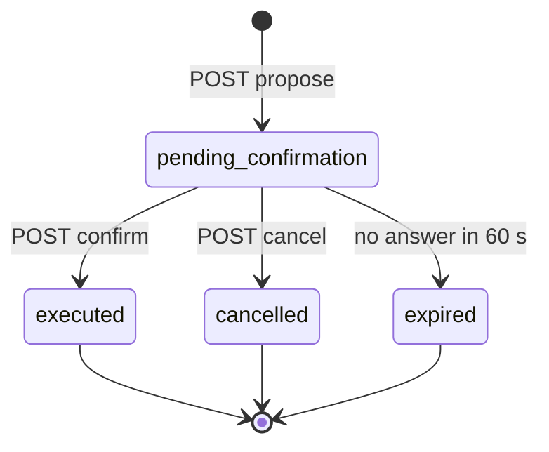

Nothing changes in the world state until `confirm` succeeds with the action id that `propose` returned. On the phone, step two is a **slide to confirm** (keyboard users get a Confirm button), and the sheet always says: *"This marks the host as contained. It is a SIMULATION: nothing on a real network changes."*

---

<a id="api-reference"></a>

## 🔌 API reference

The product's own screens use the add-on endpoints under **`/api/x`**, so they never meet NIDS's redirect-style login. Every add-on endpoint except `health` and `login` returns a **JSON 401** when you are not signed in. Errors share one JSON shape with a short code and a plain-English message.

<details>
<summary><b>Add-on endpoints</b> (25 routes, click to expand)</summary>

<br>

| Method | Path | Purpose |
|---|---|---|
| `GET` | `/api/x/health` | Check the backend is alive |
| `POST` | `/api/x/login` | JSON login using NIDS's user table; sets the session cookie |
| `POST` | `/api/x/logout` | Log out |
| `GET` | `/api/x/me` | Who is signed in |
| `GET` | `/api/x/state?since=N` | **Polling:** changes since version N |
| `GET` | `/api/x/alerts` | Security events, newest first (limit parameter) |
| `GET` | `/api/x/alerts/{id}` | One alert with its explanation |
| `GET` | `/api/x/graph` | Current graph snapshot |
| `GET` | `/api/x/forecasts` | Forecasts, filterable by status |
| `GET` | `/api/x/forecasts/current` | The pending forecast |
| `POST` | `/api/x/containment/propose` | Step 1: propose containing a target (target host, forecast id) |
| `POST` | `/api/x/containment/confirm` | Step 2: confirm with the action id |
| `POST` | `/api/x/containment/cancel` | Cancel a pending action |
| `GET` | `/api/x/containment/actions` | List actions |
| `GET` | `/api/x/session` | Current session record |
| `GET` | `/api/x/sessions` | Past sessions |
| `GET` | `/api/x/metrics/precog` | precision@k, calibration bins, hit-rate |
| `GET` | `/api/x/metrics/detection` | Static offline detection results |
| `GET` | `/api/x/replay/scenarios` | Available scenarios |
| `GET` | `/api/x/replay/status` | Current replay state |
| `POST` | `/api/x/replay/start` | Start a scenario (scenario id, speed) |
| `POST` | `/api/x/replay/pause` | Pause |
| `POST` | `/api/x/replay/resume` | Resume |
| `POST` | `/api/x/replay/restart` | Restart |
| `POST` | `/api/x/push/register` | Register a phone's push token |

</details>

<details>
<summary><b>NIDS's own endpoints</b> (unchanged)</summary>

<br>

`/login`, `/logout`, `/`, `/analyze`, `/api/upload_pcap`, `/api/stats`, `/api/alerts`, `/api/throughput`, `/api/packets`, `/api/protocol_counts`, `/api/osint/<ip>`, `/api/export_pdf`.

They stay available and untouched. NIDS's `/api/alerts` and the add-on `/api/x/alerts` are different endpoints. NIDS's PCAP upload only **analyses** a file and never stores its packets, and its "PDF export" returns an HTML report page meant for printing.

</details>

---

<a id="data-contracts"></a>

## 📐 Data contracts

Data passed between roles is agreed **first**, in writing. `contracts/schemas/` holds one JSON Schema per format and `contracts/samples/` holds sample JSON that follows it, so the phone-app and console builders can see exactly what the backend will send without waiting for it.

| Contract | What it carries |
|---|---|
| `packet_record` | NIDS's native packet row plus the detector's result fields |
| `security_event` | Id, time, host, severity, risk score, explanation, ATT&CK technique, source |
| `graph_snapshot` | Hosts with state, observed edges, the ordered compromised path |
| `forecast` | Up to three targets with confidence, a technique hint, status and outcome |
| `containment_action` | Target, requesting client, status, proposed and confirmed times |
| `reeval_result` | Whether the attack progressed and whether the chain ended early |
| `audit_entry` | One line per detection, forecast or containment |
| `world_state` | `version`, `changed`, graph, alerts, forecast, actions, replay, metrics |
| `session_record` | Every forecast with its outcome, plus containment actions |
| `session_metrics` | Hit-rate, precision@1, precision@3, calibration bins, containment success rate |
| `replay_status` | `idle`, `running`, `paused`, `waiting_for_decision` or `finished` |
| `detection_report` | Model, dataset, split, precision, recall, F1, false-positive rate, notes |

<details>
<summary><b>Example: a forecast</b></summary>

```json
{
  "forecast_id": "fc-000001",
  "ts": "2026-10-03T10:00:03Z",
  "from_host": "host-a",
  "targets": [
    { "rank": 1, "host_id": "server-b",   "confidence": 0.74 },
    { "rank": 2, "host_id": "host-b",     "confidence": 0.15 },
    { "rank": 3, "host_id": "file-server", "confidence": 0.07 }
  ],
  "technique_hint": { "technique_id": "T1021", "technique_name": "Remote Services", "probability": 0.41 },
  "source": "repo",
  "status": "pending",
  "outcome": null
}
```

*Illustrative numbers only.* Identifiers are lowercase text (`host-a`, `evt-000001`, `fc-000001`, `act-000001`); the product's own times are ISO 8601 UTC; severity uses NIDS's words `HIGH`, `MEDIUM`, `LOW`, `NORMAL`.

</details>

---

<a id="repository-layout"></a>

## 🗂️ Repository layout

One repository, **one folder per role**, so four people can build in parallel with the fewest merge conflicts.

```text
repository-root/
├── README.md, .gitignore, .env.example, .github/CODEOWNERS      LEAD-CORE
│
├── contracts/                      shared; changed only through the lead's merge
│   ├── schemas/                    one JSON Schema per contract
│   └── samples/                    sample JSON that follows the schemas
│
├── lead-core/
│   ├── backend/
│   │   ├── nids/                   unchanged copy of 123dars/NIDS (MIT licence kept)
│   │   ├── addons/                 loader, world state, /api/x routes, session record, push sender
│   │   └── run_app.py              start-up script (adjusts NIDS from the outside)
│   ├── precog/                     Precog Engine + exported technique JSON
│   └── integration/                integration tests, golden-path script
│
├── detect/
│   ├── detect_events/              security events, ATT&CK correlation, audit
│   └── offline_model/              CICIDS2017 features, training, evaluation (own environment)
│
├── graph/
│   ├── graph_replay/               replay controller + writer, scenarios, scenario generator
│   └── graph_net/                  live graph + static topology
│
├── viz/
│   └── viz_containment/            containment + re-evaluation
│
├── web/                            ONE shared React + Vite project
│   └── src/
│       ├── shared/                 API client, polling hook, theme.css      (LEAD-CORE)
│       └── areas/
│           ├── mobile/             all phone screens                        (GRAPH)
│           ├── console/            3D console                               (VIZ)
│           ├── charts/             Chart.js components                      (VIZ)
│           └── push/               Firebase + notifications                 (VIZ)
│
└── docs/                           project documents + assets/
```

The web project avoids conflicts by design: LEAD-CORE creates the whole structure first with **placeholder files** in every area, and each person replaces only their own. `App` and the router import each area through one fixed entry file, so nobody edits them.

### Branches and merging

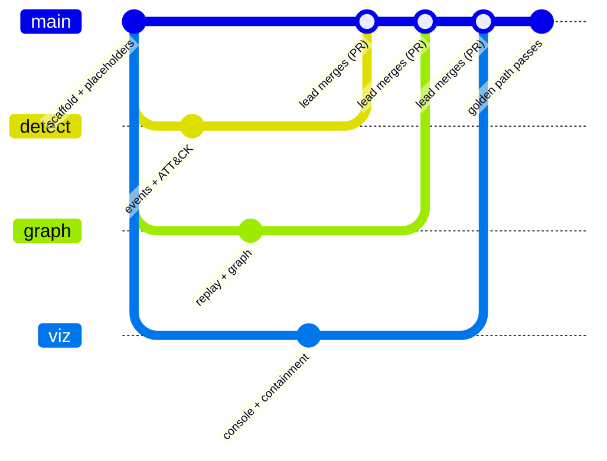

| Rule | Detail |
|---|---|
| Branches | `main` plus one working branch per person, named after the alias |
| Direct work on `main` | Not allowed for anyone |
| Merge route | Commit to your branch, tell LEAD-CORE, LEAD-CORE merges through a Pull Request |
| After a merge | Everyone brings `main` into their own branch |
| Enforcement | Branch protection (require a PR, restrict merging to the lead, block direct pushes) plus a one-line `CODEOWNERS` |
| Contracts | Change only through LEAD-CORE's merge, and LEAD-CORE tells everyone |

<details>
<summary><b>Definition of done</b> (per requirement)</summary>

<br>

1. The code or file exists in the owner's folder and runs without errors.
2. It has been tested against its acceptance criterion, with the result noted.
3. It was committed to the owner's branch and LEAD-CORE was asked to merge.
4. LEAD-CORE merged it and confirmed that `main` still runs.
5. Any contract it uses matches the files in `contracts/`.

</details>

---

<a id="evaluation"></a>

## 📏 Evaluation

Security ML is judged on rigour, so the method is fixed up front, not retrofitted.

| Area | Approach |
|---|---|
| **Detection split** | Train on CICIDS2017 and test on a held-out day or attack type to show generalization |
| **Detection metrics** | Precision, recall, F1 and, critically, the **false-positive rate** |
| **Class imbalance** | Handled explicitly (for example SMOTE or class weighting) and stated in the paper |
| **Precog metrics** | **precision@1**, **precision@3**, a **calibration curve**, and **containment success rate** under simulated replay |
| **Baseline** | The same Precog metrics for the rule-based lookup |
| **Experiment log** | Every experiment (features, model, hyperparameters, resulting metrics) logged from Week 2 onward |

| Metric | Definition |
|---|---|
| precision@1 | Share of held-out forecasts where the next attempted host was the top-ranked host |
| precision@3 | Share where it was anywhere in the Top-3 |
| Calibration | Forecasts grouped into confidence bins of width 0.1; each bin's average stated confidence vs its observed hit rate |
| Containment success rate | Of held-out scenarios where Contain was applied to a predicted host, the share in which the chain ended early |

Numbers are produced by the evaluation scripts and surfaced in the app's **History** tab (including the honest note that unseen attacks are mostly missed). They are deliberately **not hard-coded in this README**.

---

<a id="safety-and-ethics"></a>

## 🛡️ Safety and ethics

| # | Boundary |
|:---:|---|
| 1 | **No live attacks.** No scanning, exploitation or attack tool runs anywhere; all attack behaviour is scripted data or a PCAP file |
| 2 | **No sniffer.** NIDS's live packet capture is never started |
| 3 | **Containment is simulated.** It changes only in-memory state and writes a log entry: no firewall, network or device is touched |
| 4 | **A human always confirms.** Propose-then-confirm lives in the API, so no client can skip it and nothing acts autonomously |
| 5 | **No secrets in the repo.** The secret key, admin password and tokens live in environment variables; `.env` is git-ignored |
| 6 | **A single demo account** whose password is not reused anywhere; NIDS's published default password is replaced |
| 7 | **HTTPS when hosted**, required for install and push |
| 8 | **Simulated intelligence is never shown as real.** NIDS invents threat-actor names, ASN and location values from ports and hashes; the screens hide them |
| 9 | **A permanent SIMULATION badge** on every phone screen and in the console top bar |
| 10 | **Only licensed public data.** CICIDS2017 and internally generated replay logs; no real personal data anywhere |
| 11 | **Stated in the paper.** The methodology says no live attacks were run |

---

<a id="plan-and-risks"></a>

## 🗓️ Plan and risks

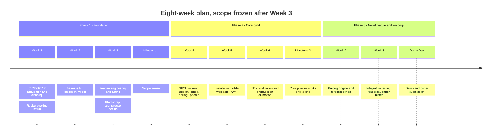

> [!NOTE]
> **The Week 8 buffer is not optional.** Anything not integration-tested by the end of Week 7 is cut from the demo, even if code exists for it. New ideas after the scope freeze become *future work* in the paper.

<details>
<summary><b>Top risks and mitigations</b></summary>

<br>

| Risk | Mitigation |
|---|---|
| A reused repository breaks or is poorly maintained | Documented fallbacks: CICIDS2017 labels for the ML model, a rule-based lookup for Precog |
| Backend and real-time work is underestimated | Owned by the lead and scoped as its own week (Week 4) |
| Scope creep | Scope frozen after Week 3 |
| Live demo failure on the day | Replay Mode removes live-network dependence; localhost demo; recorded backup video |
| NIDS ships a default admin login, a hardcoded secret key and hardcoded database passwords | Moved to environment variables; real values never committed |
| NIDS's detector runs in a 30-second batch loop | The replay writer calls the detector function immediately after writing packets |
| NIDS pins older libraries and expects PostgreSQL | SQLite through `DATABASE_URL` and the pinned libraries verified on Python 3.11; separate environments where versions clash |
| The phone can only install from hosted HTTPS | The Flask app serves the built web app itself, so one free host covers both |
| Merge conflicts or a broken `main` | Folder-per-role, branch per person, only the lead merges, branch protection |
| Novelty is narrower than assumed | The claim is scoped to node-level forecasting with confirmed containment, backed by a literature search |

</details>

---

<a id="team"></a>

## 👥 Team

**5th Semester Project-Based Learning (PBL)**, Department of Computer Science and Engineering, academic year **2026-27**.
Integrates **Machine Learning**, **Computer Graphics**, **Mobile Application Development** and **Research Methodology** (IEEE paper).

**Guide:** Dr. Nandini C, Vice Principal and Head of Department, Department of Computer Science and Engineering.

| | Name | USN | Alias | Role |
|:---:|---|---|---|---|
| 🧭 | **Sagar R** | 1DT24CS232 | `LEAD-CORE` | Team lead: backend, Precog Engine, integration; the only person who merges code |
| 🔎 | **Neha** | 1DT24CS174 | `DETECT` | Flow features, ML detection, security event processing, ATT&CK correlation |
| 🕸️ | **Pallavi Bammanni** | 1DT24CS185 | `GRAPH` | Data ingestion, simulation, attack graph, mobile web app (PWA) |
| 🧊 | **Preethi S Pujari** | 1DT24CS195 | `VIZ` | 3D visualization, charts, push notifications, containment |

The repository, folders and branches use the **aliases**; the table above maps them to people. Roles can be swapped between any two members with no loss of fairness: the split divides the work by technical adjacency, not by skill.

<details>
<summary><b>Who owns what</b> (subsystem by subsystem)</summary>

<br>

**LEAD-CORE: Sagar R**

| Subsystem | Repo / approach |
|---|---|
| Backend core | `123dars/NIDS`, used as-is and extended with add-on files |
| Precog Forecasting | `mayank02raj/...` Markov export (fallback: rule-based lookup) |
| Cross-team integration and golden path | Integration only |

**DETECT: Neha**

| Subsystem | Repo / approach |
|---|---|
| Flow feature preparation (offline) | CICIDS2017 pre-extracted features |
| ML detection | NIDS detector (live) plus `Western-OC2-Lab/...` trained offline |
| Security event processing + audit | Own code, built on NIDS's alerts |
| ATT&CK correlation | Official MITRE ATT&CK data subset |

**GRAPH: Pallavi Bammanni**

| Subsystem | Repo / approach |
|---|---|
| Sandbox / lab (simulated) and attack simulation | Scripted, Caldera and Atomic Red Team style sequences |
| Data ingestion | NIDS's packet table plus a small replay writer |
| Attack graph | `cwccie/attackgraph` plus `networkx` |
| Mobile web app (PWA) | Own code, with LEAD-CORE assisting |

**VIZ: Preethi S Pujari**

| Subsystem | Repo / approach |
|---|---|
| 3D visualization and SOC console | `vasturiano/3d-force-graph` |
| Charts | `chartjs/Chart.js` |
| Push notifications | Firebase Cloud Messaging (web push) |
| Containment and re-evaluation | Wazuh Active Response as a pattern (simulated) |

</details>

---

<a id="documentation-and-credits"></a>

## 📚 Documentation and credits

### Project documents

| Document | Answers |
|---|---|
| **Master Project Document** | What the whole project is and why |
| **PRD** (Product Requirements) | What must be built, for whom, and when it is done |
| **TRD** (Technical Requirements) | How it is built: architecture, contracts, module designs |
| **UI/UX Brief** | How it looks, feels and reads |
| **Build Guides** (four, one per role) | The exact steps each role follows to build and merge their part |

All of them live in [`docs/`](docs/).

### Credits and licensing

Standing on the shoulders of open source:

| Component | Terms |
|---|---|
| `123dars/NIDS` | **MIT**; the licence file and copyright notice stay with the vendored copy |
| `cwccie/attackgraph` | **MIT**; installed from GitHub at a pinned commit |
| `mayank02raj/MITRE-ATTACK-based-Attack-Chain-Prediction` | Used **with the author's permission** (confirmed by email). Please cite the repository and its associated SECRYPT 2026 paper, and do not redistribute its code outside this project without the author's agreement |
| MITRE ATT&CK | Technique data derived from `mitre-attack/attack-stix-data`, with MITRE's copyright notice kept |
| CICIDS2017 | University of New Brunswick, used offline for research |
| Other reused repositories | Licences are recorded in the build guides |

<details>
<summary><b>Glossary</b></summary>

<br>

| Term | Meaning |
|---|---|
| **SOC** | Security Operations Center: the team or room that watches for and responds to cyber attacks |
| **Replay Mode** | Running the pipeline from pre-recorded and scripted attack events instead of live attacks |
| **Golden path** | The single rehearsed demo scenario that must work every time |
| **Precog Engine** | The novel feature: predicts the attacker's most likely next targets with confidence scores |
| **Forecast cone** | The glowing directional shape from the compromised host toward a predicted target |
| **Containment** | The simulated isolation of a host (a status change plus a logged action) |
| **Closed loop** | Detect, forecast, act, re-evaluate, repeating |
| **Markov transition model** | Estimates, from observed sequences, the probability of moving from one state to the next |
| **precision@k** | The fraction of forecasts whose top-k contain the node actually attacked next |
| **Calibration** | Whether a stated confidence (say 74%) matches how often that forecast is actually right |
| **False-positive rate** | How often harmless traffic is wrongly flagged as an attack |
| **PWA** | Progressive Web App: installable on a phone's home screen |
| **Polling** | A client asking the server for updates every second or two instead of being pushed |
| **Add-on** | A file of our own that plugs routes or logic into NIDS without editing NIDS's files |

</details>

<br>

<div align="center">

<sub>Built for the 5th Semester PBL, Department of CSE, 2026-27. Every attack in this project is replayed, never run. Nothing here touches a real network.</sub>

<!-- Add the recorded backup demo video link and real screenshots here once available. -->

</div>