<a id="top"></a>

<div align="center">

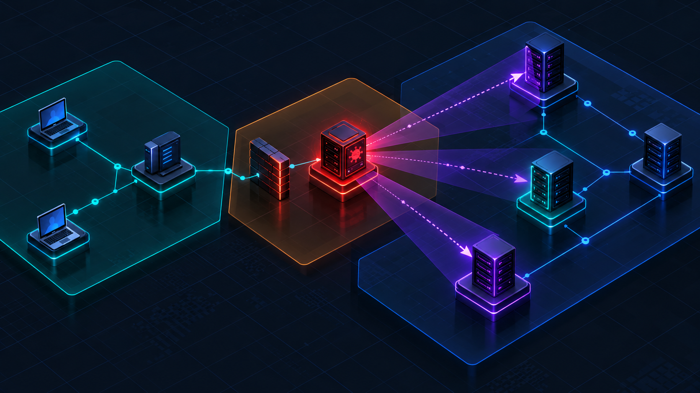

# Precog SOC

**AI Cyber Threat Detection · Attack-Path Reconstruction · Precog Forecasting · 3D Visualization · Mobile SOC · Automated Containment**

[](#-tech-stack)
[](#-tech-stack)
[](#-tech-stack)
[](#-tech-stack)
[](#-tech-stack)
[](#-safety-and-ethics)
[](#-safety-and-ethics)
[](#-known-limitations)

[Overview](#-overview) · [Precog Engine](#-the-precog-engine) · [Demo](#-the-demo-in-60-seconds) · [Visual Tour](#-visual-tour) · [Architecture](#-system-architecture) · [Quick Start](#-getting-started) · [API](#-api-reference) · [Evaluation](#-evaluation) · [Limitations](#-known-limitations) · [Team](#-team-and-workflow)

<br>

<table>
<tr>
<td align="center" width="16%"><h2>6</h2><sub>demo hosts<br>in 3 network zones</sub></td>
<td align="center" width="16%"><h2>Top-3</h2><sub>ranked next targets<br>with confidence</sub></td>
<td align="center" width="16%"><h2>1–2 s</h2><sub>polling interval<br>for live updates</sub></td>
<td align="center" width="16%"><h2>2 steps</h2><sub>propose, then confirm<br>every containment</sub></td>
<td align="center" width="16%"><h2>26</h2><sub>MITRE ATT&CK<br>techniques curated</sub></td>
<td align="center" width="16%"><h2>0</h2><sub>live attacks<br>ever run</sub></td>
</tr>
</table>

</div>


## 🧭 Overview

**Precog SOC** detects intrusions in network traffic, reconstructs how they spread from host to host, and then does what existing tools do not: it **forecasts where the attacker will go next** and lets an analyst pre-emptively contain that predicted path — with one confirmed action — before the next step happens.

It is a working product built by four people for the **5th-semester Project-Based Learning (PBL)** of the Department of Computer Science and Engineering. It joins four subjects into one system: an ML detection pipeline, a live 3D computer-graphics console, an installable mobile app, and an IEEE paper on the forecasting method.

> **Everything runs in Replay Mode.** Scripted attack events flow through the same live pipeline that real traffic would use, so the demo is deterministic, safe, and needs no lab, no virtual machines and no network access.

<details>
<summary><b>👋 Not sure where to start? Pick your path.</b></summary>
<br>

| I am… | Start here |
|---|---|
| An evaluator or faculty member | [The demo in 60 seconds](#-the-demo-in-60-seconds), then the [Visual tour](#-visual-tour). Safety is covered in [Safety and ethics](#-safety-and-ethics). |
| A developer joining the team | [Getting started](#-getting-started), [Repository structure](#-repository-structure), then [Team and workflow](#-team-and-workflow). |
| A researcher or reviewer | [The Precog Engine](#-the-precog-engine), then [Evaluation](#-evaluation) and [Known limitations](#-known-limitations). The honesty notes are in [Safety and ethics](#-safety-and-ethics). |
| Just curious how it fits together | [System architecture](#-system-architecture). Each diagram has expandable sections below it with more detail. |

</details>

### The problem, in three gaps

| Gap | | How Precog SOC answers it |
|---|---|---|
| **G1** | Detection alone isn't understanding. A flood of alerts doesn't show how they relate to one unfolding attack. | A live attack graph, plain-English alert explanations and MITRE ATT&CK context tie alerts into one story. |
| **G2** | Reconstruction alone is reactive. By the time the path is drawn, the attacker has moved on. | The Precog Engine forecasts the **Top-3 likely next hosts**, with a confidence percentage, *before* they are reached. |
| **G3** | Few tools close the loop. It is rare to find detection, reconstruction, forecasting and a fast, human-confirmed response in one accessible tool. | A two-step, human-confirmed (simulated) containment, followed by automatic re-evaluation of whether the attack really stopped. |

<details>
<summary><b>How do existing tools compare?</b></summary>
<br>

| Existing system | Category | What it does well | Where it stops |
|---|---|---|---|
| Bitdefender GravityZone | Endpoint detection and response | Detects and reports malicious activity | Descriptive: reports what happened, no next-host forecast |
| CrowdStrike Falcon | Endpoint detection and response | Real-time monitoring and incident response | Built around detect-and-respond, not next-host forecasting |
| Sekoia.io | Attack-path visualization | Shows paths between security events | Visualization comes after compromise is already detected |
| **Precog SOC** | **Closed-loop forecasting and containment** | **Detect → forecast → act → re-evaluate, live** | **Educational prototype: replay data only, simulated enforcement** |

<sub>This comparison reflects each vendor's public documentation at the time of writing. Commercial products evolve, and this table is a positioning aid, not a benchmark.</sub>

</details>

<details>
<summary><b>📖 Glossary (SOC, ATT&CK, PWA, Replay Mode and friends)</b></summary>
<br>

| Term | Meaning |
|---|---|
| **SOC** | Security Operations Center: the team or room that watches for and responds to cyber attacks |
| **Node / host** | One machine in the monitored network, shown as a point on the graph |
| **Compromised node** | A host the detector has confirmed as successfully attacked |
| **Replay Mode** | Running the pipeline from pre-recorded and scripted attack events instead of live attacks |
| **Golden path** | The single rehearsed demo scenario that must work every time |
| **Forecast cone** | The glowing violet shape on the 3D graph pointing from the compromised host to a predicted target |
| **Containment** | Simulated isolation of a host: a status change plus a logged action. Nothing real changes |
| **Re-evaluation** | Feeding the post-containment state back into the pipeline to confirm the attack stopped |
| **MITRE ATT&CK** | A public catalogue of attacker techniques (for example T1021 Remote Services) |
| **Markov transition model** | A model that estimates, from observed sequences, the probability of moving from one state (host) to the next |
| **precision@k** | The share of forecasts whose Top-k list contained the host the attacker actually tried next |
| **Calibration** | Whether a stated confidence (say 74%) matches how often such forecasts are right |
| **PWA** | Progressive Web App: a website that installs on a phone's home screen and behaves like an app |
| **Polling** | A screen asking the server for updates every second or two instead of the server pushing them |

</details>


## 🔮 The Precog Engine

Detection plus a graph is a solved problem. The contribution here is **the closed loop around a forward-looking forecast**.

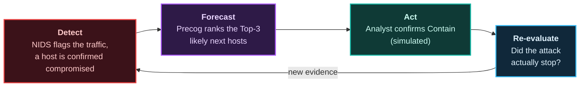

### How a forecast is made

| Step | What happens | Detail |
|---|---|---|
| **1. Trajectory model** | A frequency-based Markov model over hosts estimates where the attacker goes next, given the host they are on now | Trained on many varied, seeded, scripted attack sequences over the demo network |
| **2. Live inference** | The moment a host is confirmed compromised, Precog returns a ranked Top-3 with confidence percentages | A counting-table lookup, well under a second. It updates as new evidence arrives |
| **3. Visualization** | Violet forecast cones grow from the compromised host toward each predicted target | Cone width and opacity scale with confidence, so it reads at a glance |
| **4. Pre-emptive containment** | The phone and the console offer *Contain* on the top prediction | Two deliberate steps: propose, then slide to confirm. Simulated |
| **5. Self-scoring** | Precog tracks its own hit-rate for the session and shows it live | An honest metric, labelled as a session counter (for example "1 / 1") |

**The model, in one line** (with smoothing constant α, starting at 0.1 and tuned on the training split):

$$P(j \mid i) = \frac{\operatorname{count}(i \to j) + \alpha}{\sum_{k \in C(i)} \operatorname{count}(i \to k) + \alpha\,\lvert C(i) \rvert}$$

Here *i* is the compromised host, and *C(i)* is the set of hosts reachable from it according to the feasible attack paths, excluding hosts already compromised or contained.

<details>
<summary><b>Two layers: which <i>host</i>, and which <i>technique</i></b></summary>
<br>

| Layer | Question answered | Source | Output |
|---|---|---|---|
| **Node-level** | Which host will the attacker try next? | The product's own Markov model over hosts | Top-3 hosts with confidence |
| **Technique-level** | Which ATT&CK technique is likely next? | The reused [mayank02raj/MITRE-ATTACK-based-Attack-Chain-Prediction](https://github.com/mayank02raj/MITRE-ATTACK-based-Attack-Chain-Prediction) Markov table, exported once to a JSON file | A "likely next technique" hint |

The backend only ever reads that JSON file. It never imports the reused repository, which needs PyTorch and a different Python version. If the export fails, a rule-based ATT&CK lookup table takes over (`FORECAST_SOURCE=lookup`), and each forecast records which source produced it.

**Stretch goal** (only if time allows): replace the Markov model with a small GNN or LSTM that also uses node type, open services and patch status. The MVP is complete without it.

</details>

<details>
<summary><b>Forecast lifecycle: how a forecast ends as a hit or a miss</b></summary>
<br>

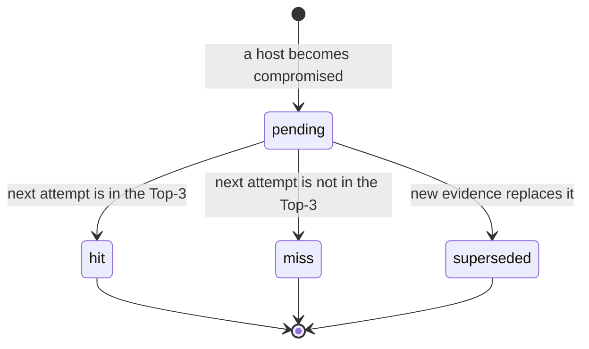

| Outcome | Rule |
|---|---|
| **Hit** at rank *r* | The attempted target is the forecast's *r*-th host (1 to 3) |
| **Miss** | The attempted target is not in the Top-3. Shown as plainly as a hit, never celebrated |
| **Blocked hit** | The attempted target was predicted *and* contained: the prediction was right and the attack was stopped before it succeeded |

</details>

> [!IMPORTANT]
> **Integrity note.** The golden path is a scripted demonstration whose forecast is arranged to be correct. Every metric reported as a result comes only from held-out generated sequences, which include wrong forecasts. The live counter in the demo is labelled *"Session counter, not the model's overall accuracy"*. Technique-level chain forecasting already exists in the literature, so the contribution is claimed narrowly: **node-level next-host forecasting** combined with **confirmed, closed-loop, pre-emptive containment** under replay.

**Working paper title:** *"Probabilistic Attack Trajectory Forecasting for Pre-Emptive Network Containment: A Closed-Loop Detect-Forecast-Act Framework."* Due the first week of December 2026, IEEE format.


## 🎬 The Demo in 60 Seconds

The rehearsed **golden path**. It runs on localhost, needs no internet, and plays the same way every time.

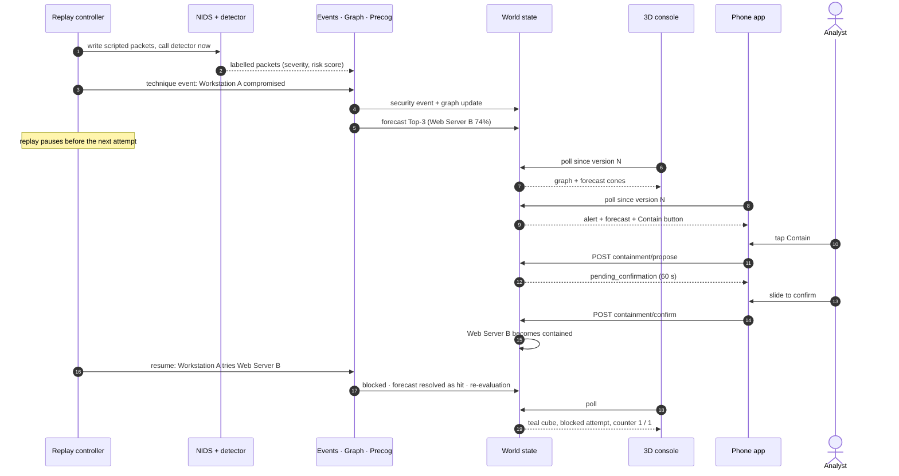

| # | What the audience sees | Where |
|---|---|---|
| 1 | A host turns red and pulses once | 3D console |
| 2 | Violet cones grow toward the likely targets and the Top-3 is listed: *"Precog predicts Web Server B, 74%"* | 3D console + phone |
| 3 | The phone buzzes with the same forecast | Phone (push) |
| 4 | The analyst taps **Contain** and slides to confirm | Phone |
| 5 | The cone toward the contained host fades and the host becomes a teal cube | 3D console |
| 6 | The attacker's next move is shown stopping short | 3D console |
| 7 | The session hit counter ticks up | Both |

> The 74% figure is illustrative. A recorded video of a perfect run is kept as a backup, and the golden path must pass five consecutive rehearsals before demo day.


## 🎨 Visual Tour

### The 3D SOC console

Hosts are 3D shapes whose form changes with state, so nothing relies on colour alone. The left scene is the moment of forecast; the right scene is after the analyst confirms Contain.

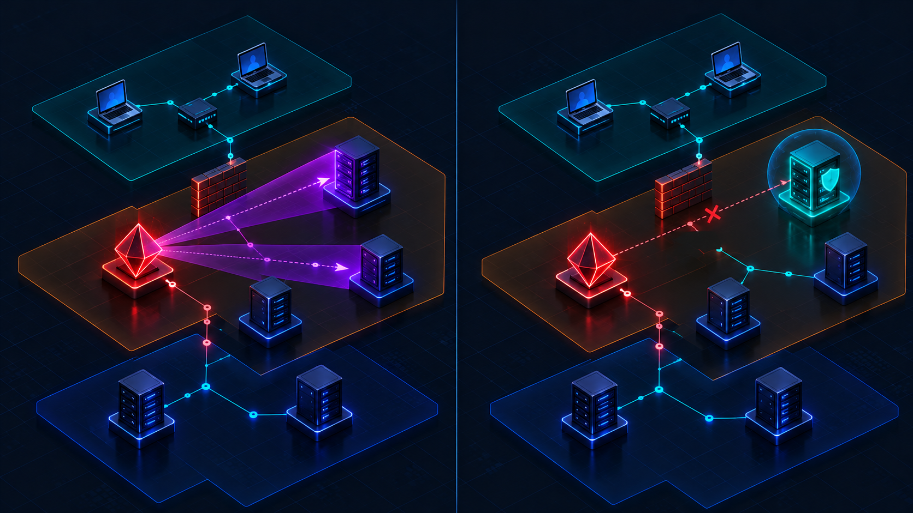

### The mobile app (installable PWA)

Triage first: *what is happening, how bad is it, what can I do?* The phone app is dark, high-contrast, thumb-friendly, and says **SIMULATION** on every screen.

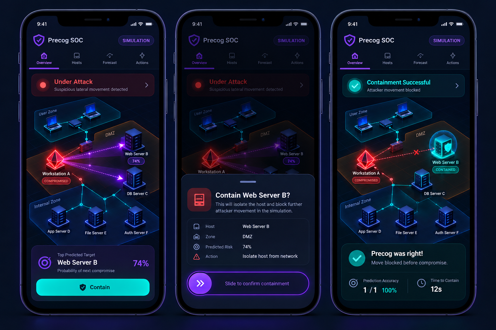

<sub><i>Concept renders drawn from the <a href="docs/">UI/UX Brief</a>. They show the designed look and the exact wording. Swap in real screenshots as the screens land.</i></sub>

### Design language: colour means one thing everywhere

| Meaning | Colour | Shape (never colour alone) | In 3D | Used for |
|---|---|---|---|---|
| **What happened** |  red | Octagon with **!** | Red octahedron, pulses once | Compromised hosts, critical alerts |
| **What Precog predicts** |  violet | Dashed ring | Violet cone + dashed ring + percentage | Forecasts only |
| **What you did** |  teal | Shield with a check | Teal cube with a ring | Contained hosts, successful containment |
| **Normal** |  slate | Hollow circle | Small slate sphere | Quiet, nothing to see |

> [!NOTE]
> There is deliberately **no green anywhere**. Green would suggest "safe", and a simulated environment is never safe to claim. Contrast ratios follow WCAG 2.2 AA, motion respects `prefers-reduced-motion`, and the app stays usable at 200% text zoom.


## 📐 System Architecture

The backend is the open-source NIDS Flask app, used as-is with no edited files, extended through add-on modules that run in the same process. **One process** serves the API, the 3D console and the phone app.

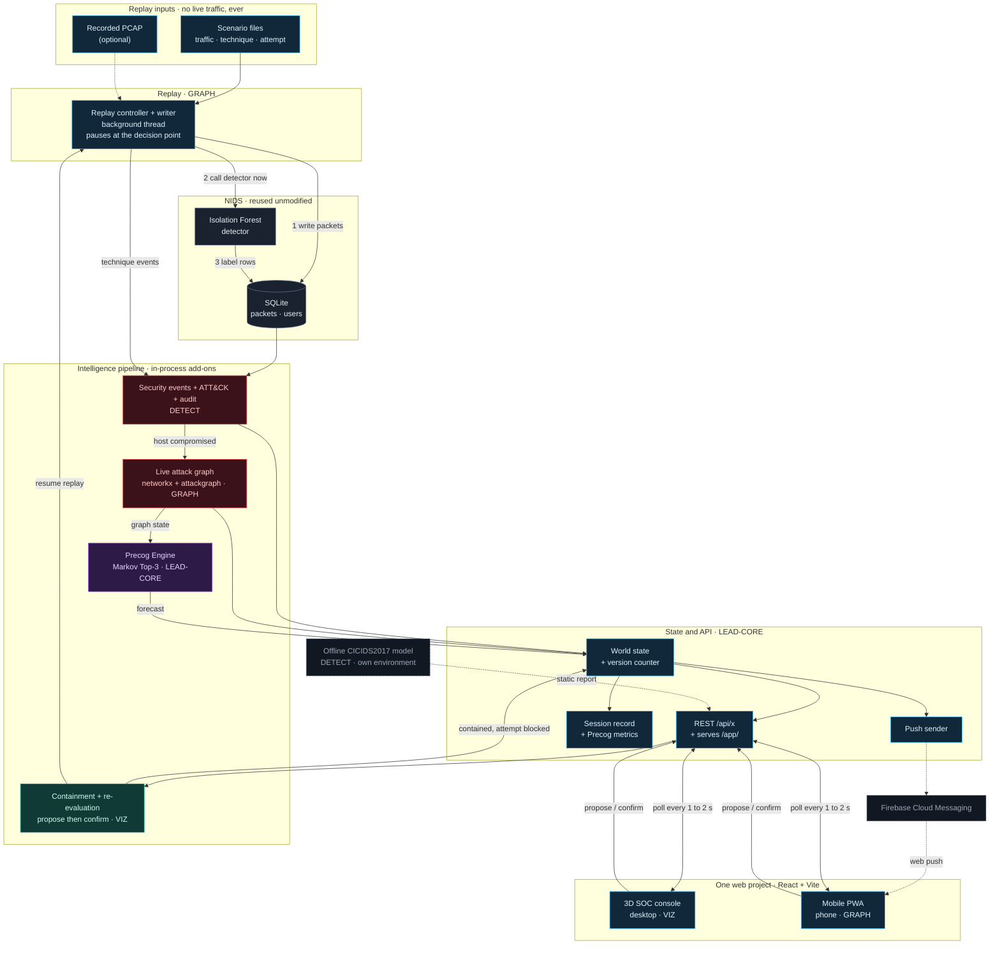

<sub><b>Reading the colours:</b> 🔴 red = detection and what happened · 🟣 violet = Precog's prediction · 🟢 teal = containment, what you did · 🔵 blue = our glue, state and clients · ⚪ grey = reused, unmodified NIDS.</sub>

### Layer responsibilities

| Layer | Responsibility | Owner |
|---|---|---|
| Replay feed | Supplies realistic attack activity without a live network: scripted scenarios, with an optional recorded PCAP | GRAPH |
| Ingestion | Writes replayed packets into NIDS's own packet table in the shape NIDS expects, then calls the detector immediately | GRAPH |
| ML detection | NIDS's Isolation Forest labels packets live with a severity and a 0–100 risk score. A CICIDS2017 model trained offline supplies the evaluation numbers | DETECT |
| Event processing | Normalizes detections into security events with identity, timestamp, severity, plain-English explanation, ATT&CK technique and an audit log | DETECT |
| Attack graph | A live networkx graph (hosts are nodes, observed connections are edges) over a static topology from attackgraph | GRAPH |
| Precog Engine | Forecasts the Top-3 next hosts and scores itself | LEAD-CORE |
| Backend and API | The NIDS Flask app plus add-on routes under `/api/x`. A version counter makes polling cheap | LEAD-CORE |
| 3D console / mobile PWA | Two experiences from one React project, reading the same state | VIZ / GRAPH |
| Containment | Simulated, two-step, human-confirmed isolation, then re-evaluation | VIZ |

<details>
<summary><b>🚢 Deployment: laptop, development and phone</b></summary>
<br>

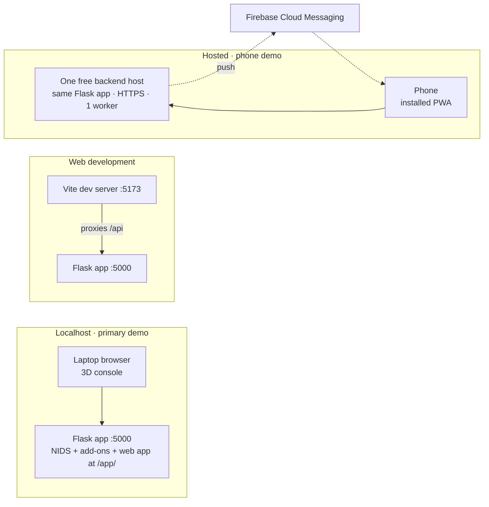

| Situation | How it runs |
|---|---|
| **Primary demo** | One Flask process on port 5000, serving the API and the built web app at `/app/`. No internet-hosted part |
| **Web development** | Flask on 5000 plus the Vite dev server on 5173 forwarding API calls, so cookies work |
| **Phone demo** | The same Flask app on one free backend host over HTTPS (required to install a PWA), serving the API and the built web app |
| **App file requested by a teacher** | The finished web app is wrapped into an APK. No hand-coded native app |

</details>

<details>
<summary><b>🔄 Live updates: polling with a version counter</b></summary>
<br>

NIDS has no WebSocket, so both clients poll. A version number that rises on every state change keeps an unchanged poll tiny.

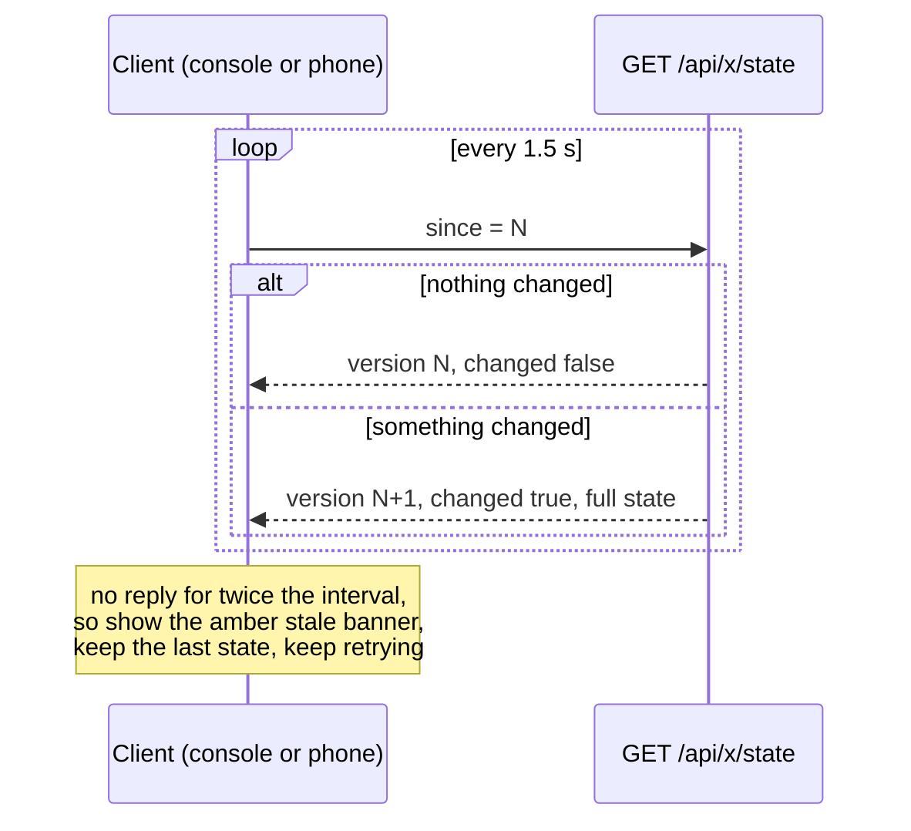

</details>

<details>
<summary><b>🛡 Human-confirmed containment: why no client can skip the confirmation</b></summary>
<br>

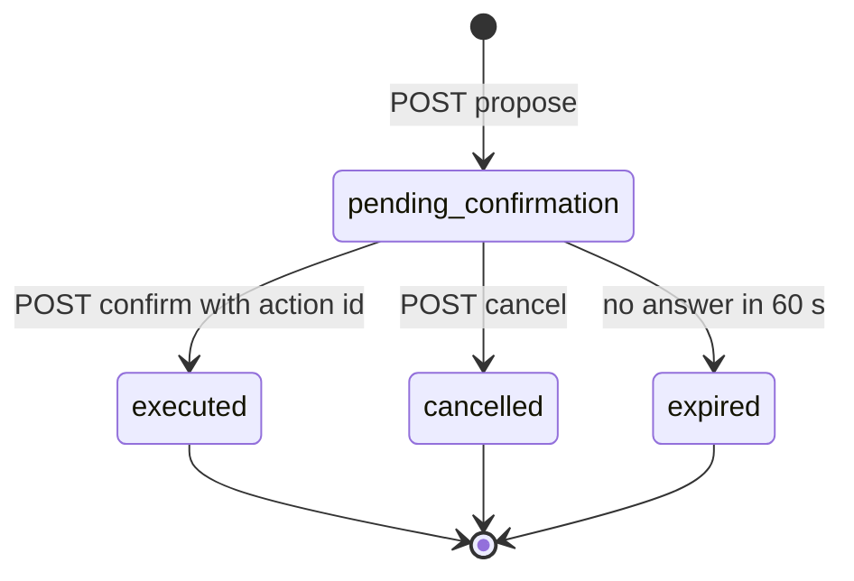

Nothing in the world state changes until `confirm` succeeds, and `confirm` must carry the `action_id` that `propose` returned. The confirmation lives in the API, not just the screen, so it cannot be bypassed by a client. Containment only flips an in-memory status and writes an audit line: no firewall, no network, no device is touched.

**Host state machine:**

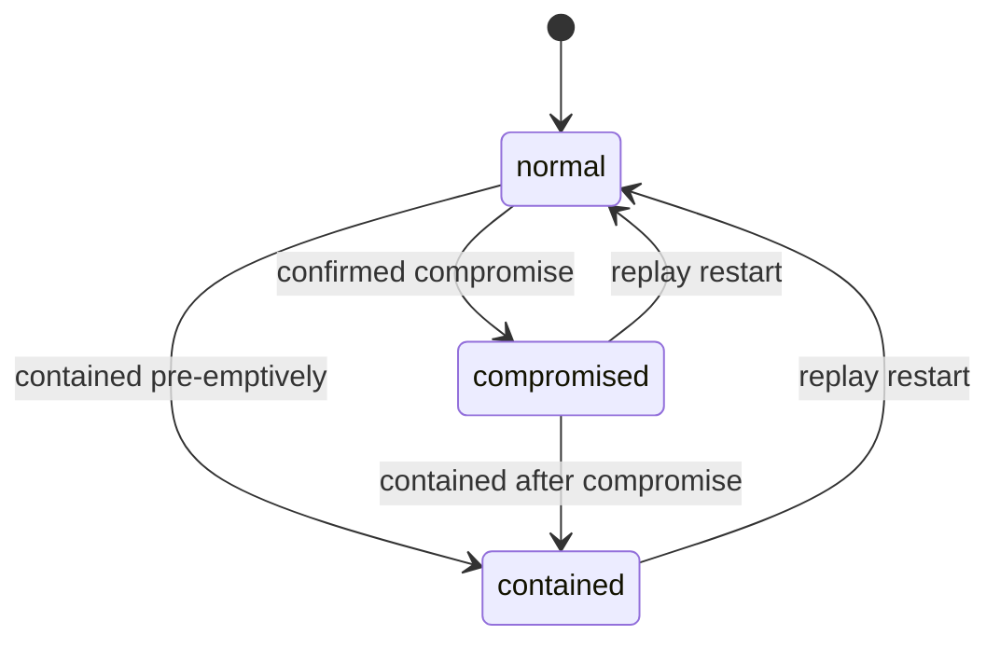

</details>

<details>
<summary><b>🗃 Data model: the contracts between roles</b></summary>
<br>

Every data format passed between roles is a JSON Schema with sample JSON in `contracts/`, agreed before anyone builds. Each role builds and tests against the samples, then swaps in real data without changing its own code.

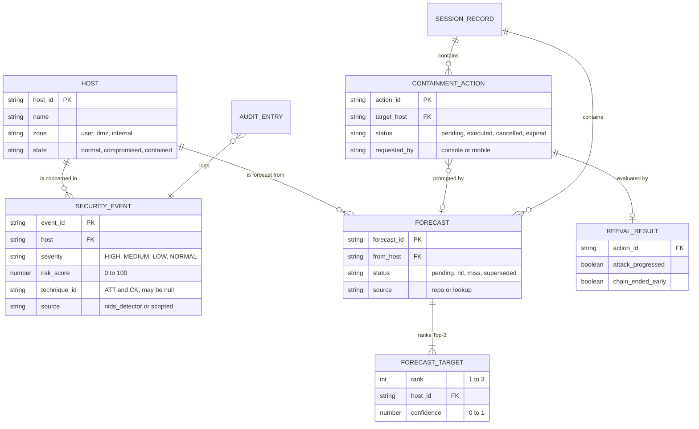

The full contract set: `packet_record`, `security_event`, `graph_snapshot`, `forecast`, `containment_action`, `reeval_result`, `audit_entry`, `world_state`, `session_record`, `session_metrics`, `replay_status`, `detection_report`.

</details>

<details>
<summary><b>🧠 Key design decisions</b></summary>
<br>

| Decision | Why |
|---|---|
| Use NIDS as-is, extend through add-ons | A reused, working backend beats a rewrite. `run_app.py` imports NIDS from the outside and replaces its secret key, admin password and cookie settings, so no NIDS file is edited |
| SQLite, no Docker, no PostgreSQL | Heavy on modest laptops. NIDS reads its database from `DATABASE_URL`, and every NIDS route was tested on SQLite |
| Polling with a version number | NIDS has no push channel. Unchanged polls are tiny, so 2–4 clients are light |
| Scripted packets are written unlabelled, then NIDS's real detector is called immediately | The real detector does the labelling, and we skip its 30-second batch loop to meet the latency target |
| Technique events are injected directly | NIDS's packet-level detector cannot name ATT&CK techniques, but the golden path needs to |
| The CICIDS2017 model is trained offline, in its own environment | Avoids library clashes with NIDS's pinned versions and produces the paper's evaluation numbers |
| attackgraph is static, so the live graph is networkx | attackgraph supplies topology, feasible paths and ATT&CK-mapped risk. Feasible paths also limit which hosts Precog may forecast |
| One shared web project with per-role folders | LEAD-CORE creates placeholder files first, so three people build in parallel without merge conflicts |

</details>

<details>
<summary><b>🪂 Fallbacks: every risky part has a switch</b></summary>
<br>

| If this fails… | …this happens |
|---|---|
| NIDS's detector cannot be called in-process | `DETECTOR_MODE=scripted` takes labels from the scenario file |
| SQLite does not work with NIDS | Fall back to NIDS's own Docker Compose (documented, heavier) |
| Precog's technique export fails | `FORECAST_SOURCE=lookup` uses a rule-based ATT&CK table |
| The offline repository model fails | CICIDS2017's own labels are used for the evaluation |
| A scenario file is invalid | Rejected with a clear error; previous state kept |
| Polling fails | Clients show an amber stale banner and keep the last state |
| Push is unavailable | Every alert still appears in the in-app feed |
| Hosted backend is asleep | Demo on localhost, or play the recorded video |
| A confirmation times out | The action becomes `expired`; nothing changes |

</details>


## 🧰 Tech Stack

| Layer | Technology | Notes |
|---|---|---|
| Backend | Flask 3.0 from [123dars/NIDS](https://github.com/123dars/NIDS), Flask-Login, SQLAlchemy | Used as-is (MIT). Extended through add-on files only |
| Language | Python 3.11 (3.11.9 on Windows) | NIDS pins older libraries; everything installs and runs on 3.11 |
| Database | SQLite via `DATABASE_URL` | No Docker, no database server |
| Live detector | NIDS's Isolation Forest (scikit-learn) | Severity HIGH / MEDIUM / LOW / NORMAL plus risk score 0–100 |
| Offline detector | CICIDS2017 + tree-based models from [Western-OC2-Lab/Intrusion-Detection-System-Using-Machine-Learning](https://github.com/Western-OC2-Lab/Intrusion-Detection-System-Using-Machine-Learning) | Own environment. Produces precision, recall, F1, false-positive rate |
| Attack graph | networkx + [cwccie/attackgraph](https://github.com/cwccie/attackgraph) | attackgraph is not on PyPI: installed from GitHub at a pinned commit |
| Forecasting | Own Markov model + technique table exported from [mayank02raj/MITRE-ATTACK-based-Attack-Chain-Prediction](https://github.com/mayank02raj/MITRE-ATTACK-based-Attack-Chain-Prediction) | Used with the author's permission |
| ATT&CK data | [mitre-attack/attack-stix-data](https://github.com/mitre-attack/attack-stix-data), curated 26-technique subset | Rebuilt by `detect/tools/build_attack_table.py` |
| Frontend | React + Vite, one project | Built to static files served by Flask at `/app/` |
| 3D | [vasturiano/3d-force-graph](https://github.com/vasturiano/3d-force-graph) (Three.js) | Custom cones, shapes and propagation animation |
| Charts | Chart.js | Calibration view, alert volume by severity |
| Mobile | PWA: web app manifest + service worker | Installable via Add to Home Screen, scope `/app/` |
| Push | Firebase Cloud Messaging (web push) | Needs HTTPS. Optional to set up: the in-app feed always works |
| Dataset | CICIDS2017 (University of New Brunswick) | Offline evaluation only, never a replay input |
| Tooling | Git + GitHub, pytest, jsonschema | Branch protection + CODEOWNERS |

## ✨ Features

| Capability | What you get | Priority |
|---|---|---|
| Scripted replay | Multi-stage scenario (recon, credential attack, lateral movement, simulated exfiltration) with start, pause, resume, restart and speed control | Must |
| Live detection | Every replayed packet labelled by NIDS's detector with severity and risk score | Must |
| Plain-English alerts | Each alert explained so a first-year student can read it, with the ATT&CK technique when matched | Must |
| Live attack graph | Hosts and connections drawn as they are observed, with compromised and contained states | Must |
| Precog forecast | Top-3 next hosts with confidence, updating as evidence arrives | Must |
| 3D SOC console | Isometric-style 3D scene, propagation animation, forecast cones, node detail, timeline strip | Must |
| Installable mobile app | Mock login, threat-level home, alert feed, 2D attack detail, forecast with Contain, history and reports | Must |
| Two-step containment | Propose, then slide to confirm. Simulated, audited, then re-evaluated | Must |
| Session scoring | Live hit-rate, precision@k, calibration data, containment success rate | Must |
| Push notifications | A notification for each HIGH alert on the installed app (needs HTTPS and Firebase; the in-app feed always works) | Must |
| Stale-data safety | If the connection drops, the last known state stays visible and marked stale: no crash, no blank screen | Must |
| Additional charts | Alert volume or severity over time | Should |
| GNN / LSTM forecaster | Node-type, service and patch-aware replacement for the Markov model | Could |
| APK wrapper | The web app wrapped as an APK, only if a teacher requires an app file | Could |


## 🚀 Getting Started

### Prerequisites

| Tool | Version | Why |
|---|---|---|
| Windows | 10 / 11 | The tested development and demo platform |
| Python | 3.11.9 | NIDS pins older libraries. Stay on 3.11 |
| Node.js | 18 or newer (20 LTS recommended) | Builds the React + Vite web app |
| Git | any recent | Clone and branch |
| Chrome or Edge | latest | 3D console. Chrome on Android for installing the phone app |
| Firebase project | optional | Push notifications only |
| Docker | **not needed** | Only a documented fallback |

> [!NOTE]
> File names and commands below follow the entry points defined in the TRD in [`docs/`](docs/). If your checkout differs, the build guides in `docs/` are the source of truth.

### Quick start (about 5 minutes)

#### 1. Clone

```bash
git clone https://github.com/Sagar44-Github/precog-platform.git
cd precog-platform
```

#### 2. Create a Python 3.11 environment and install the backend

```powershell
py -3.11 -m venv .venv
.\.venv\Scripts\Activate.ps1
pip install -r lead-core/backend/nids/requirements.txt   # NIDS's pinned libraries
pip install -r graph/requirements.txt                     # networkx + attackgraph (pinned GitHub commit)
```

#### 3. Configure

Copy the example file and set your own values. **Never commit `.env`.**

```powershell
Copy-Item .env.example .env
notepad .env
```

```ini
# Flask session secret. Generate one: python -c "import secrets; print(secrets.token_hex(32))"
SECRET_KEY=replace-with-a-long-random-string

# Demo account password. NIDS's published default password never works.
ADMIN_PASSWORD=choose-a-demo-password

# SQLite: no Docker, no PostgreSQL
DATABASE_URL=sqlite:///precog.db

# sample = serve the contract sample files, live = run the real pipeline
DATA_MODE=live

# nids = real detector, scripted = labels come from the scenario file
DETECTOR_MODE=nids

# repo = exported Markov table, lookup = rule-based ATT&CK table
FORECAST_SOURCE=repo

REPLAY_SPEED=1
```

<details>
<summary>My settings aren't being picked up</summary>
<br>

If the backend does not read `.env` in your setup, set the variables for the current PowerShell session instead, then start the app from the same window:

```powershell
$env:SECRET_KEY = "replace-with-a-long-random-string"
$env:ADMIN_PASSWORD = "choose-a-demo-password"
$env:DATABASE_URL = "sqlite:///precog.db"
$env:DATA_MODE = "live"
$env:DETECTOR_MODE = "nids"
$env:FORECAST_SOURCE = "repo"
$env:REPLAY_SPEED = "1"
```

macOS or Linux: use `export SECRET_KEY=...` and activate with `source .venv/bin/activate`. Windows is the tested platform.

</details>

#### 4. Build the web app (3D console + phone app)

```powershell
cd web
npm install
npm run build
cd ..
```

#### 5. Run everything (one process, port 5000)

```powershell
cd lead-core/backend
python run_app.py
```

The first start trains NIDS's detector model if its file is missing, so give it a moment. Then open:

| What | URL | Sign in |
|---|---|---|
| Web app | http://localhost:5000/app/ | username `admin`, password = your `ADMIN_PASSWORD` |
| 3D SOC console | http://localhost:5000/app/console/ | |
| Mobile app (resize to phone width) | http://localhost:5000/app/mobile/ | |
| Health check | http://localhost:5000/api/x/health | |

### Run the golden path

| # | Do this | You should see |
|---|---|---|
| 1 | Open the console and sign in | Six slate hosts in three zones, status *Idle* |
| 2 | Open the mobile app in a second window (or on a phone, see *Phone demo* below) and sign in | Home screen, threat level *Calm* |
| 3 | In the console top bar pick scenario **golden-path** and press **Start** | Alerts begin to arrive on both clients |
| 4 | Watch Workstation A | It turns red and pulses. Violet cones appear. The status word turns violet: *Waiting for your decision* |
| 5 | On the phone app open Forecast, tap **Contain Web Server B**, then slide to confirm | A toast: *Web Server B contained (simulated)* |
| 6 | Watch the console | Cone fades, host becomes a teal cube, the next attacker move stops short, the counter reads *1 / 1* |
| 7 | Press **Restart** to run it again | Everything resets. Same scenario, same result |

<details>
<summary><b>🛠 Development mode (hot reload for the web app)</b></summary>
<br>

Run the backend and the Vite dev server side by side. Vite forwards `/api` calls to Flask so login cookies work.

```powershell
# terminal 1: backend on :5000
cd lead-core/backend
python run_app.py

# terminal 2: web app on :5173 with hot reload
cd web
npm run dev
```

Open http://localhost:5173/app/. Each role edits only its own folder (see [Repository structure](#-repository-structure)).

**Build the UI without waiting for the pipeline:** set `DATA_MODE=sample` and the backend serves the contract sample JSON from `contracts/samples/`, so the console and phone screens can be built and tested against the exact data shapes.

</details>

<details>
<summary><b>📱 Phone demo: host it and install the app</b></summary>
<br>

A phone can only install a PWA from an HTTPS address, so the whole app (API + built web app) is hosted on one free backend host.

1. Make sure the built web app ships with the backend: either run `cd web && npm ci && npm run build` as part of the host's build step, or commit the build output.
2. Deploy the backend folder to one free backend host.
3. Set the environment variables (`SECRET_KEY`, `ADMIN_PASSWORD`, `DATABASE_URL`, and the Firebase credentials if you want push) in the host's dashboard. **Never commit them.**
4. Start command, from `lead-core/backend`:

```bash
gunicorn --workers 1 --threads 4 wsgi:application
```

Keep one worker: product state (graph, forecasts, containment) lives in memory.

5. On the phone, open `https://<your-host>/app/` in Chrome, sign in, then use the browser menu → **Add to Home Screen** (or **Install app**).

> [!WARNING]
> Free tiers sleep and may lose their disk. Wake and test the hosted app before the demo. Localhost stays the primary demo, with the recorded video as the backup.

</details>

<details>
<summary><b>⚙️ Configuration reference</b></summary>
<br>

| Variable | Values | Effect |
|---|---|---|
| `SECRET_KEY` | long random string | Flask session secret. Replaces NIDS's hard-coded value |
| `ADMIN_PASSWORD` | any | Demo account password. Written (hashed) into NIDS's own users table at start |
| `DATABASE_URL` | SQLAlchemy URL | SQLite by default |
| `DATA_MODE` | `sample` · `live` | `sample` serves `contracts/samples`; `live` runs the real pipeline |
| `DETECTOR_MODE` | `nids` · `scripted` | `scripted` takes labels from the scenario file if NIDS's detector cannot run |
| `FORECAST_SOURCE` | `repo` · `lookup` | `lookup` uses the rule-based ATT&CK table |
| `REPLAY_SPEED` | number | Speed factor for the replay (the console also offers 1×, 2×, 4×) |
| `FCM_PROJECT_ID` + Firebase credentials | — | Push notifications. Values are never committed |

</details>

<details>
<summary><b>🧪 Run the tests</b></summary>
<br>

```powershell
pip install pytest jsonschema   # if not already installed
pytest
```

| Level | What is checked |
|---|---|
| **Contract** | Every sample JSON validates against its schema, and every add-on response validates (jsonschema) |
| **Unit** | Each module alone against sample data |
| **Integration** | Replay writer → NIDS detector → events → graph → Precog wired together with `DATA_MODE=live` |
| **End-to-end** | The scripted golden path in `lead-core/integration`, with stage timestamps checked against the latency budgets |
| **Device** | Install on real phones, stale behaviour, push (manual checklist) |

</details>

<details>
<summary><b>🔬 Offline work: the CICIDS2017 model and the Precog technique export</b></summary>
<br>

These two jobs run outside the backend, in their own Python environments, because their libraries clash with NIDS's pins. The backend never imports them.

| Job | Where | Output | Fallback |
|---|---|---|---|
| CICIDS2017 detection model (DETECT) | `detect/offline_model/` | Precision, recall, F1, false-positive rate from a held-out day or attack type, saved as a static report the backend serves at `/api/x/metrics/detection` | Evaluate using CICIDS2017's own labels |
| Precog technique export (LEAD-CORE) | one-time run, CPU only, in its own Python environment | A Markov transition table saved as JSON in `lead-core/precog/` | `FORECAST_SOURCE=lookup` |

See the DETECT and LEAD-CORE build guides in `docs/` for the exact steps and Python versions.

</details>

<details>
<summary><b>🩹 Troubleshooting</b></summary>
<br>

| Symptom | Likely cause and fix |
|---|---|
| `Activate.ps1` cannot be loaded because running scripts is disabled | Run `Set-ExecutionPolicy -Scope CurrentUser RemoteSigned`, then activate again |
| `pip install` fails on NIDS's pinned libraries | You are probably on Python 3.12 or newer. Use 3.11 (`py -3.11 -m venv .venv`) |
| `pip install attackgraph` says no such package | Expected: it is not on PyPI. Use `pip install -r graph/requirements.txt`, which installs it from GitHub at a pinned commit |
| `/app/` shows a blank page or 404 | The web app is not built. Run `npm run build` in `web/` |
| Everything redirects to the login screen | Your session expired or the secret key changed. Sign in again, using `ADMIN_PASSWORD` from your `.env` |
| NIDS's default password is rejected | By design. `run_app.py` replaces it with your `ADMIN_PASSWORD` |
| Amber *Connection lost: showing old data* banner | The backend is unreachable. Check the terminal running `run_app.py`; the app keeps the last state and retries |
| Port 5000 already in use | Find the process with `netstat -ano \| findstr :5000` and stop it |
| Phone will not offer *Install* | PWAs need HTTPS. Use the hosted address, not `http://<laptop-ip>:5000` |
| No push notification | Check the Firebase variables on the host. Alerts still appear in the in-app feed either way |
| The hosted demo is slow or down | Free tiers sleep. Wake it first, or demo on localhost / play the recorded video |
| 3D console stutters | Keep the demo network at six hosts and test on the weakest laptop early |

</details>


## 🔌 API Reference

All product endpoints live under `/api/x`, return JSON, and (except health and login) answer `401 JSON` rather than a redirect when you are not signed in. Any error uses one shape: a short `code` plus a plain-English `message`. Exact request and response shapes are the schemas in `contracts/schemas/`.

```bash
# health check (no sign-in needed)
curl http://localhost:5000/api/x/health

# sign in and keep the session cookie
curl -c cookies.txt -H "Content-Type: application/json" \
  -d '{"username":"admin","password":"<your ADMIN_PASSWORD>"}' \
  http://localhost:5000/api/x/login

# poll for changes since version 0
curl -b cookies.txt "http://localhost:5000/api/x/state?since=0"
```

<details>
<summary><b>Endpoint list</b></summary>
<br>

| Method | Path | Purpose |
|---|---|---|
| `GET` | `/api/x/health` | Backend alive? |
| `POST` | `/api/x/login` · `/api/x/logout` | JSON sign-in using NIDS's user table and session cookie |
| `GET` | `/api/x/me` | Who is signed in |
| `GET` | `/api/x/state?since=N` | Polling. Changes since version N: graph, alerts, forecast, actions, replay, metrics |
| `GET` | `/api/x/alerts` · `/api/x/alerts/{id}` | Security events, newest first · one alert with explanation |
| `GET` | `/api/x/graph` | Current graph snapshot |
| `GET` | `/api/x/forecasts` · `/api/x/forecasts/current` | Forecasts (filter by status) · the pending forecast |
| `POST` | `/api/x/containment/propose` | Step 1: propose containing a target. Returns `pending_confirmation` |
| `POST` | `/api/x/containment/confirm` | Step 2: confirm with the action id. Returns `executed` |
| `POST` | `/api/x/containment/cancel` | Cancel a pending action |
| `GET` | `/api/x/containment/actions` | List containment actions |
| `GET` | `/api/x/session` · `/api/x/sessions` | Current session record · past sessions |
| `GET` | `/api/x/metrics/precog` | precision@k, calibration bins, hit-rate |
| `GET` | `/api/x/metrics/detection` | Static offline detection report |
| `GET` | `/api/x/replay/scenarios` · `/api/x/replay/status` | Available scenarios · replay state |
| `POST` | `/api/x/replay/start` · `pause` · `resume` · `restart` | Replay controls |
| `POST` | `/api/x/push/register` | Register a phone's push token |

NIDS's own endpoints (`/login`, `/api/stats`, `/api/alerts`, `/api/packets`, `/api/upload_pcap`, …) stay available and unchanged. The product's screens use `/api/x` so they never meet NIDS's redirect-style login.

</details>

<details>
<summary><b>The demo network</b></summary>
<br>

Packet records identify hosts by IP address, so each host has a fixed address in a host mapping table. With six hosts, a Top-3 forecast is meaningful.

| Host ID | Name | Role | Zone | Address |
|---|---|---|---|---|
| `host-a` | Workstation A | User workstation (entry point) | user | `192.168.1.11` |
| `host-b` | Workstation B | User workstation | user | `192.168.1.12` |
| `server-b` | Web Server B | Web server (golden path's predicted target) | dmz | `192.168.1.20` |
| `file-server` | File Server | File server | internal | `192.168.1.30` |
| `db-server` | Database Server | Database server | internal | `192.168.1.40` |
| `domain-controller` | Domain Controller | Domain controller | internal | `192.168.1.50` |

A scenario is a small JSON file of timed events (`traffic`, `technique`, `attempt`). `pause_for_decision` stops the replay before an event and waits for the analyst, and `compromise: true` marks where a host becomes compromised and triggers a forecast. The same file at the same speed always gives the same result.

</details>


## 📊 Evaluation

Security ML is judged harshly on rigor, so evaluation is fixed up front and not retrofitted. No numbers are quoted in this README until they are measured on held-out data, and numeric thresholds are set only after the Week 2 baseline.

| Area | What is measured | How |
|---|---|---|
| **Detection (offline)** | Precision, recall, F1 and false-positive rate | Train on CICIDS2017, test on a held-out day or attack type to show generalization |
| **Class imbalance** | Handled and stated explicitly | SMOTE or class weighting |
| **Experiment log** | Features, model, hyperparameters, precision, recall, F1, false-positive rate | Logged for every run from Week 2 |
| **Precog forecasts** | precision@1 and precision@3 | Held-out generated sequences (300 proposed, 80% train / 20% held out) |
| **Calibration** | Stated confidence vs actual outcome | Confidence bins of width 0.1, drawn as a calibration curve |
| **Containment** | Containment success rate | Share of held-out scenarios where Contain on a predicted host ended the chain early |
| **Baseline** | What the model adds | The same metrics for the rule-based lookup |
| **Live counter** | Session hit-rate | Shown in the product, labelled as a session counter |

<details>
<summary><b>🎓 Subjects integrated</b></summary>
<br>

| Subject | Where it shows up |
|---|---|
| Machine Learning | NIDS's Isolation Forest, the offline CICIDS2017 model, the Precog Markov model |
| Computer Graphics | The 3D SOC console: shapes, forecast cones, propagation animation, camera |
| Mobile Application Development | The installable PWA, push notifications, stale-data handling, two-step containment |
| Research Methodology | The IEEE paper on Precog's contribution, with a literature-search-backed novelty claim |

</details>

## 🧱 Known Limitations

*Stated up front, because an honest prototype is more useful than an impressive-sounding one.*

| Limitation | What it means |
|---|---|
| **Replay only** | The system has never seen live traffic. It runs on CICIDS2017-derived and scripted events over a six-host demo network |
| **Forecast metrics are generator-bound** | Precog is trained and evaluated on generated sequences, so precision@k shows how well it learns the scripted attacker model, not how real adversaries behave |
| **The golden path is arranged** | Its forecast is scripted to be right. Only held-out results measure the model |
| **Containment is simulated** | A status change and an audit line. No real enforcement exists |
| **Single process, in-memory state** | Restarting the server resets the graph, forecasts and containment. Not designed for multiple analysts or production use |
| **Packet-level detector** | NIDS's Isolation Forest is unsupervised and cannot name ATT&CK techniques, which is why technique events are injected by the scenario |
| **Polling, not push, for live state** | Updates arrive within 1–2 seconds. Push notifications cover alerts only |
| **Tested on Windows** | macOS and Linux should work but are not part of the test plan |

## 📁 Repository Structure

One repository, one folder per role, so each person normally edits only their own folder.

```
precog-platform/
├── README.md · LICENSE · .gitignore · .env.example · .github/CODEOWNERS
│
├── contracts/                              shared data formats (changed only through the lead)
│   ├── schemas/                            one JSON Schema per contract
│   └── samples/                            sample JSON that follows each schema
│
├── lead-core/                              LEAD-CORE
│   ├── backend/
│   │   ├── nids/                           unchanged copy of 123dars/NIDS (MIT licence kept)
│   │   ├── addons/                         loader, world state, /api/x routes, session record, push sender
│   │   ├── run_app.py                      start-up: wraps NIDS, sets secrets, registers add-ons
│   │   └── wsgi.py                         gunicorn entry point for the hosted demo
│   ├── precog/                             Precog Engine + exported technique JSON
│   └── integration/                        integration tests, golden-path script
│
├── detect/                                 DETECT
│   ├── detect_events/                      security events, ATT&CK correlation, audit
│   └── offline_model/                      CICIDS2017 features, training, evaluation (own environment)
│
├── graph/                                  GRAPH
│   ├── graph_replay/                       replay controller + writer, scenario files, generator
│   └── graph_net/                          live graph + static topology
│
├── viz/viz_containment/                    VIZ: containment and re-evaluation (Python)
│
├── web/                                    ONE shared React + Vite project
│   ├── package.json · vite config · manifest · service worker       LEAD-CORE
│   └── src/
│       ├── App · router · shared/ (API client, polling hook, theme)  LEAD-CORE
│       └── areas/
│           ├── mobile/                     phone screens             GRAPH
│           ├── console/                    3D console                VIZ
│           ├── charts/                     Chart.js components       VIZ
│           └── push/                       Firebase + notifications  VIZ
│
└── docs/                                   Master Project Document, PRD, TRD, UI/UX Brief, build guides
    └── assets/                             hero, network-3d, mobile-app, screenshots
```


## 👥 Team and Workflow

**Guide:** Dr. Nandini C, Vice Principal and Head of Department, Department of Computer Science and Engineering. Academic year: 2026–27, 5th semester.

| Member | USN | Role in the docs | Owns | Load |
|---|---|---|---|---|
| **Sagar R** | 1DT24CS232 | LEAD-CORE · Team lead, backend and AI integration | NIDS-based backend add-ons, Precog Engine, integration and golden path. Only person who merges code | 17 |
| **Neha** | 1DT24CS174 | DETECT · ML detection and security systems | Flow features, ML detection, event processing and audit, ATT&CK correlation | 21 |
| **Pallavi Bammanni** | 1DT24CS185 | GRAPH · Simulation, ingestion and mobile web app | Replay feed, ingestion, attack graph, the mobile PWA | 19 |
| **Preethi S Pujari** | 1DT24CS195 | VIZ · Visualization and containment | 3D console, charts, push notifications, containment and re-evaluation | 20 |

<sub>Load is relative build difficulty on a 1–10 scale per subsystem, summed. Sagar's total is lowest because he also merges everyone's work and carries integration. The split groups technically adjacent work, not skill, and roles can be swapped between any two members at any point. Project documents other than the master use the role aliases above.</sub>

### How four people build in parallel without breaking main

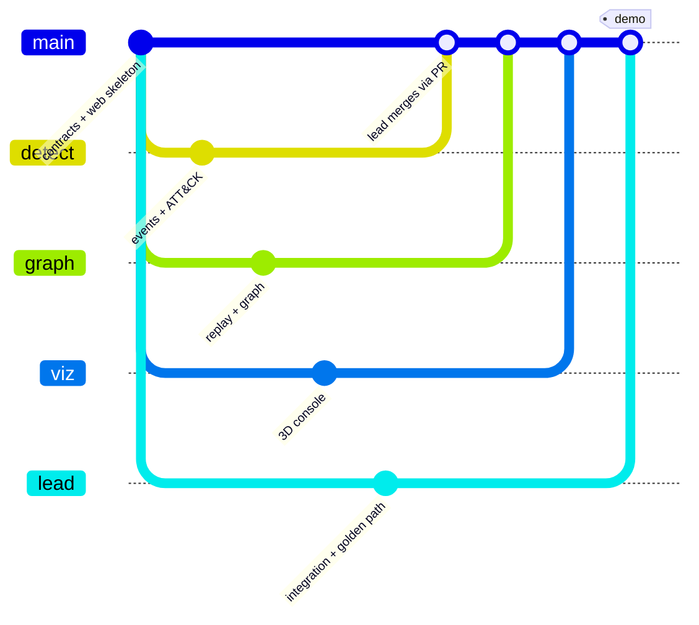

| Rule | How it is enforced |
|---|---|
| One branch per person, named after the alias (`detect`, `graph`, `viz`, and `lead` for the lead's own work) | Nobody pushes directly to `main`. The first bootstrap commit is made before branch protection is switched on |
| Only the lead merges, through a Pull Request | GitHub branch protection + a one-line CODEOWNERS (`* @Sagar44-Github`) |
| Contract first | Data formats are written as schemas + samples before anyone builds. Changes go through the lead, who tells everyone |
| Per-role folders | Each person edits only their own folder, including their own sub-folder of `web/` |
| Never blocked | Every role builds against sample JSON first, then swaps in real data |
| Definition of done | Runs, passes its acceptance test, committed to your branch, merged by the lead, main still runs, contracts match |

<details>
<summary><b>🗓 The 8-week plan</b></summary>
<br>

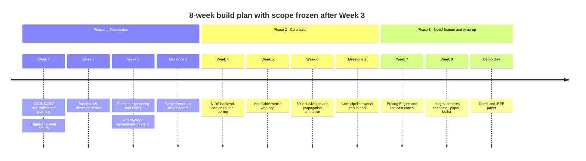

Week 8 is a buffer and is **not optional**. Anything not integration-tested by the end of Week 7 is cut from the demo, even if code exists for it.

</details>

<details>
<summary><b>🎯 Success criteria: when is this "done"?</b></summary>
<br>

- [ ] The golden path runs start to finish on localhost: replayed event → detection → graph → ATT&CK context → Precog forecast → 3D view → mobile alert → analyst containment → re-evaluation
- [ ] Detection is measured on held-out CICIDS2017 data and reported with precision, recall, F1 and false-positive rate
- [ ] Precog produces Top-3 forecasts with confidence and reports precision@k, a calibration curve and containment success rate
- [ ] The live session counter is visible and updates correctly
- [ ] The mobile web app installs on a phone, shows live alerts and executes a containment
- [ ] No containment executes without human confirmation
- [ ] The golden path survives 5 consecutive rehearsals, and a recorded backup video exists
- [ ] The IEEE paper is scoped to Precog's contribution with an honest novelty claim

</details>


## 🔒 Safety and Ethics

> [!CAUTION]
> **No live attack is ever run.** No scanning, exploitation or attack tool touches any live network, classmate's device or infrastructure the team does not fully own. All attack behaviour is pre-recorded dataset traffic or scripted event logs.

| Safeguard | Detail |
|---|---|
| **Replay only** | NIDS's live packet sniffer is never started. The product never captures live traffic |
| **Containment is simulated** | A status change plus an audit line. No firewall, no network, no device is changed |
| **Human in the loop** | Propose then confirm, enforced in the API, with a 60 s expiry. Nothing acts autonomously |
| **No secrets in the repo** | Secret key, admin password and Firebase credentials live in environment variables. `.env` is git-ignored; only `.env.example` (names only) is committed |
| **NIDS defaults neutralised** | Its hard-coded secret key and published admin password are replaced from outside, without editing NIDS |
| **No fake intelligence** | NIDS invents threat-actor names, ASN and location values from ports and hashes. They are never shown anywhere, so they cannot be mistaken for real threat intelligence |
| **No real personal data** | Only CICIDS2017 (a licensed public research dataset) and internally generated replay logs |
| **Always labelled** | A permanent **SIMULATION** badge on every screen, and the word *simulated* on every containment message |
| **Honest evaluation** | Reported results come only from held-out data, never from the rehearsed golden path |

## 📚 Documentation

Everything the team works from lives in [`docs/`](docs/).

| Document | Answers |
|---|---|
| [Master Project Document](docs/Master_Project_Document) | What the whole project is and why |
| [PRD (Product Requirements)](docs/PRD_Product_Requirements_Document) | What must be built for whom, and how we know it is done. Every requirement has an ID, a priority and an acceptance criterion |
| [TRD (Technical Requirements)](docs/TRD_Technical_Requirements_Document) | How it is built: architecture, API, data contracts, module designs, fallbacks |
| [UI/UX Brief](docs/UI_UX_Brief.md) | How it looks, feels and reads: colour system, components, screens, motion, accessibility |
| Build Guides (4) | The exact steps each role follows to build, test and merge its part |

## 🙏 Credits and Licences

> The standing rule: reuse a best-in-class open-source repository for every subsystem where one exists, and write custom code only for the glue and for what nothing existing covers.

| Component | Repository | Used for | Terms |
|---|---|---|---|
| Backend | [123dars/NIDS](https://github.com/123dars/NIDS) | Flask backend, users, packet table, Isolation Forest detector | MIT. Licence and copyright notice kept with the copy |
| Static attack graph | [cwccie/attackgraph](https://github.com/cwccie/attackgraph) | Topology, feasible paths, ATT&CK-mapped risk | MIT. Installed from GitHub at a pinned commit |
| Precog technique layer | [mayank02raj/MITRE-ATTACK-based-Attack-Chain-Prediction](https://github.com/mayank02raj/MITRE-ATTACK-based-Attack-Chain-Prediction) | Markov table exported once to JSON | Used with the author's written permission and cited with its paper. The exported JSON is committed or redistributed only as that permission allows |
| Offline detection | [Western-OC2-Lab/Intrusion-Detection-System-Using-Machine-Learning](https://github.com/Western-OC2-Lab/Intrusion-Detection-System-Using-Machine-Learning) | CICIDS2017 training code | Upstream licence, recorded in the DETECT guide |
| ATT&CK data | [mitre-attack/attack-stix-data](https://github.com/mitre-attack/attack-stix-data) | Curated 26-technique subset | MITRE ATT&CK Terms of Use, copyright notice kept |
| 3D | [vasturiano/3d-force-graph](https://github.com/vasturiano/3d-force-graph) | 3D graph rendering | MIT |
| Charts | [chartjs/Chart.js](https://github.com/chartjs/Chart.js) | Charts | MIT |
| Dataset | CICIDS2017, University of New Brunswick | Offline detection evaluation | Public research dataset, cited as its authors request |
| Pattern references | [apache/caldera](https://github.com/apache/caldera), [redcanaryco/atomic-red-team](https://github.com/redcanaryco/atomic-red-team), [wazuh/wazuh](https://github.com/wazuh/wazuh) | Output shape of scripted technique events; Active Response pattern | Reference only, no code copied |

## 📄 License

The original code written for Precog SOC is covered by the terms in [LICENSE](LICENSE). Third-party components keep their own licences, listed above.

<br>

<div align="center">


**Precog SOC** · 5th Semester PBL · Department of Computer Science and Engineering · 2026–27

*Detect. Forecast. Act. Re-evaluate.*

<sub>Built by Sagar R · Neha · Pallavi Bammanni · Preethi S Pujari, under the guidance of Dr. Nandini C</sub>

<br>

[⬆ Back to top](#top)

</div>
