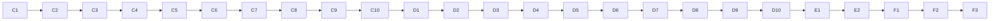

# Build Guide — DETECT

## Security events, ATT&CK technique lookup, audit log, and the offline CICIDS2017 detection model

---

## 0. Document Control

| Field | Detail |
|---|---|
| **Document** | Build Guide for DETECT |
| **Version** | 1.0 |
| **Date** | 5 October 2026 |
| **Follows** | Master Project Document, PRD v1.2, TRD v1.2, LEAD-CORE Build Guide Part 1 |
| **Delivered with this guide** | `detect-delivery.zip` (29 finished files, tested) |

---

## Naming Convention (Read This First)

The master document uses real names. **Every other project document, including this guide, uses the role-based aliases below.**

| Alias | Real Name | USN | Role |
|---|---|---|---|
| **LEAD-CORE** | Sagar R | 1DT24CS232 | Team lead — backend add-ons, Precog Engine, integration; the only person who merges code |
| **DETECT** | Neha | 1DT24CS174 | Flow feature preparation, ML detection, security event processing, ATT&CK correlation |
| **GRAPH** | Pallavi Bammanni | 1DT24CS185 | Data ingestion, simulation, attack graph, mobile web app (PWA) |
| **VIZ** | Preethi S Pujari | 1DT24CS195 | 3D visualization, charts, push notifications, containment |

**This guide is for DETECT.** Where it says "you", it means DETECT. "The lead" means LEAD-CORE.

---

## 1. What You Build and What Nobody Else Waits For

You build **two separate things**. Neither waits for anyone else's work.

| Part | What it is | Runs where |
|---|---|---|
| **Part C: Security events** (`detect/detect_events/`) | Turns NIDS's alerts and scripted attack steps into readable alerts, looks up MITRE ATT&CK technique names, keeps an audit log. GRAPH's replay calls it | Inside the backend |
| **Part D: Offline model** (`detect/offline_model/`) | Trains the CICIDS2017 detection models (LightGBM, XGBoost, CatBoost and the LCCDE ensemble) and produces the precision, recall, F1 and false-positive numbers for the paper | Your own Python environment. The backend never imports it |

**Your folder is `detect/`. You edit nothing outside it.** Your work is connected to the product through one hook called `events`.

### What other roles will call (so you understand why your functions look the way they do)

| Caller | Call | Result |
|---|---|---|
| GRAPH's replay | `events.process_packets(rows)` | A list of readable alerts (`security_event`) for the packets NIDS flagged |
| GRAPH's replay | `events.process_technique(host, technique_id, note, compromise)` | One alert for a scripted attack step |
| VIZ and LEAD-CORE | `events.audit_record(type, ref_id, summary)` | One line in the audit log |
| GRAPH's replay (on restart) | `events.reset()` | Event numbers start again at `evt-000001` |

---

## 2. What Was Verified and What Was Not

I tested everything that can run in my own test environment (Linux, Python 3.11, real CICIDS2017 sample data).

| Verified by me | Result |
|---|---|
| DETECT's backend code: 72 automatic tests | Pass. With LEAD-CORE's base the whole repo runs **173 tests, all passing** |
| Registered through the real add-on loader and shown in `/api/x/health` | Yes |
| Secrets, passwords, keys and emails are removed from the audit log | Yes (a test found and fixed a real bug in this) |
| The ATT&CK table matches MITRE's official data (ATT&CK version 19.2) | Yes: all 26 names and tactics were read from MITRE's own file |
| Offline model: 50 automatic tests (1 optional test is skipped) | Pass |
| A real training run on the real CICIDS2017 sample (44,043 rows after cleaning) | Yes. Its numbers are in Step D7 so you can compare yours |
| The report written by the offline model follows the project's `detection_report` contract | Yes, checked automatically |

| **Not** verified by me | What to do |
|---|---|
| PowerShell commands on Windows | They are standard commands. If one fails, use Section 12 and send me the exact error |
| Installing LightGBM, XGBoost and CatBoost on your Windows laptop | They normally install from ready-made files. If one fails, send me the exact error |
| How long training takes on your laptop | My one-core test is given in Step D6. More CPU cores are faster |
| GitHub's and Antigravity's screens | Names may differ slightly. Look for the same idea |

---

## How to Read This Guide

1. Do the steps **in order, top to bottom**. Every step has an ID such as `C4`.
2. Boxes marked `powershell` are typed into **PowerShell**. Press Enter after each line.
3. Text after `#` in a command is a comment. Do not type it.
4. **You should see:** tells you what correct looks like. If you see something else, go to Section 12.
5. Every **code step** has the same parts:

| Part | Meaning |
|---|---|
| **WHERE** | The exact path of the file inside the repo |
| **WHAT** | One line on what the file does |
| **COPY** | The command that copies **my finished, tested file** into your repo |
| **PROMPT** | The detailed instruction to give Antigravity so it writes its own version |
| **COMPARE** | How to put my file and Antigravity's file side by side |
| **COMMIT** | The Git commands that save the step |

6. The delivered files must be unzipped so that `C:\detect-delivery\detect\detect_events\events.py` exists. Every COPY command reads from `C:\detect-delivery\`.
7. **You start this guide only when the lead tells you the repository is ready and you have accepted the GitHub invitation.**

---

# PART A — Install the Tools (Windows)

Open PowerShell: **Start menu → type `PowerShell` → open "Windows PowerShell"** (a normal window, not "as administrator").

### A1 — Install Git

1. Open https://git-scm.com/download/win and click the **64-bit Git for Windows Setup** link.
2. Run the file. Keep clicking **Next** (leave every setting), then **Install**, then **Finish**.
3. Close PowerShell, open it again, and type:

```powershell
git --version   # prints the Git version
```

**You should see:** `git version 2.` followed by numbers.

### A2 — Install Python 3.11.9

1. Open https://www.python.org/downloads/release/python-3119/
2. Scroll to the **Files** table and click **Windows installer (64-bit)** (the file is named `python-3.11.9-amd64.exe`). The page must say **3.11.9**.
3. Run it. **Tick "Add python.exe to PATH"** on the first screen. Click **Install Now**, then **Close**.
4. Close PowerShell, open it again, and type:

```powershell
py -3.11 --version   # asks the Windows Python launcher for 3.11
```

**You should see:** `Python 3.11.9`.

### A3 — Install Antigravity

1. Open https://antigravity.google/download
2. Under **Antigravity IDE (Standalone)** click **Download for x64**. Run the installer. If Windows shows a blue warning, click **More info**, then **Run anyway**.
3. Open Antigravity and sign in with your Google account. Keep the default choices.

### A4 — Allow PowerShell scripts, and tell Git who you are

```powershell
Set-ExecutionPolicy -Scope CurrentUser -ExecutionPolicy RemoteSigned   # lets the Python environment script run (type Y if asked)
git config --global user.name "YOUR NAME"           # your real name between the quotes
git config --global user.email "you@example.com"    # the email you use for GitHub
git config --global init.defaultBranch main         # new repos start on main
```

### A5 — Unzip the delivered files

1. Right-click `detect-delivery.zip` → **Extract All**.
2. Extract it to a new folder named exactly `C:\detect-delivery`.

```powershell
Test-Path C:\detect-delivery\detect\detect_events\events.py   # asks "does this file exist?"
```

**You should see:** `True`. If `False`, the files are one folder too deep. Move them up so that the `detect` folder sits directly inside `C:\detect-delivery`.

---

# PART B — Get the Repository and Prepare

### B1 — Accept the invitation

Open the GitHub invitation email and accept it. (You need a GitHub account: https://github.com/signup. Remember your username.)

### B2 — Copy the repository to your laptop

The lead sends you the repository address, which looks like `https://github.com/LEAD-USERNAME/precog-platform.git`.

```powershell
cd $HOME\Documents                                                    # go to your Documents folder
git clone https://github.com/LEAD-USERNAME/precog-platform.git         # replace LEAD-USERNAME; a sign-in window may open
cd precog-platform                                                     # go inside the new folder
```

**You should see:** a download progress message and no error.

### B3 — Open it in Antigravity

1. In Antigravity: **File → Open Folder** → choose `Documents\precog-platform` → **Select Folder**. Click **Yes, I trust** if asked.
2. **Terminal → New Terminal** (it must say **PowerShell**). **Type every command in this terminal from now on.**

```powershell
pwd   # prints the folder you are in
```

**You should see:** a path ending in `precog-platform`.

### B4 — Create your own branch

```powershell
git switch -c detect          # creates your branch and moves you onto it
git push -u origin detect     # sends the empty branch to GitHub
git branch                    # a star marks the branch you are on
```

**You should see:** `* detect`. **Work only on `detect`. Never work on `main`.** If `git switch -c detect` says the branch already exists, use `git switch detect` instead.

### B5 — Check the lead's base is there

```powershell
Test-Path lead-core\backend\run_app.py      # must print True
Test-Path lead-core\backend\nids\LICENSE   # must print True
Test-Path contracts\data\hosts.json         # must print True
Test-Path detect\detect_events\__init__.py  # must print True (a placeholder)
```

If any line prints `False`, the lead has not merged the base yet. Tell the lead.

### B6 — Create the backend Python environment

```powershell
py -3.11 -m venv .venv                       # creates a private Python folder called .venv
.\.venv\Scripts\Activate.ps1                 # switches it on
pip install -r lead-core/backend/requirements.txt   # installs the backend libraries (a few minutes)
```

**You should see:** `(.venv)` at the start of the prompt, and `Successfully installed` at the end. **Every new terminal needs the `Activate.ps1` line again.**

### B7 — Prove the base works before you add anything

```powershell
pytest   # runs the lead's tests
```

**You should see:** a row of dots and `101 passed`. (The first run may take longer: NIDS trains a small model once.)

If the number differs or something fails, tell the lead. Do not continue.

---

# PART C — Security Events (Inside the Backend)

### C0 — Before the first prompt: the context block and how to compare

**1. The context block.** In Antigravity's agent chat, start a **new conversation** and paste this once. Keep using the same conversation for Part C:

```text
CONTEXT (remember this for everything I ask next)
I am DETECT in a team building the "Precog SOC Platform", a student cybersecurity project. Python 3.11 on Windows. Libraries allowed in this part: the Python standard library, jsonschema, pytest, and the project's own "addons" package. No other libraries.
Repo (root = precog-platform): contracts/schemas/*.schema.json are data formats; contracts/data/hosts.json lists six demo hosts; lead-core/backend/addons/ holds the shared WorldState (add_alert(event)), Contracts (validate(name, data)) and Hooks.
My folder is detect/. I may only create files inside detect/. I must NEVER edit anything outside detect/.
My package is detect/detect_events/ (importable as "detect_events"; the backend adds detect/ to Python's search path).
Rules for every file you write: plain readable Python with short docstrings and clear names; write the file ONLY to scratch-ai/<the same path as the real file>; do not touch any other file; do not add features I did not ask for.
```

**2. Make the scratch folder** (`scratch-ai/` is already in `.gitignore`, so it is never committed):

```powershell
New-Item -ItemType Directory -Force -Path scratch-ai | Out-Null   # the folder where Antigravity's versions go
```

**3. How to compare** (used in every code step):

*Method 1, side by side:* in the left file list right-click **my file** → **Select for Compare**, then right-click **the AI's file** inside `scratch-ai` → **Compare with Selected**. Red and green lines show differences.

*Method 2, in the terminal:*

```powershell
git diff --no-index scratch-ai\detect\detect_events\hosts.py detect\detect_events\hosts.py   # replace both paths with the two files
```

**4. Which one to keep?** Keep **mine** by default (copied and tested). To use the AI's version of a file, copy it over mine, then run the tests in Step C8. **If a test fails, copy mine back.** Never keep a version that fails the tests.

### C1 — hosts.py

**WHERE:** `detect/detect_events/hosts.py`
**WHAT:** Turns network addresses such as `192.168.1.11` into host names such as `host-a` / "Workstation A", using the shared list `contracts/data/hosts.json`.

**COPY:**

```powershell
Copy-Item C:\detect-delivery\detect\detect_events\hosts.py detect\detect_events\hosts.py   # copies my finished file
```

**PROMPT:**

```text
Write scratch-ai/detect/detect_events/hosts.py.
class HostMap(hosts): hosts is a list of dicts with host_id, name and address (all non-empty text, otherwise raise ValueError naming the field). Raise ValueError for a duplicate host_id, a duplicate address, or an empty list.
Class method from_file(path): reads a JSON file shaped {"hosts": [...]} (UTF-8) and builds the HostMap.
Methods: host_ids() (list), is_known(host_id), host_for_address(address) -> host id or None, name_of(value) -> readable name for a host id or an address (unknown values returned unchanged; None or empty text gives "Unknown host"), host_or_address(address) -> host id when known, else the address itself, and "unknown" when the address is None or empty.
```

**COMPARE:** Use the method in C0.

**COMMIT:**

```powershell
git add .
git commit -m "feat(detect): host name lookup"   # saves the step
```

### C2 — The ATT&CK technique table

**WHERE:** `detect/detect_events/techniques.py`, `detect/detect_events/data/attack_techniques.json`, `detect/tools/build_attack_table.py`
**WHAT:** `attack_techniques.json` is a small table of 26 MITRE ATT&CK techniques (id, official name, tactics, link) plus service-based "port hints" for the ports NIDS treats as suspicious. `techniques.py` reads it. `build_attack_table.py` rebuilds it from MITRE's official data, so you can prove the names are real.

**Honest rule built into the table:** a port number alone never proves a technique. Ports without a defensible technique are marked `null`, and then no technique is shown.

**COPY:**

```powershell
New-Item -ItemType Directory -Force -Path detect\detect_events\data | Out-Null     # makes the data folder
New-Item -ItemType Directory -Force -Path detect\tools | Out-Null                  # makes the tools folder
Copy-Item C:\detect-delivery\detect\detect_events\techniques.py detect\detect_events\techniques.py
Copy-Item C:\detect-delivery\detect\detect_events\data\attack_techniques.json detect\detect_events\data\attack_techniques.json
Copy-Item C:\detect-delivery\detect\tools\build_attack_table.py detect\tools\build_attack_table.py
```

**PROMPT 1 of 3 — techniques.py:**

```text
Write scratch-ai/detect/detect_events/techniques.py.
class TechniqueTable(data): data is the parsed JSON {"meta": {...}, "port_hints": {"22": "T1021.004", "137": null, ...}, "techniques": [{"id", "name", "tactics": [..], "url"}]}.
Each technique needs id, name and tactics (otherwise ValueError); a duplicate id is a ValueError. Every port hint must be null or the id of a known technique (otherwise ValueError). Keep meta available as .meta.
Class method from_file(path). Methods: ids() (list in file order), get(technique_id) -> dict or None, require(technique_id) -> dict or ValueError with a message listing the known ids, technique_for_port(port) -> the technique dict or None (a port with a null hint, or no hint, gives None), hinted_ports() -> sorted list of ints.
```

**PROMPT 2 of 3 — attack_techniques.json** (this one needs the real MITRE data, so the AI may get names wrong; the checker below catches that):

```text
Write scratch-ai/detect/detect_events/data/attack_techniques.json using the official MITRE ATT&CK Enterprise data. Do NOT guess: if you are not sure of a technique's official name or tactics, say so instead of inventing it.
Structure: {"meta": {"source", "source_data", "notice", "curated", "port_hints_note"}, "port_hints": {...}, "techniques": [...]}.
The notice must say: (c) The MITRE Corporation. ATT&CK(R) is a registered trademark of The MITRE Corporation, reproduced from https://attack.mitre.org under the ATT&CK Terms of Use https://attack.mitre.org/resources/legal-and-branding/terms-of-use/.
Techniques (in this order), each with id, name, tactics (list of tactic short names such as "credential-access") and url (https://attack.mitre.org/techniques/T1110/ ; for a sub-technique use a slash, e.g. T1021/004):
T1046 T1110 T1110.001 T1110.003 T1078 T1021 T1021.001 T1021.002 T1021.003 T1021.004 T1571 T1048 T1041 T1059 T1087 T1018 T1083 T1005 T1560 T1003 T1570 T1105 T1190 T1135 T1133 T1068
port_hints: "22": "T1021.004", "23": "T1021", "3389": "T1021.001", "445": "T1021.002", "135": "T1021.003", "137": null, "138": null, "139": "T1021.002", "4444": "T1571", "6666": "T1571", "31337": "T1571".
```

**PROMPT 3 of 3 — build_attack_table.py:**

```text
Write scratch-ai/detect/tools/build_attack_table.py: a script that rebuilds detect/detect_events/data/attack_techniques.json from MITRE's official file enterprise-attack.json (a STIX bundle).
Module constants TECHNIQUE_IDS (the 26 ids above), PORT_HINTS (the port hints above) and NOTICE (the MITRE copyright text above).
build_table(bundle, technique_ids=TECHNIQUE_IDS, port_hints=PORT_HINTS) -> dict. In the bundle, objects with type "attack-pattern" hold techniques; the id is the external_reference whose source_name is "mitre-attack" (its external_id); name is "name"; tactics are the phase_name of each item in kill_chain_phases; the version comes from the "x-mitre-collection" object's x_mitre_version. Stop with SystemExit and a clear message if a technique is not found, or is revoked or deprecated (x_mitre_deprecated). The meta block records the source version, the source address, the notice, and a note that port hints are hints only.
main(argv): needs one argument, the path of enterprise-attack.json; writes the table next to detect_events/data/attack_techniques.json and prints how many techniques it wrote. Print the module docstring if the argument is missing.
```

**COMPARE:** Use the method in C0.

**CHECK THE NAMES AGAINST MITRE'S OWN FILE** (this is the real test of the table):

```powershell
Invoke-WebRequest -Uri https://raw.githubusercontent.com/mitre-attack/attack-stix-data/master/enterprise-attack/enterprise-attack.json -OutFile $HOME\Downloads\enterprise-attack.json   # downloads MITRE's data (about 54 MB, may take a minute)
python detect\tools\build_attack_table.py $HOME\Downloads\enterprise-attack.json   # rebuilds the table from it
git diff --stat   # shows whether the rebuilt file differs from the one you had
```

**You should see:** `Wrote 26 techniques to ...`. If you copied **my** file and MITRE has not changed its data since 5 October 2026, `git diff --stat` shows **nothing** (the file is identical). If MITRE released a newer version, names may differ slightly: run the tests in C8. If the tests still pass, keep the rebuilt file. If you used the AI's version and `git diff` shows differences, the AI got something wrong: keep the rebuilt file (it is the correct one).

**COMMIT:**

```powershell
git add .
git commit -m "feat(detect): ATT&CK technique table built from MITRE's official data"   # saves the step
```

### C3 — explain.py

**WHERE:** `detect/detect_events/explain.py`
**WHAT:** Fixed sentence templates that describe an alert in plain English. It never uses NIDS's invented "threat actor", ASN or location values (they are simulated).

**COPY:**

```powershell
Copy-Item C:\detect-delivery\detect\detect_events\explain.py detect\detect_events\explain.py
```

**PROMPT:**

```text
Write scratch-ai/detect/detect_events/explain.py. Fixed templates only: no outside service and nothing invented.
SERVICE_NAMES: dict of port -> plain description, for 21 "FTP, file transfer", 22 "SSH, remote login", 23 "Telnet, remote login", 53 "DNS, name lookup", 80 "web, HTTP", 135 "Windows RPC", 137 "NetBIOS name service", 138 "NetBIOS datagram service", 139 "NetBIOS session service", 443 "secure web, HTTPS", 445 "SMB, Windows file sharing", 3389 "Remote Desktop", 4444 "a port often used by attack tools", 6666 "a port often used by backdoors", 31337 "a port often used by backdoors".
SEVERITY_WORDS: HIGH -> "high risk", MEDIUM -> "medium risk", LOW -> "low risk".
service_name(port); tactic_words(technique) (join the tactics, replacing "-" with a space);
explain_packet(src_name, dst_name, protocol, port, size, severity, technique=None) -> "<src> sent a <size>-byte <protocol> packet to port <port> (<service>) on <dst>. NIDS rated it <severity words>." and, if a technique is given, append " Traffic like this can be a sign of <technique name> (<id>), a <tactics> technique." If port is empty use "no port".
explain_technique(host_name, technique, note=None, compromise=False) -> "<host> shows activity matching <name> (<id>), part of the <tactics> stage of an attack." plus the note as a sentence (no doubled full stops) and, if compromise, " <host> is now treated as compromised."
```

**COMPARE:** Use the method in C0.

**COMMIT:**

```powershell
git add .
git commit -m "feat(detect): plain-English alert explanations"
```

### C4 — audit.py

**WHERE:** `detect/detect_events/audit.py`
**WHAT:** The audit log: one JSON line per detection, forecast and containment. Before any line is saved it removes anything that looks like a password, token, key or email address.

**COPY:**

```powershell
Copy-Item C:\detect-delivery\detect\detect_events\audit.py detect\detect_events\audit.py
```

**PROMPT:**

```text
Write scratch-ai/detect/detect_events/audit.py.
ENTRY_TYPES = ("detection", "forecast", "containment").
scrub(text) -> text with secrets replaced by "[redacted]": a PEM private key block; "Bearer <token>" (do this BEFORE the next rule so that "Authorization: Bearer abc" loses its token); words password, passwd, pwd, secret, token, api_key / api-key, authorization followed by : or = and a value (keep the word, redact the value); any run of 32 or more hexadecimal characters; any email address. Ordinary text must come back unchanged.
utc_now() -> "YYYY-MM-DDTHH:MM:SSZ".
class AuditLog(path, contracts=None): record(entry_type, ref_id, summary, ts=None) validates the type (ValueError), builds {"ts", "type", "ref_id", "summary"} with the summary scrubbed, validates it with contracts.validate("audit_entry", entry) when contracts is given, creates the folder, appends one JSON line (UTF-8), thread-safe (a lock), and returns the entry. read_all() returns the list of entries ([] if the file is missing). clear() deletes the file if it exists.
```

**COMPARE:** Use the method in C0.

**COMMIT:**

```powershell
git add .
git commit -m "feat(detect): audit log that scrubs secrets"
```

### C5 — events.py and reports.py

**WHERE:** `detect/detect_events/events.py`, `detect/detect_events/reports.py`
**WHAT:** `events.py` is the heart of your work: the `EventProcessor`. Packets NIDS labelled HIGH, MEDIUM or LOW become readable alerts; NORMAL traffic is ignored; scripted technique steps become alerts too. Each alert goes to the shared world state and the audit log. `reports.py` loads the offline model's report file.

**How a packet becomes an alert (rules the tests check):**

| Alert field | Where it comes from |
|---|---|
| `host` | The **source** host of the packet (its address looked up in the host list; an unknown address is kept as it is) |
| `severity`, `risk_score` | NIDS's own severity word and its 0 to 100 score |
| `anomaly` | True only when NIDS's anomaly value is -1 |
| `technique_*` | Only from the port hint table, and only when there is a defensible hint |
| `explanation` | `explain_packet` |

**COPY:**

```powershell
foreach ($f in 'events','reports') { Copy-Item "C:\detect-delivery\detect\detect_events\$f.py" "detect\detect_events\$f.py" }   # copies the two files
```

**PROMPT 1 of 2 — events.py:**

```text
Write scratch-ai/detect/detect_events/events.py (imports: from .audit import utc_now; from .explain import explain_packet, explain_technique).
ALERT_SEVERITIES = ("HIGH","MEDIUM","LOW"); DEFAULT_RISK = {"HIGH": 90.0, "MEDIUM": 65.0, "LOW": 35.0}; PACKET_FIELDS = id, timestamp, src_ip, dst_ip, protocol, src_port, dst_port, packet_size, flags, anomaly, risk_score, suspicious_port, alert, severity.
packet_to_dict(packet) copies those attributes (None if missing) into a dict. to_iso_utc(value): accepts a datetime or text such as "2026-10-03 10:00:01", "2026-10-03T10:00:01Z", "2026-10-03T15:30:01+05:30" or with microseconds and returns "YYYY-MM-DDTHH:MM:SSZ" in UTC (a time without a zone counts as UTC); anything unreadable (None, empty, nonsense, a number) returns the current time instead of failing.
class EventProcessor(hosts, techniques, audit=None, world=None, contracts=None) with a thread-safe counter that makes ids "evt-000001", "evt-000002" ...
process_packets(rows) -> list of events. For each row: severity None -> skip and count it in self.skipped_unlabelled; severity not in ALERT_SEVERITIES (for example NORMAL) -> skip; otherwise build a security_event: ts = to_iso_utc(timestamp); host = hosts.host_or_address(src_ip); packet_id = row id; anomaly = (row anomaly == -1); risk_score = the row's score clamped to 0..100 and rounded to 2 decimals, or the DEFAULT_RISK for the severity when it is missing, not a number or NaN; severity as given; technique = techniques.technique_for_port(dst_port) -> technique_id and technique_name or None; explanation = explain_packet(...) using hosts.name_of for both addresses; source "nids_detector". NIDS's threat actor, ASN and location values must never be used.
process_technique(host, technique_id, note=None, compromise=False, severity="HIGH", risk_score=None) -> one event: raise ValueError for an unknown host (message lists known hosts), an unknown technique (use techniques.require) or a severity outside ALERT_SEVERITIES, BEFORE using up an event number; ts = now; packet_id None; anomaly True; source "scripted"; explanation = explain_technique(...).
Every event is finished by one helper: validate with contracts.validate("security_event", event) if contracts is given, call world.add_alert(event) if world is given, and write audit.record("detection", event_id, "<SEVERITY> alert on <host>: <explanation>", ts=event ts) if audit is given.
audit_record(entry_type, ref_id, summary) writes through the audit log (returns None when there is none). reset(clear_audit=True) restarts the counter at 1, zeroes skipped_unlabelled and clears the audit log when asked.
```

**PROMPT 2 of 2 — reports.py:**

```text
Write scratch-ai/detect/detect_events/reports.py with load_detection_report(path, contracts=None): return None if the file does not exist; otherwise read the JSON (UTF-8), validate it with contracts.validate("detection_report", report) when contracts is given (a report that breaks the contract raises), and return the dict.
```

**COMPARE:** Use the method in C0.

**COMMIT:**

```powershell
git add .
git commit -m "feat(detect): event processor and report loader"
```

### C6 — The package file (the plug-in)

**WHERE:** `detect/detect_events/__init__.py`
**WHAT:** Replaces the lead's placeholder. Its `register(ctx)` function builds the event processor and plugs it into the backend through the `events` hook. In live mode it also loads the offline model's report (if the file exists) so the product can show it.

**COPY:**

```powershell
Copy-Item -Force C:\detect-delivery\detect\detect_events\__init__.py detect\detect_events\__init__.py   # replaces the placeholder
```

**PROMPT:**

```text
Write scratch-ai/detect/detect_events/__init__.py. Keep a module docstring listing the four methods other roles call on the "events" hook: process_packets(rows), process_technique(host, technique_id, ...), audit_record(type, ref_id, summary), reset().
Export AuditLog, EventProcessor, HostMap, TechniqueTable and packet_to_dict (via __all__ plus register). Define PACKAGE_DIR and TECHNIQUES_FILE (data/attack_techniques.json next to this file).
def register(ctx): ctx has config (repo_root, contracts_dir, data_mode), contracts, world and hooks. Build HostMap.from_file(<contracts_dir>/data/hosts.json); TechniqueTable.from_file(TECHNIQUES_FILE); AuditLog at <repo_root>/lead-core/backend/data/audit/audit.jsonl (pass ctx.contracts); an EventProcessor with world=ctx.world and contracts=ctx.contracts; register it with ctx.hooks.register("events", processor). Then, ONLY when config.data_mode == "live": load <repo_root>/detect/offline_model/results/detection_report.json with load_detection_report inside try/except (a bad report is logged as a warning and never stops the server); if a report was found call ctx.world.set_detection_report(report) and log it; if no file exists log that none was found yet.
```

**COMPARE:** Use the method in C0.

**COMMIT:**

```powershell
git add .
git commit -m "feat(detect): register the events hook with the backend"
```

### C7 — The demo script (see it work)

**WHERE:** `detect/tools/demo_events.py`
**WHAT:** Feeds three made-up packets and one scripted technique through your processor and prints the alerts and the audit log. No server needed.

**COPY:**

```powershell
Copy-Item C:\detect-delivery\detect\tools\demo_events.py detect\tools\demo_events.py
python detect\tools\demo_events.py   # runs the demo
```

**You should see** (the dates in the last lines will be different):

```text
--- 3 packets in, only alerts come out ---
evt-000001  HIGH    Workstation A sent a 2500-byte TCP packet to port 22 (SSH, remote login) on Workstation B. NIDS rated it high risk. Traffic like this can be a sign of SSH (T1021.004), a lateral movement technique.
evt-000002  HIGH    Workstation A sent a 4500-byte TCP packet to port 31337 (a port often used by backdoors) on Web Server B. NIDS rated it high risk. Traffic like this can be a sign of Non-Standard Port (T1571), a command and control technique.

--- one scripted technique ---
evt-000003  HIGH    Workstation A shows activity matching Brute Force (T1110), part of the credential access stage of an attack. Repeated failed logins. Workstation A is now treated as compromised.

--- the world state now holds 3 alerts (version 3) ---
```

Notice: three packets went in but only two alerts came out. The first packet (ordinary web traffic, NORMAL) was ignored on purpose.

**PROMPT:**

```text
Write scratch-ai/detect/tools/demo_events.py: a script run from the repo root with "python detect/tools/demo_events.py". It adds <repo>/lead-core/backend and <repo>/detect to sys.path, builds Contracts(<repo>/contracts), a WorldState, a HostMap from contracts/data/hosts.json, a TechniqueTable from detect_events.TECHNIQUES_FILE, an AuditLog in a temporary folder and an EventProcessor wiring them together. It processes three made-up NIDS-labelled packets (one NORMAL port 443; one HIGH port 22 from 192.168.1.11 to 192.168.1.12 size 2500; one HIGH port 31337 from 192.168.1.11 to 192.168.1.20 size 4500) and prints one line per alert (event id, severity, explanation). Then it processes one scripted technique (host-a, T1110, note "Repeated failed logins", compromise=True) and prints it, then prints how many alerts the world state holds and its version, then prints the audit log lines (ts, type, ref_id).
```

**COMPARE:** Use the method in C0.

**COMMIT:**

```powershell
git add .
git commit -m "feat(detect): demo script"
```

### C8 — The tests (backend side)

**WHERE:** `detect/tests/` (7 files: `conftest.py`, `detect_helpers.py`, `test_detect_hosts_and_techniques.py`, `test_detect_audit.py`, `test_detect_events.py`, `test_detect_register.py`, `test_detect_tools.py`)
**WHAT:** 72 automatic tests: host lookup, technique table (including the check that the port hints cover exactly the ports NIDS treats as suspicious), explanations (including "no threat-actor names ever appear"), audit scrubbing, event rules, registration through the real loader, and the tools.

**COPY:**

```powershell
Copy-Item -Force C:\detect-delivery\detect\tests\*.py detect\tests\   # copies the seven test files
(Get-ChildItem detect\tests -Filter *.py).Count                          # counts them
```

**You should see:** `7`.

**PROMPT** (one prompt for all test files):

```text
Write pytest test files in scratch-ai/detect/tests/ for the detect_events package described in the CONTEXT.
conftest.py: put <repo>/lead-core/backend and <repo>/detect on sys.path; fixtures contracts (Contracts for <repo>/contracts), hosts, techniques, world (WorldState(contracts)), audit (AuditLog in tmp_path) and processor (EventProcessor wired with all of them). detect_helpers.py: REPO_ROOT and a packet(**changes) helper returning a NIDS-labelled packet dict (HIGH, port 22, from 192.168.1.11 to 192.168.1.12).
test_detect_hosts_and_techniques.py: six hosts with unique addresses; names for ids and addresses; unknown and missing values; bad host lists refused; the table has 26 techniques with the official names (T1110 Brute Force, T1021.004 SSH with tactic lateral-movement); require() error lists ids; the port hints cover exactly the ports 22, 23, 3389, 445, 135, 137, 138, 139, 4444, 6666, 31337; null hints and non-suspicious ports give no technique; every technique has a tactic and an attack.mitre.org link; the MITRE notice is kept; bad tables refused; explanations are plain English, mention the technique when there is one, make no claim when there is none, never contain APT29, Lazarus or FIN7, and have no doubled full stops.
test_detect_audit.py: one JSON line per record; reading a missing log gives []; unknown type refused; contract checking (empty summary refused); clear(); 8 threads writing 25 lines each give 200 intact lines; scrub() removes password=..., "Authorization: Bearer ...", api_key: ..., token=..., 32+ hex characters, an email and a PEM private key; ordinary text is unchanged; the log scrubs before writing.
test_detect_events.py: only HIGH/MEDIUM/LOW packets become events and unlabelled ones are counted; every field of a HIGH event; anomaly follows NIDS -1; ports without a hint give no technique; unknown source address kept as host; bad scores (250, -5, None, NaN, "oops") are handled; numbering counts up and reset restarts it; events reach the world state and the audit log; reset can keep or clear the audit log; missing fields do not crash (host "unknown"); NIDS threat actor, ASN and location values are never copied; packet_to_dict; datetime input; time conversions including +05:30 and microseconds; unreadable times become now; technique events (fields, severity and score options, typos in host/technique/severity raise ValueError and do not use up an event number); audit_record; works with no world or audit; the contract check catches a bad event.
test_detect_register.py: with a bare Flask app and the real register_addons(packages=("detect_events",)) in live mode: the "events" hook is registered, /api/x/health lists it, the processor feeds the shared world state; a missing report file is fine; a valid report file is loaded in live mode; a broken report does not stop start-up; sample mode keeps the sample report; the audit file is created under lead-core/backend/data/audit and removed by reset().
test_detect_tools.py: build_attack_table.build_table works on a small fake bundle (version, ids, tactics, links with a slash for sub-techniques, the MITRE notice), refuses unknown or revoked techniques, the shipped table matches the builder's lists, and demo_events.py runs and prints evt-000001, evt-000003, "audit log" and "Brute Force (T1110)".
```

**COMPARE:** Use the method in C0. Test files only matter if they **pass**, so the real comparison is the next step.

### C9 — Run the tests

```powershell
pytest detect/tests   # runs only your tests
pytest                # runs everything: the lead's tests and yours
```

**You should see:** first a row of dots and `72 passed`, then a row of dots and `173 passed`.

If you see a failure, copy the whole red message and go to Section 12.

**COMMIT:**

```powershell
git add .
git commit -m "test(detect): 72 tests for events, techniques, audit and registration"
```

### C10 — See it inside the real backend

1. Create your settings file (the same as the lead did):

```powershell
Copy-Item .env.example .env                                   # makes your own settings file (never committed)
python -c "import secrets; print(secrets.token_hex(32))"      # prints a long random text; select and copy it
```

2. Open `.env` in Antigravity. After `SECRET_KEY=` paste the long text. After `ADMIN_PASSWORD=` type a password you invent (at least 8 characters). Save with **Ctrl+S**.

```powershell
git check-ignore -v .env   # must print a line containing .gitignore and .env
python lead-core/backend/run_app.py   # starts the backend (the first start trains NIDS's model, about 10 seconds)
```

**You should see:** `Backend ready:  http://127.0.0.1:5000/app/   (API: /api/x/health)`.

3. In the browser open http://127.0.0.1:5000/api/x/health

**You should see:** JSON containing `"hooks":["events"]` and `"detect_events":"registered"`. (The other modules say `registered` too: they are the lead's placeholders.)

4. Stop the backend: click in the terminal and press **Ctrl+C**.

---

# PART D — The Offline Model (Your Own Environment)

**Why a separate environment?** The detection libraries (LightGBM, XGBoost, CatBoost) are large and use different versions from the backend's. Keeping them apart means neither can break the other. **Never run `pip install` for the offline libraries inside the backend `.venv`.**

### D1 — Create the offline environment

```powershell
deactivate                                                       # leaves the backend environment (if the prompt shows (.venv))
py -3.11 -m venv detect\offline_model\.venv                       # creates the offline environment
.\detect\offline_model\.venv\Scripts\Activate.ps1               # switches it on
python --version                                                 # must say 3.11
```

**You should see:** a prompt starting `(.venv)` and `Python 3.11.`.

**From now on in Part D every terminal must have this offline environment switched on** (the second `Activate.ps1` line above).

### D2 — Copy the offline files and install the libraries

**WHERE:** `detect/offline_model/` (`requirements.txt`, `pytest.ini`, `README.md`)

```powershell
Copy-Item -Force C:\detect-delivery\detect\offline_model\requirements.txt detect\offline_model\requirements.txt
Copy-Item -Force C:\detect-delivery\detect\offline_model\pytest.ini detect\offline_model\pytest.ini
Copy-Item -Force C:\detect-delivery\detect\offline_model\README.md detect\offline_model\README.md
pip install -r detect/offline_model/requirements.txt   # installs the libraries (several minutes; CatBoost is large)
```

**You should see:** `Successfully installed` followed by many names, including `lightgbm`, `xgboost` and `catboost`.

**PROMPT:** None. These are settings files.

### D3 — Download the dataset sample

The data is a 5% sample of CICIDS2017 that the Western OC2 Lab published in their open-source project (MIT licence). It is about 20 MB, so you do not need the full 200 MB dataset.

```powershell
New-Item -ItemType Directory -Force -Path detect\offline_model\vendor | Out-Null                    # makes the vendor folder (never committed)
git clone https://github.com/Western-OC2-Lab/Intrusion-Detection-System-Using-Machine-Learning.git detect\offline_model\vendor\Intrusion-Detection-System-Using-Machine-Learning
git -C detect\offline_model\vendor\Intrusion-Detection-System-Using-Machine-Learning checkout 502ba86173a8aae5a9b2973fa4e0a42de69fa6ba   # the exact version I tested
Test-Path detect\offline_model\vendor\Intrusion-Detection-System-Using-Machine-Learning\data\CICIDS2017_sample.csv   # must print True
git status   # the vendor folder must NOT be listed
```

**You should see:** `True`, and `git status` shows nothing about `vendor`.

### D4 — Look at the data

```powershell
python -c "import pandas as pd; d = pd.read_csv(r'detect\offline_model\vendor\Intrusion-Detection-System-Using-Machine-Learning\data\CICIDS2017_sample.csv'); print(d.shape); print(d['Label'].value_counts())"   # prints the size and the label counts
```

**You should see:** `(56661, 78)` and these counts: BENIGN 22731, DoS 19035, PortScan 7946, BruteForce 2767, WebAttack 2180, Bot 1966, Infiltration 36 (7 kinds of traffic: 1 harmless and 6 attacks). The data has 77 numeric features and one `Label` column. (In Step D8 you will see smaller numbers, because 12,537 duplicate rows and 81 rows with missing or infinite values are removed first.)

### D5 — The four helper modules

**WHERE:** `detect/offline_model/det_cicids.py`, `det_lccde.py`, `det_metrics.py`, `det_experiments.py`

| File | What it does |
|---|---|
| `det_cicids.py` | Cleans the data (removes missing/infinite values and **duplicate rows before splitting**, so the same row is never in both training and test), gives each traffic type a fixed number, makes the splits, adds synthetic rows (SMOTE) for small classes |
| `det_lccde.py` | The LCCDE ensemble: LightGBM + XGBoost + CatBoost, each class gets a "leader" model and the three answers are combined |
| `det_metrics.py` | Precision, recall, F1 and false-positive rate, treating any attack type as "attack" |
| `det_experiments.py` | The experiment log, one CSV row per model per run |

**Where this differs from the Western OC2 Lab notebook (on purpose):** the notebook picks each class's leader model using the **test** data. Here the leader is picked on a validation part of the **training** data, so the test data is never used for choosing anything. The notebook's "all three models disagree" branch also keeps its lists between rows and mishandles one case; here every row is decided on its own. A test compares the fast version with a plain row-by-row version on 2,000 random rows.

**COPY:**

```powershell
foreach ($f in 'det_cicids','det_lccde','det_metrics','det_experiments') { Copy-Item "C:\detect-delivery\detect\offline_model\$f.py" "detect\offline_model\$f.py" }   # copies the four files
```

**CONTEXT for the AI** (a new Antigravity conversation; paste once):

```text
CONTEXT (remember this for everything I ask next)
I am DETECT in a student cybersecurity project. Python 3.11 on Windows. This part lives in detect/offline_model/ and has its own environment with numpy, pandas, scikit-learn, imbalanced-learn, lightgbm, xgboost, catboost, jsonschema and pytest. It trains intrusion-detection models on the CICIDS2017 sample (78 columns: 77 numeric features and a "Label" column). It must not import anything from lead-core/ or detect/detect_events/.
Rules: plain readable Python with short docstrings; write each file ONLY to scratch-ai/detect/offline_model/<file name>; do not touch any other file; do not add features I did not ask for.
```

**PROMPT 1 of 4 — det_cicids.py:**

```text
Write scratch-ai/detect/offline_model/det_cicids.py.
Constants: LABEL_COLUMN "Label", BENIGN "BENIGN", CANONICAL_CLASSES ["BENIGN","Bot","BruteForce","DoS","Infiltration","PortScan","WebAttack"], NUMERIC_LABELS = {0: "BENIGN", 1: "Bot", ... 6: "WebAttack"}.
load_csv(path). clean(df, keep_duplicates=False) -> (clean dataframe, report): drop rows with a missing or infinite value in any feature (convert features with pd.to_numeric first), strip column names, drop exact duplicate rows BEFORE any split unless keep_duplicates; report = {"rows_in", "rows_with_missing_or_infinite_values", "duplicate_rows_removed", "rows_out"}.
label_names(series): text labels are kept (stripped); labels that are all digits are mapped through NUMERIC_LABELS (an unknown number is a ValueError). encode(df) -> (X float32 DataFrame, y int array, class_names): class ids follow CANONICAL_CLASSES order for the classes present, followed by any other names sorted; ValueError if there is no BENIGN row.
stratified_split(X, y, test_size=0.2, seed=0) (stratified; ValueError if a class has fewer than 2 rows). inner_validation_split(X_train, y_train, val_size=0.2, seed=0) carves a validation part out of the TRAINING data; if any class has 1 row, return everything as the fitting part and an empty validation part.
holdout_attack_split(X, y, attack_id, test_size=0.2, seed=0) -> X_train, y_train, X_test, y_test, hidden_mask: train WITHOUT the attack; test = the usual 20% of the other classes plus every row of the hidden attack; hidden_mask marks the hidden rows in the test set.
smote_balance(X, y, target=1000, seed=0, k_neighbors=5) -> (X, y, info): with imblearn SMOTE, raise every class with fewer than target rows up to target, skipping a class with k_neighbors rows or fewer; info = {"target_per_class", "oversampled_classes", "skipped_too_small"}; return the inputs untouched when nothing needs doing; the result X is float32.
```

**PROMPT 2 of 4 — det_lccde.py:**

```text
Write scratch-ai/detect/offline_model/det_lccde.py: the LCCDE ensemble (Leader Class and Confidence Decision Ensemble) from the Western OC2 Lab notebook LCCDE_IDS_GlobeCom22.ipynb, vectorised, using LightGBM, XGBoost and CatBoost.
MODEL_NAMES = ("LightGBM","XGBoost","CatBoost"). make_base_models(seed, threads, catboost_iterations): LGBMClassifier(random_state, n_jobs, verbose=-1), XGBClassifier(random_state, n_jobs), CatBoostClassifier(verbose=0, boosting_type="Plain", random_seed, thread_count, iterations, allow_writing_files=False); threads 0 means all cores (-1).
choose_leaders(f1_per_model): array (3, classes); for each class the index of the model with the best F1; ties go to LightGBM, then XGBoost, then CatBoost.
lccde_combine(preds, confs, leaders): preds and confs are arrays (3, n) of each model's class and confidence for each row. Per row: all three agree -> that class. All three different -> keep the models whose own answer's leader is themselves; exactly one -> its answer; several -> the most confident of those; none -> the most confident of all three; ties go to the lower model number. Two agree, one differs -> take the majority class, then use the answer of THAT class's leader model. No state may carry over between rows.
class LccdeEnsemble(seed, threads, catboost_iterations): fit(X_train, y_train, X_val=None, y_val=None): class ids may have gaps (map them to 0..k-1 for the models); fit the three models; choose leaders from per-class F1 on the validation rows (ignore validation rows of classes the models never saw; if there are no usable validation rows fall back to the training rows); predict_all(X) returns {"LightGBM", "XGBoost", "CatBoost", "LCCDE"} -> arrays of the ORIGINAL class ids; predict(X) returns the LCCDE answer. Confidence = the model's highest predicted probability.
```

**PROMPT 3 of 4 — det_metrics.py:**

```text
Write scratch-ai/detect/offline_model/det_metrics.py. 'Attack' means any class that is not benign_id.
binary_metrics(y_true, y_pred, benign_id) -> dict with tp, fp, tn, fn, precision, recall, f1, false_positive_rate. A ratio that cannot be calculated (division by zero, or f1 when precision or recall is missing or both are 0) is None, never 0. A wrong attack class still counts as a detected attack.
macro_f1(y_true, y_pred); per_class_f1(y_true, y_pred, class_names) -> {name: f1} using zero_division=0; unseen_detection_rate(y_pred, hidden_mask, benign_id) -> the share of the hidden-attack rows predicted as any attack (None if there are no hidden rows).
```

**PROMPT 4 of 4 — det_experiments.py:**

```text
Write scratch-ai/detect/offline_model/det_experiments.py: the experiment log.
COLUMNS = timestamp_utc, split, model, n_features, smote, seed, train_rows, test_rows, precision, recall, f1, false_positive_rate, macro_f1, unseen_detection_rate, seconds, notes.
class ExperimentLog(path): add(**fields) raises ValueError for an unknown column, fills missing columns with empty text, sets timestamp_utc to the current UTC time, rounds floats to 4 decimals, writes None as empty, creates the folder, writes the header only once (when the file is new or empty), appends one row using "\n" line endings, and returns the row. rows() returns the rows as dicts ([] if the file is missing).
```

**COMPARE:** Use the method in C0 (the paths are `scratch-ai\detect\offline_model\...`).

**COMMIT:**

```powershell
git add .
git commit -m "feat(detect): offline model helpers (cleaning, LCCDE, metrics, experiment log)"
```

### D6 — The evaluation runner

**WHERE:** `detect/offline_model/run_evaluation.py`
**WHAT:** Does everything: cleans the data, trains on an 80/20 split, then trains six more times, each time **without one attack type**, to see how the model copes with an attack it has never met. Writes every result to `results/`.

**COPY:**

```powershell
Copy-Item C:\detect-delivery\detect\offline_model\run_evaluation.py detect\offline_model\run_evaluation.py
```

**PROMPT:**

```text
Write scratch-ai/detect/offline_model/run_evaluation.py using the helper modules det_cicids, det_lccde, det_metrics and det_experiments (same folder).
Command-line options: --data (required), --out (default: results next to the script), --seed 0, --no-smote, --smote-target 1000, --catboost-iterations 1000, --quick (sets CatBoost to 100 iterations), --threads 0, --skip-holdout, --keep-duplicates, --dataset-label, --contracts-dir (default <repo>/contracts).
run(args): read and clean the data and print the cleaning numbers; write feature_columns.json and dataset_summary.json; MAIN SPLIT: stratified 80/20; take a validation part out of the training data, SMOTE the fitting part (unless --no-smote), fit LccdeEnsemble, predict the test rows, compute the binary metrics and macro F1 for LightGBM, XGBoost, CatBoost and LCCDE and add one experiment-log row per model; record each class's leader model name and LCCDE's per-class F1. UNSEEN-ATTACK TESTS (unless --skip-holdout): for every attack class, train without it using holdout_attack_split, and log one row per model including unseen_detection_rate. Print one progress line per step.
Write metrics_summary.json with everything and detection_report.json with exactly the fields model, dataset, split, precision, recall, f1, false_positive_rate, notes: numbers from the LCCDE main split rounded to 4 decimals; notes must say attack means any class except BENIGN, how many rows remained and how many duplicates were removed, the share of each attack type still flagged when trained without it (or that the test was not run), and that this is lab data from a public sample, not live traffic, and not comparable with NIDS's live detector. Refuse (ValueError) to write the report if precision, recall, f1 or false_positive_rate could not be calculated. Validate the report against contracts/schemas/detection_report.schema.json with jsonschema when that file exists (a report that breaks it raises ValueError).
```

**COMPARE:** Use the method in C0.

**COMMIT:**

```powershell
git add .
git commit -m "feat(detect): evaluation runner with unseen-attack tests"
```

### D7 — The offline tests

**WHERE:** `detect/offline_model/tests/` (4 files: `conftest.py`, `test_det_lccde.py`, `test_det_cicids_metrics_log.py`, `test_run_evaluation.py`)
**WHAT:** 50 automatic tests (plus 1 optional test). They include a test that proves the fast LCCDE equals a plain row-by-row version on 2,000 random rows, one test per decision branch, and checks that the unseen attack is really never in the training data.

**COPY:**

```powershell
New-Item -ItemType Directory -Force -Path detect\offline_model\tests | Out-Null
Copy-Item -Force C:\detect-delivery\detect\offline_model\tests\*.py detect\offline_model\tests\   # copies the four test files
cd detect\offline_model    # go into the offline folder (pytest finds its own pytest.ini there)
pytest                      # runs the offline tests (about 30 seconds)
cd ..\..                    # back to the repo root
```

**You should see:** `50 passed, 1 skipped`. The skipped test is the optional one that runs on the real data.

**PROMPT** (one prompt for all offline test files):

```text
Write pytest files in scratch-ai/detect/offline_model/tests/ for the helper modules and run_evaluation.py.
conftest.py: add the offline_model folder to sys.path and build a small made-up dataset: 7 classes named BENIGN, Bot, BruteForce, DoS, Infiltration, PortScan, WebAttack with 120, 40, 36, 80, 14, 30, 30 rows, 10 float features, each class around its own random centre; options to add one infinite value, one missing value and 5 duplicate rows, and to use numeric labels 0-6 instead of names.
test_det_lccde.py: choose_leaders and its tie order; each branch of lccde_combine (all agree; two agree and the class leader decides; first and third agree is treated as two-agree; all different with exactly one qualified model; none qualified so the most confident wins; several qualified so only they compete; confidence ties go to the lower model); order of rows does not matter; the vectorised version equals a plain row-by-row reference on 2000 random rows with many ties; the ensemble learns the made-up data (accuracy above 0.9) and returns the four answer sets; class ids with gaps work; a validation class never seen in training is ignored; the same seed gives the same answers.
test_det_cicids_metrics_log.py: cleaning removes bad rows and duplicates and reports the numbers; keep_duplicates; column names are stripped; string and numeric labels give the same ids and the notebook order; a new class name goes last; an unknown number or missing BENIGN is an error; stratified split keeps every class in both parts and is repeatable; a class with 1 row cannot be split; the inner validation part comes from training only; the hold-out split never trains on the hidden attack; SMOTE lifts small classes to the target, leaves big ones, skips a class that is too small, and does nothing when nothing is needed; binary_metrics by hand, wrong attack class still counts as detected, impossible ratios are None; macro and per-class F1; unseen_detection_rate; the experiment log writes the header once, rounds, refuses unknown columns and reads back.
test_run_evaluation.py: a full run on the made-up data (CatBoost 20 iterations, 1 thread) writes experiments.csv, metrics_summary.json, detection_report.json, feature_columns.json and dataset_summary.json; the log has one row per model per split; the report has exactly the contract fields and mentions the validation split, "not ordered by time", "WITHOUT it", "not live traffic" and "duplicates"; --skip-holdout is smaller and the report says the test was not run; running twice appends and gives identical numbers; --no-smote; dirty data is cleaned and reported; --quick sets CatBoost to 100; a report that cannot be calculated or breaks the contract is refused; an optional test (skipped unless RUN_REAL_DATA=1 and the real sample exists) runs the real sample.
```

**COMPARE:** The real test is the run above. If you keep an AI version and a test fails, copy mine back.

**COMMIT:**

```powershell
git add .
git commit -m "test(detect): 50 tests for the offline model"
```

### D8 — Run the evaluation: quick first

```powershell
cd detect\offline_model    # go into the offline folder
python run_evaluation.py --data vendor\Intrusion-Detection-System-Using-Machine-Learning\data\CICIDS2017_sample.csv --quick   # a fast trial run
```

**How long:** in my test on **one CPU core** this took about **3 minutes**. Computers with more cores are faster. It prints a line for each step.

**You should see** (your numbers should be very close to mine, and may differ in the last decimals):

```text
44043 rows after cleaning (removed 81 with missing/infinite values and 12537 duplicates). Classes: {'BENIGN': 21687, 'Bot': 1437, 'BruteForce': 1987, 'DoS': 16429, 'Infiltration': 36, 'PortScan': 324, 'WebAttack': 2143}
Main split: stratified 80/20 ...
  LCCDE: precision 0.9978, recall 0.9969, F1 0.9973, false-positive rate 0.0023
Unseen-attack test: training without Bot ...
  share of Bot still flagged: 0.00
...
Wrote results to ...\results (report checked against its contract)
```

### D9 — Read your results

```powershell
Get-ChildItem results        # lists the five result files
Get-Content results\detection_report.json   # shows the short report the product will display
```

**The five files:**

| File | What it holds |
|---|---|
| `experiments.csv` | One row per model per run: your experiment log |
| `metrics_summary.json` | Every number, each class's leader model, per-class F1 |
| `detection_report.json` | The short report the product shows |
| `feature_columns.json` | The 77 feature names in the order the models use |
| `dataset_summary.json` | How many rows were removed and why |

**My results from the quick run on the real data** (to compare, and to understand what you are reporting):

| Measurement | My result |
|---|---|
| Main split, LCCDE | precision **0.9978**, recall **0.9969**, F1 **0.9973**, false-positive rate **0.0023** |
| LightGBM / XGBoost / CatBoost on the same split (F1) | 0.9973 / 0.9977 / 0.9963 |
| Per-class F1 (LCCDE) | BENIGN 0.997, Bot 0.986, BruteForce 0.997, DoS 0.999, Infiltration 1.000, PortScan 0.952, WebAttack 0.994 |
| Leader model per class | BENIGN: XGBoost, Bot: CatBoost, BruteForce: XGBoost, DoS: LightGBM, Infiltration: XGBoost, PortScan: CatBoost, WebAttack: XGBoost |

**The most important finding, which you must not hide (it goes in the paper):**

| Attack type trained WITHOUT it | Share of it still flagged as an attack (LCCDE) |
|---|---|
| Bot | 0.0% |
| BruteForce | 4.8% |
| DoS | 7.3% |
| Infiltration | 0.0% |
| PortScan | 4.0% |
| WebAttack | 1.2% |

**What this means in plain English:** the model is excellent at attack types it was trained on (F1 0.997) and almost useless against an attack type it has never seen (0 to 7% detected). That is a normal limit of this kind of model, not an error, and an honest paper states it. It is also one of the reasons the product pairs this offline model with NIDS's separate live detector.

**Why the main-split numbers are so high:** the data is lab-generated, and each attack type has very recognisable patterns. Duplicate rows were removed **before** splitting so that the same row cannot be in both training and test.

### D10 — The full run, then commit your results

The quick run uses a smaller CatBoost (100 rounds instead of the library default of 1000). For the numbers you report, do the full run:

```powershell
python run_evaluation.py --data vendor\Intrusion-Detection-System-Using-Machine-Learning\data\CICIDS2017_sample.csv   # the full run
```

**How long:** CatBoost alone took about 2 minutes per model on one CPU core in my test, and it is trained 7 times, so on one core expect **15 to 20 minutes**. More cores are faster. Leave the window open.

**You should see:** the same style of output, ending with `Wrote results to ...`. Numbers will be close to the quick run.

```powershell
cd ..\..                    # back to the repo root
git status                  # shows detect/offline_model/results/ files as new or changed
git add .
git commit -m "results(detect): CICIDS2017 evaluation, LCCDE ensemble, with unseen-attack tests"   # saves the results
```

**Keep `experiments.csv` growing:** every time you run again, a new set of rows is appended. Do not delete old rows. That file is your experiment log for the paper (PRD requirement FR-DET-6).

---

# PART E — Show the Report in the Product

### E1 — Live mode loads your report

1. Switch the backend environment on again (the offline one is not the right one here):

```powershell
deactivate                          # leaves the offline environment
.\.venv\Scripts\Activate.ps1        # switches the backend environment on
```

2. Open `.env` in Antigravity and change the line `DATA_MODE=sample` to `DATA_MODE=live`. Save.

```powershell
python lead-core/backend/run_app.py   # starts the backend
```

3. In the browser open http://127.0.0.1:5000/app/ and sign in (`admin` and your `ADMIN_PASSWORD`).
4. In the **same browser window** open http://127.0.0.1:5000/api/x/metrics/detection

**You should see:** your `detection_report.json` content: the LCCDE model name, `"dataset":"CICIDS2017 (5% sample ..."`, precision 0.99..., and the long `notes` text ending with "not comparable with NIDS's live detector".

(In `sample` mode you would see the fake sample report instead. That difference proves the live link works.)

5. Stop the backend with **Ctrl+C**, then **change `DATA_MODE` back to `sample`** in `.env` and save.

### E2 — Run every test one last time

```powershell
pytest   # runs the lead's tests and yours
```

**You should see:** `173 passed`.

---

# PART F — Hand Over to the Lead

### F1 — Push your branch

```powershell
git status                 # nothing should be left to commit, and .env must not be listed
git push origin detect     # uploads your branch
```

**You should see:** a link or a message that the branch was updated.

### F2 — Tell the lead (copy, change the brackets, send)

```text
[DETECT] ready to merge: branch detect
What changed (all inside detect/):
- detect/detect_events/  event processor, ATT&CK table (26 techniques, checked against MITRE's official data), audit log, events hook
- detect/tools/          demo script and the table builder
- detect/tests/          72 tests
- detect/offline_model/  CICIDS2017 evaluation code, 50 tests, results/ (experiment log and detection report)
Checks I ran: pytest = 173 passed; offline pytest = 50 passed, 1 skipped; the backend starts and /api/x/health lists the "events" hook.
Result to remember: main split LCCDE F1 0.997; attacks never seen in training are almost never detected (0 to 7%).
```

### F3 — After the lead merges

```powershell
git switch main                  # go to main
git pull origin main             # download the merged result
git switch detect                # return to your branch
git merge main                   # bring main into your branch
```

**You should see:** `Already up to date.` or a short merge message.

**If the lead asks for a change:** make it on your branch, run `pytest`, commit, `git push origin detect`, and tell the lead again.

---

# 11. Completion Checklist

| # | Check | How you know |
|---|---|---|
| 1 | Base works before you start | B7: 101 passed |
| 2 | All seven `detect_events` modules in place | C1 to C6 |
| 3 | ATT&CK table matches MITRE's official data | C2 check: `git diff --stat` shows nothing, or tests still pass after the rebuild |
| 4 | Demo script shows the alerts | C7 |
| 5 | 72 DETECT tests and 173 total pass | C9, E2 |
| 6 | The backend lists the `events` hook | C10 |
| 7 | Offline tests pass | D7: 50 passed, 1 skipped |
| 8 | Results exist and the report passed its contract check | D8, D10 |
| 9 | You can explain the unseen-attack finding | D9 |
| 10 | Live mode shows your report | E1 |
| 11 | Nothing outside `detect/` changed | `git diff main --stat` lists only paths starting `detect/` |
| 12 | Branch pushed and the lead told | F1, F2 |

---

# 12. Troubleshooting

| What you see | What to do |
|---|---|
| `git` / `py` / `pip` is "not recognized" | Close PowerShell completely and open it again. If it persists, restart the laptop. For Python, rerun the installer with "Add python.exe to PATH" ticked |
| `running scripts is disabled on this system` | Run Step A4's first line again |
| The prompt has no `(.venv)` | Switch an environment on: backend `.\.venv\Scripts\Activate.ps1` (repo root); offline `.\detect\offline_model\.venv\Scripts\Activate.ps1` |
| `ModuleNotFoundError: lightgbm` (or xgboost, catboost, imblearn) | You are in the backend environment. Switch the **offline** one on |
| `ModuleNotFoundError: addons` or `flask` when running `pytest` | You are in the offline environment. Switch the **backend** one on, and run `pytest` from the repo root |
| `pip install` of the offline libraries fails with a red error | Confirm `python --version` says 3.11 inside the offline environment. If it does, send me the exact error |
| Step B7 shows a different number than 101 | Tell the lead: the base is not what I tested |
| `pytest` collects nothing in `detect/offline_model` | You must be **inside** `detect\offline_model` (it has its own `pytest.ini`) |
| `Test-Path ...CICIDS2017_sample.csv` prints False | The dataset clone failed or went to the wrong folder. Redo D3 |
| The evaluation seems frozen for minutes | It is training. CatBoost is slow on few cores. Use `--quick` for trial runs. Do not close the window |
| The full run is too slow | Add `--threads 4` (or the number of cores you have) |
| `MemoryError` or the laptop freezes during training | Close other programs. Use `--quick --skip-holdout` to test, then try the full run again |
| `git status` shows `vendor` or `.venv` or `.env` | They must be ignored. Run `git check-ignore -v detect/offline_model/vendor` and tell the lead if it prints nothing. **Never commit `.env`** |
| `git push` says `Permission denied` / `403` | You are signed in to the wrong GitHub account or were not invited. Check the invitation email. In Windows search type **Credential Manager** → Windows Credentials → remove `git:https://github.com` entries, then push again |
| `git push` says `rejected ... (fetch first)` | Run `git pull origin detect`, then push again |
| `git push origin main` is refused | Correct: nobody pushes to `main`. Push your own branch |
| A test fails | Copy the whole red message. Run `git status` to see whether you changed a file by accident. If you kept an Antigravity file, copy mine back from `C:\detect-delivery` and run `pytest` again. If it still fails, send me the message |
| Antigravity changed other files | Run `git status`. For anything outside `scratch-ai` that you did not intend: `git restore <file>` |
| Anything else | Copy the exact words of the error and send them to me. Do not guess |

---

# 13. Cycle Structure

Each name is a step ID in this guide.

### 13.1 One-time chain

`A1 → A2 → A3 → A4 → A5 → B1 → B2 → B3 → B4 → B5 → B6 → B7 → C0`

### 13.2 The build loop (every code step)

```text
Git commands (be on branch detect: B4)
        ↓
Copy my finished file(s) from C:\detect-delivery  (COPY)
        ↓
Give the PROMPT to Antigravity  (writes to scratch-ai)
        ↓
Compare mine and the AI's  (C0 method)
        ↓
Keep one (default: mine)
        ↓
Run the tests or checks  (C9 / D7)
        ↓
Git commit  (COMMIT)
        ↓
External check: demo, backend or browser  (C7 → C10 → D8 → E1)
        ↓
Loop back to the next step
```

As step IDs:

`C1 → C2 → C3 → C4 → C5 → C6 → C7 → C8 → C9 → C10 → D1 → D2 → D3 → D4 → D5 → D6 → D7 → D8 → D9 → D10 → E1 → E2 → F1 → F2 → F3`



### 13.3 The hand-over loop (repeats whenever the lead asks for a change)

`F1 → F2 → (lead reviews) → change on branch detect → C9 → F1`

---

# 14. Full File List (With the Step That Uses Each)

| File | Step |
|---|---|
| `detect/detect_events/hosts.py` | C1 |
| `detect/detect_events/techniques.py`, `data/attack_techniques.json`, `detect/tools/build_attack_table.py` | C2 |
| `detect/detect_events/explain.py` | C3 |
| `detect/detect_events/audit.py` | C4 |
| `detect/detect_events/events.py`, `reports.py` | C5 |
| `detect/detect_events/__init__.py` | C6 |
| `detect/tools/demo_events.py` | C7 |
| `detect/tests/conftest.py`, `detect_helpers.py`, `test_detect_audit.py`, `test_detect_events.py`, `test_detect_hosts_and_techniques.py`, `test_detect_register.py`, `test_detect_tools.py` | C8 |
| `detect/offline_model/requirements.txt`, `pytest.ini`, `README.md` | D2 |
| `detect/offline_model/det_cicids.py`, `det_lccde.py`, `det_metrics.py`, `det_experiments.py` | D5 |
| `detect/offline_model/run_evaluation.py` | D6 |
| `detect/offline_model/tests/conftest.py`, `test_det_lccde.py`, `test_det_cicids_metrics_log.py`, `test_run_evaluation.py` | D7 |
| `detect/offline_model/results/*` (created by you) | D8, D10 |
