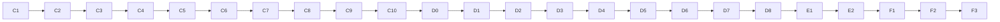

# Build Guide — GRAPH

## Replay and scenarios, the live attack graph, and the phone app

---

## 0. Document Control

| Field | Detail |
|---|---|
| **Document** | Build Guide for GRAPH |
| **Version** | 1.0 |
| **Date** | 8 October 2026 |
| **Follows** | Master Project Document, PRD v1.2, TRD v1.2, UI/UX Brief, LEAD-CORE Build Guide Part 1, DETECT Build Guide |
| **Delivered with this guide** | `graph-delivery.zip` (36 finished files, tested) |

---

## Naming Convention (Read This First)

The master document uses real names. **Every other project document, including this guide, uses the role-based aliases below.**

| Alias | Real Name | USN | Role |
|---|---|---|---|
| **LEAD-CORE** | Sagar R | 1DT24CS232 | Team lead — backend add-ons, Precog Engine, integration; the only person who merges code |
| **DETECT** | Neha | 1DT24CS174 | Flow feature preparation, ML detection, security event processing, ATT&CK correlation |
| **GRAPH** | Pallavi Bammanni | 1DT24CS185 | Data ingestion, simulation, attack graph, mobile web app (PWA) |
| **VIZ** | Preethi S Pujari | 1DT24CS195 | 3D visualization, charts, push notifications, containment |

**This guide is for GRAPH.** Where it says "you", it means GRAPH. "The lead" means LEAD-CORE.

---

## 1. What You Build

Your work has four parts. You can build and test all of them alone, without waiting for anyone.

| Part | What it is | Folder |
|---|---|---|
| **Replay and scenarios** | Scripted attacks (4 scenario files) and the **replay controller** that plays one: it writes packets into NIDS, calls NIDS's detector, hands the results to DETECT's code, and pauses at the moment the analyst must decide | `graph/graph_replay/` |
| **Live attack graph** | Keeps track of which of the 6 hosts are normal, compromised or contained, and which connections were seen. Also knows which hosts could reach which (built with the open-source `attackgraph` package) | `graph/graph_net/` |
| **Training routes** | A script that makes 300 repeatable attack routes. LEAD-CORE's Precog Engine learns from them | `graph/graph_replay/` and `graph/tools/` |
| **The phone app** | The installable web app screens: Home, Alerts, Alert detail, Forecast, History, with the Contain button | `web/src/areas/mobile/` |

**Your folders are `graph/` and `web/src/areas/mobile/`. You edit nothing else.**

### What the other roles expect from you (do not change these names)

| Who | What they use | Where it comes from |
|---|---|---|
| **LEAD-CORE's Precog Engine** | `graph.feasible_targets(host)`, `graph.topology.edge_probability(a, b)`, and the file `graph/graph_replay/training/sequences.json` | your `graph` hook and training file |
| **VIZ's containment** | `graph.set_host_state(host, "contained")` | your `graph` hook |
| **The web app routes** | the default export `MobileApp` | `web/src/areas/mobile/index.jsx` |
| **VIZ's console** | the named exports `SeverityBadge`, `StateChip`, `ForecastBars`, `OutcomeCard`, `AccuracyCounter`, `AttackPath2D` | `web/src/areas/mobile/index.jsx` |
| **The lead's backend** | `register(ctx)` in `graph_net` and `graph_replay` | your two packages |

### What you expect from the others

| From | What you call | When it is missing |
|---|---|---|
| **DETECT** (`events` hook) | `process_packets`, `process_technique`, `reset` | The replay refuses to start with a clear message ("the 'events' part has not been built yet") |
| **LEAD-CORE** (`precog` hook, Part 2) | `reset`, `on_compromise`, `on_attempt` | Optional. The replay works without it |
| **VIZ** (`usePushRegistration`) | Returns `{ status, enable }`, where `status` is `not_built`, `unsupported`, `prompt`, `enabled` or `denied` | The notification box on the Home screen stays hidden |

---

## 2. What Was Verified and What Was Not

I tested everything that can run in my own test environment (Linux, Python 3.11, Node 22).

| Verified by me | Result |
|---|---|
| Your 86 Python tests | Pass. One of them (the full golden path through NIDS's **real** detector and DETECT's **real** code) is skipped until DETECT's work is merged |
| Part 1 plus your work: `pytest` | **186 passed, 1 skipped**. With DETECT's work too: **259 passed** |
| Web tests: 44 (11 from the lead's files plus 33 of yours) and `npm run build` | Pass |
| `attackgraph` | **It is not on PyPI**, although its README says `pip install attackgraph`. It installs from GitHub at a pinned commit, through `graph/requirements.txt`. This was tested in a clean environment |
| The golden path | Scan, credential attack, compromise, decision point, **blocked** move, with a real NIDS detector flagging the packets and a real live graph |
| The no-containment path | The attacker succeeds, the web server becomes compromised |
| Timeout, cancel, expire, pause, resume, restart, stop and a crash inside another part | Each ends cleanly (tests cover each) |
| Every colour in the phone screens comes from a variable, never a colour code | Checked by an automatic test |

| **Not** verified by me | What to do |
|---|---|
| PowerShell commands on Windows | They are standard commands. If one fails use Section 12 and send me the exact error |
| Clicking through the phone screens in a real browser or on a real phone | I tested the logic and the rendered text, not the touch behaviour. Steps D7 and D8 are your check |
| The slide-to-confirm control by touch | Written with standard pointer events, a keyboard "Confirm" button is always there. Test it on a real phone (Step E2) |
| Installing `attackgraph` from GitHub on Windows | It needs Git (Step A1) and internet. It is pure Python |
| GitHub's, Antigravity's and Chrome's screens | Names may differ slightly. Look for the same idea |

---

## How to Read This Guide

1. Do the steps **in order, top to bottom**. Every step has an ID such as `C4`.
2. Boxes marked `powershell` are typed into **PowerShell**. Press Enter after each line.
3. Text after `#` in a command is a comment. Do not type it.
4. **You should see:** tells you what correct looks like. If you see something else, go to Section 12.
5. Every **code step** has the same parts:

| Part | Meaning |
|---|---|
| **WHERE** | The exact path of the file inside the repo |
| **WHAT** | One line on what the file does |
| **COPY** | The command that copies **my finished, tested file** into your repo |
| **PROMPT** | The detailed instruction to give Antigravity so it writes its own version |
| **COMPARE** | How to put my file and Antigravity's file side by side |
| **COMMIT** | The Git commands that save the step |

6. The delivered files must be unzipped so that `C:\graph-delivery\graph\graph_net\live_graph.py` exists. Every COPY command reads from `C:\graph-delivery\`.
7. **You start this guide only when the lead tells you the repository is ready and you have accepted the GitHub invitation.**

---

# PART A — Install the Tools (Windows)

Open PowerShell: **Start menu → type `PowerShell` → open "Windows PowerShell"** (a normal window, not "as administrator").

### A1 — Git

1. Open https://git-scm.com/download/win and click **64-bit Git for Windows Setup**. Run it, keep every default (**Next**, **Install**, **Finish**).
2. Close PowerShell, open it again:

```powershell
git --version   # prints the Git version
```

**You should see:** `git version 2.` and numbers. (Git is also needed to install `attackgraph` later.)

### A2 — Python 3.11.9

1. Open https://www.python.org/downloads/release/python-3119/ . Under **Files** click **Windows installer (64-bit)** (`python-3.11.9-amd64.exe`).
2. Run it. **Tick "Add python.exe to PATH"**, click **Install Now**, then **Close**.
3. Close PowerShell, open it again:

```powershell
py -3.11 --version   # asks the Windows Python launcher for 3.11
```

**You should see:** `Python 3.11.9`.

### A3 — Node.js (LTS)

1. Open https://nodejs.org and click the green **LTS** button. Run the file, keep every default.
2. Close PowerShell, open it again:

```powershell
node --version   # prints the Node version
npm --version    # prints the npm version
```

**You should see:** two version numbers.

### A4 — Antigravity

Open https://antigravity.google/download . Under **Antigravity IDE (Standalone)** click **Download for x64**. Run the installer (if Windows shows a blue warning: **More info → Run anyway**). Open it and sign in with your Google account.

### A5 — Allow scripts, and tell Git who you are

```powershell
Set-ExecutionPolicy -Scope CurrentUser -ExecutionPolicy RemoteSigned   # lets the Python environment script run (type Y if asked)
git config --global user.name "YOUR NAME"           # your real name between the quotes
git config --global user.email "you@example.com"    # the email you use for GitHub
git config --global init.defaultBranch main         # new repos start on main
```

### A6 — Unzip the delivered files

Right-click `graph-delivery.zip` → **Extract All** → extract to a new folder named exactly `C:\graph-delivery`.

```powershell
Test-Path C:\graph-delivery\graph\graph_net\live_graph.py   # asks "does this file exist?"
```

**You should see:** `True`. If `False`, move the `graph` and `web` folders up one level so they sit directly inside `C:\graph-delivery`.

---

# PART B — Get the Repository and Prepare

### B1 — Accept the invitation

Open the GitHub invitation email and accept it (you need a GitHub account: https://github.com/signup).

### B2 — Copy the repository to your laptop

The lead sends you the address, like `https://github.com/LEAD-USERNAME/precog-platform.git`.

```powershell
cd $HOME\Documents                                                    # go to your Documents folder
git clone https://github.com/LEAD-USERNAME/precog-platform.git        # replace LEAD-USERNAME; a sign-in window may open
cd precog-platform                                                    # go inside the new folder
```

### B3 — Open it in Antigravity

**File → Open Folder** → `Documents\precog-platform` → **Select Folder** (click **Yes, I trust** if asked). Then **Terminal → New Terminal** (it must say **PowerShell**). **Type every command in this terminal from now on.**

```powershell
pwd   # prints the folder you are in
```

**You should see:** a path ending in `precog-platform`.

### B4 — Create your own branch

```powershell
git switch -c graph          # creates your branch and moves you onto it
git push -u origin graph     # sends the empty branch to GitHub
git branch                   # a star marks the branch you are on
```

**You should see:** `* graph`. **Work only on `graph`. Never work on `main`.** (If the branch already exists use `git switch graph`.)

### B5 — Check the lead's base is there

```powershell
Test-Path lead-core\backend\run_app.py            # must print True
Test-Path lead-core\backend\nids\LICENSE          # must print True
Test-Path contracts\data\hosts.json               # must print True
Test-Path graph\requirements.txt                  # must print True (a short placeholder)
Test-Path web\src\areas\mobile\index.jsx          # must print True (a placeholder)
Test-Path web\src\shared\components.jsx           # must print True
```

If any line prints `False`, the lead has not merged the base yet. Tell the lead.

### B6 — The backend Python environment

```powershell
py -3.11 -m venv .venv                              # creates a private Python folder called .venv
.\.venv\Scripts\Activate.ps1                        # switches it on
pip install -r lead-core/backend/requirements.txt   # installs the backend libraries (a few minutes)
```

**You should see:** `(.venv)` at the start of the prompt and `Successfully installed` at the end. **Every new terminal needs the `Activate.ps1` line again.**

### B7 — Prove the base works before you add anything

```powershell
pytest   # runs the lead's tests
```

**You should see:** `101 passed`. If it differs, tell the lead and stop.

### B8 — The web environment

```powershell
cd web          # go into the web folder
npm ci          # installs the exact versions listed in package-lock.json (a minute or two)
npm test        # runs the lead's web tests
cd ..           # back to the repo root
```

**You should see:** `added` followed by a number of packages, then `# pass 11` and `# fail 0`.

---

# PART C — Replay, Scenarios and the Live Graph (Python)

### C0 — Before the first prompt: the context block and how to compare

**1. The context block.** In Antigravity's agent chat, start a **new conversation** and paste this once. Keep using the same conversation for Part C:

```text
CONTEXT (remember this for everything I ask next)
I am GRAPH in a team building the "Precog SOC Platform", a student cybersecurity project. Python 3.11 on Windows. Libraries allowed: the Python standard library, networkx, jsonschema, pytest, the open-source "attackgraph" package, and the project's own "addons" package. No other libraries.
Repo (root = precog-platform): contracts/data/hosts.json lists six demo hosts (host_id, name, zone, address); contracts/schemas/*.schema.json are data formats; lead-core/backend/addons/ has the shared WorldState and Hooks and addons.errors.HookError(code, message, status).
My folder is graph/ (packages graph_net and graph_replay, importable by those names). I may only create files inside graph/. I must NEVER edit anything outside graph/ except web/src/areas/mobile/ in Part D.
Rules for every file you write: plain readable Python with short docstrings and clear names; write the file ONLY to scratch-ai/<the same path as the real file>; do not touch any other file; do not add features I did not ask for.
```

**2. Make the scratch folder** (`scratch-ai/` is already listed in `.gitignore`, so it is never committed):

```powershell
New-Item -ItemType Directory -Force -Path scratch-ai | Out-Null   # the folder where Antigravity's versions go
```

**3. How to compare** (used in every code step):

*Method 1, side by side:* in the left file list right-click **my file** → **Select for Compare**, then right-click **the AI's file** inside `scratch-ai` → **Compare with Selected**. Red and green lines show differences.

*Method 2, in the terminal:*

```powershell
git diff --no-index scratch-ai\graph\graph_net\topology.py graph\graph_net\topology.py   # replace both paths with the two files
```

**4. Which one to keep?** Keep **mine** by default (copied and tested). To use the AI's version of a file, copy it over mine, then run the tests in Step C9. **If a test fails, copy mine back.** Never keep a version that fails the tests.

### C1 — Your library list (and the `attackgraph` surprise)

**WHERE:** `graph/requirements.txt`
**WHAT:** The libraries your part needs. The lead's backend list already reads this file, so one `pip install` installs everything.

**Important:** the `attackgraph` project's README says `pip install attackgraph`, but **that does not work: it is not on PyPI**. The line in my file installs it from GitHub at the exact version I tested. It needs Git (Step A1) and internet.

**COPY:**

```powershell
Copy-Item -Force C:\graph-delivery\graph\requirements.txt graph\requirements.txt   # replaces the placeholder
Get-Content graph\requirements.txt                                                  # shows it
pip install -r lead-core/backend/requirements.txt                                   # installs networkx and attackgraph
pip list | Select-String "attackgraph|networkx"                                     # confirms both are installed
```

**You should see:** two lines: `attackgraph 0.1.0` and `networkx 3.6.1`.

**PROMPT:** None for a library list. (If you want the AI's view, ask it only: "What does `attackgraph @ git+https://...@commit` mean in a requirements file?")

**COMMIT:**

```powershell
git add .
git commit -m "feat(graph): library list (networkx, attackgraph from GitHub)"   # saves the step
```

### C2 — The topology: who can reach whom

**WHERE:** `graph/graph_net/hosts_file.py`, `graph/graph_net/topology.py`, `graph/graph_net/data/topology.json`
**WHAT:** `hosts_file.py` reads the shared host list. `topology.json` says which host can connect to which and gives each host **simulated weaknesses**. Their ids start with `DEMO-` on purpose: they are invented for the simulation and are **not real CVEs**. `topology.py` builds the graph with `attackgraph` and answers questions such as "where can the attacker go from here?". If `attackgraph` is missing it quietly uses a plain networkx version (the fallback in the TRD).

**COPY:**

```powershell
New-Item -ItemType Directory -Force -Path graph\graph_net\data | Out-Null
foreach ($f in 'hosts_file','topology') { Copy-Item "C:\graph-delivery\graph\graph_net\$f.py" "graph\graph_net\$f.py" }
Copy-Item C:\graph-delivery\graph\graph_net\data\topology.json graph\graph_net\data\topology.json
```

**PROMPT 1 of 3 — hosts_file.py:**

```text
Write scratch-ai/graph/graph_net/hosts_file.py.
load_hosts(path) reads the JSON file {"hosts": [...]} (UTF-8) and returns the list. Raise ValueError if there is no non-empty "hosts" list; if a host lacks a non-empty host_id, name, zone or address; if a zone is not "user", "dmz" or "internal"; or if a host id or an address appears twice.
address_of(hosts, host_id) returns the host's address, or raises ValueError listing the known host ids.
```

**PROMPT 2 of 3 — topology.json:**

```text
Write scratch-ai/graph/graph_net/data/topology.json for the six hosts host-a, host-b, server-b, file-server, db-server, domain-controller.
"note": one sentence saying names, zones and addresses come from contracts/data/hosts.json and that the weakness ids start with DEMO- because they are invented, not real CVEs.
"feasible_connections" (one hop): host-a -> host-b, server-b, file-server; host-b -> host-a, server-b, file-server; server-b -> file-server, db-server; file-server -> db-server, domain-controller; db-server -> domain-controller; domain-controller -> nothing.
"assets": for each host a "services" list, a "criticality" (0 to 1) and "vulns" (each with id, cvss, service, description). Use: host-a and host-b: services ssh/22 and smb/445, criticality 0.3, one weakness DEMO-0001 / DEMO-0002 cvss 6.5 on ssh/22; server-b: http/80 and ssh/22, 0.7, DEMO-0003 cvss 9.8 on http/80; file-server: smb/445, 0.6, DEMO-0004 cvss 8.1; db-server: mysql/3306, 1.0, DEMO-0005 cvss 9.1; domain-controller: ldap/389 and smb/445, 1.0, DEMO-0006 cvss 7.5 on ldap/389. Every description starts with the word "Simulated".
```

**PROMPT 3 of 3 — topology.py:**

```text
Write scratch-ai/graph/graph_net/topology.py using networkx and the attackgraph package (from attackgraph import Asset, AttackGraphBuilder, Vulnerability; from attackgraph.models import AttackVector; from attackgraph.scoring import RiskScorer). If attackgraph cannot be imported, set HAVE_ATTACKGRAPH = False and use the fallback below.
class Topology(hosts, data, use_attackgraph=True): hosts is the list of host dicts, data the parsed topology.json. Raise ValueError for a connection or asset that mentions an unknown host, and for a host that connects to itself. self.engine is "attackgraph" when it is used (and available), otherwise "networkx-fallback".
With attackgraph: build one Asset per host (id, ip=address, hostname=name, services, criticality, network_zone=zone) with its Vulnerability objects (cve_id=id, cvss, affected_service, AttackVector.NETWORK, description), build the graph with AttackGraphBuilder(topology=<connections>, assets=...).build(), read each attack step's probability into a (source, target) table (keep the highest), and take the risk of each host from RiskScorer(graph).score_assets(). Fallback: the probability of a connection is the target's highest cvss divided by 10, and the risk is that cvss times the host's criticality. Every connection must end up with a probability.
class_methods from_files(hosts, topology_path, use_attackgraph=True). Methods: host_ids(); connections(host_id) (one-hop targets, ValueError for an unknown host); feasible_edges() (list of pairs); candidates(host_id, exclude=()) (one-hop targets without the excluded hosts); reachable_from(host_id) (sorted list); paths(source, target, limit=10) (feasible routes, shortest first); distance(source, target) (hops, or None when unreachable); edge_probability(source, target) (0 to 1; 0.0 for an unknown connection); risk(host_id) (a float).
```

**COMPARE:** Use the method in C0.

**COMMIT:**

```powershell
git add .
git commit -m "feat(graph): host list reader and topology built with attackgraph"
```

### C3 — The live graph

**WHERE:** `graph/graph_net/live_graph.py`, `graph/graph_net/__init__.py`
**WHAT:** `live_graph.py` is the picture of the attack right now: each host is `normal`, `compromised` or `contained`, plus the connections seen and the ordered path of compromised hosts. Every change is copied to the shared world state, so both apps see it on their next refresh. `__init__.py` plugs it into the backend as the `graph` hook.

**The rules the tests check:**

| Situation | Result |
|---|---|
| A normal host is compromised | It joins the path, in order |
| A contained host is "compromised" | **Nothing happens**: it stays contained |
| The attacker moves **to** a contained host | **Blocked**: no connection is recorded |
| The attacker moves **from** a contained host | **Blocked** too: the attacker has lost it |
| The attacker moves to a normal host | **Success**: the connection is recorded and the host becomes compromised |

**COPY:**

```powershell
foreach ($f in 'live_graph','__init__') { Copy-Item -Force "C:\graph-delivery\graph\graph_net\$f.py" "graph\graph_net\$f.py" }
```

**PROMPT 1 of 2 — live_graph.py:**

```text
Write scratch-ai/graph/graph_net/live_graph.py.
STATES = ("normal","compromised","contained"). utc_now() -> "YYYY-MM-DDTHH:MM:SSZ".
class LiveGraph(topology, world=None, clock=utc_now): thread-safe (an RLock). Every change is copied to the shared world with world.set_graph(self.snapshot()) when a world is given.
snapshot() -> {"hosts": [{"host_id","name","zone","state"} for each host in order], "edges": [{"from_host","to_host","first_seen"}], "compromised_path": [host ids in the order they were compromised]} (names and zones come from topology.hosts).
host_state(host_id), states() (a copy of the dict), feasible_targets(host_id) = topology.candidates(host_id) without every host that is not normal. ValueError for an unknown host (the message lists the known hosts).
reset() (all normal, no edges, empty path). add_connection(src, dst): ignore a host connecting to itself (return False); record only the FIRST sighting with its time; return True when new. mark_compromised(host): only a normal host changes (state compromised, appended to the path) and returns True; any other state returns False. set_host_state(host, state) (ValueError for a state not in STATES; setting compromised also adds the host to the path if missing). attempt(from_host, to_host) -> {"result": "blocked"|"success", "from_host", "to_host"}: blocked when the target OR the source is contained (nothing recorded); otherwise record the connection, mark the target compromised and answer success.
```

**PROMPT 2 of 2 — graph_net/__init__.py:**

```text
Write scratch-ai/graph/graph_net/__init__.py. A module docstring listing the methods of the "graph" hook: snapshot(), reset(), add_connection(src,dst), mark_compromised(host), set_host_state(host,state), host_state(host), attempt(from_host,to_host), feasible_targets(host), and the attribute topology.
Export register, LiveGraph, Topology, load_hosts, address_of and TOPOLOGY_FILE (data/topology.json next to the file). def register(ctx): load the hosts from <ctx.config.contracts_dir>/data/hosts.json, build the Topology and a LiveGraph(topology, world=ctx.world), register it with ctx.hooks.register("graph", graph), log how many hosts and which engine, and ONLY when ctx.config.data_mode == "live" publish the empty graph with ctx.world.set_graph(graph.snapshot()) (sample mode keeps the sample graph).
```

**COMPARE:** Use the method in C0.

**COMMIT:**

```powershell
git add .
git commit -m "feat(graph): live attack graph and the graph hook"
```

### C4 — Scenarios

**WHERE:** `graph/graph_replay/schemas/scenario.schema.json`, `graph/graph_replay/scenario.py`, `graph/graph_replay/scenarios/` (4 files)
**WHAT:** A scenario is a JSON file: an ordered list of events with times. There are three kinds:

| Kind | Meaning |
|---|---|
| `traffic` | Packets between hosts (written into NIDS's table and checked by NIDS's detector) |
| `technique` | A scripted attack step such as "T1110 Brute Force on host-a". `compromise: true` means the host is now compromised |
| `attempt` | The attacker tries to move from one host to another. It succeeds unless the target is contained |

Any event can carry `pause_for_decision: true`: the replay stops **before** it and waits for the analyst.

| Scenario file | Story |
|---|---|
| `golden-path` | The rehearsed demo: scan, attack packets, credential attack compromises Workstation A, a move toward the web server (decision point), data-exfiltration attempt |
| `lateral-spread` | From Workstation A to the file server (decision point) and on to the database |
| `quiet-scan` | Only a scan: nobody is compromised, so Precog has nothing to forecast |
| `direct-hit` | The web server is compromised first; the attacker heads for the database (decision point) and the domain controller |

**Attack packets use the ports NIDS already treats as suspicious (22, 445, 4444 ...)**, so NIDS's real detector flags them.

**COPY:**

```powershell
New-Item -ItemType Directory -Force -Path graph\graph_replay\schemas, graph\graph_replay\scenarios | Out-Null
Copy-Item C:\graph-delivery\graph\graph_replay\schemas\scenario.schema.json graph\graph_replay\schemas\scenario.schema.json
Copy-Item C:\graph-delivery\graph\graph_replay\scenario.py graph\graph_replay\scenario.py
Copy-Item C:\graph-delivery\graph\graph_replay\scenarios\*.json graph\graph_replay\scenarios\
(Get-ChildItem graph\graph_replay\scenarios).Count   # counts the scenario files
```

**You should see:** `4`.

**PROMPT 1 of 3 — scenario.schema.json:**

```text
Write scratch-ai/graph/graph_replay/schemas/scenario.schema.json, a JSON Schema (draft 2020-12, additionalProperties false everywhere): a scenario has scenario_id (lowercase letters, digits and hyphens, starting with a letter or digit), description (non-empty text) and events (at least one).
Every event has seq (integer from 1), offset_ms (integer from 0), optional pause_for_decision (boolean) and a "kind" which is exactly one of:
technique: host (non-empty text), technique_id (the pattern T followed by 4 digits, optionally a dot and 3 digits), optional note (text), optional compromise (boolean).
traffic: packets (at least one), each with src_host, dst_host (non-empty text), protocol (TCP, UDP or ICMP), dst_port (0 to 65535), size (1 to 65535), optional src_port (0 to 65535), optional flags (text), optional repeat (1 to 50).
attempt: from_host, to_host (non-empty text), technique_id (same pattern), optional note.
```

**PROMPT 2 of 3 — scenario.py:**

```text
Write scratch-ai/graph/graph_replay/scenario.py using jsonschema Draft202012Validator and the schema file next to it.
class ScenarioError(ValueError). check_scenario(data, known_hosts=None, name="scenario") -> data: first validate against the schema (the error message says the file name, the problem and where); then check that seq goes strictly up, offset_ms never goes down, an attempt never moves from a host to itself, no traffic packet goes from a host to itself, and (when known_hosts is given) every host mentioned exists (the message lists the known hosts).
load_scenario(path, known_hosts=None): read the file as UTF-8 JSON (a broken file raises ScenarioError naming the file) and check it.
class ScenarioLibrary(folder=<the scenarios folder next to this file>, known_hosts=None): loads every *.json, refuses duplicate scenario ids and a file name that does not match its scenario_id. Methods ids(), get(scenario_id) (None if unknown) and summaries() -> [{"scenario_id","description","events": count,"has_decision_point": any pause_for_decision}].
```

**PROMPT 3 of 3 — the four scenario files:**

```text
Write scratch-ai/graph/graph_replay/scenarios/golden-path.json, lateral-spread.json, quiet-scan.json and direct-hit.json following the schema.
golden-path: (1) t=0 technique host-a T1046 "Scan of the user network"; (2) t=1500 traffic host-a to host-b TCP port 22 size 800 flags S repeat 3, and host-a to server-b TCP port 445 size 600 flags S repeat 2; (3) t=3000 technique host-a T1110 compromise true, note "Repeated failed logins, then a successful one"; (4) t=4500 attempt host-a to server-b T1021.004 pause_for_decision true, note "The attacker tries to move to the web server"; (5) t=6500 technique host-a T1048 "The attacker tries to send data out".
lateral-spread: host-a T1110 compromise at 0; attempt host-a to file-server T1021.002 at 2000 with pause_for_decision; traffic file-server to db-server TCP 4444 size 1200 at 4000; attempt file-server to db-server T1021 at 5000; technique db-server T1005 "Data is copied from the database" at 6500.
quiet-scan: technique host-b T1046 at 0; traffic host-b to host-a TCP 22 (repeat 2) and host-b to file-server TCP 80 at 1500; technique host-b T1018 at 3000. Nobody is compromised.
direct-hit: technique server-b T1190 compromise true at 0; attempt server-b to db-server T1021 at 2000 with pause_for_decision; attempt db-server to domain-controller T1021 at 4000.
Each file's name matches its scenario_id and has a one-sentence description.
```

**COMPARE:** Use the method in C0.

**Check every scenario with the checker once the tools are in place (Step C8).**

**COMMIT:**

```powershell
git add .
git commit -m "feat(graph): scenario format, checker and four scenarios"
```

### C5 — Writing packets

**WHERE:** `graph/graph_replay/packet_store.py`
**WHAT:** Where replayed packets go. `NidsPacketStore` writes into NIDS's own packets table **unlabelled** (NIDS's detector fills in the severity). `MemoryPacketStore` does the same in memory for tests and the demo, with a tiny stand-in detector `simple_detector`.

**COPY:**

```powershell
Copy-Item C:\graph-delivery\graph\graph_replay\packet_store.py graph\graph_replay\packet_store.py
```

**PROMPT:**

```text
Write scratch-ai/graph/graph_replay/packet_store.py.
PACKET_FIELDS = id, timestamp, src_ip, dst_ip, protocol, src_port, dst_port, packet_size, flags, anomaly, risk_score, suspicious_port, alert, severity. SUSPICIOUS_PORTS = {22, 23, 3389, 445, 135, 137, 138, 139, 4444, 6666, 31337}.
class NidsPacketStore(nids): nids has SessionLocal and Packet (NIDS's database objects). insert(rows) writes one Packet per row (src_ip, dst_ip, protocol, src_port, dst_port, packet_size, flags) with timestamp = the current UTC time without a zone, UNLABELLED, commits and returns the new ids in order; fetch(ids) returns dicts of PACKET_FIELDS in id order; clear() deletes every packet. Always close the database session.
class MemoryPacketStore: the same three methods (ids start at 1 and restart after clear; timestamp as "YYYY-MM-DD HH:MM:SS"), thread-safe, plus all() returning copies.
simple_detector(store) returns a function that labels every unlabelled row in the memory store: HIGH, alert true, suspicious_port true and risk_score 80.0 when the destination port is in SUSPICIOUS_PORTS, otherwise NORMAL and 10.0; anomaly 1 either way. (It stands in for NIDS's real detector in tests and the demo.)
```

**COMPARE:** Use the method in C0.

**COMMIT:**

```powershell
git add .
git commit -m "feat(graph): packet stores for NIDS and for tests"
```

### C6 — The replay controller

**WHERE:** `graph/graph_replay/controller.py`
**WHAT:** The heart of your work. It plays a scenario on a background thread:

| Event | What the controller does |
|---|---|
| `traffic` | Writes the packets, calls NIDS's detector **immediately** (no 30-second wait), gives the labelled packets to DETECT's `process_packets`, records the connections in the live graph |
| `technique` | Gives it to DETECT's `process_technique`. If it says `compromise`, marks the host compromised and tells Precog |
| `attempt` | Asks the live graph. A contained target (or source) means **blocked**. It always becomes a readable alert ("The move toward Web Server B was blocked.") and Precog is told. A success also compromises the new host |
| `pause_for_decision` | Stops **before** the event. It continues when a containment is executed, cancelled or expired, when someone calls `resume`, or after the decision time runs out (default 120 seconds, `REPLAY_DECISION_TIMEOUT`; 0 = wait forever). After an executed containment it waits 1.5 seconds so the audience sees the containment first |

It also keeps the session record, archives it when the replay ends, and **never hangs**: a bug in another part ends the replay with a reason (`last_error`) instead of freezing the demo.

**COPY:**

```powershell
Copy-Item C:\graph-delivery\graph\graph_replay\controller.py graph\graph_replay\controller.py
```

**PROMPT:**

```text
Write scratch-ai/graph/graph_replay/controller.py: class ReplayController(world, hooks, store, detector, library, hosts, decision_timeout=120.0, settle_seconds=1.5) using threading. world is the shared WorldState; hooks the Hooks object (hooks.get(name), hooks.has(name)); store a packet store; detector a function that labels unlabelled packets; library a ScenarioLibrary; hosts a list of host dicts (host_id, name, address). Errors are addons.errors.HookError(code, message, status).
The hook methods: list_scenarios() (library.summaries()); status() -> copy of {"state","scenario_id","speed","position"} where state is idle, running, paused, waiting_for_decision or finished and position is how many events are done; start(scenario_id, speed=1.0): unknown scenario -> HookError 404 listing the available ones; speed not above 0 -> 400; already running, paused or waiting -> 409 "replay_busy"; the "events" or "graph" hook missing -> 501 "not_built" naming it; otherwise reset everything and begin; pause() (409 if not running); resume() (from paused to running, or from waiting_for_decision a manual go-ahead, otherwise 409); restart() (409 if nothing was ever started; otherwise stop and start the same scenario at the same speed). Extra, not hook methods: stop(timeout) (end the thread, state idle) and wait_until_done(timeout) (True when finished or idle), and attributes last_error and last_decision.
Beginning a replay: world.reset(), store.clear(), hooks "events".reset(), "graph".reset(), "precog".reset() if that hook exists, make a session record {"session_id": "ses-000001" counting up, "scenario_id","started_at","ended_at": None,"forecasts": [],"actions": []} with world.set_session, then run the events on a daemon thread. Every status change is copied to world.set_replay(status).
Timing: wait (offset_ms difference / 1000 / speed) seconds between events in steps of 0.05 s using a Condition, honouring stop, and time spent paused does not count.
Decision point (an event with pause_for_decision): remember the current action statuses, set state waiting_for_decision, and wait until: resume() was called ("manual"), or any containment action has newly become executed, cancelled or expired ("executed", "cancelled", "expired"), or decision_timeout seconds passed ("timeout", when decision_timeout > 0). Store the reason in last_decision, set state running, and when the reason was "executed" wait settle_seconds more. Stop ends the wait.
Events: traffic -> for each packet (repeat times; src_port default 40000 + index) build rows with the hosts' addresses, store.insert, call detector(), hooks "events".process_packets(store.fetch(ids)), then graph.add_connection(src, dst) for each packet. technique -> hooks "events".process_technique(host, technique_id, note=note, compromise=compromise); if compromise and graph.mark_compromised(host) is True then hooks "precog".on_compromise(host) when that hook exists. attempt -> outcome = graph.attempt(from, to); blocked = outcome result is "blocked"; make a note from the event's note plus "The move toward <target NAME> was blocked." or "... succeeded."; hooks "events".process_technique(from_host, technique_id, note=note); then precog.on_attempt(from, to, blocked) and, if not blocked, precog.on_compromise(to) (precog is optional).
After the last event: set the session's ended_at, forecasts = world.forecasts(), actions = world.actions(), world.set_session, world.archive_session(), state finished. Any exception inside the thread is logged, stored as last_error ("<Type>: <message>") and ends the replay as finished.
```

**COMPARE:** Use the method in C0.

**COMMIT:**

```powershell
git add .
git commit -m "feat(graph): replay controller with decision points"
```

### C7 — Training routes, stand-ins and the package file

**WHERE:** `graph/graph_replay/generator.py`, `graph/graph_replay/training/sequences.json`, `graph/graph_replay/standins.py`, `graph/graph_replay/__init__.py`
**WHAT:**

| File | What it does |
|---|---|
| `generator.py` | Makes repeatable attack routes over the demo network, in four attacker styles: **opportunist** (goes for the easiest target), **data-hunter** (heads for the database), **domain-chaser** (heads for the domain controller), **wanderer** (random). The same seed gives the same routes |
| `training/sequences.json` | 300 routes made with seed 0. **LEAD-CORE's Precog Engine learns from this file.** A test proves it is exactly what the generator makes |
| `standins.py` | Small fake versions of DETECT's `events` hook and Precog, used **only** by your tests and demo. Never registered in the real backend |
| `__init__.py` | Plugs the controller into the backend as the `replay` hook |

**Why this makes the demo forecast sensible:** from Workstation A, the web server is the most common first move in the training routes (98 of 300; the file server 79; Workstation B 37), so Precog can rank it first. Other moves still happen, so a forecast can also be wrong. That is on purpose.

**COPY:**

```powershell
New-Item -ItemType Directory -Force -Path graph\graph_replay\training | Out-Null
foreach ($f in 'generator','standins','__init__') { Copy-Item -Force "C:\graph-delivery\graph\graph_replay\$f.py" "graph\graph_replay\$f.py" }
Copy-Item C:\graph-delivery\graph\graph_replay\training\sequences.json graph\graph_replay\training\sequences.json
```

**PROMPT 1 of 3 — generator.py:**

```text
Write scratch-ai/graph/graph_replay/generator.py. PROFILES = ("opportunist","data-hunter","domain-chaser","wanderer"); ENTRY_WEIGHTS = host-a 0.7, host-b 0.3; MAX_HOSTS = 6; STOP_CHANCE = 0.15.
generate_sequences(topology, count=300, seed=0) -> {"seed","count","generator": "graph_replay.generator v1","profiles": list,"sequences": [{"profile","path": [host ids]}]} using random.Random(seed) so the same seed gives the same result. Sequence number i uses profile PROFILES[i % 4] (an even mix). The start host is chosen by ENTRY_WEIGHTS. Then repeat: candidates = topology.candidates(here, exclude=path); stop if none or if the path has at least 2 hosts and a random number is below STOP_CHANCE; stop at MAX_HOSTS. A host never appears twice.
Choosing the next host: wanderer -> a random candidate. data-hunter / domain-chaser -> with probability 0.7 take the candidate nearest (topology.distance) to db-server / domain-controller (ties go to the higher topology.edge_probability, then the name); otherwise, and for the opportunist, choose by weight = max(topology.edge_probability(here, candidate), 0.01).
```

**PROMPT 2 of 3 — standins.py:**

```text
Write scratch-ai/graph/graph_replay/standins.py: two small fakes for tests and the demo only (say so in the docstring).
StandInEvents(world=None): behaves like the "events" hook: process_packets(rows) (remembers the batch in packet_batches; for each row whose severity is HIGH, MEDIUM or LOW makes a security_event dict following contracts/schemas/security_event.schema.json with host = the row's src_ip, source "nids_detector", packet_id = the row id, shows it with world.add_alert and returns the list); process_technique(host, technique_id, note=None, compromise=False, severity="HIGH", risk_score=None) (remembers it in techniques, makes and shows a scripted event whose explanation is the note or "Technique <id>."); audit_record(...) returns None; reset() restarts the numbering evt-000001 and clears what it remembered. Thread-safe.
StandInPrecog: reset(), on_compromise(host) and on_attempt(from_host, to_host, blocked) only append what they were told to the list "calls" (as ("compromise", host) and ("attempt", from, to, blocked)).
```

**PROMPT 3 of 3 — graph_replay/__init__.py:**

```text
Write scratch-ai/graph/graph_replay/__init__.py. Docstring listing the replay hook methods (list_scenarios, status, start, pause, resume, restart) and the hooks the replay calls while it plays (events, graph, and the optional precog).
Export register, ReplayController, ScenarioLibrary, ScenarioError, check_scenario, load_scenario, generate_sequences, MemoryPacketStore, NidsPacketStore, simple_detector, SCENARIOS_DIR and TRAINING_FILE (training/sequences.json next to the file).
def register(ctx): load the hosts with graph_net.hosts_file.load_hosts(<contracts_dir>/data/hosts.json); build the ScenarioLibrary with the known host ids; raise RuntimeError("The replay needs NIDS's database ...") if ctx.nids has no SessionLocal; read REPLAY_DECISION_TIMEOUT from the environment (default 120, seconds, 0 = wait for the analyst forever); the detector is NIDS's own run_detection imported from ml.anomaly_detector; build the ReplayController with NidsPacketStore(ctx.nids) and register it with ctx.hooks.register("replay", controller).
```

**COMPARE:** Use the method in C0.

**CHECK THE TRAINING FILE** (it must be exactly what the generator makes):

```powershell
python graph\tools\generate_sequences.py --out $HOME\Downloads\sequences-check.json   # you will copy this tool in Step C8; run this check after it
```

**COMMIT:**

```powershell
git add .
git commit -m "feat(graph): training routes, stand-ins and the replay hook"
```

### C8 — The three tools (see it work)

**WHERE:** `graph/tools/generate_sequences.py`, `validate_scenarios.py`, `demo_replay.py`
**WHAT:**

| Tool | What it does |
|---|---|
| `validate_scenarios.py` | Checks every scenario file: format, host names, order. If DETECT's code is merged it also checks every technique id against DETECT's table |
| `generate_sequences.py` | Rebuilds `training/sequences.json` (options: `--count 300 --seed 0 --out PATH`) |
| `demo_replay.py` | **Plays a scenario with no server and no database**, using the real live graph, scenarios and controller, with stand-ins for DETECT and NIDS's detector. `--no-contain` lets the attacker succeed |

**COPY:**

```powershell
New-Item -ItemType Directory -Force -Path graph\tools | Out-Null
Copy-Item C:\graph-delivery\graph\tools\*.py graph\tools\   # copies the three tools
python graph\tools\validate_scenarios.py                    # checks the four scenarios
python graph\tools\demo_replay.py                           # plays the golden path with a containment
```

**You should see** for the validator:

```text
ok    direct-hit.json    3 events
ok    golden-path.json   5 events
ok    lateral-spread.json 5 events
ok    quiet-scan.json    3 events
all scenarios OK (technique ids not checked: DETECT's package is not merged yet)
```

(the last words change once DETECT is merged), and for the demo (the middle lines scroll by; this is the end of it):

```text
  -> the replay is waiting for the analyst's decision
  -> the analyst contained the predicted host

Alerts the analyst would see (oldest first):
  evt-000001  HIGH   host-a     Scan of the user network
  ... five alerts for the attack packets ...
  evt-000007  HIGH   host-a     Repeated failed logins, then a successful one
  evt-000008  HIGH   host-a     The attacker tries to move to the web server. The move toward Web Server B was blocked
  evt-000009  HIGH   host-a     The attacker tries to send data out

Host states at the end:
  host-a             compromised
  host-b             normal
  server-b           contained
  file-server        normal
  db-server          normal
  domain-controller  normal
Compromised path: host-a
Precog was told: [('compromise', 'host-a'), ('attempt', 'host-a', 'server-b', True)]
Replay finished: finished | sessions in history: 1
```

Now run it the other way:

```powershell
python graph\tools\demo_replay.py --no-contain   # lets the attacker succeed
```

**You should see:** "The move toward Web Server B succeeded.", `Compromised path: host-a -> server-b`, and Precog told `('attempt', 'host-a', 'server-b', False)` and `('compromise', 'server-b')`.

**PROMPT** (one prompt for the three tools):

```text
Write scratch-ai/graph/tools/validate_scenarios.py, generate_sequences.py and demo_replay.py. Each adds <repo>/graph and <repo>/lead-core/backend (and, for the validator, <repo>/detect) to sys.path, and is run from the repo root.
validate_scenarios.py: loads contracts/data/hosts.json, then every scenarios/*.json with load_scenario (known hosts given); prints "ok    <file>  <n> events" or "BAD   <message>"; if DETECT's real package can be imported (detect_events with TechniqueTable and TECHNIQUES_FILE) also checks every technique_id of technique and attempt events against its table; ends with "all scenarios OK" (adding "(technique ids not checked: DETECT's package is not merged yet)" when it could not check) or "<n> problem(s)", exit code 1 on problems.
generate_sequences.py: options --count 300, --seed 0, --out (default training/sequences.json); builds the Topology, calls generate_sequences, writes the JSON (indent 1, trailing newline), prints how many were written with the seed and the engine, and the counts of the attacker's first move from host-a.
demo_replay.py: options --scenario golden-path and --no-contain. Builds a Contracts-checked WorldState, the real LiveGraph, StandInEvents and StandInPrecog registered in a Hooks object, a MemoryPacketStore with simple_detector and a ReplayController with decision_timeout 20 and settle_seconds 0.2; starts the scenario at speed 20; when the replay waits for a decision it pauses half a second, then (default) sets the predicted host to contained in the graph and records an executed containment action, or (with --no-contain) calls resume(); prints a line for each of those events; at the end prints the alerts oldest first, the host states, the compromised path, what Precog was told, and the final replay state with the number of sessions in history; exit code 1 if the controller had an error.
```

**COMPARE:** Use the method in C0.

**COMMIT:**

```powershell
git add .
git commit -m "feat(graph): validator, training generator and demo tools"
```

### C9 — The Python tests

**WHERE:** `graph/tests/` (7 files: `conftest.py`, `graph_helpers.py`, `test_graph_topology_and_live_graph.py`, `test_graph_scenarios_and_generator.py`, `test_graph_replay_controller.py`, `test_graph_register_and_e2e.py`, `test_graph_tools.py`)
**WHAT:** 86 automatic tests. They cover the host list, the topology (with and without `attackgraph`), every rule of the live graph (including threads), every scenario rule and the four shipped scenarios, the generator (repeatable, only feasible steps, the web server is the most common first move), the controller (golden path with and without containment, cancelled, expired and timed-out decisions, pause, resume, restart, stop, crash handling, session record), your packages through the real add-on loader, the tools, and one test that runs the **whole golden path through NIDS's real detector**.

**COPY:**

```powershell
Copy-Item -Force C:\graph-delivery\graph\tests\*.py graph\tests\   # copies the six test files
(Get-ChildItem graph\tests -Filter *.py).Count                     # counts them
```

**You should see:** `7`.

**PROMPT** (one prompt for all test files):

```text
Write pytest files in scratch-ai/graph/tests/ for the graph_net and graph_replay packages described in the CONTEXT.
graph_helpers.py (a UNIQUE file name, because another role's tests also have a conftest.py and two modules with the same name would clash): set DATABASE_URL to a temporary SQLite file if it is not set; put <repo>/lead-core/backend, graph, detect and lead-core/backend/nids on sys.path; define REPO_ROOT and a Rig class wiring Hooks with StandInEvents, the graph, StandInPrecog, a MemoryPacketStore, a counting simple_detector and a ReplayController (decision_timeout 5, settle 0) with helpers wait_for(state) and contain(host_id, status="executed") that sets the host contained and records a containment action in the world. Test files import REPO_ROOT and Rig from graph_helpers, never from conftest.
conftest.py: imports graph_helpers first, then defines the fixtures contracts, hosts, topology (session scope), world, graph (LiveGraph on the world), library (ScenarioLibrary with the known hosts) and rig (a Rig that is stopped after each test).
test_graph_topology_and_live_graph.py: the host file (six hosts, address_of, bad files refused); the topology (attackgraph is the engine, connections and candidates, reachability, paths and distance, exploit likelihood follows the simulated weakness, risk, weakness ids start with DEMO-, the networkx fallback gives the same connections, a missing library selects the fallback, unknown hosts refused); the live graph (new graph valid, connections recorded once, no self-connection, compromise order, a contained host cannot be compromised, attempt success / blocked to a contained target / blocked from a contained source, feasible targets, bad states, every change reaches the world, reset, 8 threads).
test_graph_scenarios_and_generator.py: four scenarios ship, names match ids, the golden path shape, summaries, attack packets use NIDS's suspicious ports, bad scenarios refused with useful messages, ordering rules, unknown hosts, moves to oneself, broken JSON, library refuses mismatches; the generator is repeatable, follows feasible connections without repeating a host, even mix of the four styles, the web server is the most common first move from host-a (and at least 3 different first moves occur), and the shipped training file equals what the generator makes.
test_graph_replay_controller.py: start errors (unknown scenario 404, bad speed 400, missing parts 501, busy 409); the golden path with containment (states, path, precog calls, blocked alert naming Web Server B), without (success, precog calls), cancelled and expired decisions, a timeout, waiting happens BEFORE the decision event, traffic written/detected/handed over/recorded, techniques reach the events part, precog told before the decision, session recorded and archived, world state follows, quiet-scan, lateral-spread, direct-hit, pause/resume, controls that do nothing give 409, restart, stop, a crash in another part ends the replay with a reason, precog is optional, session numbers count up.
test_graph_register_and_e2e.py: registering through the real register_addons (replay reports a clear error without NIDS; live mode publishes the empty graph and sample mode keeps the sample); with the real NIDS tables and a trained NIDS model, the replay hook lists the four scenarios; and (skipped unless DETECT's real package exists) the whole golden path: NIDS's real detector flags the packets HIGH, DETECT's port hints appear, the scripted compromise appears, the containment makes the move blocked, the session is archived.
test_graph_tools.py: validate_scenarios prints all scenarios OK; demo_replay with and without containment; generate_sequences writes the same content as the shipped file.
```

**COMPARE:** Use the method in C0. Test files only matter if they **pass**, so the real comparison is the next step.

**RUN THEM:**

```powershell
pytest graph/tests   # runs only your tests
pytest               # runs everything: the lead's tests and yours
```

**You should see:** first `85 passed, 1 skipped` (the skipped one needs DETECT's merged work), then `186 passed, 1 skipped` (or `259 passed` if the lead has already merged DETECT's work).

If you see a failure, copy the whole red message and go to Section 12.

**COMMIT:**

```powershell
git add .
git commit -m "test(graph): 86 tests for the graph, the replay and the tools"
```

### C10 — See your hooks inside the real backend

1. Create your settings file (the same as the lead did), if you do not have one:

```powershell
Copy-Item .env.example .env                                   # your own settings file (never committed)
python -c "import secrets; print(secrets.token_hex(32))"      # prints a long random text; select and copy it
```

2. Open `.env`. After `SECRET_KEY=` paste the text. After `ADMIN_PASSWORD=` type a password you invent (8 characters or more). Change `DATA_MODE=sample` to `DATA_MODE=live`. Save with **Ctrl+S**.

```powershell
git check-ignore -v .env              # must print a line containing .gitignore and .env
python lead-core/backend/run_app.py   # starts the backend (the first start trains NIDS's model, about 10 seconds)
```

3. In the browser open http://127.0.0.1:5000/api/x/health

**You should see:** JSON where `"hooks"` includes `"graph"` and `"replay"` and `"modules"` shows `"graph_net":"registered"` and `"graph_replay":"registered"`.

4. Stop the backend with **Ctrl+C** in the terminal.

---

# PART D — The Phone App

**What this part builds:** the installable app's screens, exactly as the UI/UX Brief describes them (Sections 6 and 8). Read Sections 3, 4, 6 and 8 of that brief first.

### D0 — The web context block

Start a **new conversation** in Antigravity's agent chat and paste this once:

```text
CONTEXT (remember this for everything I ask next)
I am GRAPH in a team building the "Precog SOC Platform". This part is the phone app: React 18 with Vite, plain JavaScript (no TypeScript), react-router-dom 6, no UI library, no other libraries. The built app is served at /app/ so the router's basename is "/app"; the phone screens live under /mobile.
My folder is web/src/areas/mobile/ and I may only create files there. I may IMPORT (never edit) web/src/shared/api.js (the "api" object with proposeContainment(targetHost, forecastId, requestedBy), confirmContainment(actionId), cancelContainment(actionId), sessions(), forecasts(), state(since), precogMetrics()), shared/usePolling.js (useWorldState() returning {state, stale, loggedOut}), shared/components.jsx (SimulationBadge, StaleBanner, EmptyState, LoadingState, ToastProvider, useToast), ../charts/index.jsx (ForecastAccuracyChart({metrics}), AlertVolumeChart({alerts})) and ../push/index.jsx (usePushRegistration() returning {status, enable}).
"state" is the world state the backend sends: {version, changed, graph: {hosts:[{host_id,name,zone,state}], edges, compromised_path}, alerts:[security_event], forecast: forecast or null, actions, replay, metrics}.
Rules: NO colour codes anywhere (no #rrggbb, no rgb()): only CSS variables from web/src/shared/theme.css such as var(--forecast) or var(--text-muted); every colour is paired with an icon and a word; text 16px or larger; touch targets at least 44px; the UI/UX brief's wording is used exactly; write each file ONLY to scratch-ai/web/src/areas/mobile/<file name>; do not add features I did not ask for.
```

### D1 — logic.js and its tests

**WHERE:** `web/src/areas/mobile/logic.js`, `logic.test.js`
**WHAT:** All the decisions of the phone app as plain functions, so they can be tested without a screen: the four-level **threat rule** (Calm, Watching, Under attack, Contained), host names from ids, the Top-3 rows and percentages, times, the wording of a resolved forecast (hit, **blocked hit**, miss), and the **containment state machine** (idle, proposing, confirming, sending, done, with the 60-second expiry, cancel and errors).

**COPY:**

```powershell
cd web\src\areas\mobile                                                  # go into your area (one command, then back at the end)
Copy-Item C:\graph-delivery\web\src\areas\mobile\logic.js logic.js
Copy-Item C:\graph-delivery\web\src\areas\mobile\logic.test.js logic.test.js
cd ..\..\..\..                                                           # back to the repo root
```

**PROMPT 1 of 2 — logic.js:**

```text
Write scratch-ai/web/src/areas/mobile/logic.js: pure functions, no React.
SEVERITY: HIGH {word "High", icon "▲", color "var(--severity-high)"}, MEDIUM {"Medium","◆","var(--severity-medium)"}, LOW {"Low","●","var(--severity-low)"}; HOST_STATE: normal {"Normal","○","var(--state-normal)"}, compromised {"Compromised","⬣","var(--state-compromised)"}, contained {"Contained","⛨","var(--state-contained)"}. severityMeta(severity) (unknown gives word "Unrated"), hostStateMeta(state).
hostName(state, hostId) (the name from state.graph.hosts; unknown ids and a missing state come back unchanged), hostState(state, hostId) (default "normal").
threatLevel(state) -> null when there is no state; otherwise {key, word, icon, color, caption}: key "attack" ("Under attack", icon ⬣, var(--severity-critical)) when any host is compromised; else "contained" ("Contained", ⛨, var(--state-contained)) when any host is contained; else "watching" ("Watching", ◆, var(--severity-medium)) when there are alerts; else "calm" ("Calm", ○, var(--severity-low)). Caption: "N host(s) compromised" and "1 forecast pending" (when state.forecast.status is pending) joined by ", "; if empty then "N host(s) contained", then "N alert(s)", then "No alerts yet".
formatTime(ts, timeZone) -> "HH:MM:SS" (en-GB, 24 hour) where a time without a zone such as "2026-10-03 10:00:01" counts as UTC; empty input gives ""; unreadable text comes back unchanged. percent(confidence) rounds confidence times 100.
forecastRows(state) -> [{rank, hostId, name, percent}] from state.forecast.targets ([] when none). mitreUrl(techniqueId) -> https://attack.mitre.org/techniques/T1110/ (a sub-technique uses a slash: T1021.004 becomes T1021/004), null for nothing. filterAlerts(alerts, "ALL"|severity), highAlertCount(alerts). attackPath(state) -> {steps: [{hostId, name}] from graph.compromised_path, next: the rank-1 predicted host {hostId, name, percent} or null}.
outcomeText(forecast, state) -> null while pending, superseded or without an outcome; for status "hit" with outcome.blocked true {tone:"contained", text:"Precog was right. The move toward <name> was blocked."}, blocked false {tone:"happened", text:"Precog was right. The attacker reached <name>."}; for "miss" {tone:"muted", text:"Precog missed. The attacker went to <name> instead."}. accuracyText(metrics) -> "No forecasts resolved yet" or "<hits> / <resolved> (<percent> %)".
The containment state machine: CONFIRM_SECONDS = 60, SLIDE_THRESHOLD = 0.8, initialContain = {step:"idle", action:null, message:"", secondsLeft:60}, containReducer(state, event): "tap" (from idle, error, expired or done) -> proposing; "proposed" (only while proposing) -> confirming with the action and 60 seconds; "tick" (only while confirming) counts down and at 0 goes to "expired" with the message "This request expired. Try again."; "confirm" (only while confirming) -> sending; "confirmed" (only while sending) -> done; "cancel" (only while confirming) -> initial state; "error" (any time) -> error with the message (default "Something went wrong."); "reset"; anything else returns the same state object. sliderComplete(progress) is true from 0.8; clamp01(value).
```

**PROMPT 2 of 2 — logic.test.js:**

```text
Write scratch-ai/web/src/areas/mobile/logic.test.js with node:test and node:assert/strict, importing ./logic.js: the four threat levels and that "Under attack" outranks "Contained"; the caption texts; null before the first reply; host names and unknown ids; forecast rows with names and whole percentages; severity words and icons and "Unrated"; times (UTC input without a zone, empty, unreadable); technique links with the sub-technique slash; the alert filter and high count; the attack path ending with the top predicted host; the wording of a blocked hit, a hit and a miss and nothing while pending; accuracy text; the containment flow through all its steps, cancel, stray events ignored, 60 ticks to expiry with its message, errors at any step and a new tap starting again; the slider threshold.
```

**COMPARE:** Use the method in C0 (paths `scratch-ai\web\src\areas\mobile\...`).

**COMMIT:**

```powershell
git add .
git commit -m "feat(mobile): phone-app logic with the threat rule and the containment flow"
```

### D2 — components.jsx

**WHERE:** `web/src/areas/mobile/components.jsx`
**WHAT:** The building blocks from the UI/UX Brief, Section 6: **SeverityBadge**, **StateChip**, **ThreatLevelCard**, **AlertCard**, **ForecastBars**, **AccuracyCounter**, **AttackPath2D**, **OutcomeCard**, **SlideToConfirm**, and **ContainFlow** (the Contain button plus the bottom sheet). Every state has an icon and a word as well as a colour.

**COPY:**

```powershell
Copy-Item C:\graph-delivery\web\src\areas\mobile\components.jsx web\src\areas\mobile\components.jsx
```

**PROMPT:**

```text
Write scratch-ai/web/src/areas/mobile/components.jsx exporting React components, using the functions in ./logic.js and CSS classes from mobile.css (prefix m-): 
SeverityBadge({severity}) (a pill with the icon and the word, border in the severity colour via style, icon aria-hidden); StateChip({state}) likewise for host states.
ThreatLevelCard({state, stale}) (a card with data-level and data-stale attributes, aria-live polite, the level icon and word in Display size in the level's colour (undimmed only when not stale) and the caption); renders nothing without state.
AlertCard({alert, onOpen}) (a full-width button with aria-label "<Severity word> alert on <host>": a row with the SeverityBadge and the time, the explanation, then a row with "<technique name> · <technique id>" (and "scripted" when the source is scripted) and "<host id> ›").
ForecastBars({state}) (heading "Precog predicts the next target" with a dashed violet ring, one row per forecast target: rank, a bar whose width is the percentage with an aria-label, the percentage as "74 %" in mono, the host name; the line "Likely next technique: <name>" when technique_hint exists; when there is no forecast the text "No forecast right now. Precog predicts the next target after a host is compromised.").
AccuracyCounter({metrics}) ("Precog accuracy this session", the accuracy text in mono, and always "Session counter, not the model's overall accuracy.").
AttackPath2D({state}) (the compromised hosts as StateChip + name joined by arrows, ending with a dashed pill "<name> predicted, <n> %"; "No host is compromised." when empty). OutcomeCard({forecast, state}) (renders nothing unless outcomeText gives something; data-tone attribute).
SlideToConfirm({onConfirm, disabled}) (a track with the label "Slide to confirm" and a knob that follows the pointer using pointer events with pointer capture; releasing past 80 % calls onConfirm, otherwise it springs back; plus a text button "Confirm without sliding" for keyboard users).
ContainFlow({state, client = api, onDone}) using useReducer(containReducer): renders nothing when there is no forecast; a button "Contain <name of the rank-1 host>" (disabled while asking or while the sheet is open, text "Asking…" while proposing); when the step becomes proposing call client.proposeContainment(hostId, forecastId, "mobile"); an interval of 1 second sends "tick" while confirming; the sheet (role dialog, aria-modal, aria-label "Contain <name>?") says "Contain <name>?", "This marks the host as contained. It is a SIMULATION: nothing on a real network changes.", the SlideToConfirm, a Cancel button (calls client.cancelContainment when an action exists) and "<n> s left" in mono; confirming calls client.confirmContainment(action_id) and on success calls onDone("<name> contained (simulated)"); any error or the expiry shows its message under the button in the error style (role alert).
```

**COMPARE:** Use the method in C0.

**COMMIT:**

```powershell
git add .
git commit -m "feat(mobile): phone-app components"
```

### D3 — The screens and the app file

**WHERE:** `web/src/areas/mobile/screens.jsx`, `web/src/areas/mobile/index.jsx`
**WHAT:**

| Screen | What it shows (UI/UX Brief, Section 8) |
|---|---|
| **Home** | Threat level, then the forecast with its Contain button, then the latest alert, then the accuracy counter, then (only when VIZ's code says so) the notification box |
| **Alerts** | Filter chips All / High / Medium / Low, then the alert cards, newest first, up to 50 |
| **Alert detail** | Severity, time, host, "What happened", the ATT&CK technique with a link to MITRE's page, the attack path, risk score and source |
| **Forecast** | The Top-3 bars, Contain, the attack path, and how the **last** forecast turned out (a miss is shown as plainly as a hit) |
| **History** | Accuracy and its chart, alert volume chart, past sessions, the **offline detection test card** (including its honest notes), and "All data in this app is simulated" |

`index.jsx` is the default export `MobileApp` that the app's router uses. It puts the **SIMULATION** badge and the stale banner on every screen, draws the four-tab bar (Alerts shows a count of High alerts, Forecast a violet dot while a forecast is pending), and also exports the named components VIZ imports.

**COPY:**

```powershell
foreach ($f in 'screens.jsx','index.jsx') { Copy-Item -Force "C:\graph-delivery\web\src\areas\mobile\$f" "web\src\areas\mobile\$f" }
```

**PROMPT 1 of 2 — screens.jsx:**

```text
Write scratch-ai/web/src/areas/mobile/screens.jsx with these screens, each receiving the live world state as "state" (show <LoadingState /> while it is null) and using components.jsx and logic.js:
HomeScreen({state, stale}): ThreatLevelCard; a card with ForecastBars and (only when state.forecast exists) ContainFlow whose onDone shows a toast (useToast().show); a card "Latest alert" with an AlertCard that opens /mobile/alerts/<event id> (or the EmptyState "No alerts yet. Start the replay to see activity."); a card with AccuracyCounter; and a PushPrimer.
AlertsScreen: title "Alerts", filter buttons All/High/Medium/Low (aria-pressed), the filtered alerts (max 50) or the same EmptyState.
AlertDetailScreen (the id from the route params): a Back button to /mobile/alerts; the SeverityBadge and time; the host NAME as the title with the host id in mono and a StateChip; cards "What happened" (the explanation), "Attack technique" (name, id and a link "Open MITRE page ↗" opening in a new tab, only when there is a technique), "Where it is in the attack" (AttackPath2D), and "Risk score N / 100 · Source scripted or NIDS detector"; if the alert is no longer in the list show an EmptyState "This alert is no longer in the list."
ForecastScreen: title "Forecast"; a card with ForecastBars and ContainFlow; a card "Attack path" with AttackPath2D; and the OutcomeCard for the most recent hit or miss (fetch api.forecasts() and api.state(null) once).
HistoryScreen: title "History"; AccuracyCounter and ForecastAccuracyChart({metrics}); a card "Alert volume" with AlertVolumeChart({alerts}); "Past sessions" from api.sessions() (scenario name and "hits / resolved" in mono, or the EmptyState "No past sessions yet."); an "Offline detection test" card from GET /api/x/metrics/detection (model, "Precision .. · Recall .. · F1 .. · False-positive rate ..", and the notes text in full; or "No detection report yet."); and "About this data": "All data in this app is simulated. To install the app, use your browser's Add to Home Screen."
PushPrimer: uses usePushRegistration(); only when status is "prompt" and the person has not pressed "Not now" (remembered in localStorage inside try/catch) it shows a card "Get an alert when something serious happens. We only send high-risk alerts." with "Turn on alerts" (calls enable() if it exists) and "Not now".
```

**PROMPT 2 of 2 — index.jsx:**

```text
Write scratch-ai/web/src/areas/mobile/index.jsx. Import "./mobile.css". Re-export AccuracyCounter, AttackPath2D, ForecastBars, OutcomeCard, SeverityBadge and StateChip from ./components.jsx (VIZ imports them from here).
export function TabBar({state}): a nav (aria-label "Main") with four NavLinks: /mobile "Home" (end match), /mobile/alerts "Alerts", /mobile/forecast "Forecast", /mobile/history "History", each with an icon and a word, the selected one marked by aria-current; the Alerts tab shows a count badge (aria-label "<n> high alerts") when there are HIGH alerts; the Forecast tab shows a dot (aria-label "A forecast is pending") when state.forecast exists.
export default function MobileApp(): useWorldState(); when loggedOut return <Navigate to="/login" replace />; otherwise a ToastProvider around a column: a top bar with the title "Precog SOC" and the SimulationBadge, the StaleBanner, a Routes block (index = HomeScreen, "alerts" = AlertsScreen, "alerts/:id" = AlertDetailScreen, "forecast" = ForecastScreen, "history" = HistoryScreen, anything else redirects to /mobile) and the TabBar.
```

**COMPARE:** Use the method in C0.

**COMMIT:**

```powershell
git add .
git commit -m "feat(mobile): screens and the app file"
```

### D4 — The stylesheet

**WHERE:** `web/src/areas/mobile/mobile.css`
**WHAT:** All the look of the phone screens: cards, the threat card, pills, alert cards, forecast bars (violet), the Contain button (teal outline), the confirmation sheet and slider, the tab bar. **It contains no colour codes**: only variables from `theme.css`. To change a colour you edit `theme.css` (the lead's file), never this file.

**COPY:**

```powershell
Copy-Item C:\graph-delivery\web\src\areas\mobile\mobile.css web\src\areas\mobile\mobile.css
```

**PROMPT:**

```text
Write scratch-ai/web/src/areas/mobile/mobile.css for the phone app using ONLY CSS variables from theme.css (no #rrggbb, no rgb()). Classes with the prefix m-: m-app (full height column, bottom padding 72px for the tab bar), m-top (title left, badge right), m-screen (grid with gaps, side padding var(--space-4)), m-title, m-card (surface, 1px --border, --radius-m, padding), m-caption (muted 14px), m-mono (mono font, tabular numbers), m-row (flex, space-between), m-threat (a 6px left border; data-stale dims the word), m-threat-word (32px bold), m-pill, m-chip-tech, m-alert (a full-width button styled as a card, explanation clamped to 2 lines), the forecast bars (m-bars, m-bar-row with a rank column, a track and a percentage column, m-bar-fill in --forecast, m-forecast-head in --forecast-text, m-dashed-ring), buttons (m-btn at least 44px high with --border-strong, m-btn-contain in --state-contained, m-btn-text in --accent), the confirmation sheet (a dim backdrop, a bottom sheet with --radius-l top corners), the slider (m-slider track with a --state-contained outline, label, round knob, touch-action none), m-error in --text-red, m-path and arrows (m-arrow-next in --forecast-text), m-outcome with a left border whose colour follows data-tone (contained = --state-contained, happened = --state-compromised, muted), m-filters and m-filter[aria-pressed=true] in --accent, and a fixed bottom tab bar m-tabs (4 equal columns, safe-area padding) with m-tab (aria-current gets --accent and a 2px top bar), m-tab-badge (--severity-high) and m-tab-dot (--forecast), m-primer, m-back.
```

**COMPARE:** Use the method in C0.

### D5 — The component tests and the colour-code test

**WHERE:** `web/src/areas/mobile/components.test.jsx`, `noColourCodes.test.js`
**WHAT:** `components.test.jsx` draws the components into text and checks the words, for example: the badge has an icon **and** a word, the forecast uses "predicts" and never "will", the accuracy counter always carries its honesty label, a **miss** is worded as plainly as a hit, the home screen shows Contain only while a forecast is pending. `noColourCodes.test.js` fails if any `#rrggbb` or `rgb()` appears in your area (brief check 1).

**COPY:**

```powershell
foreach ($f in 'components.test.jsx','noColourCodes.test.js') { Copy-Item "C:\graph-delivery\web\src\areas\mobile\$f" "web\src\areas\mobile\$f" }
```

**PROMPT:**

```text
Write scratch-ai/web/src/areas/mobile/components.test.jsx (node:test; react-dom/server renderToStaticMarkup inside a MemoryRouter) with a sample state of two hosts (host-a compromised, server-b normal), one HIGH alert (technique SSH T1021.004), a pending forecast (server-b 0.74, hint Remote Services) and metrics 1 of 1 hits. Tests: SeverityBadge shows the ▲ icon and "High"; StateChip shows the words; ThreatLevelCard says "Under attack" with the caption "1 host compromised, 1 forecast pending" and data-stale="true" when stale; AlertCard shows the explanation, "SSH · T1021.004" and the host id, and "scripted" for a scripted alert; ForecastBars shows "Precog predicts the next target", the name, "74 %", "Likely next technique: Remote Services" and never the word "will "; the empty forecast text; AccuracyCounter shows "1 / 1 (100 %)" and the honesty label (the apostrophe may be written as &#x27;); AttackPath2D shows the compromised host and "Web Server B predicted, 74 %"; OutcomeCard says a miss plainly and renders nothing for a pending forecast; TabBar shows all four tab words, "1 high alerts" and "A forecast is pending"; HomeScreen (inside a ToastProvider) shows "Under attack", "Contain Web Server B", "Latest alert", "Precog accuracy this session", shows loading bars when state is null, and has no "Contain " when no forecast is pending.
Write scratch-ai/web/src/areas/mobile/noColourCodes.test.js: read every .js, .jsx and .css file in the folder except the test files, remove comments, and fail if any file contains a #rrggbb colour (3 to 8 hex digits) or "rgb(" / "rgba(".
```

**COMPARE:** Use the method in C0.

### D6 — Run all web tests and build

```powershell
cd web           # go into the web folder
npm test         # runs the lead's tests and yours
npm run build    # builds the app into web\dist
cd ..            # back to the repo root
```

**You should see:** `Running 5 web test files` (or more), then `# pass 44` and `# fail 0`, then `built in` and a time.

If a test fails, copy the whole message and go to Section 12.

**COMMIT:**

```powershell
git add .
git commit -m "test(mobile): component tests and the no-colour-codes check"
```

### D7 — See the phone app with sample data

Sample mode shows fake data, so you can see every screen without anyone else's work.

1. In `.env` set `DATA_MODE=sample`. Save.
2. Terminal 1: start the backend.

```powershell
python lead-core/backend/run_app.py   # starts the backend; leave this terminal open
```

3. Open a **second terminal** (Terminal → New Terminal), switch the backend environment on only if you need it (you do not here), and start the web developer server:

```powershell
cd web           # go into the web folder
npm run dev      # starts the developer web server
```

**You should see:** `Local:   http://localhost:5173/app/`.

4. Open http://localhost:5173/app/ in **Chrome**, sign in with `admin` and your `ADMIN_PASSWORD`.
5. Make the window look like a phone: press **F12** → click the **device toolbar** icon (two overlapping rectangles) → choose a phone such as **iPhone 12 Pro** (390 × 844).

**You should see on the Home screen (sample data):** the card **"⬣ Under attack"** with the caption "1 host compromised, 1 forecast pending"; "Precog predicts the next target" with Web Server B at 74 %, Workstation B 15 %, File Server 7 %, and the Technique line "Likely next technique: Remote Services"; the button **Contain Web Server B**; the latest alert; "Precog accuracy this session: No forecasts resolved yet"; the **SIMULATION** badge at the top; four tabs at the bottom, the Alerts tab with a badge **2** and the Forecast tab with a violet dot.

Walk through each tab:

| Tab | What you should see |
|---|---|
| **Alerts** | Two alert cards. Tap a filter chip: the list changes |
| **Tap an alert** | The detail page: the explanation, the technique with the MITRE link, the attack path, the risk score. **‹ Back** returns |
| **Forecast** | The same Top-3, Contain, and the attack path |
| **History** | The two chart placeholders (VIZ will replace them), "No past sessions yet", the offline detection card with the **sample** report, and "All data in this app is simulated" |

**Try Contain** (Home or Forecast): tap it. **You should see** a message "Containment is not available yet." if VIZ's part is not merged, which is correct. After VIZ merges, a sheet opens: drag the slider across to confirm.

6. Stop both servers with **Ctrl+C** in each terminal.

### D8 — The UI checklist (Section 15 of the UI/UX Brief)

Go through the brief's checklist. The ones you can check now:

| # | Check | How |
|---|---|---|
| 1 | No colour code in your files | The test in D5 does this |
| 2 | Every colour has an icon, shape or word | Look at each screen |
| 5 | Loading, empty, stale and error states | Stop the backend while the app is open: the amber "Connection lost: showing old data" strip appears and the content stays |
| 6 | Works at 360 px and at 430 px | Device toolbar: choose a width of 360 and of 430 |
| 9 | Keyboard focus is visible | Press Tab on the Home screen: a blue outline moves |
| 10 | Reduced motion | Windows Settings → Accessibility → Visual effects → turn off **Animation effects**; nothing moves |
| 12 | Screenshots | Take a phone-size screenshot of each screen for your merge message |

**COMMIT** (nothing to commit if you changed nothing).

---

# PART E — The Whole Thing, Live

You can do this part once the lead says DETECT's work is merged (and, to see the forecast and Contain, once Precog and VIZ are merged).

### E1 — Play the golden path through the real pipeline

```powershell
git switch main              # go to main
git pull origin main         # download everyone's merged work
git switch graph             # return to your branch
git merge main               # bring main into your branch
pip install -r lead-core/backend/requirements.txt   # in case a teammate added libraries
pytest                       # everything must pass (259 passed when DETECT is merged)
```

In `.env` set `DATA_MODE=live`. Start the backend (`python lead-core/backend/run_app.py`). In a **second terminal** with the backend environment on, start the replay through the API:

```powershell
$base = "http://127.0.0.1:5000"                                                                                          # the backend's address
$login = @{ username = "admin"; password = "YOUR-ADMIN-PASSWORD" } | ConvertTo-Json                                      # type your own password; do not share it
Invoke-RestMethod -SessionVariable s -Method Post -Uri "$base/api/x/login" -ContentType "application/json" -Body $login  # signs in and keeps the cookie in $s
Invoke-RestMethod -WebSession $s -Uri "$base/api/x/replay/scenarios"                                                     # lists the four scenarios
$start = @{ scenario_id = "golden-path"; speed = 1 } | ConvertTo-Json
Invoke-RestMethod -WebSession $s -Method Post -Uri "$base/api/x/replay/start" -ContentType "application/json" -Body $start   # starts the replay
```

**You should see:** the scenarios list, then `state : running` with `scenario_id : golden-path`.

Open the phone app in the browser (phone size): http://127.0.0.1:5000/app/ — sign in. **Watch:** alerts appear one by one, Workstation A turns **Under attack**, after about 4.5 seconds the replay **stops** (the status becomes `waiting_for_decision`). If Precog is merged, the forecast appears and **Contain** works: slide to confirm and about 1.5 seconds later the next alert says "The move toward Web Server B was blocked." If nobody acts, after 120 seconds the attacker goes on and the web server becomes compromised.

Other controls:

```powershell
Invoke-RestMethod -WebSession $s -Method Post -Uri "$base/api/x/replay/pause"     # pauses
Invoke-RestMethod -WebSession $s -Method Post -Uri "$base/api/x/replay/resume"    # continues (also continues a decision wait)
Invoke-RestMethod -WebSession $s -Method Post -Uri "$base/api/x/replay/restart"   # starts the same scenario again from nothing
```

Set `DATA_MODE=sample` again afterwards if you want fake data back.

### E2 — Try it on a real phone (when the lead has hosted the app)

When the lead tells you the hosted address (Part 2 of the lead's guide), open it on a phone, sign in, and use the browser's **Add to Home Screen**. Drag the slider with your thumb. If the slider does not respond to touch, use the **Confirm without sliding** button and tell me exactly what happened.

---

# PART F — Hand Over to the Lead

### F1 — Push your branch

```powershell
git status                 # nothing should be left to commit, and .env must not be listed
git push origin graph      # uploads your branch
```

### F2 — Tell the lead (copy, change the brackets, send)

```text
[GRAPH] ready to merge: branch graph
What changed (only inside graph/ and web/src/areas/mobile/):
- graph/graph_net/      live attack graph + topology built with attackgraph (the graph hook)
- graph/graph_replay/   replay controller, 4 scenarios, training routes (300, seed 0), the replay hook
- graph/tools/          validator, generator, demo
- graph/requirements.txt  networkx and attackgraph (installed from GitHub: it is NOT on PyPI)
- graph/tests/          86 tests
- web/src/areas/mobile/ the phone app (Home, Alerts, Alert detail, Forecast, History) + 33 tests
Checks I ran: pytest = [number] passed; npm test = [number] passed; npm run build works; the demo and the validator run.
Screenshots of every phone screen are attached.
For LEAD-CORE: Precog's training file is graph/graph_replay/training/sequences.json; use graph.feasible_targets(host) and graph.topology.edge_probability(a, b).
For VIZ: containment calls graph.set_host_state(host, "contained"); my replay resumes by itself when a containment becomes executed, cancelled or expired.
```

### F3 — After the lead merges

```powershell
git switch main                  # go to main
git pull origin main             # download the merged result
git switch graph                 # return to your branch
git merge main                   # bring main into your branch
```

**If the lead asks for a change:** make it on your branch, run `pytest` and `npm test` (inside `web`), commit, `git push origin graph`, and tell the lead again.

---

# 11. Completion Checklist

| # | Check | How you know |
|---|---|---|
| 1 | Base works before you start | B7: 101 passed; B8: 11 web tests |
| 2 | `attackgraph` and `networkx` installed | C1 |
| 3 | Validator says all scenarios OK | C8 |
| 4 | The demo shows a blocked move, then a successful one with `--no-contain` | C8 |
| 5 | 86 GRAPH tests pass | C9: 85 passed + 1 skipped until DETECT is merged |
| 6 | The backend lists your two hooks | C10 |
| 7 | 44 web tests pass and the app builds | D6 |
| 8 | Every screen looks right in phone size with sample data | D7 |
| 9 | UI checklist done, screenshots taken | D8 |
| 10 | Live golden path works after DETECT's merge | E1 |
| 11 | Nothing outside `graph/` and `web/src/areas/mobile/` changed | `git diff main --stat` lists only those paths |
| 12 | Branch pushed and the lead told | F1, F2 |

---

# 12. Troubleshooting

| What you see | What to do |
|---|---|
| `git` / `py` / `node` / `npm` is "not recognized" | Close PowerShell completely and open it again. If it persists, restart the laptop. For Python rerun the installer with "Add python.exe to PATH" ticked |
| `running scripts is disabled on this system` | Run Step A5's first line again |
| The prompt has no `(.venv)` | Run `.\.venv\Scripts\Activate.ps1` from the repo root |
| `pip install` fails on the `attackgraph @ git+https://...` line | It needs **Git** and internet. Check `git --version` (A1). If you are behind a college proxy or firewall, tell the lead: the line downloads from github.com. Send me the exact error |
| Someone tells you `pip install attackgraph` | It does not exist on PyPI. Use the line in `graph/requirements.txt` |
| `ModuleNotFoundError: networkx` or `attackgraph` | You skipped Step C1's `pip install -r lead-core/backend/requirements.txt` after copying the real `graph/requirements.txt` |
| The topology says `networkx-fallback` as its engine | `attackgraph` is not installed. Do Step C1 again. (The app still works with the fallback, but you should have the real one) |
| `pytest` collects nothing in `web` | Web tests run with `npm test` inside the `web` folder, not with `pytest` |
| `npm test` says esbuild or react is missing | Run `npm ci` inside `web` |
| `npm run build` fails with a Node version error | Install Node 22 from https://nodejs.org/en/download and repeat `npm ci` and `npm run build` |
| Starting a replay answers `501 not_built` naming "events" | DETECT's work is not merged yet. Use the demo tool (C8), which uses stand-ins, until it is |
| Starting a replay answers `409 replay_busy` | A replay is running. Call `.../replay/restart`, or wait for `finished` |
| The replay seems stuck on `waiting_for_decision` | It is waiting for the analyst. Contain, or call `.../replay/resume`, or wait up to 120 seconds |
| I want the replay to wait forever (for a presentation) | In `.env` add the line `REPLAY_DECISION_TIMEOUT=0` and restart the backend |
| `Containment is not available yet.` on the phone | VIZ's work is not merged yet. That message is correct until then |
| The slider does not move on my phone | Use "Confirm without sliding", then tell me which phone and browser |
| The phone screens show "Connection lost" | The backend stopped or the address is wrong. Start it again |
| `git push` says `Permission denied` or `403` | Wrong GitHub account or not invited. Check the invitation email. In Windows search type **Credential Manager** → Windows Credentials → remove `git:https://github.com` entries and push again |
| `git push origin main` is refused | Correct: nobody pushes to `main`. Push your own branch |
| A test fails | Copy the whole red message. Run `git status` to see whether you changed a file by accident. If you kept an Antigravity file, copy mine back from `C:\graph-delivery` and run the tests again. If it still fails, send me the message |
| Antigravity changed other files | Run `git status`. For anything outside `scratch-ai` that you did not intend: `git restore <file>` |
| `git status` shows `.env`, `node_modules` or `dist` | They must be ignored. **Never commit `.env`.** Tell the lead |
| Anything else | Copy the exact words of the error and send them to me. Do not guess |

---

# 13. Cycle Structure

Each name is a step ID in this guide.

### 13.1 One-time chain

`A1 → A2 → A3 → A4 → A5 → A6 → B1 → B2 → B3 → B4 → B5 → B6 → B7 → B8 → C0`

### 13.2 The build loop (every code step)

```text
Git commands (be on branch graph: B4)
        ↓
Copy my finished file(s) from C:\graph-delivery  (COPY)
        ↓
Give the PROMPT to Antigravity  (writes to scratch-ai)
        ↓
Compare mine and the AI's  (C0 method)
        ↓
Keep one (default: mine)
        ↓
Run the tests or checks  (C9 / D6)
        ↓
Git commit  (COMMIT)
        ↓
External check: demo, backend or browser  (C8 → C10 → D7 → E1)
        ↓
Loop back to the next step
```

As step IDs:

`C1 → C2 → C3 → C4 → C5 → C6 → C7 → C8 → C9 → C10 → D0 → D1 → D2 → D3 → D4 → D5 → D6 → D7 → D8 → E1 → E2 → F1 → F2 → F3`



### 13.3 The hand-over loop (repeats whenever the lead asks for a change)

`F1 → F2 → (lead reviews) → change on branch graph → C9 / D6 → F1`

---

# 14. Full File List (With the Step That Uses Each)

| File | Step |
|---|---|
| `graph/requirements.txt` | C1 |
| `graph/graph_net/hosts_file.py`, `topology.py`, `data/topology.json` | C2 |
| `graph/graph_net/live_graph.py`, `__init__.py` | C3 |
| `graph/graph_replay/schemas/scenario.schema.json`, `scenario.py`, `scenarios/golden-path.json`, `lateral-spread.json`, `quiet-scan.json`, `direct-hit.json` | C4 |
| `graph/graph_replay/packet_store.py` | C5 |
| `graph/graph_replay/controller.py` | C6 |
| `graph/graph_replay/generator.py`, `standins.py`, `__init__.py`, `training/sequences.json` | C7 |
| `graph/tools/validate_scenarios.py`, `generate_sequences.py`, `demo_replay.py` | C8 |
| `graph/tests/conftest.py`, `graph_helpers.py`, `test_graph_topology_and_live_graph.py`, `test_graph_scenarios_and_generator.py`, `test_graph_replay_controller.py`, `test_graph_register_and_e2e.py`, `test_graph_tools.py` | C9 |
| `web/src/areas/mobile/logic.js`, `logic.test.js` | D1 |
| `web/src/areas/mobile/components.jsx` | D2 |
| `web/src/areas/mobile/screens.jsx`, `index.jsx` | D3 |
| `web/src/areas/mobile/mobile.css` | D4 |
| `web/src/areas/mobile/components.test.jsx`, `noColourCodes.test.js` | D5 |
