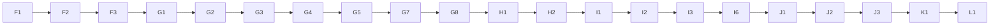
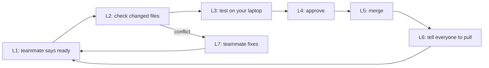

# Build Guide — LEAD-CORE (Part 1 of 2)

## Precog SOC Platform: repository, NIDS backend, contracts, add-on core and web skeleton

---

## 0. Document Control

| Field | Detail |
|---|---|
| **Document** | Build Guide for LEAD-CORE, Part 1 |
| **Version** | 1.0 |
| **Date** | 3 October 2026 |
| **Follows** | Master Project Document, PRD v1.1, TRD v1.1 |
| **Part 2 (comes next)** | Precog Engine, session metrics, integration tests and the golden-path script, deployment to a free backend host |
| **Delivered with this guide** | `precog-platform-part1.zip` and the same files one by one, in the repo folder layout |

---

## Naming Convention (Read This First)

The master document uses real names. **Every other project document, including this guide, uses the role-based aliases below.**

| Alias | Real Name | USN | Role |
|---|---|---|---|
| **LEAD-CORE** | Sagar R | 1DT24CS232 | Team lead — backend add-ons, Precog Engine, integration; the only person who merges code |
| **DETECT** | Neha | 1DT24CS174 | Flow feature preparation, ML detection, security event processing, ATT&CK correlation |
| **GRAPH** | Pallavi Bammanni | 1DT24CS185 | Data ingestion, simulation, attack graph, mobile web app (PWA) |
| **VIZ** | Preethi S Pujari | 1DT24CS195 | 3D visualization, charts, push notifications, containment |

**This guide is for LEAD-CORE.** Where it says "you", it means LEAD-CORE.

---

## How to Read This Guide

1. Do the steps **in order, top to bottom**. Never jump ahead. Every step has an ID such as `C4`.
2. Grey boxes marked `powershell` are typed into **PowerShell** (Windows). Press Enter after each line.
3. Text after `#` in a command is a comment. Do not type it. It explains the line.
4. **You should see:** tells you what correct looks like. If you see something else, go to Section 14 (Troubleshooting).
5. Every **code step** has the same six parts:

| Part | Meaning |
|---|---|
| **WHERE** | The exact path of the file inside the repo |
| **WHAT** | One line on what the file does |
| **COPY** | The command that copies **my finished, tested file** into your repo |
| **PROMPT** | The detailed instruction to give Antigravity so it writes its own version |
| **COMPARE** | How to put my file and Antigravity's file side by side |
| **COMMIT** | The Git commands that save the step |

6. **The delivered files** must be unzipped so that `C:\precog-delivery\README.md` exists. Every COPY command reads from `C:\precog-delivery\`.

---

## 1. What You Will Have at the End of Part 1

- A public GitHub repository where **only you can merge** into `main`
- An unchanged copy of NIDS inside the repo, with its MIT licence
- The twelve data contracts (schemas and samples) that let every role build without waiting
- The add-on backend: login, polling state, hooks for the other roles, the web-app server
- A React + Vite web project with a placeholder for each role, served by the backend at `/app/`
- **101 automatic Python tests and 11 web tests that pass**
- Teammates onboarded, each on their own branch

---

## 2. What Was Verified and What Was Not

I tested everything that can run in my own test environment (Linux, Python 3.11, Node 22). I could not test anything that needs Windows, a website or Antigravity.

| Verified by me | Result |
|---|---|
| NIDS runs on SQLite through its `DATABASE_URL` setting | Yes. Tables, login, its dashboard page, analyze page, report page and all its API routes work. (Its "PDF export" is really an HTML report page.) |
| NIDS's detector can be called directly from our code | Yes. `run_detection()` labels new rows in about 0.09 seconds for a few rows |
| NIDS's pinned libraries on Python 3.11 | Yes. All install and run |
| A background thread can write and detect while requests read (SQLite) | Yes, no "database is locked" errors |
| NIDS's PCAP upload | It **analyses and returns** results but does **not** store packets in the database. This corrected the TRD and PRD. Our replay writer inserts packets itself |
| NIDS's own `run.py` | It starts the Flask **debug** server. **We never use it.** We start the backend with our own `run_app.py` |
| Our backend with `waitress` and with `gunicorn` | Both start and serve correctly |
| All 101 Python tests, 11 web tests, `npm ci`, `npm run build` in a fresh environment | Pass |

| **Not** verified by me | What to do |
|---|---|
| The PowerShell commands on Windows | They are standard commands, but if one fails, use Section 14 and tell me the exact error |
| The GitHub pages and button names | GitHub changes labels. If a word differs slightly, look for the same idea |
| Antigravity's screens | It is built on VS Code, so the compare method in Step G0 should work. Fallback commands are given |
| Python 3.11.9 and Node LTS on your laptops | I tested Python 3.11.15 and Node 22 on Linux. I confirmed that 3.11.9 is the last 3.11 release with a Windows installer, but could not run it. Section 14 covers differences |
| How the web pages look and behave when clicked in a real browser | I built them, served them, and tested the login and polling logic and every file the browser loads. I could not click through them. Step I3 is your check |
| Windows console messages | Scapy (a NIDS library) may print a harmless warning on Windows about a missing packet-capture driver. I could not test it. See Section 14 |
| Installing the web app on a real phone | Needs a hosted HTTPS address, which comes in Part 2 |

---

# PART A — Install the Tools (Windows)

Do this on **your** laptop. Open PowerShell first: **Start menu → type `PowerShell` → open "Windows PowerShell"** (a normal window, not "as administrator").

### A1 — Install Git

1. In the browser open: https://git-scm.com/download/win
2. Click the **64-bit Git for Windows Setup** download link.
3. Run the file. Keep clicking **Next** (leave every setting as it is), then **Install**, then **Finish**.
4. **Close PowerShell and open it again**, then type:

```powershell
git --version   # prints the Git version
```

**You should see:** `git version 2.` followed by numbers.

### A2 — Install Python 3.11.9

1. Open: https://www.python.org/downloads/release/python-3119/
2. Scroll to the **Files** table and click **Windows installer (64-bit)** (the file is named `python-3.11.9-amd64.exe`). If you cannot find Windows installers on that page, you opened the wrong release: it must say **3.11.9**.
3. Run it. **On the first screen, tick "Add python.exe to PATH"** (bottom of the window).
4. Click **Install Now**, then **Close**.
5. Close PowerShell, open it again, and type:

```powershell
python --version      # prints the Python version
py -3.11 --version    # asks the Windows Python launcher for 3.11 specifically
```

**You should see:** `Python 3.11.9` on both lines. If the first line shows another version, that is fine as long as the second line shows 3.11.

### A3 — Install Node.js (LTS)

1. Open: https://nodejs.org
2. Click the green **LTS** download button and run the file. Keep every default.
3. Close PowerShell, open it again, and type:

```powershell
node --version   # prints the Node version
npm --version    # prints the npm version
```

**You should see:** two version numbers starting with `v` and a plain number.

### A4 — Install Antigravity

1. Open: https://antigravity.google/download
2. Under **Antigravity IDE (Standalone)**, click **Download for x64**.
3. Run the installer. If Windows shows a blue warning, click **More info**, then **Run anyway**.
4. Open Antigravity and sign in with your Google account. Keep the default choices.

### A5 — Allow PowerShell to run the Python environment script

```powershell
Set-ExecutionPolicy -Scope CurrentUser -ExecutionPolicy RemoteSigned   # lets your own scripts run
```

If it asks a question, type `Y` and press Enter.

### A6 — Tell Git who you are

```powershell
git config --global user.name "YOUR NAME"           # type your real name between the quotes
git config --global user.email "you@example.com"    # type the email you use for GitHub
git config --global init.defaultBranch main         # new repos start on the branch called main
```

### A7 — Unzip the delivered files

1. Find `precog-platform-part1.zip`. Right-click it → **Extract All**.
2. Extract it to a new folder named exactly `C:\precog-delivery`.

```powershell
Test-Path C:\precog-delivery\README.md   # asks "does this file exist?"
```

**You should see:** `True`. If you see `False`, the files are one folder too deep. Move them up so that `README.md` sits directly inside `C:\precog-delivery`.

---

# PART B — GitHub and the Local Project

### B1 — GitHub account

1. Open https://github.com/signup and create an account (skip this if you already have one).
2. Confirm your email when GitHub asks.
3. Write down your **GitHub username**. You need it in Steps C2 and C6.

### B2 — Create the repository (browser)

1. Open https://github.com/new
2. **Repository name:** `precog-platform`
3. Choose **Public**. (This is what lets GitHub enforce "only the lead merges" for free.)
4. **Do not tick** "Add a README file", "Add .gitignore" or "Choose a license". Leave them empty.
5. Click **Create repository**.
6. Copy the address that looks like `https://github.com/YOUR-USERNAME/precog-platform.git`.

### B3 — Copy the repository to your laptop

```powershell
cd $HOME\Documents                                                  # go to your Documents folder
git clone https://github.com/YOUR-USERNAME/precog-platform.git      # replace YOUR-USERNAME; copies the empty repo
cd precog-platform                                                  # go inside the new folder
```

A sign-in window may open. Sign in with GitHub.

**You should see:** `warning: You appear to have cloned an empty repository.` That is normal.

### B4 — Open the folder in Antigravity

1. In Antigravity: **File → Open Folder** → choose `Documents\precog-platform` → **Select Folder**.
2. If it asks "Do you trust the authors?", click **Yes, I trust**.
3. Open a terminal inside Antigravity: **Terminal → New Terminal**. Make sure it says **PowerShell**.
4. From now on, **type every command in this terminal.** It is already inside the repo folder.

```powershell
pwd   # prints the folder you are in
```

**You should see:** a path ending in `precog-platform`.

---

# PART C — Base Files and the First Commit

### C1 — Copy the root files

**WHERE:** repo root (`.gitignore`, `README.md`, `.env.example`, `pytest.ini`) and `.github/CODEOWNERS`
**WHAT:** The ignore list (keeps secrets out of Git), the project readme, the settings template, the test settings, and the "only the lead approves" file.

**COPY:**

```powershell
New-Item -ItemType Directory -Force -Path .github | Out-Null      # makes the .github folder
Copy-Item C:\precog-delivery\.gitignore .gitignore                # the ignore list
Copy-Item C:\precog-delivery\README.md README.md                  # the readme
Copy-Item C:\precog-delivery\.env.example .env.example            # the settings template
Copy-Item C:\precog-delivery\pytest.ini pytest.ini                # test settings
Copy-Item C:\precog-delivery\.github\CODEOWNERS .github\CODEOWNERS   # the approver file
```

**PROMPT:** None. These are plain settings files, not code.

**You should see:** no output and no red text.

### C2 — Put your GitHub username in CODEOWNERS

1. In Antigravity's left panel open `.github` → `CODEOWNERS`.
2. Replace `REPLACE_WITH_LEAD_GITHUB_USERNAME` with your GitHub username. **Keep the `@`** in front. Example: `* @sagar-example`
3. Press **Ctrl+S**.

```powershell
Get-Content .github\CODEOWNERS   # shows the file
```

**You should see:** a line starting `* @` followed by your username.

### C3 — Copy the role folders and the contracts folder

**WHERE:** `detect/`, `graph/`, `viz/`, `docs/`, `lead-core/precog/`
**WHAT:** The folders each role will fill in. They contain placeholder files that load without errors.

```powershell
Copy-Item -Recurse C:\precog-delivery\detect .                           # DETECT's folder
Copy-Item -Recurse C:\precog-delivery\graph .                            # GRAPH's folder
Copy-Item -Recurse C:\precog-delivery\viz .                              # VIZ's folder
Copy-Item -Recurse C:\precog-delivery\docs .                             # docs folder
New-Item -ItemType Directory -Force -Path lead-core | Out-Null           # your own folder
Copy-Item -Recurse C:\precog-delivery\lead-core\precog lead-core\        # the Precog placeholder
Get-ChildItem -Recurse -File detect, graph, viz, docs | Select-Object -ExpandProperty FullName   # lists what was copied
```

**You should see:** a list that includes `detect\detect_events\__init__.py`, `graph\graph_replay\__init__.py`, `graph\graph_net\__init__.py`, `viz\viz_containment\__init__.py` and several `README.md` files.

**PROMPT:** None for the READMEs. The four `__init__.py` files are tiny placeholders (a docstring and an empty `register(ctx)` function) and have no prompt.

**Also do now (outside the terminal):** open File Explorer and copy your three documents (Master Project Document, PRD, TRD) into the `docs` folder of the repo.

### C4 — Create your private `.env` file

```powershell
Copy-Item .env.example .env                                   # makes your own settings file
python -c "import secrets; print(secrets.token_hex(32))"      # prints a long random text. Select it and copy it
```

1. In Antigravity open `.env`.
2. After `SECRET_KEY=` paste the long random text.
3. After `ADMIN_PASSWORD=` type a password you invent (at least 8 characters, not one you use elsewhere).
4. Press **Ctrl+S**.

```powershell
git check-ignore -v .env   # asks Git "are you ignoring this file?"
```

**You should see:** a line that contains `.gitignore` and `.env`. That means Git will never save your passwords.

### C5 — First commit and push

```powershell
git status                 # lists new files. The file ".env" must NOT be in the list
git add .                  # stages everything that is not ignored
git commit -m "chore: project skeleton, role folders and settings files"   # saves a snapshot
git push -u origin main    # sends it to GitHub (a sign-in window may open)
```

**You should see:** `Branch 'main' set up to track 'origin/main'.`

**Browser check:** open your repository page and refresh. You should see the folders. **You must NOT see a file named `.env`.** If you do see it, stop and go to Section 14, entry "I pushed .env".

### C6 — Lock the `main` branch (browser)

1. On your repository page click **Settings** (top row).
2. Left side: **Branches**.
3. Click **Add branch protection rule** (or **Add classic branch protection rule**).
4. **Branch name pattern:** type `main`
5. Tick **Require a pull request before merging**.
6. Under it tick **Require approvals** (leave the number at 1).
7. Tick **Require review from Code Owners**.
8. **Leave "Do not allow bypassing the above settings" un-ticked.** (This lets you, the owner, merge your own work.)
9. Scroll down and click **Create** (or **Save changes**).

**You should see:** `main` listed under "Branch protection rules".

### C7 — Invite your teammates (browser)

1. Ask DETECT, GRAPH and VIZ for their **GitHub usernames**.
2. On the repository page: **Settings → Collaborators → Add people**.
3. Type a username, pick it, choose the **Write** role if asked, and send. Repeat for all three.

Each teammate gets an email to accept.

### C8 — Create your own working branch

```powershell
git switch -c lead-core   # creates your branch and moves you onto it
git branch                # lists branches; a star marks the one you are on
```

**You should see:** `* lead-core`.

From now on, **work only on `lead-core`.** Never work on `main`.

---

# PART D — The NIDS Copy (Unchanged)

**Rule for this whole project: you never edit a file inside `lead-core\backend\nids\`.**

### D1 — Download NIDS outside the repo

```powershell
cd $HOME\Documents                                              # leave the repo folder for a moment
git clone https://github.com/123dars/NIDS.git nids-temp         # downloads NIDS into a temporary folder
git -C nids-temp checkout b30070f20de1d1e22d44d0ad86140892c86c43e6   # the exact version I tested
```

**You should see:** a long message about `detached HEAD`. That is normal.

### D2 — Copy it into the repo without its Git history

```powershell
cd $HOME\Documents\precog-platform                                       # back into the repo
New-Item -ItemType Directory -Force -Path lead-core\backend\nids | Out-Null   # makes the target folder
robocopy $HOME\Documents\nids-temp lead-core\backend\nids /E /XD .git    # copies everything except the .git folder
Test-Path lead-core\backend\nids\.git        # must print False
Test-Path lead-core\backend\nids\LICENSE     # must print True
Test-Path lead-core\backend\nids\dashboard\app.py   # must print True
```

**You should see:** a table from robocopy (do not worry about its numbers) and then `False`, `True`, `True`.

### D3 — Record which version you copied

**WHERE:** `lead-core/backend/NIDS_VERSION.txt`
**WHAT:** A note saying where NIDS came from, which version, and that its licence is MIT.

```powershell
Copy-Item C:\precog-delivery\lead-core\backend\NIDS_VERSION.txt lead-core\backend\NIDS_VERSION.txt   # copies the note
```

1. Open `lead-core\backend\NIDS_VERSION.txt` in Antigravity.
2. Replace `WRITE TODAY'S DATE HERE` with today's date. Press **Ctrl+S**.

**PROMPT:** None. It is a text note.

### D4 — Commit, and delete the temporary download

```powershell
git add .                                                            # stages the NIDS copy and the note
git status                                                           # long list under lead-core/backend/nids
git commit -m "chore: add unchanged copy of NIDS (MIT) at pinned commit"   # saves it
Remove-Item -Recurse -Force $HOME\Documents\nids-temp                # deletes the temporary download
```

**You should see:** `create mode` lines for the NIDS files, and no error from the last command.

---

# PART E — The Python Environment

### E1 — Create and switch on the virtual environment

```powershell
py -3.11 -m venv .venv                  # creates a private Python folder called .venv
.\.venv\Scripts\Activate.ps1            # switches it on
python --version                        # prints the Python version inside the environment
```

**You should see:** `(.venv)` at the start of the prompt, and `Python 3.11.` followed by a number.

**Every time you open a new terminal for this project, run the `Activate.ps1` line again.**

### E2 — Install the libraries

**WHERE:** `lead-core/backend/requirements.txt`
**WHAT:** The list of libraries. The first line pulls in NIDS's own pinned list.

```powershell
New-Item -ItemType Directory -Force -Path lead-core\backend | Out-Null                       # makes sure the folder exists
Copy-Item C:\precog-delivery\lead-core\backend\requirements.txt lead-core\backend\requirements.txt   # copies the list
python -m pip install --upgrade pip                                                          # updates pip
pip install -r lead-core/backend/requirements.txt                                            # installs everything (a few minutes)
```

**PROMPT:** None. It is a settings list.

**You should see:** many lines, ending with `Successfully installed` followed by names.

### E3 — Check the versions

```powershell
python -c "from importlib.metadata import version as v; print([v(p) for p in ('flask','sqlalchemy','scikit-learn','pandas','numpy')])"   # prints five versions
```

**You should see:** `['3.0.0', '2.0.20', '1.3.0', '2.1.0', '1.24.0']`

```powershell
git add .
git commit -m "chore: backend requirements"   # saves the requirements list
```

---

# PART F — The Data Contracts

### F1 — Copy the contracts

**WHERE:** `contracts/` (27 files: `README.md`, `check_contracts.py`, `data/hosts.json`, 12 files in `schemas/`, 12 files in `samples/`)
**WHAT:** The agreed shape of every piece of data passed between roles, a valid example of each, and `data/hosts.json`: the one list of the six demo hosts (names, zones and network addresses) that every role reads.

**COPY:**

```powershell
Copy-Item -Recurse -Force C:\precog-delivery\contracts .   # copies the whole contracts folder
(Get-ChildItem -Recurse -File contracts).Count             # counts the files
```

**You should see:** `27`.

**PROMPT** (paste into Antigravity; it writes to the scratch folder):

```text
Create JSON Schema files (draft 2020-12) in scratch-ai/contracts/schemas/ and one valid example for each in scratch-ai/contracts/samples/.
Name them NAME.schema.json and NAME.sample.json. Do not touch any other folder.
Every schema: "$id" = "https://precog.local/contracts/NAME.schema.json", "additionalProperties": false, every field listed under "required".
Times are text in ISO 8601 UTC, for example 2026-10-03T10:00:03Z. Severity words are exactly HIGH, MEDIUM, LOW, NORMAL. Risk score is 0 to 100.
The twelve contracts and their fields:
1 packet_record: id(int), timestamp(text), src_ip, dst_ip, protocol (text), src_port, dst_port, packet_size (int), flags(text or null), anomaly(int or null), risk_score(number or null), suspicious_port(bool or null), alert(bool or null), severity(one of the four words or null), threat_actor, asn, location (text or null; add a description saying these values are SIMULATED).
2 security_event: event_id, ts, host, packet_id(int or null), anomaly(bool), risk_score(0-100), severity, explanation(non-empty text), technique_id(text or null), technique_name(text or null), source(nids_detector or scripted).
3 graph_snapshot: hosts[ {host_id, name, zone(user|dmz|internal), state(normal|compromised|contained)} ], edges[ {from_host, to_host, first_seen} ], compromised_path[text].
4 forecast: forecast_id, ts, from_host, targets (at most 3 items {rank 1-3, host_id, confidence 0-1}), technique_hint (null or {technique_id, technique_name, probability 0-1}), source(repo|lookup), status(pending|hit|miss|superseded), outcome(null or {attempted_host, rank_hit (1-3 or null), blocked(bool)}).
5 containment_action: action_id, target_host, forecast_id(text or null), requested_by(console|mobile), status(pending_confirmation|executed|cancelled|expired), proposed_at, confirmed_at(text or null), result(text or null).
6 reeval_result: action_id, attack_progressed(bool), chain_ended_early(bool), summary(text).
7 audit_entry: ts, type(detection|forecast|containment), ref_id, summary.
8 replay_status: state(idle|running|paused|waiting_for_decision|finished), scenario_id(text or null), speed(number above 0), position(int, 0 or more).
9 session_metrics: forecasts_resolved(int), hits(int), hit_rate, precision_at_1, precision_at_3 (number 0-1 or null), calibration_bins[ {bin_low, bin_high, mean_confidence, observed_rate, count} ], containment_success_rate(number 0-1 or null).
10 session_record: session_id, scenario_id(text or null), started_at, ended_at(text or null), forecasts[forecast], actions[containment_action]  (use $ref to the other schemas by their $id).
11 detection_report: model, dataset, split, precision, recall, f1, false_positive_rate (0-1), notes.
12 world_state: only version(int) and changed(bool) are always required; when changed is true then graph (graph_snapshot), alerts[security_event], forecast (forecast or null), actions[containment_action], replay (replay_status), metrics (session_metrics) are also required. Use $ref for the parts.
Samples: use host ids host-a, host-b, server-b, file-server, db-server, domain-controller and a forecast whose rank-1 target is server-b with confidence 0.74. Samples must follow their schema exactly.
```

**PROMPT for the host list** (a second, separate prompt):

```text
Write scratch-ai/contracts/data/hosts.json: {"network": "demo-network", "subnet": "192.168.1.0/24", "note": <one sentence: the single list of demo hosts, every role reads it, only LEAD-CORE changes it>, "hosts": [ ... ]}.
Six hosts, each with host_id, name, zone (user, dmz or internal), address and role:
host-a "Workstation A" user 192.168.1.11 (user workstation, entry point); host-b "Workstation B" user 192.168.1.12; server-b "Web Server B" dmz 192.168.1.20; file-server "File Server" internal 192.168.1.30; db-server "Database Server" internal 192.168.1.40; domain-controller "Domain Controller" internal 192.168.1.50.
```

**PROMPT for the checker script** (a third, separate prompt):

```text
Write scratch-ai/contracts/check_contracts.py (Python 3.11, libraries jsonschema and referencing only).
It reads every contracts/schemas/*.schema.json next to the script, builds a referencing Registry from each schema's "$id" so "$ref" works, checks each schema is valid with Draft202012Validator.check_schema, and validates the matching contracts/samples/NAME.sample.json.
Print one line per contract: "ok" plus the name, or "NOT VALID" plus the name, the path of the first error and its message, or "MISSING SAMPLE" plus the name; also report a sample that has no schema.
End with "N contracts OK" and exit code 0, or "N problem(s) found" and exit code 1. If there are no schema files print a clear message and exit 1.
```

**COMPARE:** The contract files cannot be compared by eye line by line. The real test is the checker in F2. Run it on **my** folder first (the default). If you want to try the AI's version, copy the AI's files from `scratch-ai\contracts` over mine and run the checker again. If it says anything other than `12 contracts OK`, copy mine back.

**Note:** `package-lock.json` (Step I1) and the `.png` icons are generated files and have no prompts.

### F2 — Check every sample against its schema

```powershell
python contracts\check_contracts.py   # checks all twelve contracts
```

**You should see:** twelve lines starting `ok`, then `12 contracts OK`.

### F3 — Commit

```powershell
git add .
git commit -m "feat(contracts): twelve data contracts with schemas, samples and checker"   # saves it
```

---

# PART G — The Add-On Backend (Code)

**What this part builds:** the code that sits next to NIDS. It never edits NIDS. It gives you login, a polling state, a plug-in socket for the other roles, and the web-app server.

### G0 — Before the first prompt: the context block and how to compare

**1. The context block.** Open Antigravity's agent chat in a **new conversation**. Paste this **once**, press Enter, and keep using the same conversation for Part G:

```text
CONTEXT (remember this for everything I ask next)
I am building the "Precog SOC Platform", a student cybersecurity project. Python 3.11 on Windows. Libraries allowed: Flask 3.0.0, Flask-Login, SQLAlchemy 2.0, jsonschema 4.23, waitress, pytest. No other libraries.
Repo layout (repo root = precog-platform):
  lead-core/backend/nids/            unchanged copy of an open-source project (NIDS). I must NEVER edit anything in it. Its dashboard/app.py exposes `app` (the Flask app), `bcrypt` and Flask-Login; its database/models.py exposes SessionLocal, User (username, password_hash), Packet and init_db().
  lead-core/backend/addons/          OUR code, a Python package called "addons"
  lead-core/backend/run_app.py       our start-up script
  contracts/schemas/*.schema.json    data formats (12 contracts), contracts/samples/*.sample.json
Rules for every file you write:
  - Plain, readable Python with short docstrings and clear names. No clever tricks.
  - Never edit anything inside lead-core/backend/nids/.
  - Write the file ONLY to scratch-ai/<the same path as the real file>. Do not touch any other file.
  - Do not add features I did not ask for.
```

**2. Make the scratch folder** (the name `scratch-ai/` is already listed in `.gitignore`, so it is never committed):

```powershell
New-Item -ItemType Directory -Force -Path scratch-ai | Out-Null   # makes the folder where Antigravity's versions go
```

**3. How to compare** (used in every code step below):

*Method 1, side by side in Antigravity:* in the left file list, right-click **my file** → **Select for Compare**. Then right-click **the AI's file** (inside `scratch-ai`) → **Compare with Selected**. Red and green lines show the differences.

*Method 2, in the terminal (use this if Method 1 is missing):*

```powershell
git diff --no-index scratch-ai\lead-core\backend\addons\config.py lead-core\backend\addons\config.py   # replace both paths with the two files
```

**4. Which one to keep?** Keep **mine** by default (it is already copied and tested). If you prefer the AI's version of a file, copy it over mine, then run the tests in Step G8. **If a test fails, copy mine back.** Never keep a version that fails the tests.

### G1 — Foundation files: config, errors, contracts, hooks

**WHERE:** `lead-core/backend/addons/config.py`, `errors.py`, `contracts.py`, `hooks.py`

**WHAT:**

| File | What it does |
|---|---|
| `config.py` | Reads settings (data mode, paths) from environment variables |
| `errors.py` | One error type, so every API error has the same JSON shape |
| `contracts.py` | Loads the JSON schemas and checks data against them |
| `hooks.py` | The plug-in socket: where DETECT, GRAPH and VIZ attach their finished modules |

**COPY:**

```powershell
New-Item -ItemType Directory -Force -Path lead-core\backend\addons | Out-Null                       # makes the add-ons folder
foreach ($f in 'config','errors','contracts','hooks') { Copy-Item "C:\precog-delivery\lead-core\backend\addons\$f.py" "lead-core\backend\addons\$f.py" }   # copies the four files
Get-ChildItem lead-core\backend\addons                                                              # lists the folder
```

**You should see:** `config.py`, `contracts.py`, `errors.py`, `hooks.py`.

**PROMPT 1 of 4 — config.py:**

```text
Write scratch-ai/lead-core/backend/addons/config.py.
A frozen dataclass Config with fields: repo_root (Path), contracts_dir (Path), web_dist (Path), data_mode (text), validate_contracts (bool), cookie_secure (bool).
A static method Config.from_env(repo_root) that:
- resolves repo_root to an absolute Path;
- reads DATA_MODE (default "sample", lower-case, must be "sample" or "live", otherwise raise ValueError with a clear message);
- reads WEB_DIST (optional folder; default <repo_root>/web/dist);
- sets contracts_dir to <repo_root>/contracts;
- reads VALIDATE_CONTRACTS (default True) and COOKIE_SECURE (default False) as yes/no flags where 1, true, yes, on (any case) mean True and an empty or missing value means the default.
```

**PROMPT 2 of 4 — errors.py:**

```text
Write scratch-ai/lead-core/backend/addons/errors.py.
class ApiError(Exception) with __init__(self, code, message, status=400) storing code, message, status, and a method to_dict() that returns {"error": {"code": code, "message": message}}.
class HookError(ApiError) with no extra code, only a docstring saying other roles raise it to send a clean error to the web app.
```

**PROMPT 3 of 4 — contracts.py:**

```text
Write scratch-ai/lead-core/backend/addons/contracts.py using the jsonschema and referencing libraries.
class ContractError(ValueError).
class Contracts, constructed with the contracts folder path:
- reads every contracts/schemas/*.schema.json file; the contract name is the file name without ".schema.json"; raise FileNotFoundError if none are found;
- builds a referencing.Registry from every schema's "$id" so that "$ref" between schemas works;
- names() returns the sorted list of names;
- validator(name) returns a cached Draft202012Validator for that schema (KeyError for an unknown name);
- errors(name, instance) returns the validation errors sorted by path;
- validate(name, instance) raises ContractError with a message of the form "<name> does not follow its contract at <path or (top level)>: <first error>" if there is any error, otherwise returns the instance.
```

**PROMPT 4 of 4 — hooks.py:**

```text
Write scratch-ai/lead-core/backend/addons/hooks.py.
A module docstring that explains the plug-in socket: six hooks and which methods each object must offer:
replay (GRAPH): list_scenarios(), status(), start(scenario_id, speed), pause(), resume(), restart().
events (DETECT): process_packets(rows), process_technique(host, technique_id, note=None, compromise=False, severity="HIGH", risk_score=None), audit_record(entry_type, ref_id, summary), reset().
graph (GRAPH): snapshot(), reset(), add_connection(src, dst), mark_compromised(host), set_host_state(host, state), host_state(host), attempt(from_host, to_host), feasible_targets(host), and a topology attribute.
precog (LEAD-CORE): reset(), on_compromise(host), on_attempt(from_host, to_host, blocked).
containment (VIZ): propose(world, target_host, forecast_id, requested_by), confirm(world, action_id), cancel(world, action_id).
push (VIZ): register(token).
KNOWN_HOOKS = ("replay", "events", "graph", "precog", "containment", "push").
class Hooks with: register(name, obj) (ValueError for an unknown name), get(name) (None if missing), has(name), require(name) (raises ApiError code "not_built", status 501, message "The '<name>' part has not been built yet." when missing; import ApiError from .errors), registered() (sorted list of registered names).
```

**COMPARE:** Use the method in G0 for each of the four files.

**COMMIT:**

```powershell
git add .
git commit -m "feat(addons): config, errors, contracts loader and hooks"   # saves the step
```

### G2 — The world state and the sample loader

**WHERE:** `lead-core/backend/addons/world_state.py`, `sample_loader.py`

**WHAT:** `world_state.py` is the one in-memory picture of the whole system. Every change adds 1 to a version number, so a polling screen can ask "anything new?" and get a tiny answer. `sample_loader.py` fills it with fake sample data so screens can be built before the real pipeline exists.

**COPY:**

```powershell
foreach ($f in 'world_state','sample_loader') { Copy-Item "C:\precog-delivery\lead-core\backend\addons\$f.py" "lead-core\backend\addons\$f.py" }   # copies the two files
```

**PROMPT 1 of 2 — world_state.py:**

```text
Write scratch-ai/lead-core/backend/addons/world_state.py.
class WorldState(contracts=None). contracts is an optional addons.contracts.Contracts object; when given, every piece of data written is checked with contracts.validate(<contract name>, data) BEFORE it is stored, and a bad write must leave everything unchanged (including the version).
All methods must be thread-safe (one threading.RLock). All reads return deep copies. Every successful write adds exactly 1 to self.version and returns the new version.
State: graph (default {"hosts": [], "edges": [], "compromised_path": []}), alerts (newest first, at most 200), forecasts (list), actions (list), replay (default {"state":"idle","scenario_id":None,"speed":1.0,"position":0}), metrics (default all zero or None: forecasts_resolved 0, hits 0, hit_rate None, precision_at_1 None, precision_at_3 None, calibration_bins [], containment_success_rate None), session (None), sessions (history list, at most 20), push tokens, detection report (None).
Methods: snapshot(since=None) -> if since equals the current version return {"version": v, "changed": False}; otherwise {"version", "changed": True, "graph", "alerts", "forecast" (the latest forecast whose status is "pending", or None), "actions", "replay", "metrics"};
graph(), alerts(limit=50), get_alert(event_id), forecasts(status=None), current_forecast(), actions(), get_action(action_id), replay(), metrics(), session(), sessions(), detection_report(), push_tokens();
set_graph(graph) [contract graph_snapshot]; add_alert(alert) [security_event]; set_forecast(forecast) [forecast; any older pending forecast becomes "superseded"; a forecast with the same id is replaced]; resolve_forecast(forecast_id, status, outcome) [status must be "hit" or "miss" else ValueError; unknown id raises KeyError; re-validate the updated forecast]; upsert_action(action) [containment_action; replace the action with the same id or append]; set_replay(replay) [replay_status]; set_metrics(metrics) [session_metrics]; set_session(record) [session_record]; archive_session() (moves the current session to the front of the history list); set_detection_report(report) [detection_report]; add_push_token(token) (no duplicates, returns the count); reset() (forgets graph, alerts, forecasts, actions, replay, metrics and session but keeps history and tokens); load_full_state(state) (replaces everything from a world_state dict).
```

**PROMPT 2 of 2 — sample_loader.py:**

```text
Write scratch-ai/lead-core/backend/addons/sample_loader.py.
A function load_samples(world, contracts_dir) that reads contracts/samples/world_state.sample.json and calls world.load_full_state(...), then reads session_record.sample.json and calls world.set_session(...), then detection_report.sample.json and calls world.set_detection_report(...). Read files as UTF-8 JSON.
```

**COMPARE:** Use the method in G0.

**COMMIT:**

```powershell
git add .
git commit -m "feat(addons): world state with version counter and sample loader"   # saves the step
```

### G3 — Login and all the routes

**WHERE:** `lead-core/backend/addons/auth.py`, `routes.py`

**WHAT:** `auth.py` is a JSON login that reuses NIDS's own users and password check. `routes.py` holds every new `/api/x/...` endpoint from TRD Section 11.

**COPY:**

```powershell
foreach ($f in 'auth','routes') { Copy-Item "C:\precog-delivery\lead-core\backend\addons\$f.py" "lead-core\backend\addons\$f.py" }   # copies the two files
```

**PROMPT 1 of 2 — auth.py:**

```text
Write scratch-ai/lead-core/backend/addons/auth.py using Flask-Login.
json_login_required(view): a decorator that raises ApiError("not_logged_in", "Please log in first.", 401) when flask_login.current_user is not authenticated (it must NOT redirect to a page).
check_login(nids, username, password): nids is an object with SessionLocal, User and bcrypt attributes. Return None unless username and password are non-empty text. Otherwise open a session, find the User with that username, close the session, and return the user only if nids.bcrypt.check_password_hash(user.password_hash, password) is true; else None.
do_login(user) calls flask_login.login_user(user); do_logout() calls logout_user().
```

**PROMPT 2 of 2 — routes.py:**

```text
Write scratch-ai/lead-core/backend/addons/routes.py: a Flask Blueprint named "precog_addons" with url_prefix "/api/x".
Access shared objects with current_app.extensions["precog"], a dict with keys world, hooks, config, contracts (may be None), nids, load_report.
Every error must be JSON {"error": {"code": ..., "message": ...}}. Add a blueprint errorhandler for Exception: ApiError -> its dict and status; werkzeug HTTPException -> its code; anything else -> log it and answer 500 {"code": "internal_error", "message": "Something went wrong on the server."}.
Helper _out(contract_name, data): if contracts is not None, validate; on ContractError log it and raise ApiError("contract_violation", message, 500). Use it on every response that has a contract (state, graph, containment actions, replay status, precog metrics).
Routes (all except health and login need json_login_required):
GET /health -> {"status":"ok","data_mode","version","hooks": registered hook names,"modules": load_report}
POST /login (JSON username and password; wrong -> 401 code invalid_credentials), POST /logout, GET /me
GET /state?since=N (N must be a whole number else 400) -> world.snapshot(since)
GET /alerts?limit= (default 50, between 1 and 200, non-number -> 400), GET /alerts/<event_id> (404 not_found)
GET /graph; GET /forecasts?status= (must be pending, hit, miss or superseded else 400); GET /forecasts/current (404 code no_forecast)
POST /containment/propose (JSON target_host required text, forecast_id optional text, requested_by "console" or "mobile", default "console") -> hooks.require("containment").propose(world, target, forecast_id, requested_by)
POST /containment/confirm and /containment/cancel (JSON action_id required) -> hooks.require("containment").confirm / .cancel(world, action_id)
GET /containment/actions -> world.actions()
GET /session (404 no_session), GET /sessions, GET /metrics/precog, GET /metrics/detection (404 no_report)
GET /replay/scenarios -> hooks.require("replay").list_scenarios(); GET /replay/status -> the replay hook's status() if registered, otherwise world.replay()
POST /replay/start (JSON scenario_id required, speed optional number above 0, not a bool, default 1.0) -> hooks.require("replay").start(scenario_id, float(speed)); POST /replay/pause, /resume, /restart -> the matching replay hook method
POST /push/register (JSON token required text, at most 4096 characters) -> world.add_push_token(token), also call hooks.get("push").register(token) if a push hook exists; answer {"status":"ok","count": n}
A final catch-all route "/<path:rest>" for GET, POST, PUT, PATCH and DELETE that raises ApiError("not_found", "There is no endpoint '/api/x/<rest>' for this method.", 404).
A request body that is not a JSON object -> 400 code bad_request.
```

**COMPARE:** Use the method in G0.

**COMMIT:**

```powershell
git add .
git commit -m "feat(addons): JSON login and /api/x routes"   # saves the step
```

### G4 — Web-app server, loader and package file

**WHERE:** `lead-core/backend/addons/webapp.py`, `loader.py`, `__init__.py`

**WHAT:** `webapp.py` serves the built web app at `/app/`. `loader.py` joins everything to NIDS and loads each role's package without crashing if a role's code is broken. `__init__.py` makes the folder a package.

**COPY:**

```powershell
foreach ($f in 'webapp','loader','__init__') { Copy-Item "C:\precog-delivery\lead-core\backend\addons\$f.py" "lead-core\backend\addons\$f.py" }   # copies the three files
```

**PROMPT 1 of 3 — webapp.py:**

```text
Write scratch-ai/lead-core/backend/addons/webapp.py with register_webapp(app, config).
Serve the folder config.web_dist (the built web app) at /app/ from the same Flask app:
- /app redirects (302) to /app/;
- /app/ returns index.html; if web_dist/index.html does not exist return status 503, plain text: "The web app has not been built yet." plus a line telling the user to open the 'web' folder and run: npm install then npm run build;
- /app/<path>: if the file exists inside web_dist, send it (use werkzeug.security.safe_join so ../ tricks cannot leave the folder); if it does not exist and the last part of the path contains a dot, return 404 plain text; otherwise return index.html (the app's own pages like /app/mobile/alerts);
- after each request whose path starts with /app, add the header Cache-Control: no-cache for /app, /app/, index.html, sw.js and manifest.webmanifest.
```

**PROMPT 2 of 3 — loader.py:**

```text
Write scratch-ai/lead-core/backend/addons/loader.py.
A dataclass AddonContext(world, hooks, config, contracts, nids, flask_app).
ROLE_FOLDERS = ("detect", "graph", "viz", "lead-core/precog"); ROLE_PACKAGES = ("detect_events", "graph_replay", "graph_net", "viz_containment").
_load_role_packages(ctx, packages) -> dict name -> status text. For each package: import it with importlib; if ModuleNotFoundError whose .name equals the package itself -> "missing"; any other import failure (including a missing library INSIDE the package, or any exception) -> log it and "error: <message>" and carry on; if it has a register function call register(ctx): success -> "registered", exception -> log and "error: ..."; if no register function -> "loaded (no register function yet)".
register_addons(flask_app, repo_root, nids, packages=ROLE_PACKAGES): build Config.from_env(repo_root); build Contracts only when config.validate_contracts is true; create WorldState(contracts) and Hooks(); append each ROLE_FOLDER (under repo_root) to sys.path if missing; build the AddonContext; load the role packages; store flask_app.extensions["precog"] = {"world","hooks","config","contracts","nids","load_report"}; register the blueprint from routes.py; call register_webapp; if config.data_mode == "sample" call load_samples. Return the context.
```

**PROMPT 3 of 3 — `__init__.py`:**

```text
Write scratch-ai/lead-core/backend/addons/__init__.py: a one-line docstring "LEAD-CORE's add-ons for the NIDS backend.", then "from .loader import register_addons" and __all__ = ["register_addons"].
```

**COMPARE:** Use the method in G0.

**Quick check** (the whole add-on package should import):

```powershell
python -c "import sys; sys.path.insert(0, 'lead-core/backend'); import addons; print('add-ons import OK')"   # tries to import our package
```

**You should see:** `add-ons import OK`.

**COMMIT:**

```powershell
git add .
git commit -m "feat(addons): web-app server and role-package loader"   # saves the step
```

### G5 — The start-up script

**WHERE:** `lead-core/backend/run_app.py`, `wsgi.py`

**WHAT:** `run_app.py` starts NIDS **without editing it**: reads your `.env`, sets the database to SQLite, replaces NIDS's hard-coded secret key and default admin password from the outside, trains NIDS's model on first start, adds our add-ons, and serves with `waitress`. `wsgi.py` is the entry point a production server uses later.

**COPY:**

```powershell
foreach ($f in 'run_app','wsgi') { Copy-Item "C:\precog-delivery\lead-core\backend\$f.py" "lead-core\backend\$f.py" }   # copies the two files
```

**PROMPT 1 of 2 — run_app.py:**

```text
Write scratch-ai/lead-core/backend/run_app.py. It starts NIDS and our add-ons WITHOUT editing any NIDS file.
Constants from this file's location: BACKEND_DIR, REPO_ROOT (two levels up), NIDS_DIR = BACKEND_DIR/"nids", NIDS_DASHBOARD = NIDS_DIR/"dashboard", DEFAULT_DB = BACKEND_DIR/"data"/"nids.db", ADMIN_USERNAME = "admin".
load_env_file(path): read KEY=VALUE lines (ignore blank lines, lines starting with #, lines without =; strip quotes around values); a value already present in os.environ always wins.
require_env(name, hint): return the value or stop with SystemExit("<name> is missing. <hint>").
ensure_admin(nids_app, password): inside a SessionLocal session, hash the password with nids_app.bcrypt.generate_password_hash(...).decode(), update the "admin" user's password_hash if the user exists, else create the user; commit; always close the session.
ensure_model(): if NIDS_DIR/ml/nids_model.pkl and label_encoder.pkl both exist do nothing; if AUTO_TRAIN_MODEL is 0/false/no/off stop with a clear SystemExit; otherwise log a warning and call ml.train_model.train_and_evaluate().
create_app(): load REPO_ROOT/.env; stop with SystemExit if the NIDS folder is missing; require SECRET_KEY and ADMIN_PASSWORD (hint: copy .env.example to .env and fill it in), ADMIN_PASSWORD at least 8 characters; if DATABASE_URL is empty set it to "sqlite:///" + DEFAULT_DB.as_posix() (create the data folder) BEFORE NIDS is imported (NIDS reads it at import time); insert NIDS_DIR and NIDS_DASHBOARD at the front of sys.path; os.chdir(NIDS_DASHBOARD) (NIDS uses relative paths); import app as nids_app; set flask_app.secret_key from SECRET_KEY; set SESSION_COOKIE_HTTPONLY True, SESSION_COOKIE_SAMESITE "Lax", SESSION_COOKIE_SECURE from COOKIE_SECURE; call database.models.init_db(); ensure_admin; ensure_model; build nids = SimpleNamespace(SessionLocal, User, Packet, bcrypt=nids_app.bcrypt, app_module=nids_app); call addons.register_addons(flask_app, REPO_ROOT, nids); return flask_app.
main(): set up logging, create the app, read HOST (default 127.0.0.1) and PORT (default 5000), print "Backend ready:  http://HOST:PORT/app/   (API: /api/x/health)", and serve with waitress (4 threads). Never use Flask's debug mode. Run main() when executed as a script.
```

**PROMPT 2 of 2 — wsgi.py:**

```text
Write scratch-ai/lead-core/backend/wsgi.py: a docstring explaining it is the entry point for gunicorn ("gunicorn --workers 1 --threads 4 wsgi:application"), then "from run_app import create_app" and "application = create_app()".
```

**COMPARE:** Use the method in G0.

**COMMIT:**

```powershell
git add .
git commit -m "feat(backend): start-up script that runs NIDS unchanged with our add-ons"   # saves the step
```

### G6 — Check the role placeholders

The four role packages were copied in Step C3. Confirm they are all there:

```powershell
foreach ($p in 'detect\detect_events','graph\graph_replay','graph\graph_net','viz\viz_containment') { "$p -> " + (Test-Path "$p\__init__.py") }   # asks if each placeholder exists
```

**You should see:** four lines ending in `True`.

### G7 — Copy the tests

**WHERE:** `lead-core/integration/tests/` (8 files: `conftest.py`, `test_contracts.py`, `test_world_state.py`, `test_api.py`, `test_nids_integration.py`, `test_loader_and_webapp.py`, `test_run_app.py`, `test_hosts_and_hooks.py`)

**WHAT:** 101 automatic tests. They check the contracts, the world state, every route, NIDS itself (including a background thread writing while requests read), the loader's crash-safety, the web-app server (including path-trick attacks) and the start-up helpers.

**COPY:**

```powershell
New-Item -ItemType Directory -Force -Path lead-core\integration\tests | Out-Null                    # makes the tests folder
Copy-Item C:\precog-delivery\lead-core\integration\tests\*.py lead-core\integration\tests\          # copies the eight test files
(Get-ChildItem lead-core\integration\tests -Filter *.py).Count                                      # counts them
```

**You should see:** `8`.

**PROMPT** (one prompt for all test files):

```text
Write pytest test files in scratch-ai/lead-core/integration/tests/ for the project described in the CONTEXT.
conftest.py: before importing the backend set environment variables DATABASE_URL (a fresh temporary SQLite file), SECRET_KEY, ADMIN_PASSWORD, DATA_MODE=sample, VALIDATE_CONTRACTS=1, AUTO_TRAIN_MODEL=1 and WEB_DIST (a folder that does not exist); add lead-core/backend to sys.path; fixtures: flask_app (run_app.create_app(), session scope), ctx (app.extensions["precog"]), world (reset and reload the sample data before each test), hooks (empty the hooks before and after each test), client, logged_in (a client already logged in through /api/x/login).
test_contracts.py: the twelve contracts exist; every schema is valid JSON Schema; every sample follows its schema; an extra field, a wrong severity word, four forecast targets, confidence 74 instead of 0.74, and a changed world_state missing the graph are all rejected; {"version": 7, "changed": false} is valid; every schema has a sample.
test_world_state.py: version +1 per write; poll with the current version returns {"version","changed": false}; poll with an old version returns everything and follows the world_state contract; newest alert first; alert list capped at 200; a new forecast supersedes the pending one; resolving records the outcome; unknown forecast -> KeyError; status "maybe" -> ValueError; same action id replaces; bad data is refused and the version does not change; reads return copies; reset keeps history; push tokens have no duplicates; 10 threads writing 50 alerts each give version 500.
test_api.py: every protected route answers 401 JSON (not a redirect); wrong password 401; NIDS's default password "password123" no longer works; login/me/logout cycle; state full then unchanged then changed; bad since -> 400; alerts limit and single alert; graph, forecasts and filters; no pending forecast -> 404; session, metrics, detection report; containment with no module -> 501 not_built; a stand-in containment object makes propose/confirm/cancel work; input checks -> 400; a module returning bad data -> 500 contract_violation; a module raising HookError -> its status; replay falls back to the world when no module; replay controls with a stand-in; start input checks; push tokens stored once and too-long token -> 400; unknown path or wrong method -> JSON 404.
test_nids_integration.py: our admin password works on NIDS's own login page and the default does not; NIDS's /api/stats, /api/alerts, /api/packets, /api/protocol_counts, /api/throughput work on SQLite; our code can insert Packet rows and call ml.anomaly_detector.run_detection() directly (ordinary port 443 -> severity NORMAL, port 3389 -> HIGH and alert true); uploading NIDS's test_traffic.pcap returns stats (total 95, some high) but does NOT add rows to the packets table; a background thread writing packets and calling run_detection while the main thread requests /api/stats produces no errors; NIDS's app.py still contains its original hard-coded secret key line (we override it from outside, we never edit it).
test_loader_and_webapp.py: a missing role package is reported "missing"; a package that raises on import, a register() that raises, a package with no register(), and a package that imports a library that does not exist are all reported without crashing; the web-app server redirects /app, serves index.html and files, falls back to index.html for page addresses, 404s a missing file, cannot be tricked out of its folder with ../ or %2e%2e, and shows a helpful 503 when not built.
test_hosts_and_hooks.py: contracts/data/hosts.json has six hosts with host_id, name, zone, address and role, unique ids and addresses all inside the subnet, and the same names and zones as graph_snapshot.sample.json; KNOWN_HOOKS is exactly (replay, events, graph, precog, containment, push); every known hook can be registered and found and answers 501 before it is registered; an unknown hook name is refused.
test_run_app.py: load_env_file reads values, ignores comments, strips quotes, lets existing environment values win and ignores a missing file; require_env stops with a clear message; ensure_admin replaces the password and keeps exactly one admin user.
```

**COMPARE:** Test files are compared the same way (G0). They only matter if they **pass** against the code, so the real comparison is Step G8.

### G8 — Run all the tests

```powershell
pytest   # runs every test found by pytest.ini
```

**You should see:** a row of dots and finally `101 passed`. The first run may take longer because NIDS's model trains once.

If you see a failure, copy the **whole red message**, and go to Section 14, entry "A test fails".

**COMMIT:**

```powershell
git add .
git commit -m "test: 101 backend tests covering contracts, state, routes and NIDS integration"   # saves the step
```

---

# PART H — First Run of the Backend

### H1 — Start the backend

```powershell
python lead-core/backend/run_app.py   # starts NIDS plus our add-ons
```

The first start trains NIDS's model (about 10 seconds) and prints a long model report.

**You should see:** `Backend ready:  http://127.0.0.1:5000/app/   (API: /api/x/health)`. **Leave this terminal open.** The prompt will not come back until you stop the server.

### H2 — Look at it in the browser

1. Open http://127.0.0.1:5000/api/x/health. **You should see** a line of JSON beginning `{"data_mode":"sample"` with `"status":"ok"`.
2. Open http://127.0.0.1:5000/ . **You should see** NIDS's own login page. Sign in with username `admin` and **the `ADMIN_PASSWORD` from your `.env`**. **You should see** the NIDS dashboard.
3. Open http://127.0.0.1:5000/app/ . **You should see** plain text saying the web app has not been built yet. That is correct for now (Part I builds it).

### H3 — Stop the backend

Click inside the terminal and press **Ctrl+C**. **You should see** the prompt `(.venv) PS ...>` again.

---

# PART I — The Web Skeleton

**What this part builds:** one React project with a fixed place for each role, served by the backend at `/app/`. After this, DETECT, GRAPH and VIZ only ever edit files inside their own folders.

### I0 — The web context block

In Antigravity's agent chat, start a **new conversation** and paste this once:

```text
CONTEXT (remember this for everything I ask next)
I am building the web part of the "Precog SOC Platform": one React 18 + Vite 5 project in the folder web/, plain JavaScript (no TypeScript), react-router-dom 6, no UI library.
The built app is served by a Flask backend at the path /app/, so Vite's base is "/app/" and the router's basename is "/app". All backend calls are to /api/x/... on the same address and use fetch with credentials "same-origin". Login is a session cookie.
Folder rules: web/src/shared/ belongs to LEAD-CORE; web/src/areas/mobile/ to GRAPH; web/src/areas/console/, charts/ and push/ to VIZ. App.jsx and main.jsx are written once and never edited again.
Rules for every file you write: readable code, short comments, no extra libraries, write the file ONLY to scratch-ai/<the same path as the real file>, do not touch any other file, and do not add features I did not ask for.
```

### I1 — Copy the web project

**WHERE:** `web/` (config files, `public/` files, `src/` files)

**WHAT:** The project settings, the install-on-phone files (manifest, service worker, two icons), the shared code and the four role placeholders.

**COPY:**

```powershell
Copy-Item -Recurse -Force C:\precog-delivery\web .   # copies the whole web folder
(Get-ChildItem -Recurse -File web).Count             # counts the files
```

**You should see:** `25`.

**Prompts for the web files** (one prompt per group; each writes into `scratch-ai\web\...`):

**PROMPT 1 of 7 — `web/vite.config.js` and `web/package.json`:**

```text
Write scratch-ai/web/vite.config.js and scratch-ai/web/package.json.
vite.config.js: defineConfig with the React plugin, base '/app/', dev server port 5173 with a proxy that forwards '/api' to 'http://127.0.0.1:5000', build outDir 'dist' with emptyOutDir true. Comments must say why the base is /app/ and why the proxy exists.
package.json: name "precog-web", private, version 0.1.0, "type": "module"; scripts dev (vite), build (vite build), preview (vite preview --port 4173), test (node --test src/shared/pollingLogic.test.js); dependencies react ^18.3.1, react-dom ^18.3.1, react-router-dom ^6.28.0; devDependencies @vitejs/plugin-react ^4.3.4 and vite ^5.4.11.
```

**PROMPT 2 of 7 — `web/index.html`, `web/public/manifest.webmanifest`, `web/public/sw.js`:**

```text
Write scratch-ai/web/index.html, scratch-ai/web/public/manifest.webmanifest and scratch-ai/web/public/sw.js.
index.html: a normal Vite page with a div id "root", a module script /src/main.jsx, viewport meta with viewport-fit=cover, theme-color #0B0F14, title "Precog SOC", links to /app/manifest.webmanifest and the icon /app/icons/icon-192.png (also as apple-touch-icon).
manifest.webmanifest: name "Precog SOC", short_name "Precog", start_url "/app/mobile/", scope "/app/", display "standalone", orientation "portrait", background and theme colour #0B0F14, two icons /app/icons/icon-192.png (192x192) and /app/icons/icon-512.png (512x512), type image/png.
sw.js: a service worker that first tries importScripts('/app/push/push-sw.js') inside try/catch (that file is optional), skips waiting on install, claims clients on activate, and has an empty fetch handler (a fetch handler must exist so the browser offers "install"). It must NOT cache API calls.
```

**PROMPT 3 of 7 — `web/src/main.jsx` and `web/src/App.jsx`:**

```text
Write scratch-ai/web/src/main.jsx and scratch-ai/web/src/App.jsx.
main.jsx: render in StrictMode inside BrowserRouter with basename "/app", wrapped by AuthProvider (from ./shared/AuthContext.jsx), importing ./shared/theme.css; after the page loads, in production builds only (import.meta.env.PROD), register '/app/sw.js' with scope '/app/' and ignore failures. Comment: written once, nobody else edits it.
App.jsx: Routes: /login -> LoginPage; /mobile/* -> MobileApp inside RequireAuth; /console/* -> ConsoleApp inside RequireAuth; anything else -> Navigate to /mobile. MobileApp comes from ./areas/mobile/index.jsx and ConsoleApp from ./areas/console/index.jsx (default exports). Comment: written once, nobody else edits it.
```

**PROMPT 4 of 7 — shared code:**

```text
Write scratch-ai/web/src/shared/api.js, pollingLogic.js, pollingLogic.test.js, usePolling.js and AuthContext.jsx.
api.js: classes ApiError(status, code, message) and NetworkError; an internal request(method, path, body) that uses fetch with credentials 'same-origin', sends JSON, throws NetworkError when fetch fails, and throws ApiError built from the server's {"error": {"code","message"}} when the answer is not ok; exports apiGet, apiPost and an object api with one function per endpoint: health, login(username,password), logout, me, state(since), alerts(limit), alert(id), graph, forecasts(status), currentForecast, proposeContainment(targetHost, forecastId, requestedBy), confirmContainment(actionId), cancelContainment(actionId), session, sessions, precogMetrics, replayStatus, startReplay(scenarioId, speed), pauseReplay, resumeReplay, restartReplay, registerPush(token). All paths start /api/x/.
pollingLogic.js: isStale(lastSuccessMs, nowMs, intervalMs) true only when there was a success and more than 2x interval has passed; stateUrl(since) returns '/api/x/state' or '/api/x/state?since=N'; applyReply(previous, reply) returns previous when the reply is broken or has changed === false, else the reply.
pollingLogic.test.js: node:test tests for those three functions (7 tests: not stale before first success, not stale within 2x, stale after 2x, url with and without since, unchanged reply keeps state, changed reply replaces it, broken reply ignored).
usePolling.js: export POLL_INTERVAL_MS = 1500 and a React hook useWorldState(intervalMs) returning { state, stale, loggedOut }: poll api.state(version) in a loop with setTimeout; remember the version; on success store applyReply result and clear stale; on a 401 set loggedOut and stop; on other errors set stale using isStale; clean up on unmount.
AuthContext.jsx: AuthProvider (checks api.me() on start; provides username, checking, login(name,password), logout()), useAuth, RequireAuth (shows "Checking login..." then redirects to /login with the current path in router state) and LoginPage (username "admin" pre-filled, password field, error text, sign-in button, redirect to the original page or /mobile after login).
```

**PROMPT 5 of 7 — `web/src/shared/theme.css`:**

```text
Write scratch-ai/web/src/shared/theme.css: CSS variables on :root for a dark SOC theme, marked PROVISIONAL in a comment (the final colours come from a UI/UX brief) and stating "red = what happened, violet = what Precog predicts, teal = what you did".
Variables: --bg #0b0f14, --surface #121821, --surface-raised #1a2230, --border #263042, --text #e6edf3, --text-muted #9aa7b8, --accent #38bdf8; severity critical #ef4444, high #f97316, medium #f59e0b, low #64748b; states compromised #ef4444, contained #14b8a6, normal #64748b; --forecast #a855f7; fonts --font-ui (Inter then system fonts) and --font-mono (JetBrains Mono then system mono).
Plus: box-sizing reset; body with the colours, font and safe-area padding (env(safe-area-inset-*)); and small classes .card, .muted, .mono, .stale-banner, .center-page, .field, .button, .error-text.
```

**PROMPT 6 of 7 — the four role placeholders:**

```text
Write scratch-ai/web/src/areas/mobile/index.jsx, console/index.jsx, charts/index.jsx and push/index.jsx. Each is a PLACEHOLDER that the owning role later replaces, and says so in a comment.
mobile/index.jsx and console/index.jsx: a default-exported component that uses useWorldState() from ../../shared/usePolling.js, redirects to /login with Navigate when loggedOut, shows a "Connection lost: showing old data" banner when stale, and displays proof that the wiring works: the mobile one shows "version N" and the number of alerts; the console one shows the number of hosts in state.graph.hosts. mobile/index.jsx ALSO exports six small named placeholder components, SeverityBadge({severity}), StateChip({state}), ForecastBars({state}), OutcomeCard(), AccuracyCounter({metrics}) and AttackPath2D({state}), because VIZ's console imports those names from it before GRAPH has merged the real ones; GRAPH replaces the whole file later and keeps the names.
charts/index.jsx: named exports ForecastAccuracyChart({ metrics }) and AlertVolumeChart({ alerts }) that render a simple card (metrics.hit_rate as a percentage or "no data yet"; the number of alerts). A comment states that GRAPH imports these two names with these properties, so the names and properties must never change.
push/index.jsx: a named export usePushRegistration() that returns { status: 'not_built' }, with a comment that the name and shape must not change.
```

**PROMPT 7 of 7 — shared components, the test runner and the extra theme variables:**

```text
Write scratch-ai/web/src/shared/components.jsx, scratch-ai/web/src/shared/components.test.jsx, scratch-ai/web/scripts/run-tests.mjs, and show the lines to ADD at the end of scratch-ai/web/src/shared/theme.css.
components.jsx exports: SimulationBadge (a pill with the word SIMULATION and an aria-label saying everything is simulated; class sim-badge); StaleBanner({stale}) (renders nothing unless stale; otherwise a div with class stale-banner, role status, text "Connection lost: showing old data"); EmptyState({children}); LoadingState({lines=3}) (grey skeleton bars, aria-busy); ToastProvider({children, seconds=4}) with a useToast() hook returning {show(text)}; a toast closes itself after 4 seconds.
components.test.jsx: node:test tests using react-dom/server renderToStaticMarkup for each component (badge text, banner hidden/shown, empty and loading, provider renders children with no toast until one is shown).
run-tests.mjs: finds every *.test.js and *.test.jsx under web/src; bundles each .jsx test with esbuild (bundle, platform node, format esm, automatic JSX, a createRequire banner) into a temporary .test-build folder; runs "node --test" on all of them; deletes the temporary folder; exits with the test result. Must also work on Windows paths.
theme.css additions: --border-strong #66758f, --forecast-text #c084fc, --text-red #f87171, --text-slate #94a3b8, --focus-ring 2px solid var(--accent), radius variables --radius-s 6px, --radius-m 12px, --radius-l 20px, spacing variables --space-1 to --space-6 (4, 8, 12, 16, 24, 32 px); a :focus-visible rule using the focus ring; classes .sim-badge, .empty-state, .skeleton, .toast; and a prefers-reduced-motion rule that switches animation and transition off.
package.json changes: the test script becomes "node scripts/run-tests.mjs"; esbuild (the version Vite already uses) is added to devDependencies; and these libraries are added to dependencies for VIZ's part (installed once here, so nobody else edits package.json): 3d-force-graph, three, three-spritetext, chart.js and firebase.
Also write scratch-ai/web/.env.example: comment lines saying to copy it to web/.env.local and fill it from the Firebase project (these are public web settings, but keep the file out of Git), then the empty variables VITE_FIREBASE_API_KEY, VITE_FIREBASE_AUTH_DOMAIN, VITE_FIREBASE_PROJECT_ID, VITE_FIREBASE_MESSAGING_SENDER_ID, VITE_FIREBASE_APP_ID and VITE_FIREBASE_VAPID_KEY.
```

**COMPARE:** Use the method in G0.

### I2 — Install, test and build the web project

```powershell
cd web                # go into the web folder
npm ci                # installs the exact versions from package-lock.json (a minute or two)
npm test              # runs the 11 web tests
npm run build         # builds the app into web\dist
cd ..                 # back to the repo root
```

**You should see:** `added 67 packages`, then `# pass 11` and `# fail 0`, then `built in` followed by a time. There may be a notice about a newer npm version. Ignore it.

### I3 — See the real app

```powershell
python lead-core/backend/run_app.py   # starts the backend again
```

1. Open http://127.0.0.1:5000/app/ — **you should see** the "Precog SOC" sign-in box (username `admin` already filled in).
2. Sign in with the password from `.env` — **you should see** "Mobile app (GRAPH placeholder)", a line like `version 3`, and `Alerts held: 2`.
3. Open http://127.0.0.1:5000/app/console — **you should see** "3D console (VIZ placeholder)" and `Hosts in the graph: 6`.
4. Type a wrong address such as http://127.0.0.1:5000/app/nothing — **you should see** the app send you back to the mobile page, not an error.

The numbers come from the sample files, because `DATA_MODE=sample` in your `.env`.

### I4 — Try the developer mode (this is how teammates work)

Leave the backend running. Open a **second terminal** (Terminal → New Terminal), then:

```powershell
cd web           # go into the web folder
npm run dev      # starts the developer web server
```

**You should see:** `Local:   http://localhost:5173/app/`. Open that address. It shows the same app, and it updates instantly when a file in `web/src` is saved. Press **Ctrl+C** in this second terminal to stop it.

### I5 — Optional: try the install-as-app button

In Chrome open http://127.0.0.1:5000/app/ and look for an install icon at the right of the address bar (or the three-dots menu → **Cast, save and share** → **Install page as app**). If you see it, the web app is installable. If you do not, nothing is wrong yet. The full phone install is tested after hosting in Part 2.

### I6 — Stop and commit

Stop the backend in the first terminal with **Ctrl+C**. Then:

```powershell
git status          # check .env, .venv, node_modules and web\dist are NOT listed
git add .
git commit -m "feat(web): React + Vite skeleton with one placeholder area per role, served at /app/"   # saves it
```

---

# PART J — Merge Your Own Work

### J1 — Send your branch to GitHub

```powershell
git push -u origin lead-core   # uploads your branch
```

**You should see:** a link that starts `https://github.com/.../pull/new/lead-core`.

### J2 — Open a pull request and merge it (browser)

1. Open your repository page. Click the yellow bar **Compare & pull request**.
2. Title: `Part 1: base project`. Click **Create pull request**.
3. Scroll to the bottom. Because you are the owner you can merge even without a second approval. Click **Merge pull request** (if you see "Merge without waiting for requirements", choose that), then **Confirm merge**.
4. **Do not click "Delete branch".** Personal branches stay.

### J3 — Bring your laptop up to date

```powershell
git switch main              # go to main
git pull origin main         # download the merged result
git switch lead-core         # return to your branch
git merge main               # bring main into your branch
```

**You should see:** `Already up to date.` or a short merge message.

**Browser check:** open your repository page. You should see all folders, **no `.env`, no `.venv`, no `node_modules`**.

---

# PART K — Onboard Your Teammates

### K1 — Send this message to DETECT, GRAPH and VIZ

Copy, change the bracketed parts, and send:

```text
The repo is ready: https://github.com/YOUR-USERNAME/precog-platform
1. Check your email and accept the GitHub invitation.
2. Follow YOUR build guide from the start (install tools, clone the repo).
3. Your branch name is your role name in lowercase: detect / graph / viz.
   Create it with:   git switch -c detect      (use your own name)
   Then:             git push -u origin detect
4. Edit ONLY your own folders (list in README.md). Never work on main.
5. When a step is finished and committed, message me "[role] ready to merge: <what changed>". Do not merge yourself.
6. After I merge, run:   git switch <your-branch>   then   git pull origin main
```

### K2 — Check that each teammate's branch exists

On GitHub open your repository page → the **branches** link (it shows a number). You should eventually see `main`, `lead-core`, `detect`, `graph` and `viz`.

### K3 — Optional: prove the lock works

Ask one teammate to type `git push origin main` while on their laptop. **You should see them report** an error containing `protected branch` or `Changes must be made through a pull request`. That proves nobody can push into `main` directly.

---

# PART L — The Merge Routine (Repeat Every Time)

This is the loop you run every time a teammate says "ready to merge".

### L1 — Receive the request

The teammate messages you: `[role] ready to merge: <what changed>`. Ask them for their branch name if not given.

### L2 — Look at what changed (browser)

1. Repository page → **Pull requests**. If there is no pull request yet, ask the teammate to open one: after they push, GitHub shows **Compare & pull request**.
2. Open it → **Files changed** tab.
3. Check that **only that person's own folders** appear:

| Alias | Allowed to change |
|---|---|
| DETECT | `detect/` |
| GRAPH | `graph/` and `web/src/areas/mobile/` |
| VIZ | `viz/` and `web/src/areas/console/`, `web/src/areas/charts/`, `web/src/areas/push/`, and `web/public/push/` |

If other files appear (especially `contracts/`, `web/src/shared/`, `lead-core/` or anything inside `nids/`), **stop** and ask them to undo those changes.

### L3 — Test it on your laptop

```powershell
git fetch origin                          # downloads the list of all branches
git switch --detach origin/detect         # looks at DETECT's work (replace detect with the person's branch name)
pytest                                    # runs the tests; must say passed
```

If they changed anything in `web/`:

```powershell
cd web
npm ci                                    # installs exact versions
npm run build                             # must say "built in"
cd ..
```

Then return to your own branch:

```powershell
git switch lead-core   # back to your branch
```

### L4 — Approve (browser)

On the pull request page: **Review changes** (top right of "Files changed") → choose **Approve** → **Submit review**.

### L5 — Merge (browser)

Click **Merge pull request** → **Confirm merge**. **Do not delete the branch.**

### L6 — Tell everyone

Send: `main has been updated. Run:  git switch <your-branch>  then  git pull origin main`.

Then do the same on your own laptop:

```powershell
git switch main
git pull origin main        # download the new main
git switch lead-core
git merge main              # bring main into your branch
```

### L7 — If GitHub says "This branch has conflicts"

Because everyone works in different folders this should be rare. If it happens, send the teammate these steps:

```text
1. git switch <your-branch>
2. git pull origin main
3. Git lists the files in conflict. Open each one in Antigravity. Choose "Accept Current Change", "Accept Incoming Change" or "Accept Both", whichever keeps the right lines.
4. git add .
5. git commit -m "fix: resolve merge conflict"
6. git push
Then tell me it is ready again.
```

---

# 12. Part 1 Completion Checklist

Tick every line before you say "continue" for Part 2.

| # | Check | How you know |
|---|---|---|
| 1 | Tools installed | A1 to A3 printed versions |
| 2 | Public repository `precog-platform` exists | You can open it in the browser |
| 3 | `main` is protected | C6 shows the rule; K3 showed a refused push |
| 4 | CODEOWNERS has your username | C2 |
| 5 | Teammates invited and on their own branches | K2 shows `detect`, `graph`, `viz` |
| 6 | NIDS copy is unchanged and has its licence | D2: `.git` False, `LICENSE` True; `git status` shows no changes inside `nids/` |
| 7 | `.env` is not on GitHub | J3 browser check |
| 8 | 12 contracts valid | F2: `12 contracts OK` |
| 9 | 101 backend tests pass | G8 |
| 10 | 11 web tests pass and the web app builds | I2 |
| 11 | Backend serves the app and login works | I3 |
| 12 | Your work is merged into `main` | J2, J3 |

---

# 13. What Part 2 Will Add

Part 2 continues in this same file. It adds: the Precog Engine (node-level model, technique table export, fallback lookup), session metrics and the evaluation numbers, the integration tests and the golden-path script, and deployment to a free backend host so the phone can install the app. Say **"continue"** when you are ready.

---

# 14. Troubleshooting

| What you see | What to do |
|---|---|
| `git` / `python` / `node` / `npm` is "not recognized" | Close PowerShell completely and open it again. If it still fails, restart the laptop. For Python, run the installer again and make sure "Add python.exe to PATH" is ticked |
| `running scripts is disabled on this system` when activating `.venv` | Run Step A5 again, then retry `.\.venv\Scripts\Activate.ps1` |
| The prompt has no `(.venv)` | Run `.\.venv\Scripts\Activate.ps1` again. Every new terminal needs it |
| `py -3.11` says "No suitable Python runtime found" | Python 3.11 is not installed. Redo Step A2 |
| `pip install` fails with a red error about "Microsoft Visual C++" | Confirm `python --version` inside `.venv` says 3.11. Other versions need compiling. If it is 3.11 and still fails, send me the exact error |
| `SECRET_KEY is missing` or `ADMIN_PASSWORD is missing` | Redo Step C4. The file must be named exactly `.env` (not `.env.txt`) and sit in the repo root. In Explorer turn on View → Show → File name extensions to check |
| `ADMIN_PASSWORD must be at least 8 characters long` | Choose a longer password in `.env`, save, start again |
| Port 5000 is already in use / `Only one usage of each socket address` | Open `.env`, change `PORT=5000` to `PORT=5001`, save, start again, and use 5001 in every address. (If you change the port, also change `5000` to `5001` in `web/vite.config.js` for developer mode.) |
| Browser shows the NIDS login but your password fails | Use the `ADMIN_PASSWORD` from `.env`. If you changed it, stop and restart the backend: it applies the new password on start |
| `/app/` shows "The web app has not been built yet" | Run `cd web`, `npm ci`, `npm run build`, `cd ..`, then restart the backend |
| `npm run build` fails with a Node version error | Install Node 22 from https://nodejs.org/en/download (choose version 22), then repeat `npm ci` and `npm run build` |
| **A test fails** | Copy the whole red message. First run `git status` to see if you edited a file by accident; if you kept an Antigravity version of a file, copy my version back from `C:\precog-delivery` and run `pytest` again. If it still fails, send me the message |
| `git push` says `Permission denied` or `403` | You are signed in to the wrong GitHub account, or you were not invited. Check the invitation email. In Windows search type **Credential Manager** → Windows Credentials → remove entries named `git:https://github.com`, then push again and sign in |
| `git push` says `rejected ... (fetch first)` | Run `git pull origin lead-core`, then push again |
| **I pushed `.env`** (you saw it on GitHub) | Treat the password and secret key as public. Change both in `.env` at once. Then in a terminal: `git rm --cached .env`, `git commit -m "remove .env from Git"`, `git push`. Tell me, because the old key remains in history and I will advise on cleaning it |
| `robocopy` prints a big table | Normal. Only a failure message with red text is a problem |
| Antigravity's agent changed other files | In the terminal run `git status`. Anything outside `scratch-ai` that you did not intend: `git restore <file>` to undo it |
| A line like `WARNING: No libpcap provider available` when starting | Harmless on Windows. NIDS's Scapy library is saying no packet-capture driver was found. We never capture traffic, so ignore it |
| The first start seems frozen for about 10 seconds | NIDS is training its detector model for the first time. Wait. Later starts are instant |
| Anything else | Copy the exact words of the error and send them to me. Do not guess |

---

# 15. Cycle Structure

Below, **each name is a step ID in this guide.**

### 15.1 One-time setup chain (do once)

`A1 → A2 → A3 → A4 → A5 → A6 → A7 → B1 → B2 → B3 → B4 → C1 → C2 → C3 → C4 → C5 → C6 → C7 → C8 → D1 → D2 → D3 → D4 → E1 → E2 → E3`

### 15.2 The build loop (every code step in Parts F, G and I)

```text
Git commands (be on branch lead-core: C8)
        ↓
Copy my finished file(s) from C:\precog-delivery  (COPY)
        ↓
Give the PROMPT to Antigravity  (writes to scratch-ai)
        ↓
Compare mine and the AI's  (G0 method)
        ↓
Keep one (default: mine)
        ↓
Run the check or tests  (F2 → G8 → I2)
        ↓
Git commit  (COMMIT)
        ↓
External check: browser or GitHub page  (H2 → I3 → I4 → I5)
        ↓
Loop back to the next step
```

As step IDs for Part 1:

`F1 → F2 → F3 → G0 → G1 → G2 → G3 → G4 → G5 → G6 → G7 → G8 → H1 → H2 → H3 → I0 → I1 → I2 → I3 → I4 → I5 → I6 → J1 → J2 → J3 → K1 → K2 → K3 → (L loop)`



### 15.3 The merge loop (repeats for every teammate request, forever)

`L1 → L2 → L3 → L4 → L5 → L6 → L1`

and if a conflict appears: `L2 → L7 → L1`



---

# 16. Full File List (With the Step That Uses Each)

| File (path in the repo) | Step |
|---|---|
| `.gitignore`, `README.md`, `.env.example`, `pytest.ini`, `.github/CODEOWNERS` | C1 |
| `detect/…`, `graph/…`, `viz/…`, `docs/README.md`, `lead-core/precog/README.md` | C3 |
| `lead-core/backend/NIDS_VERSION.txt` | D3 |
| `lead-core/backend/requirements.txt` (its second and third lines read `graph/requirements.txt` and `viz/requirements.txt`, which are comment-only placeholders until GRAPH and VIZ fill them) | E2 |
| `contracts/README.md`, `contracts/check_contracts.py`, `contracts/data/hosts.json`, `contracts/schemas/*.schema.json` (12), `contracts/samples/*.sample.json` (12) | F1 |
| `lead-core/backend/addons/config.py`, `errors.py`, `contracts.py`, `hooks.py` | G1 |
| `lead-core/backend/addons/world_state.py`, `sample_loader.py` | G2 |
| `lead-core/backend/addons/auth.py`, `routes.py` | G3 |
| `lead-core/backend/addons/webapp.py`, `loader.py`, `__init__.py` | G4 |
| `lead-core/backend/run_app.py`, `wsgi.py` | G5 |
| `lead-core/integration/tests/*.py` (8) | G7 |
| `web/package.json`, `package-lock.json`, `vite.config.js`, `index.html` | I1 |
| `web/public/manifest.webmanifest`, `sw.js`, `push/push-sw.js`, `icons/icon-192.png`, `icon-512.png` | I1 |
| `web/src/main.jsx`, `App.jsx`, `shared/*` (8: api.js, pollingLogic.js, pollingLogic.test.js, usePolling.js, AuthContext.jsx, theme.css, components.jsx, components.test.jsx), `areas/*/index.jsx` (4), `web/scripts/run-tests.mjs` | I1 |
