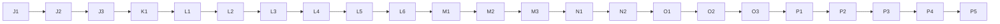

# Build Guide — LEAD-CORE (Part 2 of 2)

## Precog Engine, evaluation numbers, integration tests, and the hosted phone demo

---

## 0. Document Control

| Field | Detail |
|---|---|
| **Document** | Build Guide for LEAD-CORE, Part 2 |
| **Version** | 1.0 |
| **Date** | 10 October 2026 |
| **Follows** | Master Project Document, PRD v1.2, TRD v1.2, UI/UX Brief, LEAD-CORE Part 1, and the DETECT, GRAPH and VIZ guides |
| **Delivered with this guide** | `precog-platform-part2.zip` (32 finished files, tested) |

---

## Naming Convention (Read This First)

The master document uses real names. **Every other project document, including this guide, uses the role-based aliases below.**

| Alias | Real Name | USN | Role |
|---|---|---|---|
| **LEAD-CORE** | Sagar R | 1DT24CS232 | Team lead — backend add-ons, Precog Engine, integration; the only person who merges code |
| **DETECT** | Neha | 1DT24CS174 | Flow feature preparation, ML detection, security event processing, ATT&CK correlation |
| **GRAPH** | Pallavi Bammanni | 1DT24CS185 | Data ingestion, simulation, attack graph, mobile web app (PWA) |
| **VIZ** | Preethi S Pujari | 1DT24CS195 | 3D visualization, charts, push notifications, containment |

**This guide is for LEAD-CORE.** Where it says "you", it means LEAD-CORE.

---

## 1. What Part 2 Adds

| Part | What it is | Where |
|---|---|---|
| **Precog Engine** | The forecast: a Top-3 list of the hosts the attacker will try next, with a confidence for each, a technique hint, and the name of the table that gave the hint. It also **resolves** every forecast (hit at rank 1 to 3, miss, or blocked hit) and keeps the live accuracy numbers: precision@1, precision@3, calibration, containment success | `lead-core/precog/precog_engine/` |
| **Evaluation** | A script that trains the model on GRAPH's 300 training routes, tests it on routes it **never saw**, compares it with two baselines, and saves the model the product uses | `lead-core/precog/tools/evaluate_precog.py` |
| **Technique table export** | A script that exports the forecasting repository's Markov table to a JSON file, **once** | `lead-core/precog/tools/export_technique_markov.py` |
| **Integration tests and the golden-path script** | The whole demo run through the real backend and the real routes, with timing checks, and the script for the five rehearsals | `lead-core/integration/` |
| **Deployment** | One free host serving the backend and the built web app over HTTPS, so a phone can install the app | `render.yaml`, `deploy/build_web_bundle.py`, `lead-core/integration/check_hosted.py` |

### What Part 2 changes in Part 1's files (seven small files, replaced by the zip)

| File | Change |
|---|---|
| `lead-core/backend/addons/loader.py` | Loads the new `precog_engine` package |
| `lead-core/backend/addons/config.py` | Serves the bundled web app from `lead-core/backend/web_dist` when that folder exists (the hosted copy), otherwise `web/dist` |
| `lead-core/backend/requirements.txt` | Adds `PyYAML` (checks the Render file in a test) |
| `lead-core/integration/tests/test_api.py` | The health test now expects five role packages |
| `pytest.ini` | Also runs the Precog tests |
| `.gitignore` | Ignores your rehearsal log |
| `.env.example` | Adds `FORECAST_SOURCE` |

### Six honest findings (read them before you write the paper)

| # | Finding | What it means |
|---|---|---|
| 1 | **The forecasting repository cannot be "run" or imported.** Its README describes files (`train_markov.py`) that do not exist. The code is one big script with paths from its author's computer that imports PyTorch first and starts training | The export tool reads the script's **text**, takes out only the repository's own Markov functions (unchanged) and runs them on the repository's own Attack Flow data files. PyTorch is never used. Only the 39 Attack Flow files are used (the Unit 42 playbooks give names, not ATT&CK ids) |
| 2 | **That exported table does not know every technique we use** (for example Brute Force `T1110`) | For those the hand-written rule table answers, and the forecast says `source: "lookup"`. For others (for example `T1046`) the exported table answers and the forecast says `"repo"`. Either way the source is recorded, as the PRD requires |
| 3 | **Precision@3 is about 1.0 for every method.** At most three hosts can be reached from any host in the six-host network, so a Top-3 list nearly always holds every candidate | Do not report precision@3 as an achievement. Report precision@1, calibration, and the gap to the baselines |
| 4 | **The model only slightly beats the baselines.** On 149 held-out forecasts: Markov model 0.651, rule-based baseline 0.638, uniform 0.550. The standard error of 0.651 is about 0.039, so the gap to the rule-based baseline is smaller than the noise | Say so plainly. The honest contribution is the closed loop and the measured, calibrated forecasts, not a large accuracy jump |
| 5 | **The training data is made by our own scripted generator**, not by real attackers | The numbers say how well the model learned that generator's habits on routes it never saw. They are not a claim about real intrusions |
| 6 | **Containment success equals precision@1 (contain the top host) or precision@3 (contain the Top-3) by construction** in this replay setting | Report it with that sentence next to it |

The documents show "74 %" for the demo forecast. **That number was always illustrative.** The real forecast from Workstation A is about **web server 45 %, file server 39 %, Workstation B 16 %**.

---

## 2. What Was Verified and What Was Not

I tested everything that can run in my own test environment (Linux, Python 3.11, Node 22).

| Verified by me | Result |
|---|---|
| **Everything merged** (Part 1, DETECT, GRAPH, VIZ and Part 2) in a fresh environment installed from the requirements files | **370 passed, 1 skipped** (the skipped one needs a copy of the forecasting repository). Web: 91 tests pass and the app builds |
| Part 2 together with any subset of the teammates' work | Part 2 alone: 168 passed, 10 skipped. With DETECT: 240. With GRAPH: 256. With VIZ: 202. DETECT + GRAPH: 329. The skips are tests that wait for the other roles |
| **The golden path through the real routes** | Sign in, start the replay, it stops with a forecast (web server first), Contain asks first, confirm, the replay carries on by itself, the move is **blocked**, the forecast is a blocked hit, the accuracy counter ticks up, the success rate is 100 %, the re-evaluation sentence appears, the session is archived, the audit log has detections, forecasts and containments |
| **The golden-path script, twice, at the real 1× pace** | Both PASS. The replay stops at the decision point after about **4.6 s**; after confirmation everything is finished about **2.3 s** later |
| The no-containment path | The attacker reaches the web server, the forecast is a hit that was not blocked, and a new forecast is made from the web server |
| Timing budget (PRD NFR-PERF) | From the compromise to the forecast: under 1 second on the server side, which leaves room for the 1.5-second polling delay inside the 3-second target |
| The Precog model | Hand-checked probability formula, repeatable split, alpha chosen only on training data, held-out test routes never used for training, same numbers on a re-run |
| The export tool | Runs on the **real** repository (39 flow files, 1,617 sequences, 104 techniques with a next step) without PyTorch; also tested on a made-up repository whose script would crash if it were run |
| **The hosted set-up, locally** | The app started the way the host starts it (`gunicorn`, one worker, four threads) with the bundled web app: the readiness checker passed every line |
| `render.yaml` | Parsed, and checked: free plan, one worker, secrets are asked for in the dashboard and never stored in Git |

| **Not** verified by me | What to do |
|---|---|
| **Render itself** (an account, the dashboard screens, a real deploy, the free plan's current limits) | Part P walks through it. If a screen differs, look for the same idea and tell me exactly what you see |
| Installing the app on a **real phone**, and push on a phone | Needs the hosted HTTPS address (Part P) |
| PowerShell commands on Windows | They are standard commands. If one fails use Section 12 and send me the exact error |
| The five rehearsals on **your** laptop, the backup video | Part Q. Only you can do these |
| GitHub's and Antigravity's screens | Names may differ slightly. Look for the same idea |

---

## How to Read This Guide

1. Do the steps **in order, top to bottom**. Every step has an ID such as `L2`.
2. Boxes marked `powershell` are typed into **PowerShell**. Press Enter after each line.
3. Text after `#` in a command is a comment. Do not type it.
4. **You should see:** tells you what correct looks like. If you see something else, go to Section 12.
5. Every **code step** has the same parts: **WHERE**, **WHAT**, **COPY** (my finished, tested file), **PROMPT** (the instruction for Antigravity), **COMPARE** and **COMMIT**. The compare method is the one in Part 1, Step G0.
6. The delivered files must be unzipped so that `C:\precog-delivery2\lead-core\precog\precog_engine\engine.py` exists. Every COPY command reads from `C:\precog-delivery2\`.
7. **Start this guide only when Part 1 is finished and merged.** The teammates' work may or may not be merged yet: Part 2 works with whatever is there (the steps say which tests wait for whom).

---

# PART J — Get Ready

### J1 — Unzip the delivered files

Right-click `precog-platform-part2.zip` → **Extract All** → extract to a new folder named exactly `C:\precog-delivery2`.

```powershell
Test-Path C:\precog-delivery2\lead-core\precog\precog_engine\engine.py   # asks "does this file exist?"
```

**You should see:** `True`. If `False`, move the `lead-core`, `deploy` and other folders up one level so they sit directly inside `C:\precog-delivery2`.

### J2 — Bring your branch up to date

```powershell
cd $HOME\Documents\precog-platform     # the repo folder
.\.venv\Scripts\Activate.ps1           # switches the backend environment on
git switch main                        # go to main
git pull origin main                   # download everything merged so far
git switch lead-core                   # your own branch
git merge main                         # bring main into your branch
pytest                                 # whatever is merged must pass
```

**You should see:** `101 passed` if only Part 1 is merged, or more (for example `259 passed` with DETECT and GRAPH, `294 passed` with all three teammates).

### J3 — Make the scratch folder and the context block

```powershell
New-Item -ItemType Directory -Force -Path scratch-ai | Out-Null   # the folder where Antigravity's versions go (already ignored by Git)
```

In Antigravity's agent chat start a **new conversation** and paste this once. Keep it for Parts K to M:

```text
CONTEXT (remember this for everything I ask next)
I am LEAD-CORE in a team building the "Precog SOC Platform", a student cybersecurity project. Python 3.11 on Windows. Libraries allowed: the Python standard library, jsonschema, pytest, and the project's own "addons" package. No other libraries.
Repo (root = precog-platform): contracts/schemas/*.schema.json are data formats (forecast, session_metrics, ...); lead-core/backend/addons/ has the shared WorldState (set_forecast, resolve_forecast, set_metrics, forecasts(), actions(), alerts(limit), session()), Hooks and Contracts (validate(name, data)).
Other roles' hooks I call: graph (feasible_targets(host), snapshot(), optional topology.edge_probability(a, b)), events (audit_record(type, ref_id, summary)). GRAPH's replay calls MY hook "precog": reset(), on_compromise(host), on_attempt(from_host, to_host, blocked).
My folder is lead-core/precog/ (package precog_engine). Rules for every file you write: plain readable Python with short docstrings and clear names; write the file ONLY to scratch-ai/<the same path as the real file>; do not touch any other file; do not add features I did not ask for.
```

---

# PART K — Update Part 1's Seven Files

### K1 — Copy the seven changed files

```powershell
$d = "C:\precog-delivery2"
Copy-Item -Force $d\lead-core\backend\addons\loader.py lead-core\backend\addons\loader.py                 # loads precog_engine
Copy-Item -Force $d\lead-core\backend\addons\config.py lead-core\backend\addons\config.py                 # serves the bundled web app when it exists
Copy-Item -Force $d\lead-core\backend\requirements.txt lead-core\backend\requirements.txt                 # adds PyYAML
Copy-Item -Force $d\lead-core\integration\tests\test_api.py lead-core\integration\tests\test_api.py       # health test expects five packages
Copy-Item -Force $d\pytest.ini pytest.ini                                                                 # also runs the Precog tests
Copy-Item -Force $d\.gitignore .gitignore                                                                 # ignores the rehearsal log
Copy-Item -Force $d\.env.example .env.example                                                             # adds FORECAST_SOURCE
pip install -r lead-core/backend/requirements.txt                                                         # installs PyYAML
git diff --stat                                                                                           # shows exactly 7 changed files
```

**You should see:** a list of **7** files changed. (`.env` is yours and untouched: add the line `FORECAST_SOURCE=repo` to it if you want to set it, or leave it, because `repo` is the default.)

**PROMPT:** None. These are small edits, shown by `git diff`; read them if you are curious.

**COMMIT:**

```powershell
git add .
git commit -m "chore: load the precog package, serve a bundled web app, run the precog tests"
```

---

# PART L — The Precog Package (Code)

The package lives in `lead-core/precog/precog_engine/`. Build it in this order. Always **COPY**, then give the **PROMPT**, then **COMPARE** (Part 1, Step G0), keep mine by default, and run the tests in Step N2.

```powershell
New-Item -ItemType Directory -Force -Path lead-core\precog\precog_engine\data | Out-Null
```

### L1 — metrics.py: the numbers for the paper

**WHERE:** `lead-core/precog/precog_engine/metrics.py`
**WHAT:** Plain functions (no state) for the numbers in PRD EV-6 to EV-10.

| Number | Meaning |
|---|---|
| precision@1 | Share of resolved forecasts where the attacker's next host was the top-ranked one |
| precision@3 | Share where it was anywhere in the Top-3 |
| **Calibration** | Every target of every forecast is one prediction (its stated confidence, and whether it was the host the attacker tried). They are grouped into bins of width 0.1; each bin compares the average stated confidence with how often it was right |
| **Containment success rate** | Of the resolved forecasts where an **executed** containment was applied to a predicted host, the share where the attacker's move was blocked. Empty when no containment was applied |

**COPY:**

```powershell
Copy-Item C:\precog-delivery2\lead-core\precog\precog_engine\metrics.py lead-core\precog\precog_engine\metrics.py
```

**PROMPT:**

```text
Write scratch-ai/lead-core/precog/precog_engine/metrics.py: plain functions, no state. A "resolved record" is {"forecast_id", "targets": [{"rank","host_id","confidence"}], "attempted_host", "rank_hit" (1 to 3 or None), "blocked" (bool)}.
calibration_bins(records): every target of every record is one prediction with confidence p and outcome 1 if target.host_id equals the record's attempted_host, else 0. Group by tenths: index = min(int(p / 0.1), 9). Return, for non-empty bins only and in order, {"bin_low": index*0.1 rounded to 1 decimal, "bin_high": (index+1)*0.1 rounded, "mean_confidence", "observed_rate" (both rounded to 4 decimals), "count"}.
expected_calibration_error(bins): the count-weighted mean of |mean_confidence - observed_rate|, rounded to 4 decimals; None for no bins.
containment_success_rate(records, actions): a record counts as "applied" when some action has status "executed", its target_host is one of the record's predicted hosts, and its forecast_id is None or equals the record's forecast_id; success when that record's blocked is True; return successes / applied rounded to 4 decimals, or None when none was applied.
session_metrics(records, actions) -> the session_metrics contract: forecasts_resolved, hits (rank_hit not None), hit_rate, precision_at_1 (rank_hit == 1), precision_at_3 (rank_hit not None and <= 3) (each a ratio rounded to 4 decimals, None when there are no records), calibration_bins, containment_success_rate. zero_metrics() is session_metrics([], []).
```

**COMPARE:** Part 1, Step G0.

### L2 — model.py: the node-level Markov model

**WHERE:** `lead-core/precog/precog_engine/model.py`
**WHAT:** The model of TRD Section 9.2. The state is the host the attacker is on; the candidates are the hosts it could go to next. The probability of moving from `i` to `j` is

```text
P(j | i) = ( count(i -> j) + alpha ) / ( sum over candidates k of count(i -> k) + alpha * number_of_candidates )
```

`alpha` is a small smoothing number so a move never seen in training still has a small chance. The top three probabilities are the forecast. The file also has the repeatable 80/20 split and `tune_alpha`, which picks alpha **only from a validation part of the training data**, never from the test routes.

**COPY:**

```powershell
Copy-Item C:\precog-delivery2\lead-core\precog\precog_engine\model.py lead-core\precog\precog_engine\model.py
```

**PROMPT:**

```text
Write scratch-ai/lead-core/precog/precog_engine/model.py. DEFAULT_ALPHA = 0.1, ALPHA_GRID = (0.01, 0.05, 0.1, 0.2, 0.5, 1.0).
split_sequences(sequences, seed=0, test_fraction=0.2) -> (train, test): shuffle the indexes with random.Random(seed), cut at round(len * (1 - test_fraction)). count_moves(sequences) -> {from_host: {to_host: count}} over consecutive pairs of each sequence's "path" (a sequence is a dict with "path", or a plain list).
class NodeModel(counts, alpha=0.1, meta=None): negative alpha -> ValueError. train(sequences, alpha, meta) classmethod. probabilities(from_host, candidates) -> {candidate: probability} using P(j|i) = (count(i->j) + alpha) / (sum over the candidates k of count(i->k) + alpha * number of candidates); empty candidates -> {}; if the denominator is 0 every candidate gets 1/n. top(from_host, candidates, k=3) -> [(host, probability)] best first, ties broken by the host id, cut to k. to_dict/from_dict/save/load as JSON ({"alpha","counts","meta"}, sorted keys, UTF-8, creating the folder).
file_sha256(path). negative_log_likelihood(model, sequences, candidates_fn): the mean of -log(probability of the move that really happened) over every move; candidates_fn(here, path_so_far_including_here) -> candidate list; clamp probabilities at 1e-12; infinity for no moves. tune_alpha(train_sequences, candidates_fn, grid, seed=0): split the TRAINING sequences again with seed+1 (80/20), fit a model per alpha on the 80 %, score on the 20 %, return (alpha with the lowest score, ties to the smaller alpha, {alpha: score}).
```

**COMPARE:** Part 1, Step G0.

### L3 — technique_layer.py: the technique hint

**WHERE:** `lead-core/precog/precog_engine/technique_layer.py`
**WHAT:** "Which ATT&CK technique is likely next?" It reads two JSON files at start-up (nothing from the forecasting repository is imported): `technique_markov.json` (exported from the repository, Step M2) and `technique_lookup.json` (the hand-written rule table, the fallback). A sub-technique is tried first, then its parent. If the preferred table has no answer the other one is used, and **the forecast records which one answered**.

**COPY:**

```powershell
Copy-Item C:\precog-delivery2\lead-core\precog\precog_engine\technique_layer.py lead-core\precog\precog_engine\technique_layer.py
```

**PROMPT:**

```text
Write scratch-ai/lead-core/precog/precog_engine/technique_layer.py: class TechniqueLayer(markov=None, lookup=None, prefer="repo"). markov is the parsed technique_markov.json ({"names": {id: name}, "next_prob": {id: {next_id: probability}}}); lookup is the parsed technique_lookup.json ({"names": {id: name}, "next": {id: [{"id", "probability"}, ... best first]}}); prefer is "repo" or "lookup".
Class method load(markov_path, lookup_path, prefer) reads each file as UTF-8 JSON, or None when the file does not exist. Property default_source: "repo" when prefer is "repo" and a markov table exists, else "lookup".
hint(technique_id) -> (hint or None, source): for no id return (None, default_source). Try the tables in the preferred order (repo then lookup, or the reverse); in each table try the technique id first and then its parent (the part before the dot); take the most probable next technique (highest probability, ties to the larger id for the markov table); the hint is {"technique_id", "technique_name" (from that table's names, else the id), "probability" rounded to 4 decimals} and the source is "repo" or "lookup" according to the table that answered. If neither table answers return (None, default_source).
```

**COMPARE:** Part 1, Step G0.

### L4 — engine.py: forecasts, resolving, live numbers

**WHERE:** `lead-core/precog/precog_engine/engine.py`
**WHAT:** The `precog` hook that GRAPH's replay calls.

| Call | What it does |
|---|---|
| `on_compromise(host)` | Asks GRAPH for the hosts still reachable (not compromised, not contained), ranks them with the model, takes the top three, adds the technique hint (from the latest technique seen on that host), builds a forecast (`fc-000001`, `fc-000002` ...), checks it against the contract, publishes it (any older pending forecast becomes `superseded`) and writes an audit line. **No reachable host means no forecast** |
| `on_attempt(from, to, blocked)` | The attacker's next move is seen. If `to` is in the Top-3 the forecast is a **hit at that rank** (blocked or not), otherwise a **miss**. Then the live numbers are recomputed and published, the session is saved to a JSON file, and an audit line is written |
| `reset()` | A new replay begins |

If no model is available it falls back to ranking hosts by how easy they are to attack (the rule-based fallback). A problem saving the session file or writing the audit log never disturbs the demo.

**COPY:**

```powershell
Copy-Item C:\precog-delivery2\lead-core\precog\precog_engine\engine.py lead-core\precog\precog_engine\engine.py
```

**PROMPT:**

```text
Write scratch-ai/lead-core/precog/precog_engine/engine.py: class PrecogEngine(world, hooks, model, technique_layer, contracts=None, clock=utc_now, sessions_dir=None, top_k=3). model is a NodeModel or None. utc_now() -> "YYYY-MM-DDTHH:MM:SSZ". Use metrics.session_metrics and zero_metrics.
reset(): forget the counter (forecast ids restart at fc-000001), the pending forecast and the resolved records.
on_compromise(host): graph = hooks.get("graph"); none -> log and return None. candidates = graph.feasible_targets(host); none -> forget the pending forecast and return None. Rank: model.top(host, candidates, 3); with no model use the weights max(graph.topology.edge_probability(host, c), 0.01) (1.0 each if there is no topology), normalised, best first, ties by host id. Technique hint: the technique_id of the NEWEST alert in world.alerts(200) whose host is this host and has a technique_id, then technique_layer.hint(that id) -> (hint, source); without a layer (None, "lookup"). Build {"forecast_id", "ts", "from_host", "targets": [{"rank" from 1, "host_id", "confidence" rounded to 4 decimals}], "technique_hint", "source", "status": "pending", "outcome": None}, validate with contracts "forecast" when given, world.set_forecast, remember it as pending, write an audit entry through hooks.get("events").audit_record("forecast", id, "Forecast from <host name>: <name> <percent> %, ...") (names from graph.snapshot(); an audit problem is logged, never raised); return the forecast.
on_attempt(from_host, to_host, blocked): no pending forecast -> None. rank_hit = 1 + index of to_host among the forecast's host ids, or None; status "hit" when rank_hit else "miss"; outcome {"attempted_host", "rank_hit", "blocked": bool}; world.resolve_forecast(id, status, outcome); clear the pending one; remember a resolved record {forecast_id, targets, attempted_host, rank_hit, blocked}; refresh_metrics(); audit "Forecast resolved: hit at rank N" or "miss" plus ", the move was blocked"; return the outcome.
metrics() = session_metrics(resolved records, world.actions()). refresh_metrics(): compute, validate with the contract "session_metrics" when given, world.set_metrics, save the session, return it. describe() -> {"node_model": "markov" or "rule-based fallback", "alpha", "technique_source": layer.default_source}.
Saving the session: when sessions_dir is set and world.session() exists, write <sessions_dir>/<session_id>.json containing {"session", "forecasts": world.forecasts(), "actions": world.actions(), "metrics"} (UTF-8, indent 1, through a temporary file and os.replace); any exception is logged and swallowed.
```

**COMPARE:** Part 1, Step G0.

### L5 — evaluation.py: the honest evaluation

**WHERE:** `lead-core/precog/precog_engine/evaluation.py`
**WHAT:** The evaluation (PRD EV-6 to EV-10). Rules that keep it honest: the test routes are held out (never used for training or for choosing alpha); each held-out step is one forecast ("the attacker is on host i; the candidates are the hosts not yet compromised that i can reach"); the numbers come **only** from held-out routes, never from the rehearsed golden path. It scores the model and two baselines: **rule-based** (easier-to-attack hosts first, no learning) and **uniform** (all candidates equal). It also reports the largest candidate list and the standard error of precision@1.

**COPY:**

```powershell
Copy-Item C:\precog-delivery2\lead-core\precog\precog_engine\evaluation.py lead-core\precog\precog_engine\evaluation.py
```

**PROMPT:**

```text
Write scratch-ai/lead-core/precog/precog_engine/evaluation.py using metrics.calibration_bins and expected_calibration_error and model.ALPHA_GRID, NodeModel, split_sequences, tune_alpha.
_forecast_points(sequences, candidates_fn): for every move in every sequence's path yield (profile, here, candidates, actual_next) where candidates = candidates_fn(here, path[: i + 1]).
_score(points, ranker, k=3): ranker(here, candidates) -> [(host, probability)] best first. For every point take the first k; count total, hits where the top one is the actual next host (precision@1), hits where the actual host is anywhere in the k, how many points had more than k candidates, and the biggest candidate list. Return {"forecasts", "precision_at_1", "precision_at_1_std_error" (sqrt(p(1-p)/n)), "precision_at_3", "max_candidates", "share_with_more_than_3_candidates", "calibration_bins", "expected_calibration_error"} (4 decimals).
evaluate(sequences, candidates_fn, edge_probability_fn, seed=0, test_fraction=0.2, grid=ALPHA_GRID) -> (model, result): split with split_sequences; alpha = tune_alpha on the TRAINING part only; model = NodeModel.train(train, alpha, meta={seed, test_fraction, training_sequences, alpha_chosen_on}); score on the test points: "node_model" (the model's top), "baseline_rule_based" (candidates ranked by max(edge_probability_fn(here, c), 0.01), normalised, ties by host id), "baseline_uniform" (equal shares in host-id order). Also "by_profile" (the model's score per attacker style without calibration bins), "containment_success" {"contain_top_1": the model's precision_at_1, "contain_top_3": its precision_at_3}, "split" {seed, training_sequences, test_sequences, test_forecasts}, "alpha" {"chosen", "validation_surprise": {alpha: score}}.
```

**COMPARE:** Part 1, Step G0.

### L6 — The package file

**WHERE:** `lead-core/precog/precog_engine/__init__.py`
**WHAT:** `register(ctx)` loads the saved model (`data/node_model.json`; if it is missing it trains one from GRAPH's training file; if that is missing too it uses the fallback ranking), loads the two technique tables, builds the engine and plugs it in as the `precog` hook. `FORECAST_SOURCE=lookup` forces the rule table.

**COPY:**

```powershell
Copy-Item C:\precog-delivery2\lead-core\precog\precog_engine\__init__.py lead-core\precog\precog_engine\__init__.py
```

**PROMPT:**

```text
Write scratch-ai/lead-core/precog/precog_engine/__init__.py. Docstring listing the hook methods (reset, on_compromise, on_attempt) and the setting FORECAST_SOURCE (repo or lookup). Constants PACKAGE_DIR, DATA_DIR (data/), MODEL_FILE (data/node_model.json), TRAINING_FILE = graph/graph_replay/training/sequences.json (relative to the repo root). Export register, PrecogEngine, NodeModel, TechniqueLayer, session_metrics, zero_metrics, MODEL_FILE.
_load_model(repo_root): load MODEL_FILE if it exists; else if the training file exists train a NodeModel on its "sequences" with the default alpha and log a warning that tools/evaluate_precog.py should be run; else log a warning and return None.
register(ctx): prefer = FORECAST_SOURCE from the environment (default "repo", lower-case); anything other than "repo" or "lookup" raises ValueError("FORECAST_SOURCE must be 'repo' or 'lookup', not ..."). Build TechniqueLayer.load(DATA_DIR/technique_markov.json, DATA_DIR/technique_lookup.json, prefer); the PrecogEngine with the model, the layer, contracts=ctx.contracts and sessions_dir=<repo_root>/lead-core/backend/data/sessions; register it with ctx.hooks.register("precog", engine); log engine.describe().
```

**COMPARE:** Part 1, Step G0.

**COMMIT (L1 to L6 together):**

```powershell
git add .
git commit -m "feat(precog): node-level Markov forecasts, resolving, live accuracy numbers and the evaluation core"
```

---

# PART M — The Data Files and the Two Tools

### M1 — The rule table (the fallback)

**WHERE:** `lead-core/precog/precog_engine/data/technique_lookup.json`
**WHAT:** A hand-written table of which ATT&CK technique usually follows which, in kill-chain order, for the 26 techniques DETECT knows. **The numbers are rule weights chosen by hand, not learned**, and the file says so. The names are MITRE's official names (copied from DETECT's table).

**COPY:**

```powershell
Copy-Item C:\precog-delivery2\lead-core\precog\precog_engine\data\technique_lookup.json lead-core\precog\precog_engine\data\technique_lookup.json
```

**PROMPT:** A table like this is best written by hand from your own reading of the ATT&CK matrix, not by an AI. If you want the AI's draft, ask: "Write scratch-ai/lead-core/precog/precog_engine/data/technique_lookup.json: {meta, names, next} where names maps each of these 26 ATT&CK ids to its official name (T1046 T1110 T1110.001 T1110.003 T1078 T1021 T1021.001 T1021.002 T1021.003 T1021.004 T1571 T1048 T1041 T1059 T1087 T1018 T1083 T1005 T1560 T1003 T1570 T1105 T1190 T1135 T1133 T1068) and next maps each id to a list of {id, probability} (best first, probabilities summing to 1, only ids from the 26, an empty list for T1048 and T1041). meta says these are hand-chosen rule weights, not learned." Then check that the names match MITRE's.

### M2 — Export the forecasting repository's Markov table (once)

**WHERE:** `lead-core/precog/tools/export_technique_markov.py` and its output `lead-core/precog/precog_engine/data/technique_markov.json`
**WHAT:** Exports the technique-level Markov table **once**, in its own folder. How it works, honestly: the repository is one big script that imports PyTorch first and trains when run, so it cannot be imported. The tool reads the script's text, cuts out only the repository's own functions it needs (`af_sequences_from_file` and `train_markov_from_sequences`, **unchanged**) and runs them on the repository's own Attack Flow data files. PyTorch is never used. It cuts each sequence at steps that have no ATT&CK id, so two techniques that were never next to each other are never joined. The output records where it came from, the commit and the permission note.

**You need the repository's permission and must cite it.** The README asks users to contact the author, and you have the author's email permission: keep that email, cite the repository and its paper, and do not give the repository's code to anyone outside the project without the author's agreement. (The export file contains only numbers and names, not the repository's code.)

**COPY:**

```powershell
New-Item -ItemType Directory -Force -Path lead-core\precog\tools | Out-Null
Copy-Item C:\precog-delivery2\lead-core\precog\tools\export_technique_markov.py lead-core\precog\tools\export_technique_markov.py
```

**PROMPT:**

```text
Write scratch-ai/lead-core/precog/tools/export_technique_markov.py (standard library only, Python 3.9 or newer). It exports the technique-level Markov table from the cloned repository https://github.com/mayank02raj/MITRE-ATTACK-based-Attack-Chain-Prediction WITHOUT importing or running its script (which imports PyTorch and trains when run).
load_repo_functions(script_path): read AP_Prob_Rs_3_Scenarios_Latest.py as text, parse it with ast, keep ONLY the top-level functions af_sequences_from_file and train_markov_from_sequences and the assignment MIN_CHAIN_LEN, compile and exec just those in a namespace holding json, os, re, Counter, defaultdict, List, Dict and a logger named log; stop with SystemExit if a wanted function is missing ("...no longer contains: ...").
class AnyTechniqueId(dict): "x in it" is true for any string like T1234 or T1234.567 and it[x] returns x, so the repository's functions return technique IDs instead of names.
split_at_non_ids(sequences) -> (segments, cut count): cut each sequence at every step that is not an ATT&CK id and keep the pieces of two or more ids. names_from_flows(files): id -> name from the "name" of attack-action objects that have a technique_id.
export(repo_dir, commit=None): run af_sequences_from_file on every "Attack flows/*.json" file, cut with split_at_non_ids, run train_markov_from_sequences, and return {"meta": {source URL, commit (from git rev-parse when not given), data, flow_files, sequences, free_text_steps_cut_out, start_states, unique_transitions, repository_functions_used, markov description, notice about permission and citation}, "names", "start_prob", "next_prob"} (probabilities rounded to 6 decimals, keys sorted). main(): --repo (required), --commit, --out (default precog_engine/data/technique_markov.json); print how many flow files, sequences, techniques and transitions were written and that PyTorch was not needed.
```

**COMPARE:** Part 1, Step G0.

**RUN IT (once):**

```powershell
cd $HOME\Documents                                                                                                   # leave the repo folder for a moment
git clone https://github.com/mayank02raj/MITRE-ATTACK-based-Attack-Chain-Prediction.git mitre-chain                   # downloads the forecasting repository next to your project
git -C mitre-chain checkout e188cc6ec96d6f0a5ea62d7ccfb53be3c5a4df14                                                  # the exact version I tested (if this says the commit is unknown, skip this line)
cd $HOME\Documents\precog-platform                                                                                    # back into the repo
python lead-core/precog/tools/export_technique_markov.py --repo $HOME\Documents\mitre-chain                          # exports the table
```

**You should see:** `Wrote ...technique_markov.json: 39 flow files, 1617 sequences, 104 techniques with a next step, 237 transitions (PyTorch was not needed)`. If the repository was changed by its author since, the numbers may differ a little: that is fine, as long as the tests in Step N2 still pass.

**Check against my file:**

```powershell
git diff --stat lead-core/precog/precog_engine/data/technique_markov.json   # nothing shown means yours equals mine
```

(Copy my file first with `Copy-Item C:\precog-delivery2\lead-core\precog\precog_engine\data\technique_markov.json lead-core\precog\precog_engine\data\technique_markov.json`, `git add` it, then run the export and compare with `git diff`.)

**Do not commit the `mitre-chain` folder**: it sits outside your repo, which is correct.

### M3 — The evaluation tool and the saved model

**WHERE:** `lead-core/precog/tools/evaluate_precog.py`, and its outputs `precog_engine/data/node_model.json`, `lead-core/precog/results/precog_evaluation.json`, `precog_experiments.csv`
**WHAT:** Trains the model on GRAPH's 300 training routes (80 % to train, 20 % held out), picks alpha from the training data only, tests on the held-out routes, compares with the two baselines, saves **the very model that was evaluated** as `node_model.json` (the product uses it), and writes the results and one line in the experiment log. The same seed always gives the same numbers. **Needs GRAPH's work merged** (it uses GRAPH's topology and training file).

**COPY:**

```powershell
Copy-Item C:\precog-delivery2\lead-core\precog\tools\evaluate_precog.py lead-core\precog\tools\evaluate_precog.py
```

**PROMPT:**

```text
Write scratch-ai/lead-core/precog/tools/evaluate_precog.py, run from the repo root with the backend environment on. It adds <repo>/lead-core/precog, lead-core/backend and graph to sys.path and imports graph_net (TOPOLOGY_FILE, Topology, load_hosts), precog_engine (MODEL_FILE) and precog_engine.evaluation.evaluate. Options --seed 0, --test-fraction 0.2, --out (default lead-core/precog/results).
Load graph/graph_replay/training/sequences.json, build the Topology from contracts/data/hosts.json, call evaluate(sequences, lambda here, path: topology.candidates(here, exclude=path), topology.edge_probability, seed, test_fraction). Add to the model's meta the SHA-256 of the training file, its seed and generator name and the topology engine; save the model to MODEL_FILE. Write precog_evaluation.json (the result plus generated_at, the training file hash and a NOTES text) and append one row to precog_experiments.csv (header written once: timestamp_utc, seed, alpha, train_sequences, test_forecasts, model_p1, model_p3, model_ece, rule_p1, rule_p3, uniform_p1, uniform_p3).
NOTES must say: the training sequences come from GRAPH's scripted generator, not real attackers, so the numbers are not a claim about real intrusions; containment success equals precision@1 or precision@3 by construction; the numbers come only from held-out sequences; on this six-host network at most three hosts are reachable so precision@3 is about 1.0 for every method and says nothing, and the model should be judged by precision@1, calibration and its gap to the baselines read against the standard error.
Print the held-out forecast count, a table of precision@1, precision@3 and the calibration error for the Markov model, the rule-based baseline and the uniform baseline, the largest candidate list and the standard error, and where the model and results were saved.
```

**COMPARE:** Part 1, Step G0.

**RUN IT:**

```powershell
python lead-core/precog/tools/evaluate_precog.py   # trains, tests and saves (a second or two)
```

**You should see (my numbers; yours should be identical because the seed is fixed):**

```text
Held-out forecasts: 149 (from 60 test sequences; 240 training sequences; alpha 0.01)
                        precision@1  precision@3      ECE
Markov node model            0.6510       1.0000   0.0572
rule-based baseline          0.6376       1.0000   0.0417
uniform baseline             0.5503       1.0000   0.0
Largest candidate list in the test forecasts: 3 hosts; precision@1 standard error: 0.0390
```

Read the six honest findings in Section 1 again. This is the table for the paper, with those caveats written next to it.

**COMMIT:**

```powershell
git add .
git commit -m "feat(precog): rule table, exported technique table, evaluated model and its results"
```

---

# PART N — The Precog Tests

### N1 — Copy the tests

**WHERE:** `lead-core/precog/tests/` (6 files: `conftest.py`, `precog_helpers.py`, `test_precog_model_and_metrics.py`, `test_precog_technique_layer.py`, `test_precog_engine.py`, `test_precog_register_and_tools.py`)

```powershell
New-Item -ItemType Directory -Force -Path lead-core\precog\tests | Out-Null
Copy-Item -Force C:\precog-delivery2\lead-core\precog\tests\*.py lead-core\precog\tests\   # copies the test files
(Get-ChildItem lead-core\precog\tests -Filter *.py).Count                                    # counts them
```

**You should see:** `6`.

**WHAT:** 64 automatic tests: the probability formula by hand; the repeatable split; alpha chosen without the test data; every metric; the technique layer including the fallback and the recorded source; every engine case (hit at rank 1 and 2, miss, blocked hit, nothing reachable, superseding, the audit lines, the session file, a broken file never disturbing the run); registration through the real loader; the shipped model matches the current training file; the shipped results match a fresh evaluation; and the export tool on a made-up repository whose script would crash if run.

**PROMPT** (one prompt for all test files):

```text
Write pytest files in scratch-ai/lead-core/precog/tests/ for the precog_engine package described in the CONTEXT.
precog_helpers.py (a UNIQUE file name, because other roles' tests also have a conftest.py and two modules with the same name would clash): put <repo>/lead-core/backend, lead-core/precog, graph and detect on sys.path; define REPO_ROOT, DATA, FakeGraph (hosts host-a, host-b, server-b, file-server, db-server with links host-a to host-b, server-b, file-server; feasible_targets leaves out hosts that are not normal; snapshot with names; a topology with edge_probability), FakeEvents (records audit_record calls), a GOOD_MODEL of counts, and a Rig (WorldState with contracts, the fakes, a NodeModel, the real technique files, a PrecogEngine with a fixed clock, and execute_containment(host, forecast_id)). Tests import from precog_helpers, never from conftest. conftest.py: imports precog_helpers first; fixtures contracts and rig.
test_precog_model_and_metrics.py: the split is repeatable, disjoint and the right size; moves are counted; the probability formula by hand with alpha 0.1; unavailable candidates are renormalised away; unseen hosts and no data give equal shares; top is sorted, cut and tie-broken by host id; negative alpha refused; save and load; a trained model is less surprised than an untrained one; alpha tuning is repeatable and picks the lowest score; calibration bins (tenths, confidence 1.0 in the last bin, empty bins left out); the calibration error; session metrics; zero metrics follow the contract; containment success counts only executed actions on predicted hosts.
test_precog_technique_layer.py: the shipped rule table is valid (26 techniques, probabilities sum to 1, says NOT learned); the shipped exported table is valid and names its source repository, 40-character commit, 39 flow files and the permission notice; a hint has id, name and probability and records its source; a sub-technique falls back to its parent; a technique the exported table lacks is answered by the rule table with source lookup; lookup can be forced; no hint when nothing is known; missing files are fine.
test_precog_engine.py: a forecast is a valid ranked Top-3 whose confidences follow the model; compromised and contained hosts are not candidates; fewer than three candidates; nothing reachable gives no forecast; a new forecast supersedes the pending one; no graph part gives no forecast; the technique hint follows the latest technique seen on the host and the source is named; FORECAST_SOURCE lookup is honoured; without a model easier targets come first; audit lines; a broken audit log never stops a forecast; resolving as hit at rank 1, hit at rank 2, miss and blocked hit; an attempt without a pending forecast is ignored; the live numbers follow the contract after each resolution; containment success follows executed containments; reset; the session file is written and a problem writing it never disturbs the run.
test_precog_register_and_tools.py: the loader knows precog_engine; registering gives the precog hook with the three methods; FORECAST_SOURCE lookup and a bad value (reported, not fatal); (when GRAPH is merged) the shipped model was trained on the current training file, the shipped results equal a fresh evaluation and are honest (notes mention that precision@3 says nothing and that this is not a claim about real intrusions), the evaluation is repeatable and never trains on test sequences; the evaluation core works on a tiny hand-made network where the common move sorts last; the export tool uses the repository's functions without importing torch and cuts at free-text steps, refuses a repository whose functions have gone, and (only when PRECOG_REPO_DIR is set) reproduces the shipped table from the real repository.
```

**COMPARE:** Part 1, Step G0.

### N2 — Run the Precog tests

```powershell
pytest lead-core/precog/tests   # runs only the Precog tests
pytest                          # runs everything merged so far
```

**You should see:** first `63 passed, 1 skipped` (the skipped test needs a copy of the forecasting repository; if GRAPH's work is not merged yet, `60 passed, 4 skipped`), then a bigger number with the other roles included. With **everything** merged: `370 passed, 1 skipped`.

**COMMIT:**

```powershell
git add .
git commit -m "test(precog): 64 tests for the model, metrics, technique layer, engine and tools"
```

---

# PART O — Integration Tests and the Golden-Path Script

### O1 — Copy the files

```powershell
Copy-Item C:\precog-delivery2\lead-core\integration\golden_path.py lead-core\integration\golden_path.py
Copy-Item C:\precog-delivery2\lead-core\integration\check_hosted.py lead-core\integration\check_hosted.py
Copy-Item C:\precog-delivery2\lead-core\integration\tests\test_golden_path_e2e.py lead-core\integration\tests\test_golden_path_e2e.py
Copy-Item C:\precog-delivery2\lead-core\integration\tests\test_deploy_and_config.py lead-core\integration\tests\test_deploy_and_config.py
```

| File | What it does |
|---|---|
| `test_golden_path_e2e.py` | 6 tests: the **whole golden path through the real backend and the real `/api/x` routes**, with containment and without, the audit log, the timing budgets, and the script itself. **Skipped until DETECT, GRAPH, VIZ and Precog are all merged** (the skip message says so) |
| `golden_path.py` | The same run as a script that prints a line per check and the stage timings. `--runs 5` is the five rehearsals; it writes `rehearsals.csv` and counts consecutive successes |
| `test_deploy_and_config.py` | 7 tests: which web folder is served, the bundle builder, `render.yaml` is valid and safe, and the readiness checker against the real routes |
| `check_hosted.py` | The readiness checker for a running copy (localhost or hosted), Step P5 |

**PROMPT** (one prompt for the two test files; the two scripts are long and best taken from my files):

```text
Write scratch-ai/lead-core/integration/tests/test_golden_path_e2e.py and test_deploy_and_config.py for the project described in the CONTEXT. The existing conftest.py in that folder gives fixtures flask_app, client, logged_in and world.
test_golden_path_e2e.py: skip (inside the fixture, after flask_app exists, because making the app puts the role folders on Python's search path) unless the real detect_events (EventProcessor), graph_net (LiveGraph), graph_replay (ReplayController), viz_containment (ContainmentService) and precog_engine (PrecogEngine) exist. Fixture stack: other tests empty the shared hooks, so clear them and register every package in addons.loader.ROLE_PACKAGES again with addons.loader._load_role_packages on the same app; set the replay's settle_seconds to 0; reset the world; stop the replay and the containment service afterwards. Use only the HTTP routes through the client. Tests: every hook is registered; the golden path with containment (replay at speed 40 stops at waiting_for_decision with a forecast whose first target is server-b; host-a compromised; NIDS-detector alerts of severity HIGH; propose gives pending_confirmation and changes nothing; confirm gives executed; the replay finishes by itself; server-b is contained and the compromised path is only host-a; the blocked sentence names Web Server B; exactly one forecast hit with outcome {attempted_host server-b, rank_hit 1, blocked true}; metrics 1, 1, 1.0, 1.0 and containment success 1.0; within 5 seconds an action result contains "ended early"; the session is archived with its forecast); the path without containment (resume; compromised path host-a then server-b; one hit, not blocked, success rate None; a new forecast from server-b); the audit file lead-core/backend/data/audit/audit.jsonl has detection, forecast and containment lines; timing (speed 1, poll every 2 ms: from host-a compromised to the forecast under 1 second; confirm to executed under 1 second); and the golden_path.py script run as a subprocess with --runs 2 --speed 40 --log <tmp file> exits 0, logs two PASS rows and prints "consecutive successes at the end: 2 of 2 runs".
test_deploy_and_config.py: Config.from_env uses lead-core/backend/web_dist when it has an index.html and WEB_DIST is not set, uses web/dist when there is no bundle, and an explicit WEB_DIST always wins; deploy/build_web_bundle.copy_dist replaces the old copy and returns the file count and refuses a folder without index.html; render.yaml (loaded with yaml) has plan free, runtime python, healthCheckPath /api/x/health, a start command with --workers 1, wsgi:application and $PORT, DATA_MODE live, COOKIE_SECURE "1", PYTHON_VERSION 3.11.9, a generated SECRET_KEY, and ADMIN_PASSWORD, FCM_PROJECT_ID and FCM_CREDENTIALS_JSON marked sync false with no value; and check_hosted.Checker run through the Flask client does not fail on the health check or the sign-in.
```

**COMPARE:** Part 1, Step G0. For the two scripts, copy mine and read them: they only call the routes you already know.

### O2 — Run them

```powershell
pytest lead-core/integration/tests   # runs the integration tests
pytest                               # runs everything
```

**You should see:** with only Part 1 and Part 2 merged: `168 passed, 10 skipped` (the e2e tests wait for the others). **With everything merged: `370 passed, 1 skipped`.**

**COMMIT:**

```powershell
git add .
git commit -m "test: golden path end to end through the real routes, timing budgets, rehearsal script, readiness checker"
```

### O3 — Run the golden path yourself (needs DETECT, GRAPH, VIZ merged)

In `.env` make sure `ADMIN_PASSWORD` is filled in. Then:

```powershell
python lead-core/integration/golden_path.py --runs 1 --speed 1   # one run at the real pace (about 7 seconds)
```

**You should see** a line per check, each starting `ok`, for example:

```text
   ok    Precog predicts the web server first  (server-b 45 %)
   ok    NIDS's real detector raised alerts from the packets
   ok    Contain asks for confirmation first
   ok    the move toward Web Server B was blocked
   ok    the accuracy counter ticked up
   ok    re-evaluation says the chain ended early
   -> PASS {'to_decision_s': 4.59, 'decision_to_finish_s': 2.26}
consecutive successes at the end: 1 of 1 runs (the plan asks for 5 in a row before demo day)
```

If a part is not merged yet it says which and stops. Any `FAIL` line names the check: copy it to me.

---

# PART P — Deployment: the Hosted Phone Demo

**What this gives you:** one free Render web service that serves the backend **and** the built web app over HTTPS, so a phone can open the address, sign in and install the app. **Localhost stays the primary demo.** Render is the hosted fallback for the phone.

**What to expect from a free service (from Render's free-tier page at the time of writing; check https://render.com/docs/free before the demo):** it goes to sleep after about 15 minutes without traffic and takes up to a minute to wake; its disk is not kept, so every restart starts clean (our app rebuilds its small database and trains NIDS's model on the first start, about 10 to 20 seconds); it has a monthly allowance of free hours. None of this matters for a replay demo, but **wake the service and test it before you present** (Step P5).

### P1 — Fill in the Firebase web settings first (optional, for push)

If you want push notifications on the hosted app, VIZ's guide (Step F2) explains how to get the six values. Put them in `web/.env.local` **before** building the bundle, because they are baked into the build. Without them everything works and only push is switched off.

### P2 — Build the web bundle

```powershell
python deploy/build_web_bundle.py   # runs "npm ci" and "npm run build", then copies the result into lead-core\backend\web_dist (a few minutes)
```

**You should see:** `Copied 20 files to ...\lead-core\backend\web_dist` (the number may differ a little) and a line telling you to commit it.

**COPY** (the builder itself, if you are writing it with Antigravity; otherwise copy it as shown:)

```powershell
New-Item -ItemType Directory -Force -Path deploy | Out-Null
Copy-Item C:\precog-delivery2\deploy\build_web_bundle.py deploy\build_web_bundle.py
Copy-Item C:\precog-delivery2\render.yaml render.yaml
```

**PROMPT 1 of 2 — deploy/build_web_bundle.py:**

```text
Write scratch-ai/deploy/build_web_bundle.py (standard library only). REPO_ROOT is two levels up from the file, BUNDLE = REPO_ROOT/lead-core/backend/web_dist. copy_dist(source, target): stop with SystemExit "... has no index.html: the web app was not built" if source/index.html is missing; delete target if it exists; copy the whole source folder to target; return the number of files copied. main(): run "npm ci" and then "npm run build" inside the web folder (npm.cmd on Windows), stop with a clear message if either fails, call copy_dist(web/dist, BUNDLE), print how many files were copied and a reminder to commit lead-core/backend/web_dist.
```

**PROMPT 2 of 2 — render.yaml:**

```text
Write scratch-ai/render.yaml, a Render Blueprint with ONE service: type web, name precog-soc, runtime python, plan free, region singapore, buildCommand "pip install --upgrade pip && pip install -r lead-core/backend/requirements.txt", startCommand "cd lead-core/backend && gunicorn --workers 1 --threads 4 --timeout 120 --bind 0.0.0.0:$PORT wsgi:application" (ONE worker, because the live state is kept in memory), healthCheckPath /api/x/health. Environment variables: PYTHON_VERSION 3.11.9, SECRET_KEY with generateValue true, ADMIN_PASSWORD with sync false, DATA_MODE live, COOKIE_SECURE "1", AUTO_TRAIN_MODEL "1", REPLAY_DECISION_TIMEOUT "120", CONTAINMENT_CONFIRM_SECONDS "60", FORECAST_SOURCE repo, FCM_PROJECT_ID with sync false, FCM_CREDENTIALS_JSON with sync false. Comments explain each choice. No secret value may appear in the file.
```

**COMPARE:** Part 1, Step G0.

### P3 — Try the hosted setup on your own laptop first

```powershell
$env:DATA_MODE = "live"; $env:COOKIE_SECURE = "0"           # live data; the secure cookie needs https, so switch it off for this local test only
python lead-core/backend/run_app.py                        # starts the backend; leave this terminal open
```

In a **second** terminal (with the backend environment on):

```powershell
python lead-core/integration/check_hosted.py http://127.0.0.1:5000 YOUR-ADMIN-PASSWORD   # checks everything a phone needs
```

**You should see** a list of lines each starting `ok` and the last line `READY for the demo`. (This is the same check I ran against the app started the way Render starts it.) Stop the backend with **Ctrl+C** and close the second terminal's settings:

```powershell
Remove-Item Env:\DATA_MODE, Env:\COOKIE_SECURE   # puts the settings back to normal
```

### P4 — Commit the bundle and merge Part 2

```powershell
git status                                            # shows lead-core/backend/web_dist as new; .env and web\.env.local must NOT be listed
git add .
git commit -m "feat(deploy): bundled web app, Render blueprint, hosted readiness checker"
git push -u origin lead-core                          # uploads your branch
```

On GitHub: **Compare & pull request** → title `Part 2: Precog, evaluation, integration, deployment` → **Create pull request** → **Merge pull request** → **Confirm merge** (do not delete the branch). Then bring your laptop up to date:

```powershell
git switch main
git pull origin main
git switch lead-core
git merge main
```

### P5 — Deploy on Render and test it (browser; I could not run this part)

1. Open https://render.com and **sign up** (the free plan; use your GitHub account to sign in so Render can see your repository).
2. Dashboard → **New +** → **Blueprint** → **Connect** your `precog-platform` repository (you may be asked to give Render access to it on GitHub) → pick the branch **main**. Render reads `render.yaml`.
3. Render asks for the values marked "sync: false": **ADMIN_PASSWORD** (invent one; it is the sign-in password for the demo account, so do not reuse one), and **FCM_PROJECT_ID** and **FCM_CREDENTIALS_JSON** (leave both empty if you are not using push; otherwise the project id, and the **whole text** of the Firebase service-account key file pasted in). Click **Apply**.
4. Wait for the first deploy to finish (a few minutes: it installs the libraries, including `attackgraph` from GitHub; the log shows progress). The service page then shows its address, like `https://precog-soc.onrender.com` (the name may carry a suffix).
5. Test it from your laptop:

```powershell
python lead-core/integration/check_hosted.py https://YOUR-ADDRESS.onrender.com YOUR-ADMIN-PASSWORD   # wakes the service if asleep (can take a minute), then checks everything
```

**You should see:** `READY for the demo`. If a line says `FAIL`, copy it to me.

6. **On the phone (Chrome on Android):** open `https://YOUR-ADDRESS.onrender.com/app/`, sign in, then the three-dots menu → **Add to Home screen** (or **Install app**). Open it from the home screen: it should open without browser bars. Start the golden path from a laptop browser on the same address (console → pick golden-path → Start) and watch the phone.
7. **Before every demo:** wake the service (open the address or run the check) 10 minutes ahead, run the check, and keep **localhost** and the **recorded video** as backups.

If you change web code later, repeat Steps P2 and P4 (rebuild the bundle, commit, merge): Render redeploys by itself when `main` changes.

---

# PART Q — What Only You Can Do

| # | Task | How |
|---|---|---|
| 1 | **Five rehearsals in a row** (PRD SM-5, AC-8) | `python lead-core/integration/golden_path.py --runs 5 --speed 1`. It writes `lead-core/integration/rehearsals.csv` (ignored by Git). The last line must say `consecutive successes at the end: 5 of 5 runs`. If one fails, fix the cause and start the count again |
| 2 | **Rehearse with people**, the real screens | Console on the laptop, phone app on the phone, replay started from the console, Contain slid on the phone. Do it twice, with the real timing |
| 3 | **Record the backup video** (PRD FR-DEMO-1, AC-9) | Windows: press **Win + Alt + R** to start and stop a recording (Xbox Game Bar), or **Win + G**. Record one perfect golden path with the console and the phone visible, and save a second copy |
| 4 | **The paper's numbers** | Use `lead-core/precog/results/precog_evaluation.json` and the six honest findings in Section 1. State that no live attacks were run (NFR-SEC-7) |
| 5 | **The literature search** (PRD Section 10.3, RK-6) | Search Google Scholar and IEEE Xplore for the exact mechanism, then word the novelty claim to "to the best of our knowledge". The forecasting repository already predicts the next **technique**; ours is the next **host** with confirmed, closed-loop containment |
| 6 | **An APK only if a teacher requires one** | Not built (PRD: only on request). The finished hosted web app would be wrapped at that time |
| 7 | **Run every guide on a real Windows laptop** | Nobody has done that yet, including me. Send me the exact words of any error |

---

# 11. Part 2 Completion Checklist

| # | Check | How you know |
|---|---|---|
| 1 | Part 1's seven files updated | K1: 7 files changed |
| 2 | Precog package in place | L1 to L6 |
| 3 | Exported technique table made | M2: 39 flow files, 104 techniques, "PyTorch was not needed" |
| 4 | Evaluated model saved, numbers read | M3: precision@1 0.6510 and the honest findings understood |
| 5 | The 64 Precog tests pass (63 passed, 1 skipped) | N2 |
| 6 | Everything passes | O2: `370 passed, 1 skipped` with all roles merged |
| 7 | Golden path script passes | O3: every line `ok` and `PASS` |
| 8 | Hosted set-up works locally | P3: `READY for the demo` |
| 9 | Part 2 merged | P4 |
| 10 | Hosted on Render and checked | P5: `READY for the demo` on the real address |
| 11 | App installed on a phone | P5 item 6 |
| 12 | Five rehearsals in a row, video recorded | Part Q items 1 and 3 |

---

# 12. Troubleshooting

| What you see | What to do |
|---|---|
| `git diff --stat` in Step K1 shows more or fewer than 7 files | You edited a Part 1 file by hand, or the zip was extracted one folder too deep. Re-extract and repeat Step K1 |
| `pytest` says the health test expects five packages | Step K1 was skipped: copy `test_api.py` and `loader.py` from `C:\precog-delivery2` |
| The Precog tests say `ModuleNotFoundError: precog_engine` | Run `pytest` from the repo root, inside the backend environment |
| `NodeModel` file not found, or "No saved model" in the backend log | Run Step M3 (`evaluate_precog.py`) or copy my `data\node_model.json` |
| `evaluate_precog.py` says `No module named graph_net` or `attackgraph` | GRAPH's work is not merged yet, or its libraries are not installed: merge it and run `pip install -r lead-core/backend/requirements.txt` |
| The export tool says "The repository script no longer contains ..." | The author changed the script. Keep my `technique_markov.json` and tell me |
| The export numbers differ from mine | The author added flow files. That is fine if the tests pass; the tests that compare with the real repository only run when `PRECOG_REPO_DIR` is set |
| Forecast shows `source: "lookup"` for some techniques | Correct: the exported table does not contain them (Section 1, finding 2) |
| The golden-path script says a part is not merged | It names it. Merge that role's work first |
| A `FAIL` line in the golden-path script | Copy the check's name and the line above it to me |
| `check_hosted.py` says `every part is registered` failed | Look at the `missing:` list: that role's package failed to load. Open `/api/x/health` and read the `modules` entry for it |
| `check_hosted.py` says the web app page failed | `lead-core\backend\web_dist` is missing in the deployed copy: do Steps P2 and P4 again |
| `check_hosted.py` times out on Render | The free service was asleep. Run it again after a minute |
| Sign-in works locally but not on Render | `COOKIE_SECURE` must be `1` on https and `0` on plain http; the blueprint sets `1`. Use the https address |
| Render's build fails on the `attackgraph` line | Render needs internet access to github.com during the build; check the build log and send me the error |
| Render's log says the model is training | That is the first start (10 to 20 seconds). Later starts are instant until the service sleeps |
| The phone shows no "Add to Home screen" | It needs https and the service worker: open `/app/` again, wait a few seconds, then use the three-dots menu |
| `git status` shows `.env`, `web\.env.local` or a Firebase key | **Never commit them.** Remove them from the list with `git restore --staged <file>` and check `.gitignore` |
| Anything else | Copy the exact words of the error and send them to me. Do not guess |

---

# 13. Cycle Structure

Each name is a step ID in this guide.

### 13.1 The build loop (every code step)

```text
Git commands (be on branch lead-core)
        ↓
Copy my finished file(s) from C:\precog-delivery2  (COPY)
        ↓
Give the PROMPT to Antigravity  (writes to scratch-ai)
        ↓
Compare mine and the AI's  (Part 1, Step G0 method)
        ↓
Keep one (default: mine)
        ↓
Run the tests or checks  (N2 / O2)
        ↓
Git commit  (COMMIT)
        ↓
External check: the tool, the script or the browser  (M2 → M3 → O3 → P3 → P5)
        ↓
Loop back to the next step
```

As step IDs:

`J1 → J2 → J3 → K1 → L1 → L2 → L3 → L4 → L5 → L6 → M1 → M2 → M3 → N1 → N2 → O1 → O2 → O3 → P1 → P2 → P3 → P4 → P5 → Q1 → Q2 → Q3`



---

# 14. Full File List (With the Step That Uses Each)

| File | Step |
|---|---|
| `lead-core/backend/addons/loader.py`, `config.py`, `lead-core/backend/requirements.txt`, `lead-core/integration/tests/test_api.py`, `pytest.ini`, `.gitignore`, `.env.example` (replaced) | K1 |
| `lead-core/precog/precog_engine/metrics.py` | L1 |
| `lead-core/precog/precog_engine/model.py` | L2 |
| `lead-core/precog/precog_engine/technique_layer.py` | L3 |
| `lead-core/precog/precog_engine/engine.py` | L4 |
| `lead-core/precog/precog_engine/evaluation.py` | L5 |
| `lead-core/precog/precog_engine/__init__.py` | L6 |
| `lead-core/precog/precog_engine/data/technique_lookup.json` | M1 |
| `lead-core/precog/tools/export_technique_markov.py`, `lead-core/precog/precog_engine/data/technique_markov.json` | M2 |
| `lead-core/precog/tools/evaluate_precog.py`, `lead-core/precog/precog_engine/data/node_model.json`, `lead-core/precog/results/precog_evaluation.json`, `precog_experiments.csv` | M3 |
| `lead-core/precog/tests/conftest.py`, `precog_helpers.py`, `test_precog_model_and_metrics.py`, `test_precog_technique_layer.py`, `test_precog_engine.py`, `test_precog_register_and_tools.py` | N1 |
| `lead-core/integration/golden_path.py`, `check_hosted.py`, `tests/test_golden_path_e2e.py`, `tests/test_deploy_and_config.py` | O1 |
| `deploy/build_web_bundle.py`, `render.yaml` | P2 |
| `lead-core/backend/web_dist/` (made by you) | P2, P4 |
