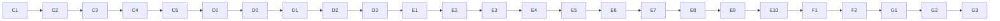

# Build Guide — VIZ

## Containment, push notifications, charts, and the 3D console

---

## 0. Document Control

| Field | Detail |
|---|---|
| **Document** | Build Guide for VIZ |
| **Version** | 1.0 |
| **Date** | 9 October 2026 |
| **Follows** | Master Project Document, PRD v1.2, TRD v1.2, UI/UX Brief, LEAD-CORE Build Guide Part 1, DETECT Build Guide, GRAPH Build Guide |
| **Delivered with this guide** | `viz-delivery.zip` (30 finished files, tested) |

---

## Naming Convention (Read This First)

The master document uses real names. **Every other project document, including this guide, uses the role-based aliases below.**

| Alias | Real Name | USN | Role |
|---|---|---|---|
| **LEAD-CORE** | Sagar R | 1DT24CS232 | Team lead — backend add-ons, Precog Engine, integration; the only person who merges code |
| **DETECT** | Neha | 1DT24CS174 | Flow feature preparation, ML detection, security event processing, ATT&CK correlation |
| **GRAPH** | Pallavi Bammanni | 1DT24CS185 | Data ingestion, simulation, attack graph, mobile web app (PWA) |
| **VIZ** | Preethi S Pujari | 1DT24CS195 | 3D visualization, charts, push notifications, containment |

**This guide is for VIZ.** Where it says "you", it means VIZ. "The lead" means LEAD-CORE.

---

## 1. What You Build

Four parts. You can build and test all of them alone, without waiting for anyone.

| Part | What it is | Where |
|---|---|---|
| **Containment and re-evaluation** | The two-step **propose, then confirm** action that marks a host as contained (simulated, nothing real changes). It expires after 60 seconds if nobody answers, writes the audit log, and afterwards works out whether the attack really stopped | `viz/viz_containment/` |
| **Push notifications** | The backend part (a watcher that sends each new HIGH alert through Firebase) and the browser part (asking permission, registering the phone, the service worker that shows the notification) | `viz/viz_containment/push.py`, `web/src/areas/push/`, `web/public/push/` |
| **Charts** | The two Chart.js charts: forecast accuracy (calibration view) and alert volume | `web/src/areas/charts/` |
| **The 3D console** | The desktop screen: 3D network picture, forecast cones, replay controls, panels, timeline | `web/src/areas/console/` |

**Your folders are `viz/`, `web/src/areas/console/`, `web/src/areas/charts/`, `web/src/areas/push/` and `web/public/push/`. You edit nothing else.**

### What the other roles expect from you (do not change these names)

| Who | What they use | Where it comes from |
|---|---|---|
| **The lead's routes** | `containment.propose(world, target_host, forecast_id, requested_by)`, `.confirm(world, action_id)`, `.cancel(world, action_id)` | your `containment` hook |
| **The lead's routes** | `push.register(token)` | your `push` hook |
| **GRAPH's replay** | It watches the actions list: when a containment becomes `executed`, `cancelled` or `expired` it carries on by itself | your hook changes the action's `status` |
| **GRAPH's phone app** | `ForecastAccuracyChart({ metrics })` and `AlertVolumeChart({ alerts })` | `web/src/areas/charts/index.jsx` |
| **GRAPH's phone app** | `usePushRegistration()` returning `{ status, enable }` where `status` is `unsupported`, `prompt`, `enabled` or `denied` | `web/src/areas/push/index.jsx` |
| **The app's router** | the default export `ConsoleApp` | `web/src/areas/console/index.jsx` |
| **The lead's service worker** | loads `/app/push/push-sw.js` | `web/public/push/push-sw.js` |

### What you expect from the others

| From | What you use | When it is missing |
|---|---|---|
| **GRAPH** (`graph` hook) | `host_state(host)`, `set_host_state(host, "contained")`, `snapshot()` | Containment answers "not built" (501) |
| **DETECT** (`events` hook) | `audit_record(type, ref_id, summary)` | Containment still works, just without audit lines |
| **GRAPH** (phone area) | The named exports `SeverityBadge`, `StateChip`, `ForecastBars`, `OutcomeCard`, `AccuracyCounter`, `AttackPath2D` | The lead's placeholders with the same names are used until GRAPH merges |
| **LEAD-CORE** (Precog, Part 2) | Resolves forecasts (hit or miss with an outcome) | Re-evaluation never gets a result, and the action keeps its plain text. Everything else works |

### Three honest differences from the earlier documents

| Earlier text | What this guide does | Why |
|---|---|---|
| TRD 14.3: "a `reeval_result` states whether the attack progressed" | The result is written into the **action's `result` text**, the **audit log**, and the **forecast outcome card** (a `reeval_result` record is also kept in memory) | The polling state has no field for it, and the contracts are the lead's to change |
| Firebase "admin" library on the backend | The backend calls **Firebase's HTTP API** with `google-auth` and the `requests` library | `firebase-admin` needs a newer `requests` than NIDS pins, which would break NIDS |
| 3D graph "force layout" | **Fixed, calm positions** by zone (user left, dmz middle, internal right) | Six hosts are clearer when nothing jitters, and it matches the brief's "spacious and calm" |

---

## 2. What Was Verified and What Was Not

I tested everything that can run in my own test environment (Linux, Python 3.11, Node 22).

| Verified by me | Result |
|---|---|
| Your 35 Python tests | 34 pass; 1 (the whole golden path with **real** containment, real NIDS, real DETECT and real GRAPH) is skipped until those are merged |
| Your 47 web tests | Pass: scene data, 3D object creation, panels, charts' data, push logic, the **real service-worker file** run against a fake browser, and "no colour codes" |
| The whole repository together, every combination of roles | **Everything merged: 294 Python tests pass, 91 web tests pass, the app builds.** Part 1 + VIZ alone: 135 passed, 1 skipped, 58 web tests |
| The golden path with real containment | The phone proposes, confirms, the replay resumes by itself, the move toward Web Server B is **blocked**, the action is `executed`, the audit log has the entries |
| Expiry, cancel, double confirm, one request at a time, unknown host or request, restart forgetting old requests | Each tested |
| Re-evaluation | "Chain ended early" after a blocked hit; "progressed elsewhere" after a miss; a different forecast is ignored |
| Push watcher | A new HIGH alert goes to every phone once; MEDIUM and LOW never; alerts already there at start-up are not announced; a restarted replay is announced again |
| Firebase message | Built exactly as Firebase's HTTP API wants (data-only message), tested with a fake network. A service-account key is accepted and turned into a sender |
| `google-auth` with NIDS's pinned `requests==2.31.0` | Installs together in a clean environment without changing NIDS's pins |

| **Not** verified by me | What to do |
|---|---|
| **How the 3D scene looks and moves** | My environment has no browser or graphics card. I tested all the decisions (shapes, sizes, positions, cone width and opacity, the pulse) and that the 3D objects can be created, and the app builds. **Step E9 is your eye check.** If something looks wrong, send me a screenshot |
| How the two Chart.js charts look | Same reason. Their data and text summaries are tested. Check them in Step E9 |
| **A real push notification arriving** | Needs your own Firebase project and keys. Step F2 walks through it. I could not run it |
| Push on a real phone | Needs the hosted HTTPS address (the lead's Part 2) |
| PowerShell commands on Windows | They are standard commands. If one fails use Section 12 and send me the exact error |
| GitHub's, Antigravity's, Chrome's and Firebase's screens | Names may differ slightly. Look for the same idea |

---

## How to Read This Guide

1. Do the steps **in order, top to bottom**. Every step has an ID such as `C4`.
2. Boxes marked `powershell` are typed into **PowerShell**. Press Enter after each line.
3. Text after `#` in a command is a comment. Do not type it.
4. **You should see:** tells you what correct looks like. If you see something else, go to Section 12.
5. Every **code step** has the same parts:

| Part | Meaning |
|---|---|
| **WHERE** | The exact path of the file inside the repo |
| **WHAT** | One line on what the file does |
| **COPY** | The command that copies **my finished, tested file** into your repo |
| **PROMPT** | The detailed instruction to give Antigravity so it writes its own version |
| **COMPARE** | How to put my file and Antigravity's file side by side |
| **COMMIT** | The Git commands that save the step |

6. The delivered files must be unzipped so that `C:\viz-delivery\viz\viz_containment\containment.py` exists. Every COPY command reads from `C:\viz-delivery\`.
7. **You start this guide only when the lead tells you the repository is ready and you have accepted the GitHub invitation.**

---

# PART A — Install the Tools (Windows)

Open PowerShell: **Start menu → type `PowerShell` → open "Windows PowerShell"** (a normal window, not "as administrator").

### A1 — Git

1. Open https://git-scm.com/download/win and click **64-bit Git for Windows Setup**. Run it, keep every default (**Next**, **Install**, **Finish**).
2. Close PowerShell, open it again:

```powershell
git --version   # prints the Git version
```

**You should see:** `git version 2.` and numbers.

### A2 — Python 3.11.9

1. Open https://www.python.org/downloads/release/python-3119/ . Under **Files** click **Windows installer (64-bit)** (`python-3.11.9-amd64.exe`).
2. Run it. **Tick "Add python.exe to PATH"**, click **Install Now**, then **Close**.
3. Close PowerShell, open it again:

```powershell
py -3.11 --version   # asks the Windows Python launcher for 3.11
```

**You should see:** `Python 3.11.9`.

### A3 — Node.js (LTS)

1. Open https://nodejs.org and click the green **LTS** button. Run the file, keep every default.
2. Close PowerShell, open it again:

```powershell
node --version   # prints the Node version
npm --version    # prints the npm version
```

**You should see:** two version numbers.

### A4 — Antigravity

Open https://antigravity.google/download . Under **Antigravity IDE (Standalone)** click **Download for x64**. Run the installer (if Windows shows a blue warning: **More info → Run anyway**). Open it and sign in with your Google account.

### A5 — Allow scripts, and tell Git who you are

```powershell
Set-ExecutionPolicy -Scope CurrentUser -ExecutionPolicy RemoteSigned   # lets the Python environment script run (type Y if asked)
git config --global user.name "YOUR NAME"           # your real name between the quotes
git config --global user.email "you@example.com"    # the email you use for GitHub
git config --global init.defaultBranch main         # new repos start on main
```

### A6 — Unzip the delivered files

Right-click `viz-delivery.zip` → **Extract All** → extract to a new folder named exactly `C:\viz-delivery`.

```powershell
Test-Path C:\viz-delivery\viz\viz_containment\containment.py   # asks "does this file exist?"
```

**You should see:** `True`. If `False`, move the `viz` and `web` folders up one level so they sit directly inside `C:\viz-delivery`.

---

# PART B — Get the Repository and Prepare

### B1 — Accept the invitation

Open the GitHub invitation email and accept it (you need a GitHub account: https://github.com/signup).

### B2 — Copy the repository to your laptop

The lead sends you the address, like `https://github.com/LEAD-USERNAME/precog-platform.git`.

```powershell
cd $HOME\Documents                                                    # go to your Documents folder
git clone https://github.com/LEAD-USERNAME/precog-platform.git        # replace LEAD-USERNAME; a sign-in window may open
cd precog-platform                                                    # go inside the new folder
```

### B3 — Open it in Antigravity

**File → Open Folder** → `Documents\precog-platform` → **Select Folder** (click **Yes, I trust** if asked). Then **Terminal → New Terminal** (it must say **PowerShell**). **Type every command in this terminal from now on.**

```powershell
pwd   # prints the folder you are in
```

**You should see:** a path ending in `precog-platform`.

### B4 — Create your own branch

```powershell
git switch -c viz            # creates your branch and moves you onto it
git push -u origin viz       # sends the empty branch to GitHub
git branch                   # a star marks the branch you are on
```

**You should see:** `* viz`. **Work only on `viz`. Never work on `main`.** (If the branch already exists use `git switch viz`.)

### B5 — Check the lead's base is there

```powershell
Test-Path lead-core\backend\run_app.py             # must print True
Test-Path lead-core\backend\nids\LICENSE           # must print True
Test-Path contracts\data\hosts.json                # must print True
Test-Path viz\requirements.txt                     # must print True (a short placeholder)
Test-Path web\scripts\run-tests.mjs                # must print True
Test-Path web\src\shared\components.jsx            # must print True
Test-Path web\.env.example                         # must print True
Test-Path web\public\push\push-sw.js               # must print False (you create it)
Test-Path web\src\areas\console\index.jsx          # must print True (a placeholder)
```

If any line is not as stated, the lead has not merged the base yet. Tell the lead.

### B6 — The backend Python environment

```powershell
py -3.11 -m venv .venv                              # creates a private Python folder called .venv
.\.venv\Scripts\Activate.ps1                        # switches it on
pip install -r lead-core/backend/requirements.txt   # installs the backend libraries (a few minutes)
```

**You should see:** `(.venv)` at the start of the prompt and `Successfully installed` at the end. **Every new terminal needs the `Activate.ps1` line again.**

### B7 — Prove the base works before you add anything

```powershell
pytest   # runs the lead's tests
```

**You should see:** `101 passed`. If it differs, tell the lead and stop.

### B8 — The web environment

```powershell
cd web          # go into the web folder
npm ci          # installs the exact versions in package-lock.json (3D, chart and Firebase libraries are already included; takes a few minutes)
npm test        # runs the lead's web tests
cd ..           # back to the repo root
```

**You should see:** `added` followed by a number of packages, then `# pass 11` and `# fail 0`.

---

# PART C — Containment and Push (Backend, Python)

### C0 — Before the first prompt: the context block and how to compare

**1. The context block.** In Antigravity's agent chat, start a **new conversation** and paste this once. Keep using the same conversation for Part C:

```text
CONTEXT (remember this for everything I ask next)
I am VIZ in a team building the "Precog SOC Platform", a student cybersecurity project. Python 3.11 on Windows. Libraries allowed: the Python standard library, requests, google-auth, pytest, and the project's own "addons" package. No other libraries (NOT firebase-admin).
Repo (root = precog-platform): contracts/schemas/*.schema.json are data formats (containment_action, reeval_result, security_event ...); lead-core/backend/addons/ has the shared WorldState (actions(), upsert_action(action), forecasts(), alerts(limit), graph(), push_tokens()), Hooks (get, has, register, require) and addons.errors.HookError(code, message, status).
Other roles' hooks I may call: graph (host_state(host), set_host_state(host, state), snapshot()), events (audit_record(type, ref_id, summary)).
My folder is viz/ (package viz_containment, importable by that name). I may only create files inside viz/. I must NEVER edit anything outside viz/ except the web folders named in Parts D and E.
Rules for every file you write: plain readable Python with short docstrings and clear names; write the file ONLY to scratch-ai/<the same path as the real file>; do not touch any other file; do not add features I did not ask for.
```

**2. Make the scratch folder** (`scratch-ai/` is already listed in `.gitignore`, so it is never committed):

```powershell
New-Item -ItemType Directory -Force -Path scratch-ai | Out-Null   # the folder where Antigravity's versions go
```

**3. How to compare** (used in every code step):

*Method 1, side by side:* in the left file list right-click **my file** → **Select for Compare**, then right-click **the AI's file** inside `scratch-ai` → **Compare with Selected**. Red and green lines show differences.

*Method 2, in the terminal:*

```powershell
git diff --no-index scratch-ai\viz\viz_containment\containment.py viz\viz_containment\containment.py   # replace both paths with the two files
```

**4. Which one to keep?** Keep **mine** by default (copied and tested). To use the AI's version of a file, copy it over mine, then run the tests in Step C5. **If a test fails, copy mine back.** Never keep a version that fails the tests.

### C1 — Your library list

**WHERE:** `viz/requirements.txt`
**WHAT:** One library, `google-auth`, which signs the request to Firebase. The lead's backend list already reads this file, so one `pip install` installs everything.

**COPY:**

```powershell
Copy-Item -Force C:\viz-delivery\viz\requirements.txt viz\requirements.txt   # replaces the placeholder
Get-Content viz\requirements.txt                                              # shows it
pip install -r lead-core/backend/requirements.txt                            # installs google-auth
pip list | Select-String "google-auth|requests"                              # confirms the versions
```

**You should see:** `google-auth 2.61.0` and `requests 2.31.0` (NIDS's own pin must stay at 2.31.0).

**PROMPT:** None for a library list.

**COMMIT:**

```powershell
git add .
git commit -m "feat(viz): library list (google-auth)"   # saves the step
```

### C2 — Containment and re-evaluation

**WHERE:** `viz/viz_containment/containment.py`
**WHAT:** The `containment` hook. Nothing real is ever changed: a host's state becomes `contained` through GRAPH's `graph` hook and a log entry is written.

| Call | What happens |
|---|---|
| `propose` | Creates an action in `pending_confirmation` and starts a 60-second timer. Nothing else changes yet. Asking again for the same host returns the open request; a different host while one is open is refused (409) |
| `confirm` | Stops the timer, sets the host to `contained`, the action to `executed`, writes the audit entry, and starts the re-evaluation watcher |
| `cancel` | Stops the timer, action becomes `cancelled`, host untouched |
| timer runs out | Action becomes `expired`, host untouched, and a later `confirm` is refused |
| re-evaluation | After `confirm`, waits for the forecast it was made for to be resolved, then writes one plain sentence into the action's `result`, the audit log and a `reeval_result` record: "The attacker tried to reach Web Server B and was blocked. The attack chain ended early." or "The attacker went on to ... The attack progressed elsewhere, so Precog forecasts again." |

Every error is a clean `HookError`: unknown host 404, unknown request 404, already contained 409, request already answered 409, graph missing 501.

**COPY:**

```powershell
New-Item -ItemType Directory -Force -Path viz\viz_containment | Out-Null
Copy-Item C:\viz-delivery\viz\viz_containment\containment.py viz\viz_containment\containment.py
```

**PROMPT:**

```text
Write scratch-ai/viz/viz_containment/containment.py: class ContainmentService(world, hooks, confirm_seconds=60.0, contracts=None, clock=utc_now, reeval_wait=180.0, poll=0.1), thread-safe (an RLock). utc_now() returns "YYYY-MM-DDTHH:MM:SSZ".
Hook methods (they receive the world too, because the lead's routes pass it; use self.world): propose(world, target_host, forecast_id, requested_by), confirm(world, action_id), cancel(world, action_id). Each returns a copy of the action dict (contract containment_action).
propose: the graph hook is needed (else HookError "not_built", 501); an unknown host (graph.host_state raises ValueError) -> HookError "unknown_host" 404; a host already contained -> "already_contained" 409 with the host's NAME in the message; if a request is already waiting for the SAME host return it; for another host -> "pending_exists" 409. Otherwise build {"action_id": "act-000001" counting up, "target_host", "forecast_id", "requested_by", "status": "pending_confirmation", "proposed_at": now, "confirmed_at": None, "result": None}, validate with contracts when given, world.upsert_action, start a daemon threading.Timer(confirm_seconds) that expires it, write an audit entry.
confirm: unknown id -> HookError "unknown_action" 404; status not pending_confirmation -> "not_pending" 409 with the message "This request is already <status>."; stop the timer; if the host became contained meanwhile set the action to cancelled and raise "already_contained"; otherwise graph.set_host_state(target, "contained"), status "executed", confirmed_at now, result "Contained (simulated). Nothing on a real network changed.", upsert, audit, start the re-evaluation watcher.
cancel: same checks; status "cancelled", result "Cancelled by the analyst."; audit.
Expiry: status "expired", result "Expired without confirmation."; audit; only if still pending.
Before every call forget pending requests that the world no longer has (the replay clears the actions when it restarts), stopping their timers.
Audit: through hooks.get("events").audit_record("containment", action_id, text) when that hook exists; an exception there must never block a containment (log it).
Re-evaluation: a daemon thread polls world.forecasts() every `poll` seconds for up to reeval_wait seconds for a forecast with status hit or miss and an outcome, and whose forecast_id equals the action's forecast_id (any resolved forecast when the action has none). Result: hit and blocked -> attack_progressed False, chain_ended_early True, summary "The attacker tried to reach <name> and was blocked. The attack chain ended early."; otherwise attack_progressed True, chain_ended_early False, summary "The attacker went on to <name>. The attack progressed elsewhere, so Precog forecasts again." (<name> is the attempted host's name from graph.snapshot()). Validate it as reeval_result, keep it, set the action's result to "Contained (simulated). Re-evaluation: <summary>", upsert, audit "Re-evaluation: <summary>".
Extra methods: reeval_results() (list of copies) and shutdown() (stop timers and watchers).
```

**COMPARE:** Use the method in C0.

**COMMIT:**

```powershell
git add .
git commit -m "feat(viz): simulated containment with confirmation, expiry and re-evaluation"
```

### C3 — Push notifications (backend)

**WHERE:** `viz/viz_containment/push.py`
**WHAT:**

| Part | What it does |
|---|---|
| `alert_notification` | Builds the text from the UI/UX brief: title "High alert: Workstation A", body = the first sentence of the explanation, and a link to the alert |
| `AlertWatcher` | A background thread. Each **new HIGH** alert is sent **once** to every registered phone. Alerts that already exist when the server starts are not announced |
| `FcmSender` | Sends one "data only" message per phone to Firebase's HTTP API. A network problem is logged and never stops the watcher |
| `LogSender` | Used when Firebase is not set up: only writes a log line. The in-app alert feed still shows every alert |
| `build_sender_from_env` | Chooses between them from `FCM_PROJECT_ID` plus `FCM_CREDENTIALS_FILE` (path of the key file) or `FCM_CREDENTIALS_JSON` (the key's text) |

**The Firebase key is a secret.** It comes from an environment variable or a file **outside the repo**. It is never in code and never committed.

**COPY:**

```powershell
Copy-Item C:\viz-delivery\viz\viz_containment\push.py viz\viz_containment\push.py
```

**PROMPT:**

```text
Write scratch-ai/viz/viz_containment/push.py (standard library, plus requests and google-auth imported only inside the functions that need them).
first_sentence(text) (up to and including the first ". ", or the whole text). alert_notification(alert, host_name) -> {"title": "<Severity word> alert: <host name>" with High/Medium/Low, "body": first sentence of alert["explanation"], "event_id", "url": "/app/mobile/alerts/<event_id>"}.
LogSender.send(tokens, notification) logs and returns 0. FcmSender(project_id, token_provider, post=None): post defaults to requests.post; send(tokens, notification) gets one access token from token_provider(), then POSTs for every token to https://fcm.googleapis.com/v1/projects/<project_id>/messages:send with header Authorization: Bearer <token>, json {"message": {"token": t, "data": {title, body, event_id, url as strings}, "webpush": {"headers": {"Urgency": "high"}}}} (data only: NO "notification" key) and timeout 10; count 2xx replies; log a refusal; catch every exception per phone; return the count.
service_account_token_provider(info): google.oauth2.service_account.Credentials.from_service_account_info with the scope https://www.googleapis.com/auth/firebase.messaging; the returned function refreshes with google.auth.transport.requests.Request when not valid and returns the token.
build_sender_from_env(env): FCM_PROJECT_ID and one of FCM_CREDENTIALS_FILE / FCM_CREDENTIALS_JSON set -> FcmSender; if the key cannot be read or parsed log it and return LogSender; anything missing -> LogSender.
PushHook(world).register(token): logs the number of registered phones. 
AlertWatcher(world, sender, interval=0.5, severities=("HIGH",)): at construction remember the alerts that already exist (key = event_id + "|" + ts); poll_once() walks world.alerts(200) oldest first, and for every unseen alert marks it seen and, if its severity is in severities and world.push_tokens() is not empty, sends alert_notification (host name from world.graph()["hosts"], or the host text as it is) and returns the list of notifications sent; start() runs poll_once every `interval` seconds on a daemon thread named "push-watcher" and logs (never raises) errors; stop().
```

**COMPARE:** Use the method in C0.

**COMMIT:**

```powershell
git add .
git commit -m "feat(viz): push notifications through Firebase's HTTP API with a log-only fallback"
```

### C4 — The package file

**WHERE:** `viz/viz_containment/__init__.py`
**WHAT:** Replaces the lead's placeholder. `register(ctx)` builds the containment service and the push hook, and starts the alert watcher.

**COPY:**

```powershell
Copy-Item -Force C:\viz-delivery\viz\viz_containment\__init__.py viz\viz_containment\__init__.py   # replaces the placeholder
```

**PROMPT:**

```text
Write scratch-ai/viz/viz_containment/__init__.py. A module docstring listing the hook methods (containment: propose, confirm, cancel; push: register) and the settings: CONTAINMENT_CONFIRM_SECONDS (default 60), FCM_PROJECT_ID with FCM_CREDENTIALS_FILE or FCM_CREDENTIALS_JSON, and PUSH_WATCHER=0 to switch the watcher off.
Export register, ContainmentService, AlertWatcher, FcmSender, LogSender, PushHook, alert_notification and build_sender_from_env. def register(ctx): read CONTAINMENT_CONFIRM_SECONDS (default "60"); register ContainmentService(ctx.world, ctx.hooks, confirm_seconds=..., contracts=ctx.contracts) as the "containment" hook and PushHook(ctx.world) as the "push" hook; unless PUSH_WATCHER is 0, false, no or off start AlertWatcher(ctx.world, build_sender_from_env(os.environ)); log that containment is ready.
```

**COMPARE:** Use the method in C0.

**COMMIT:**

```powershell
git add .
git commit -m "feat(viz): register the containment and push hooks"
```

### C5 — The tests (backend side)

**WHERE:** `viz/tests/` (5 files: `conftest.py`, `viz_helpers.py`, `test_viz_containment.py`, `test_viz_push.py`, `test_viz_register_and_e2e.py`)
**WHAT:** 35 automatic tests: the whole two-step flow, expiry, one request at a time, the audit log, re-evaluation, the push watcher and its wording, the Firebase message, registration through the real loader, and (skipped until the others are merged) the **whole golden path with real containment**.

**COPY:**

```powershell
New-Item -ItemType Directory -Force -Path viz\tests | Out-Null
Copy-Item -Force C:\viz-delivery\viz\tests\*.py viz\tests\   # copies the five test files
(Get-ChildItem viz\tests -Filter *.py).Count                  # counts them
```

**You should see:** `5`.

**PROMPT** (one prompt for all test files):

```text
Write pytest files in scratch-ai/viz/tests/ for the viz_containment package described in the CONTEXT.
viz_helpers.py (a UNIQUE file name, because other roles' tests also have a conftest.py and two modules with the same name would clash): set DATABASE_URL to a temporary SQLite file if it is not set; put <repo>/lead-core/backend, viz, graph, detect and lead-core/backend/nids on sys.path; define REPO_ROOT; FakeGraph (a stand-in for GRAPH's graph hook with three hosts host-a, host-b, server-b: host_state raising ValueError for an unknown host, set_host_state, snapshot), FakeEvents (remembers audit_record calls), and a Rig class wiring a ContainmentService (poll 0.01, reeval_wait 3) with those and a wait(check, timeout) helper. Test files import from viz_helpers, never from conftest.
conftest.py: imports viz_helpers first; fixtures contracts, world (WorldState with contracts) and rig (stops the service after each test).
test_viz_containment.py: propose makes a pending, contract-valid action and changes nothing else; confirm contains the host and records the time; cancel leaves the host alone; no double confirm or confirm after cancel (409 not_pending); unknown action 404 and unknown host 404; a contained host is refused (409, with the host's name); only one request waits at a time (same host returns the same, another host 409, allowed after cancel); containment needs the graph part (501); an unanswered request expires and cannot be confirmed; confirming in time stops the timer; a world reset makes pending requests be forgotten; every step is audited; a broken audit log never blocks; works without the events part; re-evaluation: blocked hit means the chain ended early, a miss means it progressed, a different forecast is ignored, and no resolved forecast leaves the plain result.
test_viz_push.py: first sentence; notification title and body follow the UI brief; a new HIGH alert is sent once to every phone; only HIGH is sent; alerts present at start are not announced; nothing is sent with no phone registered; a restarted replay with the same event numbers is announced again; an unknown host is shown as it is; the background thread sends; FcmSender posts a data-only message per phone with the right URL, header and body (fake post); it counts only accepted phones and survives errors; sender choice follows the environment (missing key, missing file, bad JSON give LogSender); a generated service-account key gives an FcmSender without using the network.
test_viz_register_and_e2e.py: registering through the real register_addons registers both hooks and reads CONTAINMENT_CONFIRM_SECONDS; the watcher thread starts unless PUSH_WATCHER=0; propose and confirm through the registered hook; and (skipped unless DETECT's and GRAPH's real packages exist) the whole golden path: start the replay, wait for the decision point, propose, confirm, the replay resumes by itself, the move toward Web Server B is blocked, the action is executed.
```

**COMPARE:** Use the method in C0. Test files only matter if they **pass**, so the real comparison is the next step.

**RUN THEM:**

```powershell
pytest viz/tests   # runs only your tests
pytest             # runs everything: the lead's tests and yours
```

**You should see:** first `34 passed, 1 skipped` (the skipped one needs GRAPH's and DETECT's merged work), then `135 passed, 1 skipped` (or `294 passed` once DETECT's and GRAPH's work are merged).

If you see a failure, copy the whole red message and go to Section 12.

**COMMIT:**

```powershell
git add .
git commit -m "test(viz): 35 tests for containment and push"
```

### C6 — See your hooks inside the real backend

1. Create your settings file (the same as the lead did), if you do not have one:

```powershell
Copy-Item .env.example .env                                   # your own settings file (never committed)
python -c "import secrets; print(secrets.token_hex(32))"      # prints a long random text; select and copy it
```

2. Open `.env`. After `SECRET_KEY=` paste the text. After `ADMIN_PASSWORD=` type a password you invent (8 characters or more). Save with **Ctrl+S**. Leave the Firebase lines empty for now.

```powershell
git check-ignore -v .env              # must print a line containing .gitignore and .env
python lead-core/backend/run_app.py   # starts the backend (the first start trains NIDS's model, about 10 seconds)
```

**You should see:** `Backend ready:  http://127.0.0.1:5000/app/   (API: /api/x/health)`. A line saying Firebase is not configured and push is log-only is correct for now.

3. In the browser open http://127.0.0.1:5000/api/x/health

**You should see:** JSON where `"hooks"` includes `"containment"` and `"push"` and `"modules"` shows `"viz_containment":"registered"`.

4. Stop the backend with **Ctrl+C** in the terminal.

---

# PART D — Charts and Push Notifications (Web)

### D0 — The web context block

Start a **new conversation** in Antigravity's agent chat and paste this once. Keep it for Parts D and E:

```text
CONTEXT (remember this for everything I ask next)
I am VIZ in a team building the "Precog SOC Platform". This part is web code: React 18 with Vite, plain JavaScript (no TypeScript), react-router-dom 6. Libraries already installed (do NOT add others): three, 3d-force-graph, three-spritetext, chart.js, firebase.
The built app is served at /app/ so the router's basename is "/app". My folders are web/src/areas/console/, web/src/areas/charts/, web/src/areas/push/ and web/public/push/, and I may only create files there. I may IMPORT (never edit) web/src/shared/api.js (the "api" object, and apiGet(path)), shared/usePolling.js (useWorldState() returning {state, stale, loggedOut}), shared/components.jsx (SimulationBadge, StaleBanner, EmptyState, LoadingState, ToastProvider, useToast), and, from GRAPH's area through its entry file only, ../mobile/index.jsx (named exports SeverityBadge, StateChip, ForecastBars, OutcomeCard, AccuracyCounter, AttackPath2D).
"state" is the world state the backend sends: {version, changed, graph: {hosts:[{host_id,name,zone,state}], edges:[{from_host,to_host,first_seen}], compromised_path}, alerts:[security_event], forecast: forecast or null, actions, replay: {state, scenario_id, speed, position}, metrics}.
Rules: NO colour codes anywhere (no #rrggbb, no rgb()): only CSS variables from web/src/shared/theme.css (the 3D scene and the charts read them at run time); every colour is paired with an icon, shape or word; the UI/UX brief's wording is used exactly; pure decisions go in plain .js files so they can be tested without a browser; write each file ONLY to scratch-ai/<the same path as the real file>; do not touch any other file; do not add features I did not ask for.
```

### D1 — The charts

**WHERE:** `web/src/areas/charts/chartData.js`, `chartData.test.js`, `index.jsx`
**WHAT:** The two charts of UI/UX Brief Section 7, built with **Chart.js**. `chartData.js` holds all the decisions as plain functions (tested). `index.jsx` draws them.

| Chart | What it shows |
|---|---|
| **ForecastAccuracyChart** `({ metrics })` | The **calibration view**: stated confidence against the observed hit rate, a violet line with round markers, and a dashed "perfect" line. Caption: "Closer to the dashed line means the stated confidence matches reality." |
| **AlertVolumeChart** `({ alerts })` | Stacked columns per minute. Each severity has its **own fill pattern** (solid, diagonal lines, dots) as well as its colour |

Both show a plain "no data yet" message instead of an empty frame, have a text summary for screen readers, switch animation off for "reduce motion", and read their colours from the CSS variables.

**COPY:**

```powershell
foreach ($f in 'chartData.js','chartData.test.js') { Copy-Item "C:\viz-delivery\web\src\areas\charts\$f" "web\src\areas\charts\$f" }
Copy-Item -Force C:\viz-delivery\web\src\areas\charts\index.jsx web\src\areas\charts\index.jsx   # replaces the placeholder
```

**PROMPT 1 of 2 — chartData.js and chartData.test.js:**

```text
Write scratch-ai/web/src/areas/charts/chartData.js (plain functions, no React): calibrationPoints(metrics) -> [{x, y, count}] in whole percent from metrics.calibration_bins using mean_confidence and observed_rate, leaving out bins whose count is 0 ([] for missing metrics); referenceLine() -> [{x:0,y:0},{x:100,y:100}]; CALIBRATION_CAPTION = "Closer to the dashed line means the stated confidence matches reality."; calibrationSummary(metrics) -> "No forecasts resolved yet." or "Calibration: stated 74 %, observed 100 % (1 forecast)." (several points joined by "; ", plural "forecasts"); alertVolume(alerts) -> {labels, high, medium, low}: alerts counted per minute (the minute is the first 16 characters of the time with a space turned into T) and severity, oldest minute first, labels as HH:MM; volumeSummary(alerts) -> "No alerts yet." or "2 alerts over 2 minutes: 1 high, 0 medium, 1 low." (singular "minute" for one); PATTERNS = {high: "solid", medium: "diagonal", low: "dots"}.
Write scratch-ai/web/src/areas/charts/chartData.test.js with node:test testing each function, including empty bins, plural and singular wording, ordering of minutes, a time with a space and no zone, and that the three patterns are different.
```

**PROMPT 2 of 2 — index.jsx:**

```text
Write scratch-ai/web/src/areas/charts/index.jsx using chart.js (register only BarController, BarElement, CategoryScale, Legend, LineController, LineElement, LinearScale, PointElement, Tooltip) and the functions in ./chartData.js. Export two components with EXACTLY these names and properties (GRAPH imports them): ForecastAccuracyChart({ metrics }) and AlertVolumeChart({ alerts }).
Colours are read at run time with getComputedStyle(document.documentElement).getPropertyValue("--forecast") etc.; never write a colour code. Animation is off when window.matchMedia("(prefers-reduced-motion: reduce)") matches, otherwise one 300 ms draw-in. Both charts are 180 px high with maintainAspectRatio false, a transparent background, horizontal grid lines in --border, ticks in --text-muted and at most 5 ticks per axis.
ForecastAccuracyChart: no calibration points -> the shared EmptyState "No forecasts resolved yet."; otherwise a <figure> with a canvas (role img, aria-label = calibrationSummary) and the caption: a line chart on linear axes 0 to 100 titled "Stated confidence (%)" and "Observed hit rate (%)", the Observed dataset in --forecast with round markers, and the Perfect dataset dashed in --text-muted without markers.
AlertVolumeChart: no alerts -> EmptyState "No alerts yet."; otherwise a canvas (role img, aria-label = volumeSummary) with a stacked bar chart (x titled Time, y titled Alerts) with datasets High (--severity-high), Medium (--severity-medium) and Low (--severity-low); each dataset's fill is a canvas pattern: solid colour for high, diagonal lines for medium, dots for low (draw an 8 by 8 canvas tile on the surface colour --surface, then createPattern).
Use a small useChart hook that creates the Chart in useEffect and destroys it on cleanup, rebuilding when the data changes.
```

**COMPARE:** Use the method in C0 (paths `scratch-ai\web\src\areas\charts\...`).

**COMMIT:**

```powershell
git add .
git commit -m "feat(charts): forecast accuracy and alert volume charts"
```

### D2 — Push notifications (browser side)

**WHERE:** `web/src/areas/push/pushLogic.js`, `pushLogic.test.js`, `index.jsx`, `sw.test.js`, and `web/public/push/push-sw.js`
**WHAT:**

| File | What it does |
|---|---|
| `pushLogic.js` | The decisions: which status to show, whether the browser supports push, reading the Firebase settings |
| `index.jsx` | `usePushRegistration()` returns `{ status, enable }`. `enable()` asks the browser's permission, gets a token from Firebase, sends it to `POST /api/x/push/register`. Firebase is loaded **only then**, so it never slows the first screen |
| `push-sw.js` | The service worker part that shows the notification when the app is closed, and opens the alert when it is tapped. The lead's `sw.js` already loads this file |
| `sw.test.js` | Runs the **real** `push-sw.js` against a fake browser and checks title, body, link, a broken message and the tap |

The statuses: `unsupported` (browser cannot, or Firebase settings missing), `prompt` (can be switched on), `enabled`, `denied`. GRAPH's Home screen shows the "Get an alert when something serious happens" box only for `prompt`.

**COPY:**

```powershell
New-Item -ItemType Directory -Force -Path web\public\push | Out-Null
Copy-Item C:\viz-delivery\web\public\push\push-sw.js web\public\push\push-sw.js
foreach ($f in 'pushLogic.js','pushLogic.test.js','sw.test.js') { Copy-Item "C:\viz-delivery\web\src\areas\push\$f" "web\src\areas\push\$f" }
Copy-Item -Force C:\viz-delivery\web\src\areas\push\index.jsx web\src\areas\push\index.jsx   # replaces the placeholder
```

**PROMPT 1 of 3 — pushLogic.js and its test:**

```text
Write scratch-ai/web/src/areas/push/pushLogic.js (plain functions): decidePushStatus({supported, configured, permission, registered}) -> "unsupported" when not supported or not configured; "denied" when permission is "denied"; "enabled" when permission is "granted" and registered; otherwise "prompt". isPushSupported(win) -> true only when win has Notification, win.navigator.serviceWorker and PushManager. readFirebaseConfig(env) -> null unless all of VITE_FIREBASE_API_KEY, VITE_FIREBASE_AUTH_DOMAIN, VITE_FIREBASE_PROJECT_ID, VITE_FIREBASE_MESSAGING_SENDER_ID, VITE_FIREBASE_APP_ID and VITE_FIREBASE_VAPID_KEY are non-empty; otherwise {config: {apiKey, authDomain, projectId, messagingSenderId, appId}, vapidKey}.
Write scratch-ai/web/src/areas/push/pushLogic.test.js (node:test) covering each rule.
```

**PROMPT 2 of 3 — index.jsx:**

```text
Write scratch-ai/web/src/areas/push/index.jsx exporting usePushRegistration() (a React hook) returning { status, enable }. Read the Firebase settings with readFirebaseConfig(import.meta.env || {}). On start set status from decidePushStatus using isPushSupported(window), whether the settings exist, Notification.permission and a localStorage flag "precog-push-registered" (read and written inside try/catch). enable(): do nothing without settings; await Notification.requestPermission(); if not granted set the status from decidePushStatus and stop; otherwise load firebase/app and firebase/messaging with dynamic import(), await navigator.serviceWorker.ready, call getToken(getMessaging(initializeApp(config)), { vapidKey, serviceWorkerRegistration }), send the token with api.registerPush(token) from ../../shared/api.js, store the flag, set status "enabled"; on any error set status "prompt" so the person can try again. Comment at the top: GRAPH's screens read { status, enable } and the names must not change.
```

**PROMPT 3 of 3 — push-sw.js and sw.test.js:**

```text
Write scratch-ai/web/public/push/push-sw.js: plain service-worker JavaScript. buildNotification(payload): the data is payload.data (or payload itself); title = data.title or "Precog SOC"; options {body: data.body or "", tag: data.event_id or "precog-alert", data: {url: data.url or "/app/mobile/"}, requireInteraction: true}. A "push" listener: read event.data.json() (if that throws use {data: {body: event.data.text()}}), then event.waitUntil(self.registration.showNotification(title, options)). A "notificationclick" listener: close the notification; find an open window whose url contains "/app/" and navigate it to the link and focus it, else self.clients.openWindow(url). It must contain no colour codes.
Write scratch-ai/web/src/areas/push/sw.test.js (node:test) that runs the real file with node:vm against a fake "self" (addEventListener recorder, registration.showNotification recorder, clients.matchAll returning [] and clients.openWindow recorder) and checks: a data message becomes the right title, body, tag and link; an empty message gives the defaults; an unreadable message does not crash and shows the plain text; tapping closes the notification and opens the link.
```

**COMPARE:** Use the method in C0.

**COMMIT:**

```powershell
git add .
git commit -m "feat(push): browser registration, service worker and tests"
```

### D3 — Run the web tests and build

```powershell
cd web           # go into the web folder
npm test         # runs the lead's tests, GRAPH's if merged, and yours
npm run build    # builds the app into web\dist
cd ..            # back to the repo root
```

**You should see:** `# fail 0` (for example `# pass 33` with only the lead's files and yours so far, or `# pass 58` if you copied everything in this guide, see Step E7 for the final number), then `built in` and a time. A note about a large chunk size is normal (the 3D library is big).

**COMMIT** (nothing to commit if you changed nothing).

---

# PART E — The 3D Console

**What this part builds:** the desktop screen of UI/UX Brief Section 9. Read Sections 3, 4, 6 and 9 of that brief first.

### E1 — logic.js

**WHERE:** `web/src/areas/console/logic.js`, `logic.test.js`
**WHAT:** The console's decisions as plain functions: the four-level threat rule (same words as the phone), the replay words and **which replay buttons work in each state**, the text summary of the scene ("3 hosts. 1 compromised: ..."), the timeline marks, and the containment flow's small state machine (propose, confirm, expire, cancel, errors). The console keeps its **own copy** of the helpers GRAPH has, so the two areas never depend on each other's files.

**COPY:**

```powershell
foreach ($f in 'logic.js','logic.test.js') { Copy-Item "C:\viz-delivery\web\src\areas\console\$f" "web\src\areas\console\$f" }
```

**PROMPT 1 of 2 — logic.js:**

```text
Write scratch-ai/web/src/areas/console/logic.js: pure functions, no React.
hostName(state, id) (name from state.graph.hosts, unknown ids unchanged); percent(confidence); threatLevel(state) -> null without a graph, else {key, word, icon, color}: "attack" "Under attack" ⬣ var(--severity-critical) when any host is compromised; else "contained" "Contained" ⛨ var(--state-contained) when any host is contained; else "watching" "Watching" ◆ var(--severity-medium) when there are alerts; else "calm" "Calm" ○ var(--severity-low). formatTime(ts, timeZone) -> HH:MM:SS (en-GB, 24 h; a time without a zone counts as UTC; empty gives ""; unreadable comes back unchanged).
replayWord(replay) -> Idle, Running, Paused, "Waiting for your decision", Finished (default Idle). replayButtons(replay) -> {start, pause, resume, restart} booleans: start when not running, paused or waiting; pause only when running; resume when paused or waiting_for_decision; restart unless idle. SPEEDS = [1, 2, 4].
sceneSummary(state) -> "No data yet." or e.g. "3 hosts. 1 compromised: Host 0. 1 contained: Host 2. 1 forecast: Host 1 74 %." (parts only when they exist; the forecast part only for a pending forecast, its first target).
timelineMarks(alerts) -> [{id, severity, position}] with position 0 for the oldest alert to 1 for the newest along the time span (a single alert is at 1).
Containment flow: CONFIRM_SECONDS = 60, initialContain = {step:"idle", action:null, message:"", secondsLeft:60}, containReducer(state, event): tap (from idle, error, expired or done) -> proposing; proposed (only while proposing) -> confirming with the action; tick (only while confirming) counts down and at 0 -> expired with the message "This request expired. Try again."; confirm (only while confirming) -> sending; confirmed (only while sending) -> done; cancel (only while confirming) -> initial state; error (any time) -> error with the message (default "Something went wrong."); reset; anything else returns the same state.
Write scratch-ai/web/src/areas/console/logic.test.js (node:test) covering each of these.
```

**COMPARE:** Use the method in C0. **COMMIT** after Step E3 (the three files belong together).

### E2 — sceneModel.js: the 3D scene as plain data

**WHERE:** `web/src/areas/console/sceneModel.js`, `sceneModel.test.js`
**WHAT:** Everything the 3D scene needs to know, as data you can test without a graphics card. The rules come straight from the UI/UX Brief:

| Thing | Rule |
|---|---|
| Normal host | small sphere, radius 4, slate |
| Compromised host | **octahedron**, radius 6, red |
| Contained host | **cube**, size 8, teal, with a ring |
| Predicted target | keeps its shape, plus a **dashed violet ring** and its percentage |
| Positions | **fixed**: user zone left, dmz middle, internal right, hosts of one zone spread up and back. Nothing moves by itself |
| Forecast cone | one per predicted target for a **pending** forecast only. Width and opacity grow with confidence (a 74 % cone is clearly strong, a 7 % cone is faint) |
| Edges | the ones along the attack path are marked red |
| Pulse | when a host becomes compromised it grows to 1.6 and back within 600 ms |

**COPY:**

```powershell
foreach ($f in 'sceneModel.js','sceneModel.test.js') { Copy-Item "C:\viz-delivery\web\src\areas\console\$f" "web\src\areas\console\$f" }
```

**PROMPT:**

```text
Write scratch-ai/web/src/areas/console/sceneModel.js (plain functions, no 3D library): ZONE_X = {user: -120, dmz: 0, internal: 120}; NODE_STYLE = {normal: {shape "sphere", radius 4, colorVar "--state-normal"}, compromised: {"octahedron", 6, "--state-compromised"}, contained: {"cube", 8, "--state-contained"}}; layoutFor(zone, indexInZone, countInZone) -> {x: ZONE_X[zone], y: spread * 48, z: spread * -30} where spread = index - (count - 1) / 2; pulseScale(elapsedMs) -> 1 outside 0 to 600 ms, rising linearly to 1.6 at 300 ms and back to 1 at 600 ms; coneWidth(c) = 0.6 + c * 5; coneOpacity(c) = 0.15 + c * 0.65.
buildScene(state) -> {nodes, links, cones, zones} (all empty without a graph). nodes: one per host with id, name, zone, state, the NODE_STYLE fields, x, y, z, and predicted = the whole-percent confidence when the host is a target of a PENDING forecast, else null. links: one per graph edge with key "from>to", source, target and onPath true when the two hosts are neighbours in compromised_path. cones: for a pending forecast one per target {from: forecast.from_host, to, confidence, width, opacity}; none otherwise. zones: [{zone, hostIds}].
Write scratch-ai/web/src/areas/console/sceneModel.test.js (node:test): the three shapes and sizes, fixed positions with zones side by side, predicted percentages, cones only for a pending forecast and stronger with confidence, path edges, zones, an empty scene, and the pulse curve.
```

**COMPARE:** Use the method in C0.

### E3 — The 3D objects and the colours

**WHERE:** `web/src/areas/console/theme3d.js`, `objects3d.js`, `objects3d.test.js`
**WHAT:** `theme3d.js` reads the colours **from the CSS variables while the app runs** (the 3D library needs real colour values, but the code may not contain colour codes). `objects3d.js` makes the Three.js shapes: host bodies, the rings, the labels (these need a browser, so Node skips them), the forecast cone and `placeCone`, which stretches a cone between two hosts. The tests create the real Three.js objects in Node and check shapes, rings, the cone's length, direction and strength.

**COPY:**

```powershell
foreach ($f in 'theme3d.js','objects3d.js','objects3d.test.js') { Copy-Item "C:\viz-delivery\web\src\areas\console\$f" "web\src\areas\console\$f" }
```

**PROMPT:**

```text
Write scratch-ai/web/src/areas/console/theme3d.js: SCENE_VARS = {bg: "--bg", text: "--text", muted: "--text-muted", normal: "--state-normal", compromised: "--state-compromised", contained: "--state-contained", forecast: "--forecast", accent: "--accent", high: "--severity-high", medium: "--severity-medium", low: "--severity-low"}; readSceneColors(getVar) -> an object with the same keys whose values are getVar(variable) trimmed, or "white" when empty; browserVar(name) (reads the CSS variable from document.documentElement, "" without a document); prefersReducedMotion() (window.matchMedia reduce, false without a window). No colour codes anywhere.
Write scratch-ai/web/src/areas/console/objects3d.js using three and three-spritetext: makeHostMesh(node, colors) (OctahedronGeometry, BoxGeometry or SphereGeometry by node.shape, MeshBasicMaterial in colors[node.state], name "body"); makeRing(radius, color, dashed) (a 48-segment circle Line: LineDashedMaterial with computeLineDistances when dashed, named "predicted-ring", else LineBasicMaterial named "contained-ring"); makeLabel(text, color, size) (returns null when there is no document, else a SpriteText); makeHostObject(node, colors) (a Group named node.id with the body, a contained ring at radius*1.9 for contained hosts, and for a predicted host a dashed ring at radius*2.3 in colors.forecast plus a "<n> %" label above, and the host name label below); makeCone(colors, confidence) (an open ConeGeometry(1,1,24,1,true) with a transparent double-sided material, depthWrite false, opacity coneOpacity(confidence)); placeCone(cone, from, to, confidence) (scale x and z to coneWidth, y to the distance, position at the midpoint, rotate so the cone's +y axis points from the source to the target using Quaternion.setFromUnitVectors).
Write scratch-ai/web/src/areas/console/objects3d.test.js (node:test): octahedron for compromised, cube plus ring for contained, dashed ring for predicted, only a sphere for a normal host (no labels in Node), the cone's position, length, width, opacity and direction, and readSceneColors with a fake getVar.
```

**COMPARE:** Use the method in C0.

**COMMIT (E1 to E3 together):**

```powershell
git add .
git commit -m "feat(console): console logic, scene model and 3D objects"
```

### E4 — The 3D scene component

**WHERE:** `web/src/areas/console/Scene3D.jsx`
**WHAT:** Draws the scene model with `3d-force-graph` (Three.js). It cannot be tested without a graphics card, so **you check it by eye in Step E9**.

| What | How |
|---|---|
| Hosts | the objects from `objects3d.js`, at their fixed positions |
| Edges | grey; the attack path edges red and thicker with a small travelling particle |
| Forecast cones | one per predicted host, "breathing" slowly (opacity ± 8 % over 2.4 s). Rebuilt when the forecast changes |
| Pulse | a host that becomes compromised grows to 1.6 and back within 600 ms |
| Camera | starts above and in front, turns very slowly (about one turn in 90 s). **It stops turning while a forecast is waiting for a decision**, so the cones stay still |
| Click | clicking a host selects it; clicking the background clears it |
| Reduced motion | no turning, no pulse, no breathing, no particles |
| Cleanup | the animation loop and the 3D library are shut down when the screen closes |

**COPY:**

```powershell
Copy-Item C:\viz-delivery\web\src\areas\console\Scene3D.jsx web\src\areas\console\Scene3D.jsx
```

**PROMPT:**

```text
Write scratch-ai/web/src/areas/console/Scene3D.jsx: a React component Scene3D({ model, pendingForecast, onSelect }) using 3d-force-graph (import ForceGraph3D from '3d-force-graph'), three, and ./objects3d.js, ./sceneModel.js (pulseScale), ./theme3d.js. model is the result of buildScene.
Create the scene ONCE in a useEffect: colors = readSceneColors(browserVar); ForceGraph3D({ controlType: 'orbit' })(holderElement) with backgroundColor(colors.bg), showNavInfo(false), nodeId('id'), nodeThreeObject(node => makeHostObject(node, colors)), nodeThreeObjectExtend(false), linkColor (colors.compromised for onPath links else colors.muted), linkOpacity(0.5), linkWidth (1.2 on the path, 0.4 otherwise), linkDirectionalParticles (2 on the path unless reduced motion), linkDirectionalParticleWidth(1.6), cooldownTicks(0), onNodeClick(node => onSelect(node.id)), onBackgroundClick(() => onSelect(null)). cameraPosition({x:0,y:90,z:280}); controls().autoRotate = not reduced motion with autoRotateSpeed 0.67. Add a THREE.Group for the cones to graph.scene().
Run a requestAnimationFrame loop: remember each host's previous state and when it changes to compromised (not in reduced motion) pulse that host's object with pulseScale for 600 ms; rebuild the cone meshes (makeCone) when model.cones changes (dispose the old ones) and every frame place each cone between its two hosts with placeCone using the hosts' current x, y, z, and set its opacity to the cone's opacity times (1 + 0.08 * sin(2π * seconds / 2.4)) (no breathing in reduced motion); set controls().autoRotate to false while pendingForecast is true. Resize the graph to the holder on window resize. On cleanup cancel the loop, remove the listener and call graph._destructor().
A second useEffect feeds new data: graphData({ nodes: model.nodes copied with fx, fy, fz set to x, y, z so they stay fixed, links: model.links copied }). Render <div ref={holder} className="c-scene" role="presentation" />. Comment that this cannot be tested without a graphics card.
```

**COMPARE:** Use the method in C0.

**COMMIT:**

```powershell
git add .
git commit -m "feat(console): 3D scene component"
```

### E5 — The panels

**WHERE:** `web/src/areas/console/panels.jsx`, `panels.test.jsx`
**WHAT:** The pieces around the 3D picture, as in UI/UX Brief 9.1:

| Piece | What it shows |
|---|---|
| **TopBar** | name, **SIMULATION** badge, "Threat: Under attack" with icon and colour, the replay controls, "Connected" or "Offline: showing old data" |
| **ReplayControls** | scenario list (from the backend), Start, Pause, Resume, Restart, speed 1× 2× 4×, and the word (**Waiting for your decision** in violet). Buttons that do nothing are greyed out; a refused request shows its plain message |
| **LeftRail** | Graph, Alerts, Reports |
| **ForecastPanel** | the Top-3 bars, **Contain**, the attack path, how the last forecast turned out |
| **ConsoleContain** | "Contain Web Server B" then a dialog: "This marks the host as contained. It is a SIMULATION: nothing on a real network changes." with Confirm and Cancel, a 60-second countdown, and the expiry message |
| **NodeDetailPanel** | a clicked host: name, id, zone, state chip, its recent alerts, and Contain if it is predicted |
| **AlertsPanel**, **ReportsPanel** | the alert list; the accuracy counter and both charts |
| **TimelineStrip** | one mark per alert (shape by severity) and a marker where a forecast was made |
| **SceneSummary** | the text version of the scene for screen readers |

The phone components (`SeverityBadge`, `StateChip`, `ForecastBars`, `OutcomeCard`, `AccuracyCounter`, `AttackPath2D`) come from GRAPH's area **through its entry file**. Until GRAPH merges, the lead's placeholders with the same names are used, so you are never blocked.

**COPY:**

```powershell
foreach ($f in 'panels.jsx','panels.test.jsx') { Copy-Item "C:\viz-delivery\web\src\areas\console\$f" "web\src\areas\console\$f" }
```

**PROMPT 1 of 2 — panels.jsx:**

```text
Write scratch-ai/web/src/areas/console/panels.jsx with these exported components, using ./logic.js, the shared api and components, the phone components from ../mobile/index.jsx and the charts from ../charts/index.jsx:
ReplayControls({ replay, client = api }): a group (aria-label "Replay controls") with a scenario <select> (options from apiGet('/api/x/replay/scenarios'); "golden-path" until loaded), buttons Start, Pause, Resume, Restart calling client.startReplay(scenario, speed), pauseReplay, resumeReplay, restartReplay, a speed <select> (1×, 2×, 4×), and the replayWord (class c-waiting, violet and bold, while waiting for a decision). Buttons and selects are disabled when replayButtons says they do nothing. A refused call shows the error message (role alert).
TopBar({ state, stale }): "Precog SOC", the SimulationBadge, "Threat: <word>" with the level's icon and colour (aria-live polite), ReplayControls, and "● Connected" or "◌ Offline: showing old data".
LeftRail({ view, onChange }): a nav with three buttons Graph ◉, Alerts ≡, Reports ◔ (aria-pressed for the selected, aria-label and title the word).
ConsoleContain({ state, client = api, onDone }): renders nothing without a pending forecast; a button "Contain <name of the first target>" ("Asking…" while proposing); using useReducer(containReducer): on proposing call client.proposeContainment(hostId, forecastId, "console"); a 1-second interval ticks while confirming; the dialog (role dialog, aria-modal, aria-label "Contain <name>?") says "Contain <name>?" and "This marks the host as contained. It is a SIMULATION: nothing on a real network changes." with Confirm (client.confirmContainment(action_id), then onDone("<name> contained (simulated)")), Cancel (client.cancelContainment when an action exists) and "<n> s left"; errors and expiry show their message under the button (role alert).
ForecastPanel({ state, resolved, onDone }): ForecastBars, ConsoleContain, a heading "Attack path" with AttackPath2D, and an OutcomeCard for `resolved`.
NodeDetailPanel({ state, hostId, onClose, onDone }): a "‹ Back to forecast" button, the host name as the title, "<id> · zone <zone>" in mono, a StateChip, "Recent alerts" (up to 5 for that host, each with SeverityBadge and the explanation, or "No alerts for this host."), and, when the host is a target of the pending forecast, ForecastBars and ConsoleContain. Renders nothing for an unknown host.
AlertsPanel({ state }) (up to 50 alerts with SeverityBadge, time and explanation, or "No alerts yet. Start the replay to see activity."), ReportsPanel({ state }) (AccuracyCounter, ForecastAccuracyChart, a heading "Alert volume" and AlertVolumeChart), TimelineStrip({ alerts, forecast }) (role img, aria-label "<n> alerts on the timeline"; one mark per alert with data-severity; a "◌" marker titled "A forecast was made" for a pending forecast; "Alerts appear here as the replay runs." when empty), SceneSummary({ state }) (the sceneSummary text, aria-live polite).
```

**PROMPT 2 of 2 — panels.test.jsx:**

```text
Write scratch-ai/web/src/areas/console/panels.test.jsx (node:test; react-dom/server renderToStaticMarkup inside a MemoryRouter) with a sample state of two hosts (host-a compromised, server-b normal), one HIGH alert, a pending forecast (server-b 0.74), replay state waiting_for_decision and metrics 1 of 1. IMPORTANT: assert only on text that VIZ's own components produce, never on text from GRAPH's components (ForecastBars heading, OutcomeCard), because VIZ's tests must pass before GRAPH has merged. Tests: TopBar shows the name, SIMULATION, "Threat: Under attack" and "Connected" (and "Offline: showing old data" when stale); ReplayControls shows "Waiting for your decision", Start and Pause disabled, Resume and Restart enabled; an idle replay can only be started; the left rail shows the three words; ConsoleContain shows "Contain Web Server B" and nothing without a forecast; ForecastPanel shows 74 %, the Contain button and "Attack path"; NodeDetailPanel for the predicted host shows its name and Contain, for the compromised host shows its alert text and no Contain, and nothing for an unknown host; AlertsPanel with and without alerts; TimelineStrip with marks, the forecast marker and its empty text; SceneSummary text; both charts show their empty states and, with data, a canvas whose aria-label is the text summary.
```

**COMPARE:** Use the method in C0.

**COMMIT:**

```powershell
git add .
git commit -m "feat(console): panels, replay controls and containment dialog"
```

### E6 — The console screen and its stylesheet

**WHERE:** `web/src/areas/console/index.jsx`, `console.css`
**WHAT:** `index.jsx` is the default export `ConsoleApp` that the app's router uses. It lays out the top bar, left rail, the 3D scene, the right panel and the timeline strip, keeps the stale banner and toast, switches the right panel between forecast, selected host, alerts and reports, and puts a **violet dashed outline** around the right panel while the replay waits for your decision. `console.css` is the layout and look: **only variables from `theme.css`, no colour codes**.

**COPY:**

```powershell
Copy-Item -Force C:\viz-delivery\web\src\areas\console\index.jsx web\src\areas\console\index.jsx   # replaces the placeholder
Copy-Item C:\viz-delivery\web\src\areas\console\console.css web\src\areas\console\console.css
```

**PROMPT 1 of 2 — index.jsx:**

```text
Write scratch-ai/web/src/areas/console/index.jsx: import "./console.css". Default export ConsoleApp(): useWorldState(); when loggedOut return <Navigate to="/login" replace />; otherwise a ToastProvider around an inner Console component.
Console({ state, stale }): state for the chosen view ("graph" default, "alerts", "reports") and the selected host; model = useMemo(buildScene(state), [state.version]); load the newest forecast with status hit or miss from api.forecasts() again whenever metrics.forecasts_resolved changes (for the outcome card). Layout (CSS grid classes c-app, data-waiting true while a forecast is pending): TopBar; StaleBanner; LeftRail (changing the view clears the selection); a centre area with Scene3D (onSelect sets the selection and switches to the graph view), the SceneSummary, and the text "Start the replay to see an attack." while the replay is idle; a right <aside className="c-right" data-focus=pending> with LoadingState while there is no state, AlertsPanel or ReportsPanel for those views, NodeDetailPanel for a selected host, otherwise ForecastPanel (toast.show as onDone); and the TimelineStrip.
```

**PROMPT 2 of 2 — console.css:**

```text
Write scratch-ai/web/src/areas/console/console.css using ONLY CSS variables from theme.css (no #rrggbb, no rgb()). Classes with the prefix c-: c-app (full-height grid: 56px rail, flexible centre, 360px right panel; rows top bar, stale banner, main, 72px timeline), c-top (flex bar on --surface), c-threat, c-conn (pushed right, muted), c-rail and c-rail-btn (44px buttons, aria-pressed uses --accent), c-centre and c-scene (the scene fills it), c-summary (small muted text bottom left), c-hint, c-right (scrolling, --surface, data-focus true gives a 2px dashed --forecast outline), c-panel-body (grid with gaps), c-timeline and c-mark (small marks on the strip: a diamond for HIGH in --severity-high, a rounded square for MEDIUM in --severity-medium, a circle for LOW in --severity-low), c-forecast-mark in --forecast-text, c-replay (flex, wrap), c-btn (36px, --border-strong), c-btn-contain (--state-contained outline, 44px high, full width), c-btn-text, c-replay-word, c-waiting (--forecast-text bold), c-error (--text-red), c-row, c-mono, c-muted, c-dialog (--surface-raised with a --state-contained border), c-alert.
```

**COMPARE:** Use the method in C0.

### E7 — Run all web tests and build

Also copy the colour test:

```powershell
Copy-Item C:\viz-delivery\web\src\areas\console\noColourCodes.test.js web\src\areas\console\noColourCodes.test.js
```

**PROMPT for `noColourCodes.test.js`:**

```text
Write scratch-ai/web/src/areas/console/noColourCodes.test.js (node:test): read every .js, .jsx and .css file (except the test files) in web/src/areas/console, charts, push and in web/public/push (the service worker), remove comments, and fail if any contains a #rrggbb colour (3 to 8 hex digits) or "rgb(" or "rgba(". Also assert that at least 12 files were checked.
```

```powershell
cd web           # go into the web folder
npm test         # runs every web test
npm run build    # builds the app into web\dist
cd ..            # back to the repo root
```

**You should see:** `# fail 0`, then `built in` and a time. With the lead's files and yours only: `# pass 58`. With GRAPH's merged too: `# pass 91`.

If a test fails, copy the whole message and go to Section 12.

**COMMIT:**

```powershell
git add .
git commit -m "feat(console): console screen, styles and colour-code test"
```

### E8 — Everything in one go

```powershell
pytest                                              # all backend tests
cd web; npm test; npm run build; cd ..              # all web tests and the build
```

**You should see:** `135 passed, 1 skipped` (lead + yours; more if others are merged) and the web results above.

### E9 — See the console (your eye check)

Sample mode shows fake data, so you can see everything without anyone else's work.

1. In `.env` set `DATA_MODE=sample`. Save.
2. Terminal 1: start the backend.

```powershell
python lead-core/backend/run_app.py   # starts the backend; leave this terminal open
```

3. Open a **second terminal** (Terminal → New Terminal) and start the web developer server:

```powershell
cd web           # go into the web folder
npm run dev      # starts the developer web server
```

**You should see:** `Local:   http://localhost:5173/app/`.

4. Open **http://localhost:5173/app/console** in **Chrome on the laptop** (window at least 1280 pixels wide), sign in with `admin` and your `ADMIN_PASSWORD`.

**You should see (sample data):**

| Where | What |
|---|---|
| **Top bar** | "Precog SOC", the SIMULATION pill, "⬣ Threat: Under attack" in red, the replay controls (scenario list, **Start** enabled, Pause and Resume greyed, **Restart** greyed while idle), speed, the word "Idle", "● Connected" |
| **Centre** | A calm 3D picture, spacious, six hosts in three groups from left to right (user, dmz, internal). **Workstation A is a red eight-sided shape**, the others small grey spheres. A grey line between connected hosts, the attack path line red. A **violet cone** from Workstation A toward Web Server B (the thick, strong one), thinner fainter cones toward the others, **dashed violet rings** and "74 %" above the predicted hosts. Host names under every host. The picture turns very slowly **unless a forecast is waiting, then it stays still** |
| **Under the picture** | A line of text such as "6 hosts. 1 compromised: Workstation A. 1 forecast: Web Server B 74 %." |
| **Right panel** | The Top-3 bars with percentages, the button **Contain Web Server B**, the attack path |
| **Bottom strip** | One mark per alert (a diamond for High), and a ◌ marker for the forecast |
| **Left rail** | Graph, Alerts, Reports. Alerts shows the list; Reports shows the accuracy counter and both charts (the calibration chart says "No forecasts resolved yet" until a forecast is resolved) |

Try these:

| Do this | Expect |
|---|---|
| Drag in the picture | It rotates. Scroll zooms |
| Click a host | The right panel shows that host: name, id, zone, state, its alerts, and Contain if it is predicted. **‹ Back to forecast** returns |
| Click empty space | Selection clears |
| Press **Contain Web Server B** | If GRAPH's work is not merged you see "Containment needs the 'graph' part ..." in red text under the button: that is correct. Once it is merged, a dialog opens: "Contain Web Server B?" with the SIMULATION sentence, **Confirm**, **Cancel** and a countdown |
| Stop the backend while the page is open | The amber "Connection lost" strip appears, the top bar says "◌ Offline: showing old data" and the picture stays |

**If the picture is blank, black, or the shapes look wrong, take a screenshot and press F12 → Console and copy any red message, then send both to me.** I could not look at the 3D picture myself.

5. Stop both servers with **Ctrl+C** in each terminal.

### E10 — The UI checklist (Section 15 of the UI/UX Brief)

| # | Check | How |
|---|---|---|
| 1 | No colour code in your files | The test in E7 does this |
| 2 | Every colour has an icon, shape or word | Look: compromised is an octahedron **and** red **and** the word; contained is a cube |
| 3 | Violet only for predictions, red only for what happened, teal only for what was done | Look at the cones, rings and the Contain button |
| 4 | SIMULATION badge visible, containment says "simulated", no threat-actor, ASN or location value | Look |
| 5 | Loading, empty, stale and error states | Empty: sample mode with the replay idle shows the hint; stale: stop the backend; error: the red message under Contain |
| 7 | Contain needs two steps and states the consequence | Dialog text |
| 8 | A miss is shown as plainly as a hit | After a forecast resolves (needs Precog) |
| 9 | Keyboard focus is visible | Press Tab: a blue outline moves through the top bar and rail |
| 10 | Reduced motion | Windows Settings → Accessibility → Visual effects → turn off **Animation effects**, reload: no turning, no pulse, no breathing |
| 12 | Screenshots | Take a full-window screenshot of the console, one with a host selected, and one of Reports, for your merge message |

---

# PART F — The Whole Thing, Live

You can do this part once the lead says DETECT's, GRAPH's and (for the forecast and accuracy numbers) Precog's work is merged.

### F1 — Play the golden path with real containment

```powershell
git switch main              # go to main
git pull origin main         # download everyone's merged work
git switch viz               # return to your branch
git merge main               # bring main into your branch
pip install -r lead-core/backend/requirements.txt   # in case a teammate added libraries
pytest                       # everything must pass (294 passed when everyone is merged)
cd web; npm ci; npm test; npm run build; cd ..
```

In `.env` set `DATA_MODE=live`. Start the backend (`python lead-core/backend/run_app.py`). Open **two browser windows**: the console (http://127.0.0.1:5000/app/console) and, in a second window made phone-sized (F12 → device toolbar), the phone app (http://127.0.0.1:5000/app/mobile). Sign in on both.

In the console top bar choose **golden-path** and press **Start**.

**You should see, in this order:** alerts appear on both; Workstation A turns into a **red octahedron that pulses once**; after about 4.5 seconds the word becomes **"Waiting for your decision"** in violet and the right panel gets a dashed violet outline; with Precog merged the **violet cones** grow and the Top-3 appears on both screens. Now press **Contain** (console) or slide to confirm (phone): the host becomes a **teal cube**, about 1.5 seconds later the next alert says "The move toward Web Server B was blocked.", and the console picture shows the attack stopping short.

If nobody acts, after 120 seconds the attacker goes on and Web Server B turns red.

Set `DATA_MODE=sample` again afterwards if you want fake data back.

### F2 — Switch on real push notifications (needs your own Firebase project)

**I could not run this part myself, so follow it slowly and tell me exactly where it differs.** Never put a key file inside the repo folder.

1. Open https://console.firebase.google.com and sign in. **Add project** → any name → you can turn Analytics off → **Create**.
2. In the project: **Project settings** (gear icon) → **General** → under **Your apps** click the **web** icon `</>` → give it a nickname → **Register app**. You are shown a block of settings (apiKey, authDomain, projectId, messagingSenderId, appId). Keep that page open.
3. **Project settings → Cloud Messaging** tab → under **Web configuration** → **Web Push certificates** → **Generate key pair**. Copy the long key shown (this is the VAPID key).
4. In the repo, make the web settings file:

```powershell
Copy-Item web\.env.example web\.env.local   # your own settings file (never committed)
```

Open `web\.env.local` and fill the six values from steps 2 and 3. Save.

```powershell
git check-ignore -v web/.env.local   # must print a line containing .gitignore
```

5. The backend key: **Project settings → Service accounts** tab → **Generate new private key** → download the `.json` file. **Move it to a folder outside the repo**, for example `C:\secrets\precog-firebase.json`. Open your `.env` and set:

```text
FCM_PROJECT_ID=your-project-id-from-step-2
FCM_CREDENTIALS_FILE=C:\secrets\precog-firebase.json
```

Save.

6. Rebuild and restart:

```powershell
cd web; npm run build; cd ..          # the new web settings are baked into the build
python lead-core/backend/run_app.py   # starts the backend
```

7. Open **http://localhost:5000/app/mobile** in Chrome (not 127.0.0.1: `localhost` is treated as secure, so notifications work without HTTPS) and sign in. On the Home screen you should see the box **"Get an alert when something serious happens."** (this is GRAPH's screen using your code). Press **Turn on alerts** and **Allow** in Chrome's box. The box disappears.
8. Start the golden path (Step F1). **You should see a desktop notification titled "High alert: Workstation A"** with the first sentence of the explanation, even if you switch to another tab. Clicking it opens that alert.
9. If it does not appear, in the backend terminal look for lines mentioning `Firebase refused a push` (copy them to me) and in Chrome press F12 → **Application** → **Service Workers** to check `/app/sw.js` is running.

A phone needs the hosted HTTPS address (the lead's Part 2).

---

# PART G — Hand Over to the Lead

### G1 — Push your branch

```powershell
git status                 # nothing should be left to commit; .env and web\.env.local must NOT be listed
git push origin viz        # uploads your branch
```

### G2 — Tell the lead (copy, change the brackets, send)

```text
[VIZ] ready to merge: branch viz
What changed (only inside viz/, web/src/areas/console, charts, push, and web/public/push):
- viz/viz_containment/   containment with re-evaluation, push sender and alert watcher (the containment and push hooks)
- viz/requirements.txt   google-auth (NOT firebase-admin: that needs a newer "requests" than NIDS pins)
- viz/tests/             35 tests
- web/src/areas/console/ the 3D console + 47 web tests across console, charts and push
- web/src/areas/charts/  the two Chart.js charts
- web/src/areas/push/    usePushRegistration() returns { status, enable } + the service worker in web/public/push/
Checks I ran: pytest = [number] passed; npm test = [number] passed; npm run build works.
Screenshots of the console (normal, host selected, reports) are attached.
For LEAD-CORE: re-evaluation needs Precog to resolve forecasts (status hit or miss with an outcome); it then writes the sentence into the action's result. Settings in .env.example: CONTAINMENT_CONFIRM_SECONDS, FCM_PROJECT_ID, FCM_CREDENTIALS_FILE or FCM_CREDENTIALS_JSON, PUSH_WATCHER. For the hosted demo set the Firebase key as FCM_CREDENTIALS_JSON in the host's dashboard.
For GRAPH: usePushRegistration statuses are unsupported, prompt, enabled, denied. Charts keep the names ForecastAccuracyChart({ metrics }) and AlertVolumeChart({ alerts }).
```

### G3 — After the lead merges

```powershell
git switch main                  # go to main
git pull origin main             # download the merged result
git switch viz                   # return to your branch
git merge main                   # bring main into your branch
```

**If the lead asks for a change:** make it on your branch, run `pytest` and `npm test` (inside `web`), commit, `git push origin viz`, and tell the lead again.

---

# 11. Completion Checklist

| # | Check | How you know |
|---|---|---|
| 1 | Base works before you start | B7: 101 passed; B8: 11 web tests |
| 2 | `google-auth` installed and `requests` still 2.31.0 | C1 |
| 3 | 35 VIZ backend tests pass | C5: 34 passed + 1 skipped until GRAPH and DETECT are merged |
| 4 | The backend lists `containment` and `push` | C6 |
| 5 | Web tests pass and the app builds | E7: 58 (or 91 with GRAPH merged) |
| 6 | The console looks right with sample data | E9 |
| 7 | UI checklist done, screenshots taken | E10 |
| 8 | Live golden path with real containment | F1 |
| 9 | Push notification arrives (optional until Firebase is set up) | F2 |
| 10 | No key or `.env` in Git | `git status` shows neither `.env` nor `web\.env.local`; the Firebase key file is outside the repo |
| 11 | Nothing outside your folders changed | `git diff main --stat` lists only your paths |
| 12 | Branch pushed and the lead told | G1, G2 |

---

# 12. Troubleshooting

| What you see | What to do |
|---|---|
| `git` / `py` / `node` / `npm` is "not recognized" | Close PowerShell completely and open it again. If it persists, restart the laptop. For Python rerun the installer with "Add python.exe to PATH" ticked |
| `running scripts is disabled on this system` | Run Step A5's first line again |
| The prompt has no `(.venv)` | Run `.\.venv\Scripts\Activate.ps1` from the repo root |
| `ModuleNotFoundError: google` | You skipped Step C1's `pip install -r lead-core/backend/requirements.txt` after copying the real `viz/requirements.txt` |
| `pip` says `requests` was changed or complains about a conflict | Someone installed `firebase-admin`. Do not use it. Create a fresh `.venv` and install only from the requirements file |
| `npm ci` is slow or stops | The 3D, chart and Firebase libraries are large. Wait; if it fails on a network error, run it again |
| `npm run build` fails with a Node version error | Install Node 22 from https://nodejs.org/en/download and repeat `npm ci` and `npm run build` |
| The build prints "Some chunks are larger than 500 kB" | Normal: it is a warning, not an error (the 3D library is big) |
| Containment answers `501 not_built` | GRAPH's `graph` part is not merged yet. That message is correct until then |
| Containment answers `409 pending_exists` | Another request is waiting. Confirm or cancel it, or wait 60 seconds |
| Containment answers `409` "already expired" | The 60 seconds ran out. Press Contain again |
| The console picture is blank or black | Press F12 → Console and copy the red message to me with a screenshot. Also try Chrome or Edge, and turn on "hardware acceleration" in the browser settings |
| The picture is there but the shapes look wrong | Send me a screenshot and say which host and state |
| The 3D picture is slow | Close other tabs. It has only six hosts and no shadows, so a very slow picture means the laptop's graphics are turned off |
| `Turn on alerts` does nothing, or the box is not shown | The Firebase settings in `web\.env.local` are missing (then the status is `unsupported` and the box is hidden), or you did not rebuild after filling them |
| Chrome says notifications are blocked | Click the padlock in the address bar → Notifications → Allow, then reload |
| No notification arrives | See Step F2, item 9. Also check the phone or laptop is not in a "do not disturb" mode |
| The backend prints `Firebase refused a push (401 or 403)` | The key file does not belong to the project in `FCM_PROJECT_ID`, or Firebase Cloud Messaging API is off: in the Firebase project settings open Cloud Messaging and make sure the API is enabled |
| `git push` says `Permission denied` or `403` | Wrong GitHub account or not invited. Check the invitation email. In Windows search type **Credential Manager** → Windows Credentials → remove `git:https://github.com` entries and push again |
| `git push origin main` is refused | Correct: nobody pushes to `main`. Push your own branch |
| `git status` shows `.env`, `web\.env.local` or a Firebase `.json` key | **Never commit them.** Tell the lead. If you already pushed a key, delete it in the Firebase console (Service accounts → manage keys) and make a new one |
| A test fails | Copy the whole red message. Run `git status` to see whether you changed a file by accident. If you kept an Antigravity file, copy mine back from `C:\viz-delivery` and run the tests again. If it still fails, send me the message |
| Antigravity changed other files | Run `git status`. For anything outside `scratch-ai` that you did not intend: `git restore <file>` |
| Anything else | Copy the exact words of the error and send them to me. Do not guess |

---

# 13. Cycle Structure

Each name is a step ID in this guide.

### 13.1 One-time chain

`A1 → A2 → A3 → A4 → A5 → A6 → B1 → B2 → B3 → B4 → B5 → B6 → B7 → B8 → C0`

### 13.2 The build loop (every code step)

```text
Git commands (be on branch viz: B4)
        ↓
Copy my finished file(s) from C:\viz-delivery  (COPY)
        ↓
Give the PROMPT to Antigravity  (writes to scratch-ai)
        ↓
Compare mine and the AI's  (C0 method)
        ↓
Keep one (default: mine)
        ↓
Run the tests or checks  (C5 / D3 / E7)
        ↓
Git commit  (COMMIT)
        ↓
External check: backend, browser or Firebase  (C6 → E9 → F1 → F2)
        ↓
Loop back to the next step
```

As step IDs:

`C1 → C2 → C3 → C4 → C5 → C6 → D0 → D1 → D2 → D3 → E1 → E2 → E3 → E4 → E5 → E6 → E7 → E8 → E9 → E10 → F1 → F2 → G1 → G2 → G3`



### 13.3 The hand-over loop (repeats whenever the lead asks for a change)

`G1 → G2 → (lead reviews) → change on branch viz → C5 / E7 → G1`

---

# 14. Full File List (With the Step That Uses Each)

| File | Step |
|---|---|
| `viz/requirements.txt` | C1 |
| `viz/viz_containment/containment.py` | C2 |
| `viz/viz_containment/push.py` | C3 |
| `viz/viz_containment/__init__.py` | C4 |
| `viz/tests/conftest.py`, `viz_helpers.py`, `test_viz_containment.py`, `test_viz_push.py`, `test_viz_register_and_e2e.py` | C5 |
| `web/src/areas/charts/chartData.js`, `chartData.test.js`, `index.jsx` | D1 |
| `web/src/areas/push/pushLogic.js`, `pushLogic.test.js`, `index.jsx`, `sw.test.js`, `web/public/push/push-sw.js` | D2 |
| `web/src/areas/console/logic.js`, `logic.test.js` | E1 |
| `web/src/areas/console/sceneModel.js`, `sceneModel.test.js` | E2 |
| `web/src/areas/console/theme3d.js`, `objects3d.js`, `objects3d.test.js` | E3 |
| `web/src/areas/console/Scene3D.jsx` | E4 |
| `web/src/areas/console/panels.jsx`, `panels.test.jsx` | E5 |
| `web/src/areas/console/index.jsx`, `console.css` | E6 |
| `web/src/areas/console/noColourCodes.test.js` | E7 |
